*Mandolin Making: Design, Construction, Assembly and Final Setup（曼陀林製作：設計、結構、組裝與完工設定）*

## 本章重點

- 製琴順序是：**先定幾何與用途 → 選材 → 琴體 → 琴頸與指板 → 琴格 → 裝飾與塗裝 → 上弦後設定**。
- 三種琴體工法（圓背、雕刻、平背）用不同方式回答同一組力學問題。
- **琴體肋條越多不代表等級越高**，因為材料、曲面和尺寸也一起在變。
- **上弦後的設定（final setup）是製造的一部分**，不是售後服務。
- 歷史複製琴可以重建型制與材料，但**複製琴仍是新的個體**。

---

製琴從用途、尺寸與結構規劃開始，然後才進入加工和組裝。

一把曼陀林在第一刀落下之前，就已經有一連串決定：

- **弦長（scale length）**
- 琴體容積
- 面板幾何
- 琴橋位置
- 弦張力
- 目標音域
- 琴頸角度
- 演奏用途

不同傳統之所以長得不同，是因為它們用**不同的結構，回答同一組力學和聲學問題**。

三種主要傳統不能簡單用同一套流程解釋：

| 傳統 | 中文 | 成形方式 |
|---|---|---|
| 那不勒斯圓背（Neapolitan bowlback） | 圓背琴 | 在模具上逐條拼肋條 |
| Gibson 雕刻琴體（carved-body） | 雕刻琴體 | 從厚板雕出拱度與厚度分布 |
| 現代平背／民謠曼陀林（flat-back / folk mandolin） | 平背琴 | 比較接近吉他家族的側背板組裝 |

理解工藝最好的方法，重點在**知道每一步在控制哪個幾何和物理條件**。

本章會沿著設計、選材、琴體、琴頸、琴格、裝飾、塗裝與完工設定的順序走一遍。

同時用 1784 年 Filano 琴的研究複製，和 1898 年 Gibson 專利，作為兩個對比案例。

## 10.1　設計目標與尺寸規劃

**弦長（scale length）**是最早就必須決定的參數之一。

因為它會牽動四件事：**琴格間距（fret spacing）、琴頸長度、琴橋位置、弦張力**。

現行常見規格如下：

| 品牌／型號 | 弦長 |
|---|---|
| Calace 曼陀林（mandolin） | 33.5 cm |
| Calace 曼陀拉（mandola） | 43.2 cm |
| Calace 曼陀隆切羅（mandoloncello） | 61 cm |
| Suzuki M-30 | 336 mm |
| Suzuki MD-4 | 426 mm |
| Suzuki MC-836 | 574 mm |

〔S711〕〔S712〕〔S713〕〔S714〕

這些數字背後的重點是：**不同家族成員對演奏手感和音域，做出不同的折衷**。

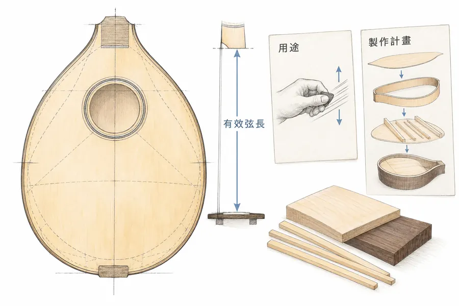

圖解 10.1　設計目標與尺寸規劃（示意）

接著要決定琴體形狀與受力系統。

| 琴型 | 決定體積與結構的關鍵 |
|---|---|
| 圓背（bowlback） | 琴肚深度、肋條曲率、折面面板 |
| 雕刻面板（carved-top） | 拱度（arching）與厚度分布（graduation） |
| 平頂（flat-top） | 更依賴力木（bracing） |

比較設計時，要**一起**確認外形、板材厚度與內部支撐。

專業製琴圖除了外形尺寸，還會包含這些關鍵資訊：

- 琴頸角度（neck angle）
- 目標琴橋高度（bridge height target）
- 指板平面（fingerboard plane）
- 音孔（soundhole）
- 力木（bracing）
- 面板厚度（top thickness）

這些尺寸彼此相依。

如果後期要靠**設定（Setup）**大幅補救，通常表示**前期幾何已經有偏差**。

| **重點與應用** | **內容** |
|----|----|
| 核心概念 | Scale length 是最早就必須決定的參數之一，因為它會牽動 fret spacing、琴頸長度、琴橋位置與弦張力。 |
| 關係與條件 | Suzuki 2017 型錄中的 M-30 是 336 mm、MD-4 是 426 mm、MC-836 是 574 mm。 |
| 應用方向 | 理解製琴流程與結構。 |

## 10.2　選材與初步加工

材料進到工坊後，製琴師會先評估每一片木料適合什麼用途。

他會觀察這些項目：

- 纖維是否筆直
- 有沒有**跑切（runout）**
- 密度和重量如何
- 彎曲時的剛性感
- 缺陷位置
- 可用尺寸

對天然材料來說，設計值往往要和實際木料互相調整。

這就是為什麼手工製琴不可能完全等同於**電腦數值控制（Computer Numerical Control，CNC）**複製。〔S707〕

含水率同樣重要。

木料應該先接近工坊與未來使用環境的合理平衡狀態。如果還沒達到，就在精密厚度下封箱，之後的收縮可能造成三件事：

- 接縫改變
- 拱度改變
- 琴頸幾何改變

乾燥的重點，是**讓材料進入可預測的狀態**。〔S708〕〔S723〕

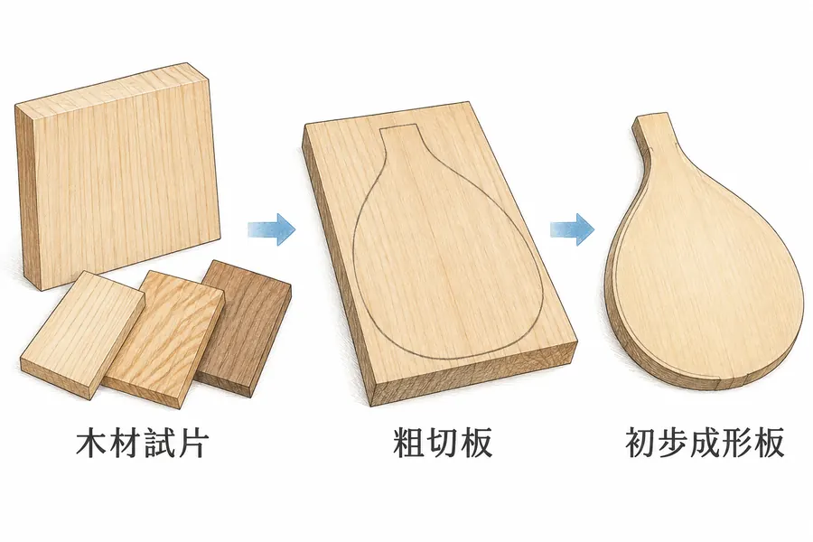

圖解 10.2　選材與初步加工（示意）

初加工時會留下**餘量**。

面板、背板、琴頸粗坯（neck blank）都不會一開始就做到最終尺寸。

因為後續的膠合、雕削與修整，還需要**基準面**。

> **常見誤解：「製琴的誤差主要是手抖。」**
> 不是。很多誤差的重點在**基準設置錯誤**。
> 所以建立中心線（centerline）、模具基準（mold reference）和琴頸軸線（neck axis），是整個流程的基本功。

| **重點與應用** | **內容** |
|----|----|
| 核心概念 | 材料進工坊後，製琴師先評估每片木料適合的用途。 |
| 關係與條件 | 含水率同樣重要。 |
| 應用方向 | 理解製琴流程與結構。 |

## 10.3　圓背琴肚的製作

圓背製作通常依賴**模具（mold）**。

製琴師先建立琴體外形，再把窄肋條彎到所需曲率，逐條貼合並膠合。

每一條肋條很窄，單條誤差看起來不大。

但累積二十多條之後，就可能讓中心線偏移，或琴肚左右不對稱。

所以每一條接縫都要控制**角度和貼合**。

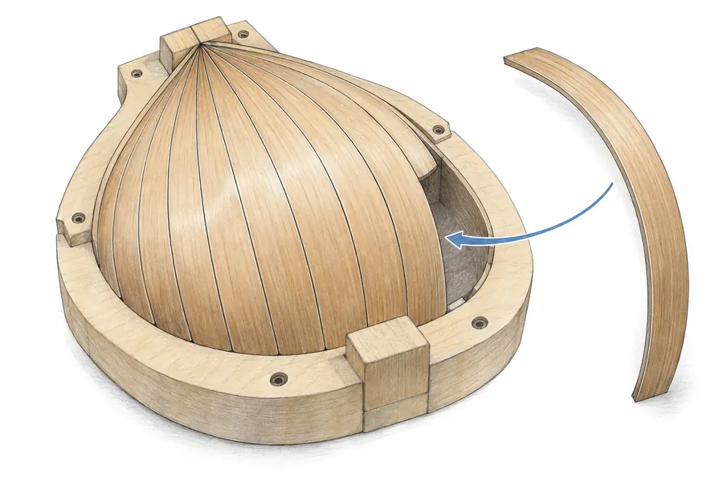

圖解 10.3　圓背琴肚的製作（示意）

歷史實物可以看到肋條數量差異很大：

| 樂器 | 肋條數 |
|---|---|
| Vinaccia 1781 | 23 條窄條（narrow strips） |
| Calace 現代常見 | 25、31、33 條 |
| Calace 曼陀隆切羅 | 可到 41 條 |

〔S701〕〔S711〕〔S713〕

肋條越多，單條通常越窄，曲面可以做得更細緻。

但工時與接縫數也跟著增加。

> **常見誤解：「肋條越多，等級越高。」**
> 不能把肋條數量直接當成產品等級。
> 因為平滑肋條（smooth rib）／溝槽肋條（fluted rib）、材料與整體尺寸也都會一起變。

圓背內側還需要處理幾個位置：

- 肋條接縫（rib joints）
- 端木塊（end blocks）
- 琴頸接合區（neck joint）
- 面板接合邊

這些位置決定**長期結構穩定**。

如果拼接只追求外表無縫，內部接觸不足，日後在濕度循環和弦張力下就可能開膠。

| **重點與應用** | **內容** |
|----|----|
| 核心概念 | 圓背製作通常依賴 mold。 |
| 關係與條件 | 歷史實物可以看到 ribs 數量差異很大。 |
| 應用方向 | 理解製琴流程與結構。 |

## 10.4　那不勒斯折面面板

那不勒斯式的面板（soundboard）不是完全平的。

琴橋附近有一個**折角（cant / bend）**，讓下半部面板形成折面。

大都會博物館（The Metropolitan Museum of Art，Met）對 Vinaccia 1781 有一段說明。它指出這是**那不勒斯學派（Neapolitan school）**的典型特徵。這種做法具有**增加結構強度**的作用。〔S701〕〔S722〕

製作這種面板，要同時控制四件事：

- 木材纖維
- 折彎位置
- 厚度
- 接合到琴肚的邊界

如果折線位置偏差，琴橋可能無法落在設計的幾何點上。

如果面板在折彎處過弱，長期壓力又可能造成變形。

這一段的重點，是**把面板幾何納入結構設計**。

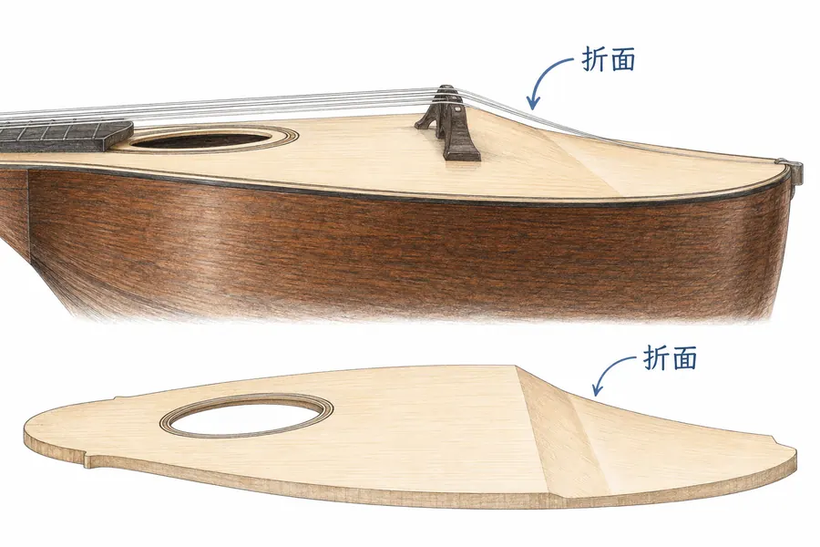

圖解 10.4　那不勒斯折面面板（示意）

1784 年的 Filano 研究琴，正好位於**腸弦到金屬弦**的歷史轉型期。

它保留了折面面板（bent soundboard）與**混合腸弦—金屬弦（mixed gut–metal strings）**。

研究團隊在複製之前，先做聲學量測。

這顯示歷史工法研究已經不只停在尺寸與外觀，而會把**原琴的動態行為**也記錄下來。〔S706〕

| **重點與應用** | **內容** |
|----|----|
| 核心概念 | 那不勒斯式 soundboard 不是完全平面。 |
| 關係與條件 | 製作這種面板要同時控制木材纖維、折彎位置、厚度與接合到 bowl 的邊界。 |
| 應用方向 | 理解製琴流程與結構。 |

## 10.5　雕刻拱面與厚度控制

Orville Gibson 1898 年的核心創新之一，是把面板和背板從較厚的木料**雕成凸拱（convex arch）**。

他的專利明確批評當時的結構：「太多彎板、拼接、貼皮與內部支撐」。

他主張更一體化的雕刻方式。

Met 保存的 1898 實物，可以看到：

- 雲杉雕刻面板（spruce carved top）
- 胡桃木雕刻背板（walnut carved back）
- 一體式側板／琴頸／琴頭

〔S702〕〔S703〕

**雕刻（carving）**不是只決定外表曲線。

製琴師要控制外拱、內凹，以及各區的**厚度分布（thickness graduation）**。

這些區域的厚度會共同決定剛性和模態：

- 板材中央
- 邊緣
- 琴橋區域（bridge area）
- 音孔周圍（soundhole）

這就是為什麼兩片外表看起來完全一樣的雕刻面板，聲學反應仍可能不同。

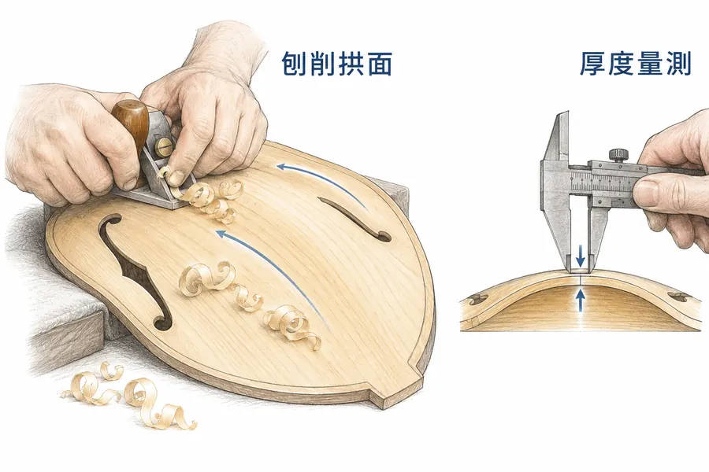

圖解 10.5　雕刻拱面與厚度控制（示意）

後來的 Gibson 系統，並沒有完全照 Orville 原始的「無力木」理念不變地延續。

它反而形成了更成熟的設計：力木、**f 型音孔（f-hole）**、琴橋位置等。

> **常見誤解：「一個發明完成後就固定不動。」**
> 製琴史很少是這樣。
> 更常見的是：每一代都在原本的架構上重新調整。〔S719〕〔S720〕

| **重點與應用** | **內容** |
|----|----|
| 核心概念 | Orville Gibson 1898 的核心創新之一，是把 top 和 back 從較厚木料雕成 convex arch。 |
| 關係與條件 | carving 不是只決定外表曲線。 |
| 應用方向 | 理解製琴流程與結構。 |

## 10.6　平背與平面琴體

平背型的製作，通常需要：

1. 彎側板肋條（side ribs）
2. 安裝木塊（blocks）與襯條（linings）
3. 把面板與背板膠合，形成箱體

外形看起來比圓背簡單，但**側板彎曲（side bending）、邊框幾何（rim geometry）和力木的精度同樣關鍵**。

對民謠曼陀林或某些曼陀琴（mandocello）來說，這種結構在製造、坐姿與收納上也有實務優勢。

Suzuki 2017 的 MC-836 就是玫瑰木平背琴身的曼陀琴案例。

它和同品牌的 M-30／MD-4 的多片圓背琴身不同。

這顯示一件事。同一家公司在家族的大型低音樂器上，也可能因為尺寸與演奏需求，選擇不同的琴體。〔S714〕

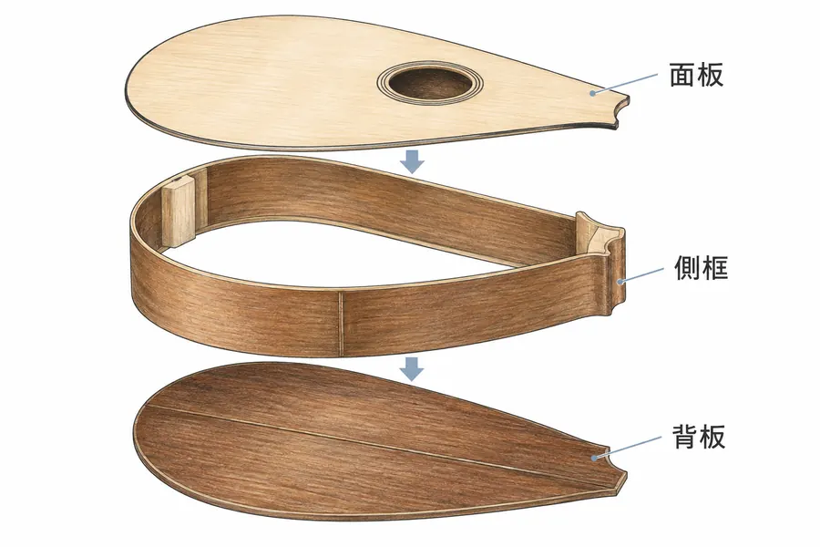

圖解 10.6　平背與平面琴體（示意）

> **常見誤解：「平背就是便宜簡化版。」**
> 這不是可靠的分類方式。
> 確實有廉價的平背量產琴，但也有高階的手工平頂琴。
> **結構形式只描述做法，不直接等同品質。**

| **重點與應用** | **內容** |
|----|----|
| 核心概念 | 平背型製作通常需要彎 side ribs、安裝 blocks 與 linings，再將 top/back 膠合形成箱體。 |
| 關係與條件 | Suzuki 2017 MC-836 就是 rosewood flat body 的 mandocello 案例，和該品牌 M-30／MD-4 的多片 round body 不同。 |
| 應用方向 | 理解製琴流程與結構。 |

## 10.7　力木與面板支撐

**力木（bracing）**會增加局部剛性，也會增加質量。

這是一個取捨：

| 做法 | 短期結果 | 長期風險 |
|---|---|---|
| 粗而重的力木 | 通常更安全 | 面板某些區域可能不易被驅動 |
| 過度削薄 | 聲音可能短期活躍 | 長期失去幾何 |

真正困難的地方是：**把結構壽命和聲學目標同時放進設計**。

製琴師常透過這些方法調整力木：

- 經驗
- 板材彎曲感
- 厚度
- 重量
- 甚至**模態／敲擊響應（modal / tap response）**

但這些方法**並非單一公式**。

聲學研究可以提供**琴橋導納（bridge admittance）**和模態資料。

但它仍然不能替代每片木材與實際工藝的判斷。〔S705〕

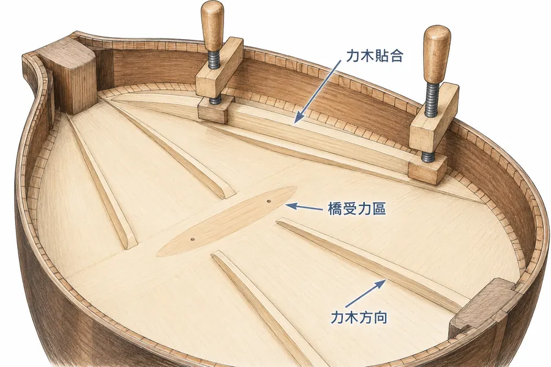

圖解 10.7　力木與面板支撐（示意）

> **常見誤解：「維修時加一根木條加強就好。」**
> 不行。新力木會改變模態，還可能把濕度變形**鎖在錯誤的幾何裡**。
> 歷史琴修復尤其需要**最小干預**與**可逆性**思維。

| **重點與應用** | **內容** |
|----|----|
| 核心概念 | bracing 會增加局部剛性，也會增加質量。 |
| 關係與條件 | 製琴師常透過經驗、板材彎曲感、厚度、重量，甚至 modal/tap response 來調整 bracing，但這些方法並非單一公式。 |
| 應用方向 | 理解製琴流程與結構。 |

## 10.8　琴頸接合與指板

琴頸和琴體接合，必須控制三件事：

1. 左右**中心線（centerline）**
2. **琴頸角度（neck angle）**
3. **指板平面（fingerboard plane）**的旋轉

只要其中一項偏差，就可能出現這些問題：

- 琴橋被迫移離中心
- 弦距左右不一致
- action 調整範圍不足

這些問題做對了幾乎看不見，做錯了卻會伴隨整把琴。

不同歷史型制的琴頸接合（neck joint）做法不一樣：

| 型制 | 接合方式 |
|---|---|
| Orville Gibson 原始設計 | 把側板、琴頸、琴頭高度整合 |
| 圓背琴（bowlback） | 常把琴頸塊與琴肚肋條結合 |
| 現代量產 | 可能使用更標準化的接合 |

〔S703〕

理解這些差異對中古琴維修很重要。

因為**琴頸重設（neck reset）的方法不能跨結構照搬**。

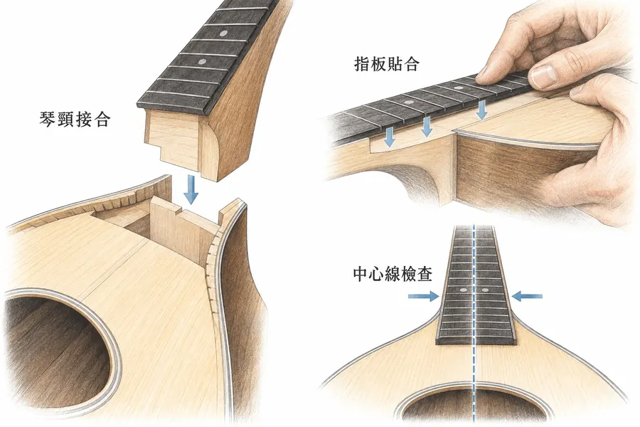

圖解 10.8　琴頸接合與指板（示意）

指板黏合前，還要考慮**弦長基準（scale reference）**和**琴格槽位置（fret slot）**。

指板延伸（fingerboard extension）越長，高把位就越多。

但它對面板的覆蓋和支撐也可能增加。

Calace 音樂會型號的 29 格，就代表完全不同於早期 Vinaccia 13 格的演奏需求。〔S701〕〔S711〕

| **重點與應用** | **內容** |
|----|----|
| 核心概念 | 琴頸和琴體接合必須控制三件事：左右 centerline、neck angle、以及 fingerboard plane 的旋轉。 |
| 關係與條件 | 不同歷史型制的 neck joint 做法不一。 |
| 應用方向 | 理解製琴流程與結構。 |

## 10.9　琴格安裝與整平

在**十二平均律（twelve-tone equal temperament）**下，琴格位置按照固定比例縮短弦長。

槽位切錯，即使只有小誤差，也可能在高把位累積成聽得出來的偏差。

安裝後還要確保兩件事：

- 琴格**坐實（seated）**完整
- **頂冠（crown）**高度一致

否則就會出現**打弦（buzz）**和**死音（dead spot）**。

**琴格整平（fret leveling）**的目標，是在預定的**琴頸曲度（neck relief）**和弦路（string path）下，建立一個一致可用的平面。

之後要把頂冠重新塑形，讓琴弦在**很窄的接觸線**上離開琴格。

如果頂冠磨得太平，實際發音點會變模糊，影響**音準（intonation）**。

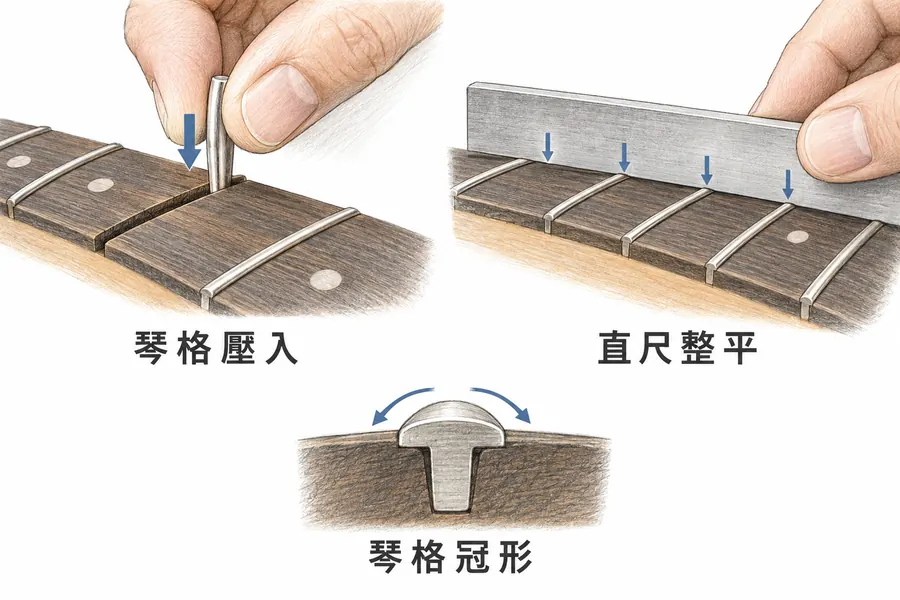

圖解 10.9　琴格安裝與整平（示意）

歷史教本和現代樂器的格數差異，也提醒我們一件事：

**琴格數量與製作品質，也會影響可用曲目。**

Munier 1891 年的教本，描述當時的曼陀林琴頸／指板和第一把位系統。

現代音樂會用曼陀林則把高把位需求推得更遠。〔S717〕〔S711〕

| **重點與應用** | **內容** |
|----|----|
| 核心概念 | 在十二平均律下，fret 位置按照固定比例縮短弦長。 |
| 關係與條件 | Fret leveling 的目標重點在在預定 neck relief 和 string path 下建立一致可用的平面。 |
| 應用方向 | 理解製琴流程與結構。 |

## 10.10　鑲嵌、裝飾與護板

**邊飾（binding）**和**內嵌線（purfling）**常被當成裝飾。

但它們也能**保護板材邊緣、覆蓋接縫、形成視覺基準**。

傳統圓背的**護板（pickguard / scudo）**，則負責防止撥片和手部摩擦直接磨損柔軟的雲杉面板。

Vinaccia 1781 的珍珠母、玳瑁與金屬鑲嵌非常華麗。

這證明高級歷史樂器的裝飾，本身也承載**社會地位與工藝價值**。〔S701〕

不過裝飾並非「完全不影響聲音」。

厚重的**鑲嵌（inlay）**、大片護板或過量膠合，都會改變局部質量與剛性。

影響可能很小，也可能在薄面板上大到可以量測。

專業製琴會把裝飾設計納入結構，**預先評估裝飾的重量與位置**。

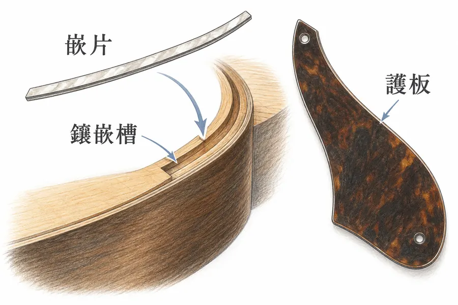

圖解 10.10　鑲嵌 裝飾與護板（示意）

現代保育還要考慮材料倫理與法規。

歷史上使用**象牙（ivory）**、**玳瑁（tortoiseshell）**等材料，不代表今天應該複製原材料。

現代修復和復刻常採用替代材料，並在文件中清楚記錄。

| **重點與應用** | **內容** |
|----|----|
| 核心概念 | Binding 和 purfling 常被當成裝飾，但它們也能保護板材邊緣、覆蓋接縫並形成視覺基準。 |
| 關係與條件 | 不過裝飾並非「完全不影響聲音」。 |
| 應用方向 | 理解製琴流程與結構。 |

## 10.11　塗裝與表面保護

塗裝最直接的功能有四項：

- 保護表面
- 控制髒污
- 控制水氣交換速度
- 提供視覺和觸感

常見塗料各有不同的施工、修補與耐用性：

| 塗料 | 中文 | 說明 |
|---|---|---|
| shellac / French polish | 蟲膠／法式拋光 | 施工方式與修補特性不同 |
| nitrocellulose lacquer | 硝化纖維素漆 | 施工方式與修補特性不同 |
| 各式現代 varnish | 現代清漆 | 施工方式與修補特性不同 |

把塗裝簡化成「薄的一定響、厚的一定悶」並不充分。

因為**配方、固化、厚度和基材**都會改變結果。

對薄面板來說，塗層確實會增加質量、改變表面阻尼。

所以理論上會影響振動。

但在成品琴上，這個影響和面板厚度、力木、琴橋、弦等因素**混在一起**，很難從品牌名稱直接預測。

最可靠的原則仍然是：**適量、均勻、符合設計**。

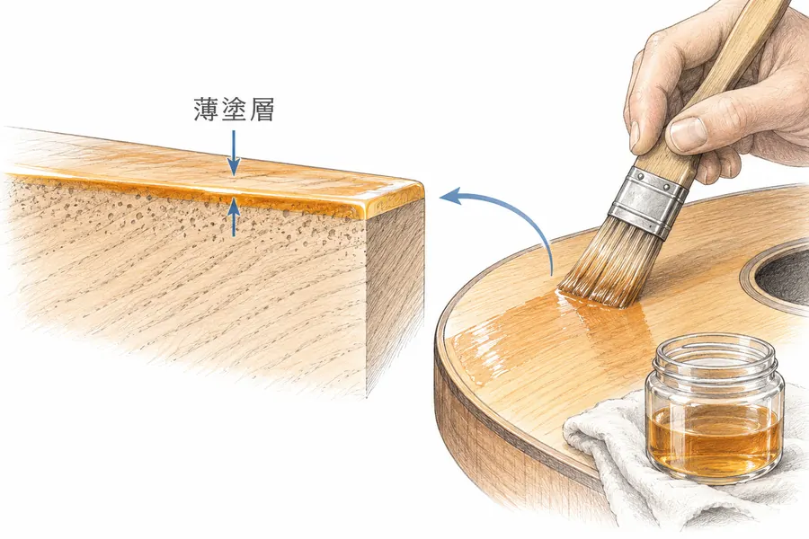

圖解 10.11　塗裝與表面保護（示意）

老琴的**重新塗裝（refinish）**則是另一個問題。

重新磨掉原塗裝，可能同時移除木材、邊角和歷史資訊。

過厚的新漆也會改變外觀與材料。

判斷收藏價值時，要**先確認原裝程度與修復紀錄**，再評估塗裝外觀。

| **重點與應用** | **內容** |
|----|----|
| 核心概念 | 塗裝最直接的功能是保護表面、控制髒污與水氣交換速度、提供視覺和觸感。 |
| 關係與條件 | 對 thin soundboard 而言，塗層確實增加質量和改變表面阻尼，因此理論上會影響振動。 |
| 應用方向 | 理解製琴流程與結構。 |

## 10.12　完工設定與校正

一把剛完成的琴在上弦後，弦張力會讓整體幾何重新受力。

製琴師需要檢查這些項目：

- 琴頸曲度（neck relief）
- 上弦枕槽（nut slots）
- 琴橋高度（bridge height）
- 琴橋位置（bridge location）
- 音準（intonation）
- 琴格打弦（fret buzz）

**這些步驟是製造的一部分。**

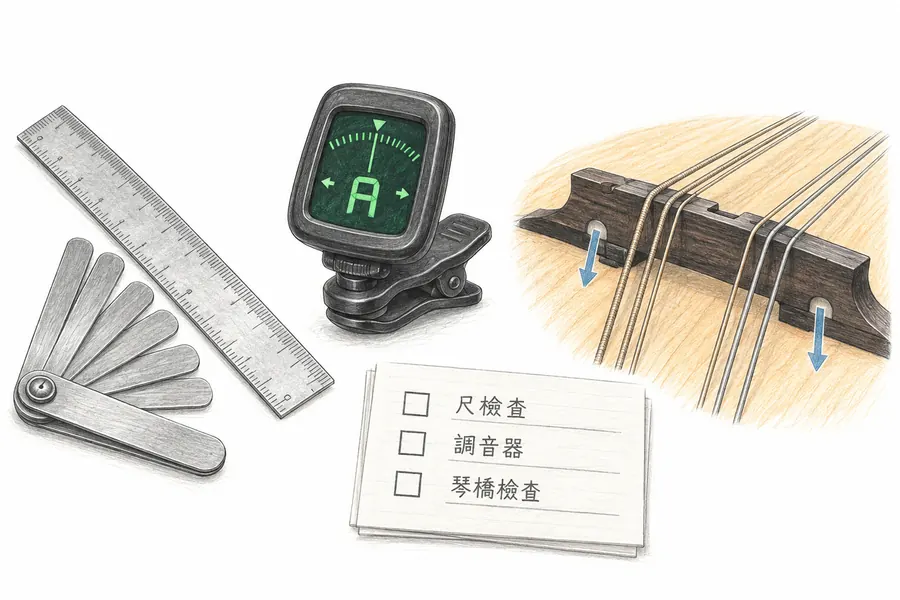

圖解 10.12　完工設定與校正（示意）

**浮動琴橋（floating bridge）**尤其需要在真正的弦張力下定位。

流程是：

1. 先用弦長建立初始位置。
2. 再透過十二格等方法做補償。
3. 同時確認橋腳完全貼合面板。

如果把琴橋歪到極端角度才勉強準，應該回頭檢查這幾項：

- 上弦枕（nut）
- 琴格尺度（fret scale）
- 弦徑（string gauge）
- 整體幾何（geometry）

找出音準偏差的真正來源。

真正成熟的**完工品管（final QC）**，還會在不同力度下彈奏。

因為有些問題只有實際演奏才會暴露：

| 檢查項目 | 要聽什麼 |
|---|---|
| 低音弦組（bass course） | 是否打弦 |
| 顫音（tremolo） | 兩弦是否同步 |
| 和弦（chord） | 低把位是否偏尖 |
| 調音後 | 弦軸／機械是否回滑 |

| **重點與應用** | **內容** |
|----|----|
| 核心概念 | 一把剛完成的琴在上弦後，弦張力會讓整體幾何重新受力。 |
| 關係與條件 | 浮動琴橋尤其需要在真正弦張力下定位。 |
| 應用方向 | 理解製琴流程與結構。 |

## 10.13　案例：Filano 歷史琴的複製

Filano 1784 的研究複製案，非常適合作為製琴科學的案例。

研究者的流程是：

1. 先對原琴做**非破壞聲學量測**。
2. 再建立**有限元素模型（finite element model）**。

因為他們知道：**只抄尺寸和木種，不足以保證聲音相同**。

天然木材的機械性質會變。

歷史膠合、老化和原琴的微小幾何，也不可能完全重建。〔S706〕

科學複製的目標可以分清楚：

**可以**重建型制、尺度、材料類型與可觀察工藝，並把聲學響應當作校準目標之一。

但**複製琴仍然是新的個體**。

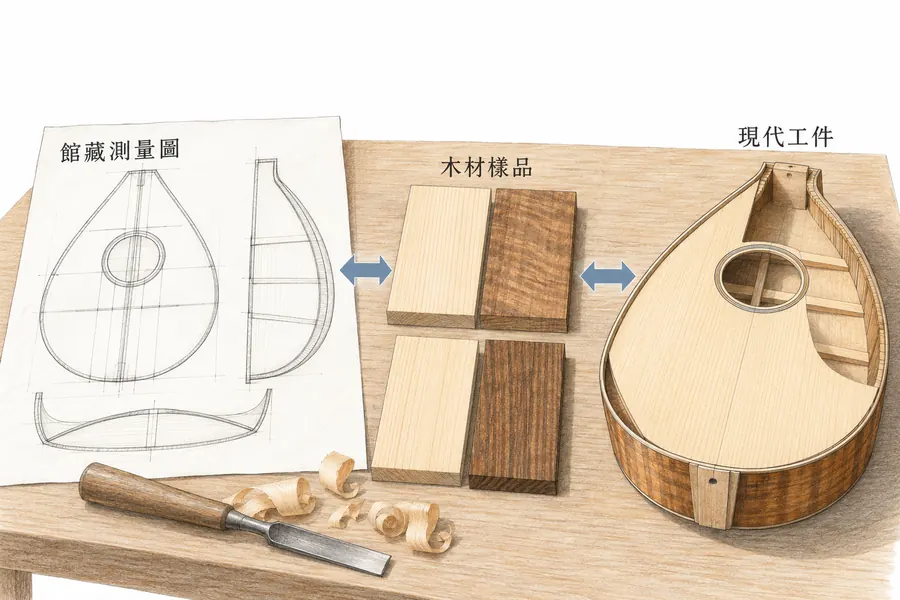

圖解 10.13　案例 Filano 歷史琴的複製（示意）

對一般製琴也一樣。

圖面是起點。

真正的工藝在於：**如何讓這塊特定的木料達到設計目標**。

這就是手工製琴最難被「照尺寸複製」取代的部分。

## 表 10-1｜三種主要琴體工法，工作重點不同

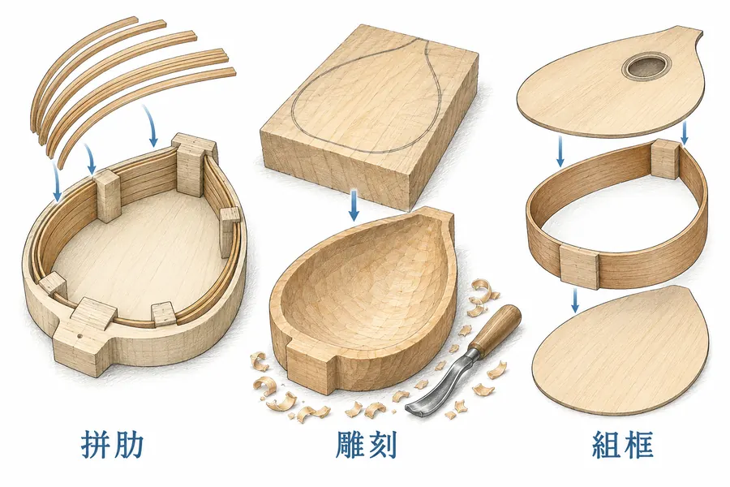

| **型制** | **主要成形方式** | **最關鍵幾何** | **典型風險** |
|----|----|----|----|
| **Bowl-back（圓背）** | mold（模具）上逐條 ribs（肋條）拼合 | bowl（琴肚）對稱、top bend（面板折彎）、neck axis（琴頸軸線） | 接縫累積誤差、open seam（接縫開膠） |
| **Carved-top/back（雕刻面板／背板）** | 厚板雕拱與 graduation（厚度分布） | arching（拱度）、厚度分布、bridge plane（琴橋平面） | 過厚／過薄、橋腳 fitting（貼合） |
| **Flat-back/top（平背／平頂）** | 彎 sides（側板）＋ blocks/linings（木塊／襯條）＋ plates（板） | rim 平面（邊框平面）、bracing（力木）、neck angle（琴頸角度） | 側板變形、bracing 不平衡 |

圖解 表 10-1｜三種主要琴體工法，工作重點不同（示意）

| **【工藝觀念】 真正的製琴順序是：先定幾何與用途 → 選材 → 建立琴體結構 → 琴頸與指板 → fretwork → 表面與裝飾 → 上弦後 final setup。不是「木工完成」就等於樂器完成。** |
|----|

| **【歷史案例】 Orville Gibson 1898 的原始設計強調 carved construction 與減少傳統內部零件；1784 Filano 研究則展示現代歷史複製如何把聲學量測納入工藝。兩者相隔百餘年，卻都在回答「如何讓結構更有效工作」。** |
|----|

## 自我學習題庫

學習檢查：作答、核對、複習

先自己作答，再看答案。答錯時回到本章相關小節重新讀一次。

**1. Bowl-back 製作的重要工序之一是？**

- A. 在 mold 上逐條拼 ribs

- B. 用一塊塑膠壓成

- C. 取消面板

- D. 只靠螺絲組裝

**2. Fret leveling 的主要目標是？**

- A. 讓所有 fret 看起來一樣亮

- B. 建立一致可用的弦路平面

- C. 改變琴頭角度

- D. 增加琴體重量

**3. Final setup 應該被視為？**

- A. 製造流程的一部分

- B. 完全無關

- C. 只屬於買家工作

- D. 只有舊琴才需要

**答案：1.A　2.B　3.A**

## 本章主要查證來源

查證來源：找原文、核條件、留紀錄

**【S701】The Metropolitan Museum of Art：Mandolin, Antonius Vinaccia, Naples, 1781（Met 89.4.2140）。** 那不勒斯式圓背、23 條琴肚肋條、折面面板、八弦四 course、13 格等實物資料。

https://www.metmuseum.org/art/collection/search/504543

**【S702】The Metropolitan Museum of Art：Mandolin, Orville Gibson, 1898（Met 2015.643a–c）。** carved spruce top、carved walnut back、浮動琴橋、尾弦板、18 格、空心琴頸等實物資料。

https://www.metmuseum.org/art/collection/search/700485

**【S703】United States Patent Office / Google Patents：US598245A – Mandolin, Orville H. Gibson（patented 1898-02-01）。** Gibson 一體式 rim/neck/head、carved top/back 與減少傳統內部支撐的原始專利。

https://patents.google.com/patent/US598245A/en

**【S705】Quintavalla et al.：The Acoustics of Traditional Italian Mandolins and Their Relation with Soundboard Wood Properties（International Journal of Wood Culture 2, 2022）。** 義大利歷史與現代曼陀林的 bridge admittance、聲輻射、模態與 soundboard wood 研究。

https://www.sciencedirect.com/org/science/article/pii/S2772318622000017

**【S706】Quintavalla et al.：Acoustical Survey and Finite Element Analyses of Late Baroque Mandolin（International Journal of Wood Culture 4(1), 2024）。** 1784 Joseph Filano 曼陀林的聲學量測、有限元素分析與複製研究。

https://www.sciencedirect.com/org/science/article/pii/S2772318624000018

**【S707】USDA Forest Products Laboratory：Wood Handbook—Wood as an Engineering Material（FPL-GTR-282, revised 2021）。** 木材結構、物理性質、機械性質、乾燥、膠合與材料工程基礎。

https://research.fs.usda.gov/fpl/wood-handbook

**【S708】Glass & Zelinka, USDA Forest Products Laboratory：Moisture relations and physical properties of wood（Wood Handbook Chapter 4, 2021）。** 木材吸濕、平衡含水率、收縮膨潤與尺寸穩定的官方技術資料。

https://research.fs.usda.gov/treesearch/62243

**【S711】Liuteria Calace：Mandolini – official specifications（accessed 2026-10-06）。** 33.5 cm 弦長、24/29 格、25/31/33 ribs、spruce top、rosewood/maple body 等現行規格。

https://www.calace.it/en/mandolini

**【S712】Liuteria Calace：Mandole – official specifications（accessed 2026-10-06）。** 43.2 cm（部分可 45.6 cm）scale、G/C 調 mandola、25/33 ribs 與材料配置。

https://calace.it/en/mandole

**【S713】Liuteria Calace：Mandoloncelli & Liuti – official specifications（accessed 2026-10-06）。** 61 cm scale、8/10 弦、25/41 ribs、不同琴體尺寸與材料配置。

https://calace.it/en-mandoloncelli-liuti

**【S714】Suzuki Music / Suzuki Violin：2017 String Instrument Catalog（2017）。** M-30、M-100、MD-4、MD-10、MC-836 的弦長、木材與規格。

https://www.suzuki-music.co.jp/app/uploads/2017catalog14.pdf

**【S719】The Metropolitan Museum of Art：Gibson F-2, F-4, A-4 and H-2/H-4 instruments（1916–1919 collection records）。** 早期 Gibson A/F/H 系列 carved construction、格數、琴頸／指板材料與浮動琴橋實物比較。

https://www.metmuseum.org/art/collection/search/506859

**【S720】The Metropolitan Museum of Art：Archtop Guitars and Mandolins（Met Heilbrunn Timeline essay）。** Orville Gibson carved archtop 系統與其美國製琴影響。

https://www.metmuseum.org/essays/archtop-guitars-and-mandolins

**【S722】The Metropolitan Museum of Art：Mandolin, 1781 – Guitar Heroes（exhibition essay）。** 那不勒斯式折面提高結構強度、四組複弦、小提琴式調弦與撥片使用背景。

https://blog.metmuseum.org/guitarheroes/mandolin-1781/

**【S723】USDA Forest Products Laboratory：Drying and control of moisture content and dimensional changes（technical report / Wood Handbook）。** 乾燥、平衡含水率與尺寸變化控制。

https://research.fs.usda.gov/treesearch/37419

---
