*Strings and Setup: Tension, Action, Relief, Bridge Position and Intonation（琴弦與設定：張力、弦距、曲度、琴橋位置與音準）*

## 本章重點

- **設定（Setup）**是把木製結構與特定弦組調到「可演奏」的過程，是製造的一部分。
- 弦長變長，張力會以**平方**增加：33.5 cm 拉到 43.2 cm，理論張力約 1.66 倍。
- 換弦時琴橋可能移位，換完一定要重新檢查**音準（intonation）**。
- 診斷順序是：**先確認症狀 → 再找來源 → 最後才做最小幅度調整**。
- 同樣叫「打弦」，發生在空弦、某一格或強奏時，原因是完全不同的。

---

很多演奏者直到琴開始打弦、音準跑掉，或手開始痛，才第一次認真面對 Setup（設定）。

**設定（Setup）**是把一套木製結構，和特定弦組調整到可演奏狀態的過程。

它牽動的項目彼此互相影響：

- 弦徑（string gauge）
- 弦長（scale length）
- 張力（tension）
- 上弦枕（nut）
- 琴頸曲度（neck relief）
- 琴橋高度與位置

任何一項改動，都可能讓其他項目重新平衡。

曼陀林又比單弦樂器多一層**複弦（course）**問題。

同一個 course 的兩根弦，必須有一致的高度、間距與按弦感。

而且琴橋通常是**浮動式（floating）**，換弦或碰撞就可能移位。

家族成員的弦長從 33 cm 級一路到 61 cm 級。

所以**不能把標準曼陀林的弦組和 Setup 邏輯原封不動放大**（Setup 見第 11 章）。

本章教你用「症狀」和「結構」來逐步診斷：

1. 先確認症狀。
2. 再判斷可能來源。
3. 最後才做最小幅度調整。

這套流程比背標準數值更安全。

## 11.1　弦材、弦徑與張力

琴弦一上到標準音高，就對樂器施加**持續張力**。

不同**弦徑（gauge）**、**芯線（core）**、**纏繞（winding）**和材料，會改變**單位重量（unit weight）**。

所以在同樣的弦長和音高下，就需要不同的張力。〔S715〕

換弦不只是換「音色」，也可能改變四件事：

- 琴頸曲度
- 弦距手感
- 琴橋載荷
- 左手壓力

標準曼陀林的弦組分工如下：

| 弦組 | 常用做法 | 原因 |
|---|---|---|
| G／D course | 纏繞弦（wound strings） | 需要足夠的線密度 |
| A／E course | 可用較細的鋼弦（steel） | 不需要那麼大的質量 |

> **常見誤解：「同樣標 G 弦、同樣 gauge，張力就一樣。」**
> 不一定。不同品牌的纏繞比例與芯線設計不同。
> 所以兩組標示相同 gauge 的弦，實際 unit weight 和張力也可能不完全一致。
> 如果想精確比較，應該看**張力資料（tension data）**，把弦徑和張力一起比。

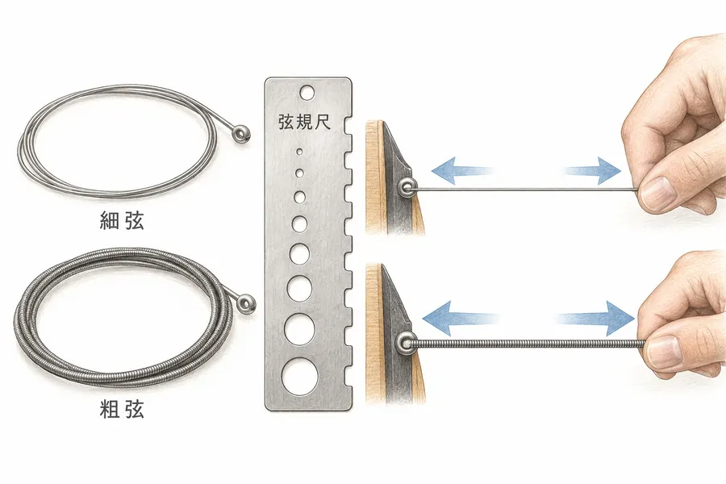

圖解 11.1　弦材 弦徑與張力（示意）

老琴尤其要慎重。

歷史琴可能原本承受較低的張力、不同的材料，或不同的**音高標準（pitch standard）**。

直接裝現代重弦不一定安全。

如果不確定結構狀態，應該先由熟悉該型制的製琴師評估。

| **重點與應用** | **內容** |
|----|----|
| 核心概念 | 琴弦一上到標準音高，就對樂器施加持續張力。 |
| 關係與條件 | 標準 mandolin 的 G/D course 通常需要 wound strings 取得足夠線密度，而 A/E course 可用較細 steel。 |
| 應用方向 | 檢查手感、音準與 Setup。 |

初學者買弦時，先核對四件事：**琴型、弦長、原廠建議弦徑、張力**。

島村指南提醒：圓背琴與美式琴的常用弦組，各有各的規格。

挑選時應以**適用樂器與原廠資料**為準。〔N01〕

實用做法有兩步：

1. 把原有的弦袋拍照存檔，記下品牌、型號及四組弦的規格。
2. 詢問店家「這組弦是否適合我的琴型與弦長」。

這比只說「我要曼陀林弦」，更容易買到合適的產品。

換弦方法見 11.3 與 21.8。

## 11.2　弦長與張力關係

D'Addario 的工程公式顯示一件事：

在**單位重量（unit weight）**和**頻率（frequency）**相同時，**張力和弦長的平方成正比**。

所以把 33.5 cm 的曼陀林弦長拉到 43.2 cm，其他條件完全不變的話，張力理論上會變成約 **1.66 倍**。

到 61 cm，更會**超過 3 倍**。

真實的曼陀拉／曼陀隆切羅當然不會這樣做。

它們會同時做三件事：**降低音高、改弦徑、改纏繞方式**。

目的就是把張力拉回「可演奏」且「結構安全」的範圍。〔S715〕

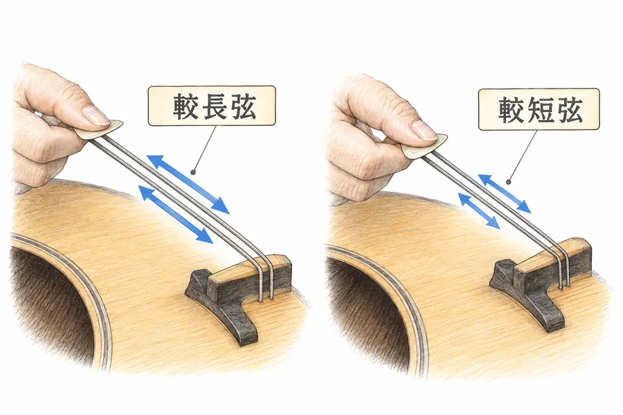

圖解 11.2　弦長與張力關係（示意）

現行 Calace 提供很清楚的家族對照：

| 樂器 | Calace 弦長 |
|---|---|
| 曼陀林（mandolin） | 33.5 cm |
| 曼陀拉（mandola） | 43.2 cm（部分可 45.6 cm） |
| 曼陀隆切羅（mandoloncello） | 61 cm |

Suzuki 2017 的數字則是：

| 型號 | 弦長 |
|---|---|
| M-30 | 336 mm |
| MD-4 | 426 mm |
| MC-836 | 574 mm |

〔S711〕〔S712〕〔S713〕〔S714〕

兩家連大型家族成員的弦長都不完全相同。

所以「曼陀琴弦」也要對應**實際弦長與調弦**。

這同時解釋了為什麼**移調夾（capo）**、降調或**替代調弦（alternative tuning）**會改變手感。

只要頻率改變，張力就會跟著平方關係變化。

演奏者覺得「降半音突然變很軟」，這不是心理作用。

| **重點與應用** | **內容** |
|----|----|
| 核心概念 | D'Addario 的工程公式顯示，在 unit weight 和 frequency 相同時，張力和 scale length 的平方成正比。 |
| 關係與條件 | 真實 mandola / mandoloncello 當然會同時降低音高、改 gauge 和 winding，目的就是把張力拉回可演奏且結構安全的範圍。 |
| 應用方向 | 檢查手感、音準與 Setup。 |

## 11.3　換弦前後的檢查

多數原聲曼陀林使用**浮動琴橋（floating bridge）**。

如果一次把八根弦全部拆下，琴橋就完全失去弦壓。

它在清潔過程中很容易移位。

重新上弦後，即使看起來位置差不多，只要前後差幾毫米，十二格音準就可能明顯偏差。

所以日常換弦有兩種做法：

1. **分 course 更換**（一次只拆一組）。
2. 拆弦前用**低黏性方法**記錄琴橋位置。

但任何標記都只能是**初始參考**。

最後仍然要重新檢查 intonation。

琴橋在不同季節、不同弦組下，可能需要輕微調整。

**不能把歷史位置當成神聖座標。**

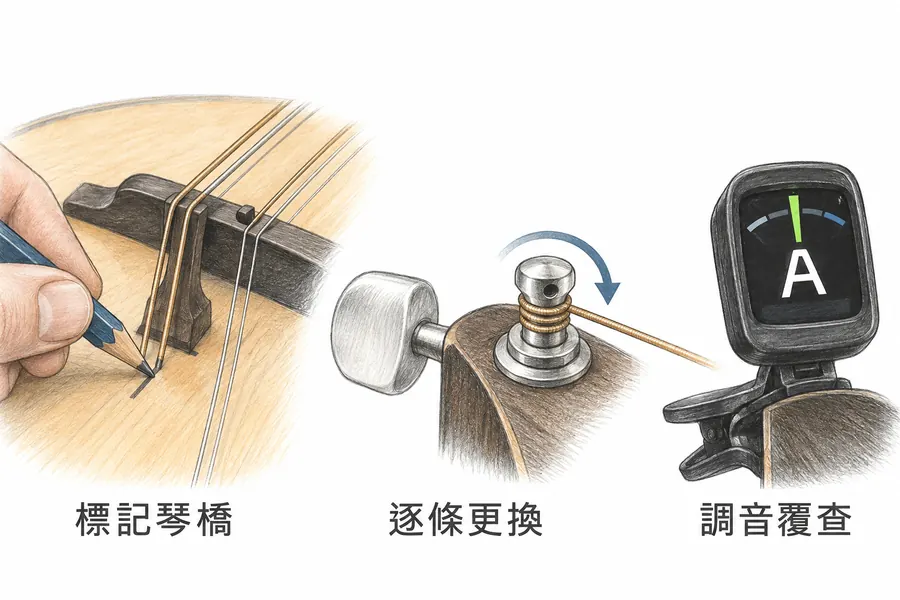

圖解 11.3　換弦前後的檢查（示意）

橋腳也要確認沒有因為移位而翹起。

**雕刻面板（carved top）**的橋腳，通常是針對**特定曲面**做貼合（fitting）的。

如果琴橋前後移得太遠，腳底和面板的曲率可能就不再完全貼合。

| **重點與應用** | **內容** |
|----|----|
| 核心概念 | 多數原聲曼陀林使用 floating bridge。 |
| 關係與條件 | 因此日常換弦可以分 course 更換，或在拆弦前用低黏性方法記錄琴橋位置。 |
| 應用方向 | 檢查手感、音準與 Setup。 |

## 11.4　上弦枕溝槽

這裡有一個很實用的診斷練習。

**情況**：空弦準，但第一格、第二格的按弦音普遍偏尖。

**先檢查**：**上弦枕槽（nut slot）**的高度。

**原因**：弦離琴格太高，按下去時需要額外拉長。

這個效應在低把位比例最大。

到十二格時，反而可能沒那麼誇張。

> **常見誤解：「低把位偏尖，就把琴橋往後移。」**
> 這通常不是最佳解。
> 把琴橋往後移，雖然可以讓全指板平均變低，但會**犧牲中高把位**。
> 真正的根因可能仍然在 nut。

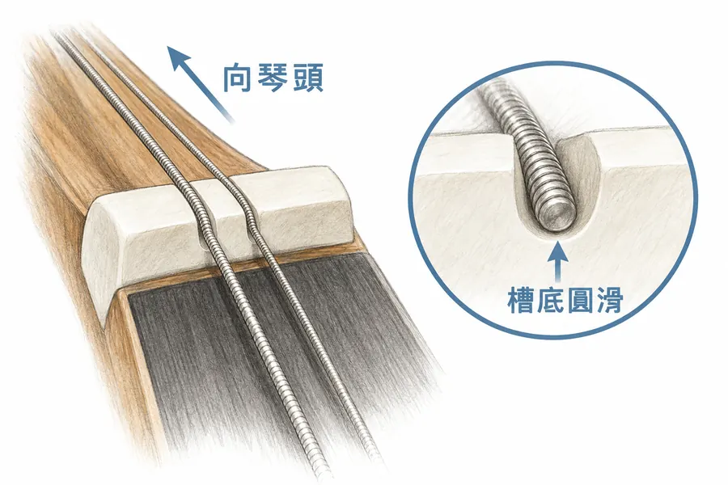

圖解 11.4　上弦枕溝槽（示意）

槽寬也要和**弦徑**匹配。

| 槽寬狀況 | 後果 |
|---|---|
| 太窄 | 卡弦，造成調音跳動 |
| 太寬 | 可能產生**橫向雜音（lateral rattle）** |

複弦的兩個槽，高度和間距最好**成對一致**。

否則同一個 course 的兩根弦，手感會不一樣。

| **重點與應用** | **內容** |
|----|----|
| 核心概念 | 如果空弦準，第一格、第二格的按弦音卻普遍偏尖，最先應檢查 nut slot 高度。 |
| 關係與條件 | 這也是一個很好的診斷範例：若低把位偏尖、十二格大致正常，移琴橋通常不是最佳解。 |
| 應用方向 | 檢查手感、音準與 Setup。 |

## 11.5　弦高與演奏手感

**弦距（action）**指的是弦相對指板／琴格的高度。

低 action 確實讓左手省力。

但琴弦振動需要空間。

演奏力度越大、低音弦越粗，所需的**淨空（clearance）**通常越大。

把 action 壓到極低，可能在輕彈時完美。

但一進入**強奏（forte）**、**和弦切奏（chop）**或強力顫音，就開始打弦。

Action 也不是只量一個琴格就能決定。

它是由四個因素共同形成的一條**弦路（string path）**：

- 上弦枕高度（nut action）
- 琴頸曲度（neck relief）
- 琴橋高度（bridge height）
- 琴格平面（fret plane）

所以診斷時要**比較各把位的弦高**，了解整條弦路。

| 症狀 | 可能方向 |
|---|---|
| 第一把位高、十二格也高 | 整條弦路都偏高 |
| 第一把位正常、只有高把位高 | 問題集中在後段 |

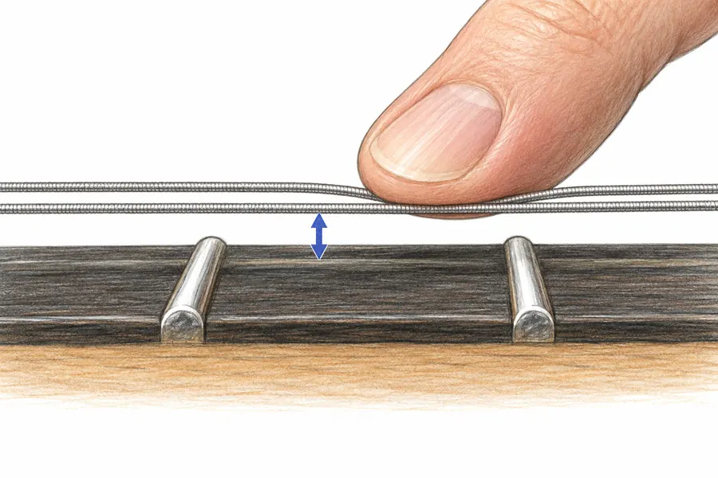

圖解 11.5　弦高與演奏手感（示意）

不同風格也會有不同偏好：

| 風格 | 常見需求 |
|---|---|
| 古典（classical） | 重視顫音的均勻和左手的細膩 |
| 藍草（bluegrass） | 常需要更強的**攻擊（attack）**與和弦切奏 |

這一段的重點是：**「演奏輸入」也應該納入 Setup 的目標**。

| **重點與應用** | **內容** |
|----|----|
| 核心概念 | 低 action 確實讓左手省力，但琴弦振幅需要空間。 |
| 關係與條件 | Action 也不是只量一個 fret 就能決定。 |
| 應用方向 | 檢查手感、音準與 Setup。 |

## 11.6　琴頸弧度

琴弦振動時需要足夠的活動空間。

琴頸留有極輕微的**前傾曲度（forward relief）**，可以在低至中把位提供淨空。

完全**反向彎曲（back-bow）**，則很容易在前幾格就打弦。

但 relief 也不能用來補救所有的高 action。

| 問題 | 調整 relief 的效果 |
|---|---|
| relief 過大 | 會讓中把位難按，卻不一定解決高把位 |
| 琴頸角度本身錯 | 調整 relief 只能暫時改變曲線 |

沒有**桁架桿（truss rod）**的歷史圓背琴，更需要從整體琴頸狀態判斷。

要依該琴的實際結構，決定處理方式。

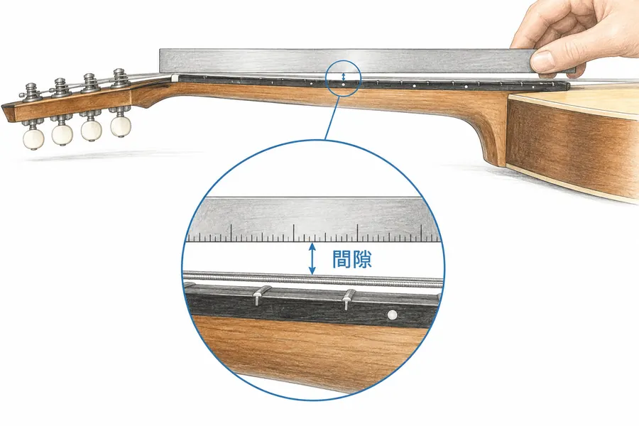

圖解 11.6　琴頸弧度（示意）

檢查 relief 有一個簡單方法：**把琴弦本身當直尺**。

按住某一 course 的兩端或特定琴格，看中間的淨空。

重點是**比較趨勢**，以及**左右是否一致**。

然後再依琴型與演奏需求，評估這個間隙是否合適。

| **重點與應用** | **內容** |
|----|----|
| 核心概念 | 琴弦振動時需要足夠的活動空間。 |
| 關係與條件 | 但 relief 也不能用來補救所有高 action。 |
| 應用方向 | 檢查手感、音準與 Setup。 |

## 11.7　浮動琴橋定位

理論上，第十二格應該位於**有效弦長的中點**。

所以 nut 到第 12 格的距離，大約是弦長的一半。

把同樣的距離延伸到琴橋，就可以得到**初始位置**。

但實際琴弦按下去時會被拉長。

所以琴橋往往還需要**補償（compensation）**。

操作流程是：

1. 先把琴橋放在合理的中心線上。
2. 調準空弦。
3. 比較**第十二格泛音（harmonic）**與**按弦音（fretted note）**。

判讀方式如下：

| 比較結果 | 通常需要 |
|---|---|
| 按弦音偏尖 | 該弦需要**更長**的有效弦長 |
| 按弦音偏低 | 相反方向 |

但四個 course 的補償需求不同。

所以**補償式絃枕／琴橋（compensated saddle / bridge）**，會讓不同弦的接觸點略有差異。

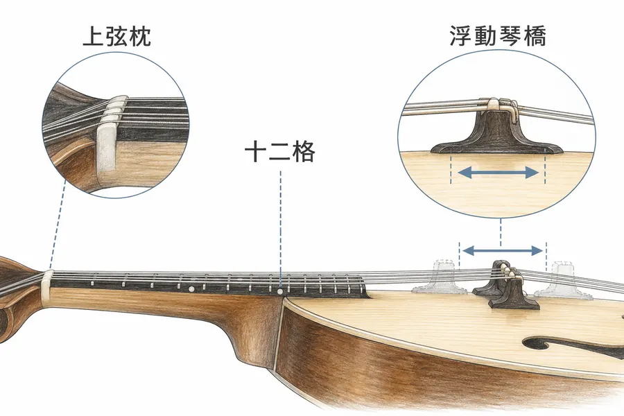

圖解 11.7　浮動琴橋定位（示意）

如果要把琴橋傾斜到非常誇張的角度，才能勉強準，就應該停下來。

回頭檢查這些因素：

- 弦長／琴格位置（scale / fret position）
- 上弦枕高度（nut action）
- 弦徑（string gauge）
- 琴格磨耗（fret wear）
- 琴橋是否**放反了**

演奏設定的原則有兩條：**找出原因**，以及**保留調整餘量**。

| **重點與應用** | **內容** |
|----|----|
| 核心概念 | 理論上，第十二格應位於有效弦長中點，因此 nut 到 12th fret 的距離約是 scale 的一半。 |
| 關係與條件 | 操作時先把橋放在合理中心線上，調準空弦，再比較十二格 harmonic 與 fretted note。 |
| 應用方向 | 檢查手感、音準與 Setup。 |

## 11.8　音準補償與檢查

空弦調音只能校正**四個空弦音高（open pitches）**。

一旦按弦，弦長和張力都改變。

所以音準還會受這些因素影響：

- 弦距（action）
- 按弦力量
- 琴格位置
- 補償（compensation）

這就是 **intonation（音準）**的核心：

**讓實際演奏音在整個指板上都合理。**

十二格是最常用的檢查點，因為理論上它正好是**八度**。

但不應該只看十二格。

| 你的主要用途 | 應該檢查哪裡 |
|---|---|
| 低把位和弦 | 1–5 格 |
| 高把位獨奏（solo） | 12 格以上 |

完美符合所有琴格，幾乎不可能。

Setup 的目標，是把誤差**分布到音樂上可接受的程度**。

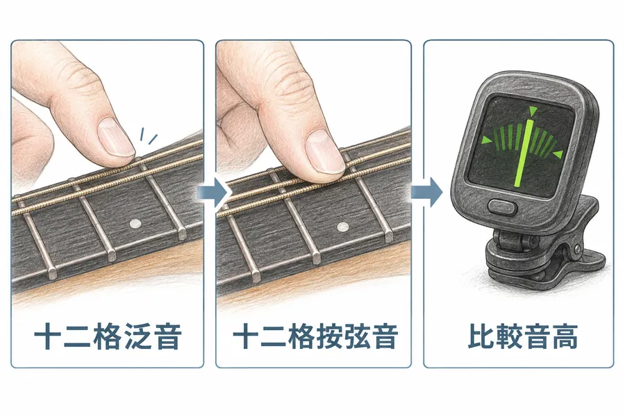

圖解 11.8　音準補償與檢查（示意）

> **常見誤解：「量音準時用力按，比較準。」**
> 相反。按弦力量也會影響測量。
> 如果測 intonation 時用比平常演奏更大的力，會把音推尖。
> 最後調出的琴橋位置，可能反而不適合真實演奏。
> 最好用**正常手感**，並且**多次重複**。

| **重點與應用** | **內容** |
|----|----|
| 核心概念 | 空弦調音只校正四個 open pitches。 |
| 關係與條件 | 十二格是最常用檢查點，因為理論上正好是八度，但不應只看十二格。 |
| 應用方向 | 檢查手感、音準與 Setup。 |

## 11.9　打弦與異音診斷

**打弦（buzz）**的來源比想像中多。

它可能來自**琴格接觸**，也可能來自：

- 尾弦板（tailpiece）
- 鬆動的**調音器（tuner）**
- 琴橋絃枕（bridge saddle）
- 護板（pickguard）
- 弦尾
- 甚至琴體內部的**鬆動力木（loose brace）**

第一步應該判斷三件事：**在哪些音、哪種力度、哪一根 course** 出現。

記錄症狀之後，再決定要調整哪一項。

| 症狀 | 可能方向 |
|---|---|
| 只有空弦 buzz | 上弦枕槽、尾弦或硬體 |
| 某個琴格開始，之後一路 buzz | 高琴格或琴頸曲度 |
| 所有弦在強奏時一起 buzz | action 過低 |
| 某特定音無論在哪根弦都金屬異響 | 共振中的硬體 |

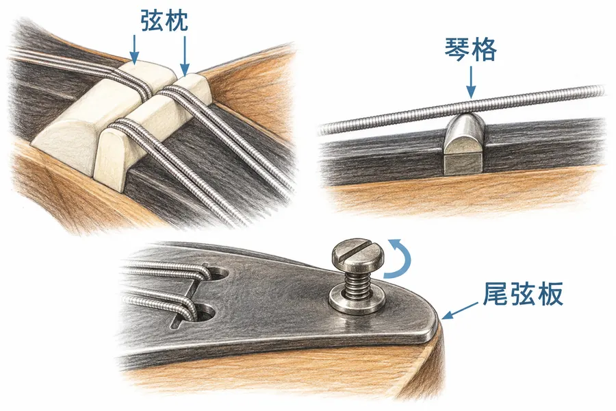

圖解 11.9　打弦與異音診斷（示意）

這種**症狀地圖（symptom map）**能大幅減少「修錯地方」。

> **常見誤解：「有雜音就把琴橋升高。」**
> 把琴橋升高，也許能掩蓋琴格問題。
> 但會讓整把琴的手感變差。
> 同樣地，把單一琴格磨低，也許能短期安靜，卻可能破壞整體的平整度。

| **重點與應用** | **內容** |
|----|----|
| 核心概念 | Buzz 可以來自 fret contact，也可以來自尾弦板、鬆動 tuner、bridge saddle、pickguard、弦尾甚至琴體內部 loose brace。 |
| 關係與條件 | 若只有空弦 buzz，常見方向是 nut slot、尾弦或硬體。 |
| 應用方向 | 檢查手感、音準與 Setup。 |

## 11.10　更換弦徑與特殊調弦

換弦徑會改變整個平衡。

| 換法 | 連帶變化 |
|---|---|
| 換較重的弦 | 總張力增加，可能使琴頸曲度增加、action 上升 |
| 換較輕的弦 | 曲度可能變小，原本不打弦的琴開始打弦 |

這些變化是否明顯，取決於四件事：

- 琴頸剛性
- 是否有桁架桿
- 琴體結構
- 原本的 Setup

**替代調弦（alternative tuning）**也一樣。

整體降半音會降低張力。

某些**特殊調弦（scordatura）**只改一兩個 course，則會讓四組弦的受力分布**不再對稱**。

歷史曲目如果要求特殊調弦，應該先確認兩件事：**弦組和琴體是否適合**。

然後選用符合目標音高與張力的弦組。

**美國古典曼陀林協會（Classical Mandolin Society of America，CMSA）**的記譜指南也提醒：曼陀林家族存在 scordatura 例外。〔S716〕

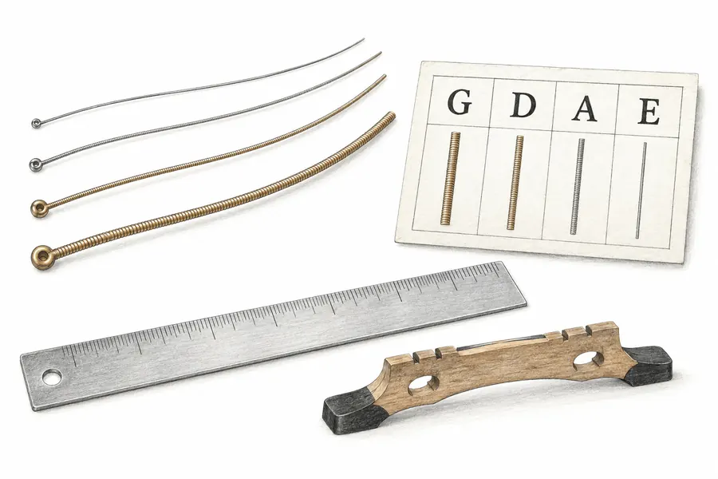

圖解 11.10　更換弦徑與特殊調弦（示意）

大型家族成員更不可以混用。

Calace 的曼陀拉同時提供 **G 調與 C 調**版本，弦長 43.2 cm。

這兩種調弦需要**各自的弦組**。

光看琴的外型，無法安全決定要裝什麼弦。〔S712〕

| **重點與應用** | **內容** |
|----|----|
| 核心概念 | 換較重弦可能增加總張力，使 neck relief 增加、action 上升。 |
| 關係與條件 | Alternative tuning 也一樣。 |
| 應用方向 | 檢查手感、音準與 Setup。 |

## 11.11　案例：三種設定問題的處理

| 案例 | 症狀 | 優先檢查 | 不要先做 |
|---|---|---|---|
| 一 | 空弦準，前幾格普遍偏尖，十二格尚可 | 上弦枕高度，再看按弦力 | 先移琴橋 |
| 二 | 十二格全部偏尖，低把位也略尖，琴橋曾被拆過 | 重新校正琴橋位置，再檢查上弦枕 | — |
| 三 | action 高，琴橋已降到底 | 琴頸角度、面板變形、琴格平面 | 繼續削琴橋 |

案例三要先確認結構問題，再決定維修方式。

另外還有兩個案例：

| 案例 | 症狀 | 可能方向 |
|---|---|---|
| 四 | E course 只有空弦 buzz，按第一格後消失 | E 弦的上弦枕槽過低，或空弦端點問題 |
| 五 | 強奏才 buzz，輕奏完全正常 | action 與演奏輸入不匹配，不一定是製造瑕疵 |

案例四要注意：如果**所有**空弦都 buzz，才需要考慮整體上弦枕或硬體。

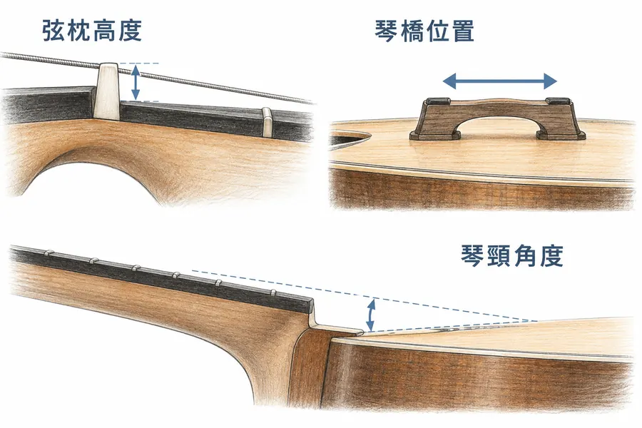

圖解 11.11　案例 三種設定問題的處理（示意）

這些案例的共同原則是：**症狀位置比症狀名稱重要。**

同樣叫 buzz，發生在空弦、單一琴格、所有高把位或特定音高，代表不同可能原因。

**把診斷做對，調整才有方向。**

## 表 11-1｜症狀導向的 Setup 診斷

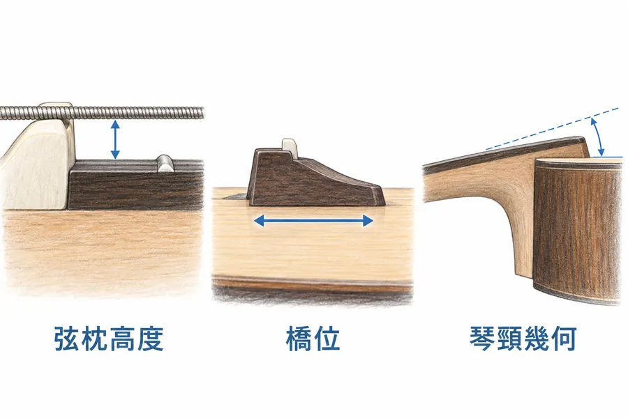

| **症狀** | **優先檢查** | **不要先做什麼** |
|----|----|----|
| **低把位普遍偏尖** | nut slot 高度（上弦枕槽）、按弦力 | 先大幅移 bridge（琴橋） |
| **12th fret 普遍偏尖** | bridge location（琴橋位置）、scale（弦長）、弦規 | 磨 fret（琴格） |
| **Action 高且 bridge 已到底** | neck angle（琴頸角度）、top geometry（面板幾何） | 繼續削 bridge |
| **只有 open string buzz** | nut slot、弦尾／硬體 | 整體升 action |
| **強奏才 buzz** | 演奏振幅、action、relief（曲度） | 把所有 fret 重磨 |

圖解 表 11-1｜症狀導向的 Setup 診斷（示意）

| **【張力重點】 同一 unit weight、同一音高下，張力與 scale length 的平方成正比。家族樂器不能把同一組弦直接「放大使用」。** |
|----|

| **【安全界線】 Nut slot、fret leveling、neck angle、老琴琴頸矯正都可能不可逆或高風險。若缺乏經驗，量測可以自己做，切削最好交給製琴師。** |
|----|

## 自我學習題庫

學習檢查：作答、核對、複習

先自己作答，再看答案。答錯時回到本章相關小節重新讀一次。

**1. Action 指的是？**

- A. 弦相對指板／琴格的高度

- B. 琴弦材質

- C. 琴身長度

- D. 撥片厚度

**2. 空弦調準但高把位普遍偏尖，應先檢查？**

- A. 琴橋位置與 intonation

- B. 琴盒

- C. 背帶

- D. 音孔形狀

**3. 換成明顯不同 gauge 的弦後？**

- A. Setup 可能需要重新檢查

- B. 一定不用調整

- C. 只會改顏色

- D. 琴橋會自動補償

**答案：1.A　2.A　3.A**

## 本章主要查證來源

查證來源：找原文、核條件、留紀錄

**【S711】Liuteria Calace：Mandolini – official specifications（accessed 2026-10-06）。** 33.5 cm 弦長、24/29 格、25/31/33 ribs、spruce top、rosewood/maple body 等現行規格。

https://www.calace.it/en/mandolini

**【S712】Liuteria Calace：Mandole – official specifications（accessed 2026-10-06）。** 43.2 cm（部分可 45.6 cm）scale、G/C 調 mandola、25/33 ribs 與材料配置。

https://calace.it/en/mandole

**【S713】Liuteria Calace：Mandoloncelli & Liuti – official specifications（accessed 2026-10-06）。** 61 cm scale、8/10 弦、25/41 ribs、不同琴體尺寸與材料配置。

https://calace.it/en-mandoloncelli-liuti

**【S714】Suzuki Music / Suzuki Violin：2017 String Instrument Catalog（2017）。** M-30、M-100、MD-4、MD-10、MC-836 的弦長、木材與規格。

https://www.suzuki-music.co.jp/app/uploads/2017catalog14.pdf

**【S715】D'Addario：A Complete Technical Reference for Fretted Instrument String Tensions（technical guide）。** 弦張力與 unit weight、scale length、frequency 的關係與公式。

https://www.daddario.com/globalassets/pdfs/accessories/tension_chart_13934.pdf

**【S716】Robert A. Margo / Classical Mandolin Society of America：Music Notation for Mandolin Family Instruments（v3, 2019）。** 曼陀林家族標準調弦、譜號、實音／移調記譜與地域名稱差異。

https://classicalmandolinsociety.org/wp-content/uploads/Music_Notation_for_Mandolin_Family_Instruments_v3.pdf

**【S721】D'Addario：What Is Guitar String Tension?（current resource）。** unit weight、scale length、frequency 三變數對張力的說明。

https://www.daddario.com/blogs/guitar/all-about-string-tension

從讀譜和指板開始，依序練習雙手、和聲與表情，建立可持續的練習方法。

閱讀範圍　第 12 章至第 17 章

---
