*Notation, Fretboard Logic, Positions, Scales and Transposition（記譜、指板邏輯、把位、音階與移調）*

## 本章重點

- 標準調弦是 **G3–D4–A4–E5**，用**高音譜號**、**實音記譜**，和小提琴空弦相同。
- 五度調弦有一個超好用的規律：**第 7 格＝下一條弦的空弦音**。
- **第 12 格＝空弦的八度**，位置大約在有效弦長的一半。
- **TAB（指法譜）**告訴你「按哪裡」，但不告訴你「這是什麼音、什麼調」。
- 同一個音在指板上常有好幾個位置；**選哪一個是配器決策**，不是唯一答案。

---

曼陀林有琴格、又是五度調弦，看起來比無格弦樂器容易找音。

但很多學習者卡住的地方，其實不是「找不到音」。

更準確地說，是**無法把五線譜、指板位置、把位和音樂語法連成同一張地圖**。

這兩種學習方式各有盲點：

| 學習方式 | 好處 | 容易失去什麼 |
|---|---|---|
| 只靠 TAB | 可以很快彈出一首曲子 | 調性、節奏、聲部、轉調能力 |
| 只背五線譜音名 | 知道每個音叫什麼 | 每看到一個音都要重新算手指位置 |

十九世紀的 Carlo Munier《曼陀林學校》（Scuola del Mandolino）和 Raffaele Calace 的方法，都把第一把位、之後的把位與技法建立成**系統**。

這說明專業曼陀林教育從很早就把**讀譜、位置與音樂表現一起學**。〔S717〕〔S718〕

本章會從標準的 G–D–A–E 指板出發。

順序是：先建立音名與音程，再進入把位、音階、調號、移調和家族記譜。

目標是：**讓你在沒有 TAB 的情況下，仍然知道音樂正在做什麼。**

## 12.1　五線譜與四組弦

標準曼陀林調弦是 **G3–D4–A4–E5**。

通常用**高音譜號（treble clef）**、**實音記譜（sounding pitch）**。

CMSA（美國古典曼陀林協會）的家族記譜指南把這點列得非常明確。

由於空弦和小提琴相同，許多小提琴聲部可以直接讀音高，不需要整段移調。〔S716〕

初學時最有效的方法，是**先把四條空弦當錨點**，再用半音上行填滿第一把位。

來源舉的例子是：

| 弦 | 0–2–4 格 |
|---|---|
| G 弦 | G–A–B |
| D 弦 | D–E–F♯ |

逐步把譜上常見的音，和手指位置綁在一起。

這種「從弦出發」的方法，比每次從中央 C 數線和間要快得多。

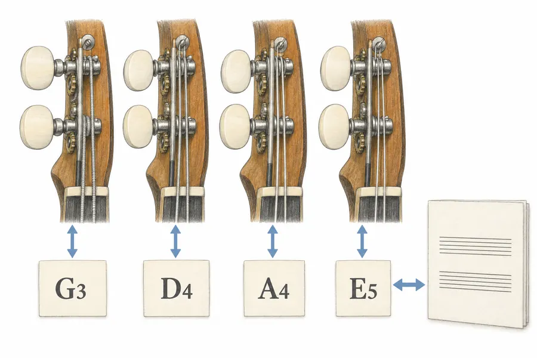

圖解 12.1　四組複弦的局部與空弦音名（示意）

讀譜還要同時看**節奏（rhythm）**。

曼陀林的**起音（attack）**很清楚。

所以節奏錯誤，比某些長音樂器更容易被聽見。

因此視奏時要**優先維持拍點**。

即使暫時漏掉一兩個裝飾音，也比「音全對但節拍崩掉」實用得多。

| **重點與應用** | **內容** |
|----|----|
| 核心概念 | 標準 mandolin tuning 是 G3–D4–A4–E5，通常用 treble clef、實音記譜。 |
| 關係與條件 | 初學時最有效的方法重點在先把四根 open course 當錨點，再用半音上行填第一把位。 |
| 應用方向 | 讀譜與找到指板位置。 |

## 12.2　TAB 的閱讀與使用

**TAB（指法譜）**直接告訴你在哪根弦、哪一格按。

對快速入門非常有效。

但它通常**不會主動告訴你**三件事：音名、調性功能、最佳替代位置。

如果 TAB 只有數字、沒有完整的節奏，讀者甚至必須靠錄音去猜節拍。

同一音在曼陀林上常有多個位置。

來源舉的例子是：某個 A 可以在**空弦 A**，也可以在**D 弦第 7 格**。

TAB 選定其中一個位置，就把**音色、換弦與把位選擇**一起決定了。

五線譜只給音高，演奏者則保留詮釋空間。

**高階演奏最需要的，正是這種選擇能力。**

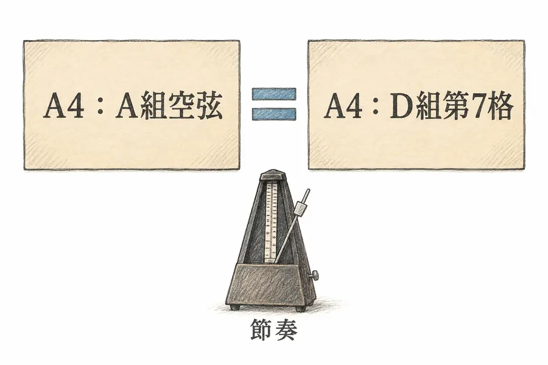

圖解 12.2　TAB 的閱讀與使用（示意）

兩種譜各有專長：

| 譜種 | 擅長 |
|---|---|
| TAB | 標示指板位置 |
| 五線譜 | 音高與樂句資訊 |

搭配使用，就能同時讀到兩邊的資訊。

學習新曲時，可以這樣做：

1. 先用 TAB 建立手感。
2. 再逐步遮掉 TAB，只看五線譜。
3. 最後應該能理解：這段音樂在什麼調、和聲走向在哪裡。

| **重點與應用** | **內容** |
|----|----|
| 核心概念 | TAB 直接告訴你在哪根弦、哪一格按，對快速入門非常有效。 |
| 關係與條件 | 同一音在曼陀林上常有多個位置。 |
| 應用方向 | 讀譜與找到指板位置。 |

## 12.3　十二平均律與琴格間距

**十二平均律（twelve-tone equal temperament）**的定義很簡單：

每升一個**半音（semitone）**，頻率乘上 **2^(1/12)**。

弦長和頻率近似成**反比**。

所以第 n 格到 nut 的理論位置是：

> **x = L ×（1 − 2^(−n/12)）**

其中 L 是有效弦長。

第 12 格剛好是 **L/2**。

因為一個八度頻率加倍，弦長就減半。

以 **335 mm** 弦長為例：

| 琴格 | 距 nut 的理論距離 |
|---|---|
| 第 1 格 | 約 18.8 mm |
| 第 5 格 | 約 84.0 mm |
| 第 7 格 | 約 111.4 mm |
| 第 12 格 | 正好 167.5 mm（＝L/2） |

越往琴身，剩餘的有效弦長越短。

所以相鄰琴格的距離，自然會逐漸縮小。

這就是平均律的幾何。

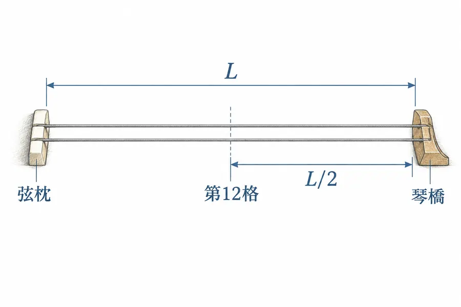

圖解 12.3　理想弦長減半的幾何關係，以單組複弦示意（示意）

但計算出正確的琴格位置，只完成了一半。

真實的弦按下去會**拉伸**，所以琴橋補償仍然必須修正。

如果琴格**頂冠（crown）**太寬，或磨耗不均，實際發音點也可能偏離理論線。

**樂理和設定（Setup）就在這裡直接相遇。**

| **重點與應用** | **內容** |
|----|----|
| 核心概念 | 十二平均律每升一個半音，頻率乘上 2^(1/12)。 |
| 關係與條件 | 以 335 mm scale 為例，第一格約離 nut 18.8 mm，第 5 格約 84.0 mm，第 7 格約 111.4 mm，第 12 格正好 167.5 mm。 |
| 應用方向 | 讀譜與找到指板位置。 |

## 12.4　全指板音名

五度調弦最大的優點，是**相鄰弦之間有穩定的幾何關係**。

| 關係 | 內容 |
|---|---|
| D 是 G 的上五度 | 高五個音級 |
| A 是 D 的上五度 | 高五個音級 |
| E 是 A 的上五度 | 高五個音級 |

若在 G course 找到某個音，它的八度、五度與同名音，可以透過**固定的琴格關係**在其他 course 找到。

最能馬上用的是這個規律：

> **「7 格＝下一條 open course」**

| 在這一條弦 | 第 7 格是 | 等於 |
|---|---|---|
| G course | D | 下一條 D 的空弦 |
| D course | A | 下一條 A 的空弦 |
| A course | E | 下一條 E 的空弦 |

這個規律，是**快速移動和跨弦視覺化的核心**。

相反方向，則可以用五度關係找低音版本。

E course 上方沒有下一條弦，所以這個規律到此為止。

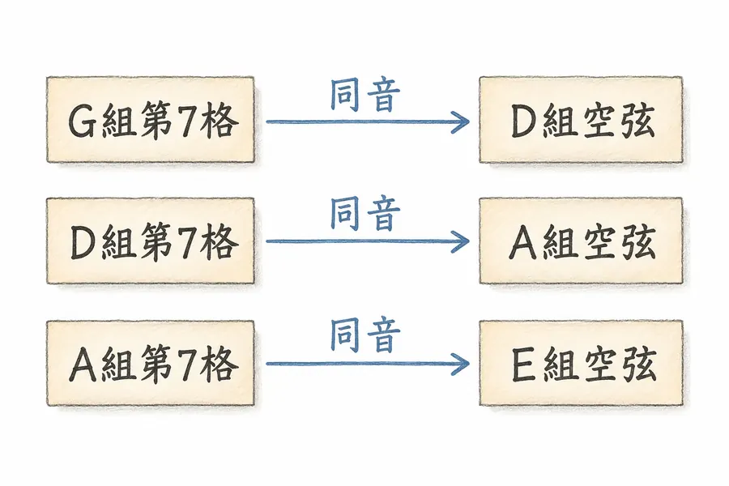

圖解 12.4　全指板音名（示意）

指板記憶應該**優先建立地標（landmarks）**：

- 空弦（open strings）
- 第 5／7 格
- 第 12 格
- 常見調號的音階位置

當這些點變成直覺，剩下的半音就能用**相對位置**推導。

一步一步，串起整張指板地圖。

| **重點與應用** | **內容** |
|----|----|
| 核心概念 | 五度調弦最大的優點，是相鄰弦之間有穩定的幾何關係。 |
| 關係與條件 | 例如 G course 第 7 格是 D，正好等於下一條 D open。 |
| 應用方向 | 讀譜與找到指板位置。 |

## 12.5　音程與雙音

**音程（interval）**描述兩個音之間的距離。

對曼陀林而言，有四種音程特別重要：

| 音程 | 中文 | 為什麼重要 |
|---|---|---|
| perfect fifth | 完全五度 | 和調弦方式直接相關 |
| third | 三度 | 決定**大調／小調**的色彩 |
| sixth | 六度 | 旋律配和聲（harmonization）的常用形狀 |
| octave | 八度 | 幫助換把、重新配置同一旋律 |

把音程畫成「**指板形狀**」，比單純背音名更有效率。

某個**大三度形狀（major third shape）**平移到另一個根音，只要不跨越**調弦例外（tuning anomaly）**，幾何關係仍然一致。

這裡說的例外，是指像吉他那種 B–G 之間的特例。

**曼陀林沒有這種特例。**

這正是五度調弦在「全調系統」上的優勢。

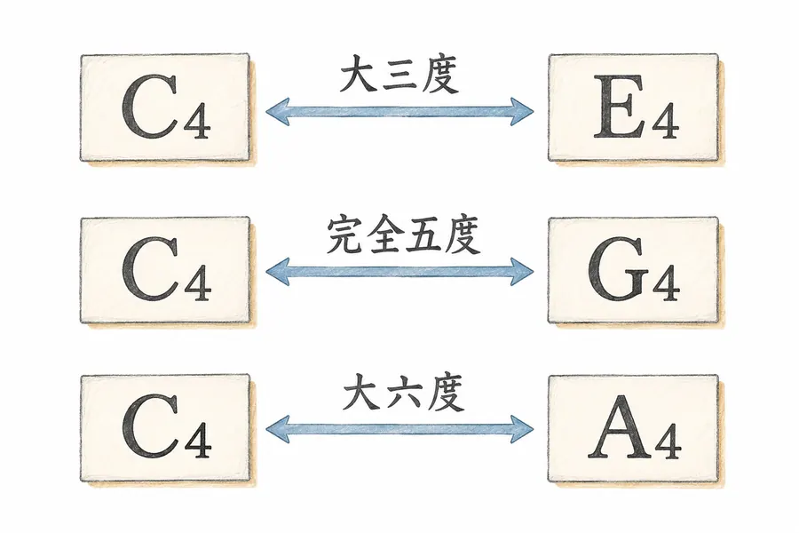

圖解 12.5　音程與雙音（示意）

學習**雙音（double stop）**的順序應該是：

1. 先理解音程。
2. 再沿著音階練習不同組合。
3. 先知道三度和六度如何沿音階變成大／小。
4. 再理解**聲部進行（voice leading）**。

之後任何調都能自己推導。

| **重點與應用** | **內容** |
|----|----|
| 核心概念 | 音程描述兩個音之間的距離。 |
| 關係與條件 | 把音程畫成「指板形狀」比單純背音名更高效。 |
| 應用方向 | 讀譜與找到指板位置。 |

## 12.6　音階與把位

**大調音階（major scale）**的全半音結構是：

> **W–W–H–W–W–W–H**（全–全–半–全–全–全–半）

這是**調號、和弦與旋律的共同基礎**。

其他音階是在這個基礎上，改變特定級數：

| 音階 | 中文 |
|---|---|
| natural minor | 自然小調 |
| harmonic minor | 和聲小調 |
| melodic minor | 旋律小調 |
| modes | 調式 |

練音階如果只追速度，就失去了它最重要的作用：

**讓耳朵、手和調性結構連在一起。**

第一把位音階適合建立基本音名。

但高階演奏需要**跨把位**。

把同一個 G 大調，分別用三種方式演奏：

| 方式 | 特點 |
|---|---|
| 空弦第一把位 | 用 open string |
| 封閉把位（closed position） | 不用空弦 |
| 高把位 | 位置更高 |

音高一樣。

但**音色、換弦和圓滑奏（legato）可能完全不同**。

演奏者應該知道自己**為什麼**選某一套指法。

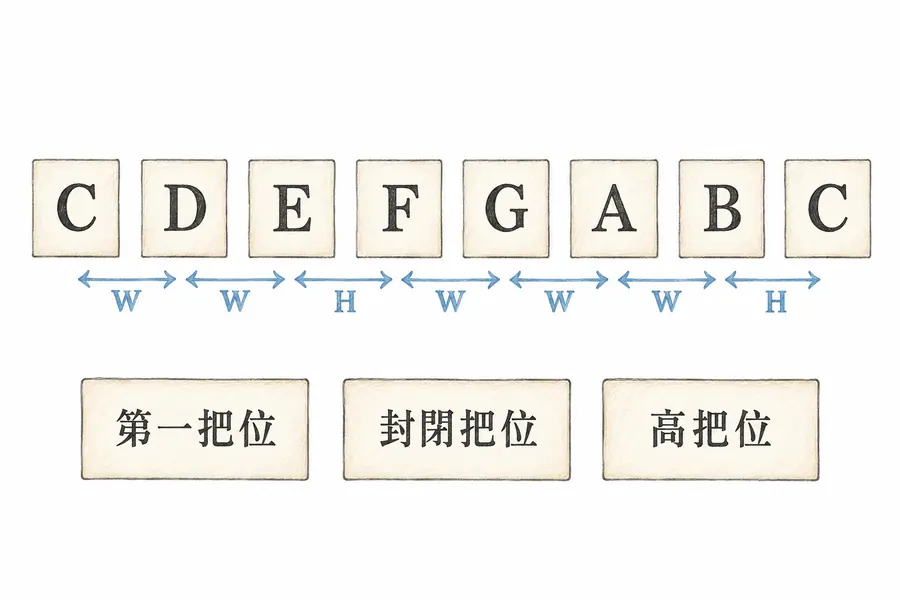

圖解 12.6　音階與把位（示意）

Munier 1891 年的方法，特別強調**先掌握第一把位，再進入其他把位**。

這反映歷史教學也把把位當作**系統**，而不是零散的技巧。

現代學習可以更彈性。

但「先有穩定基本地圖，再擴展」仍然合理。〔S717〕

| **重點與應用** | **內容** |
|----|----|
| 核心概念 | Major scale 的全半音結構 W–W–H–W–W–W–H，是調號、和弦與旋律的共同基礎。 |
| 關係與條件 | 第一把位音階適合建立基本音名，但高階演奏需要跨把位。 |
| 應用方向 | 讀譜與找到指板位置。 |

## 12.7　把位與換把

所謂**把位（position）**，本質上是**左手在指板上的參考框架**。

第一把位通常讓食指負責第一、二格附近的音。

移到更高把位後，同一根弦上的音就由不同手指接管。

**換把（shift）**的重點，是**提前決定下一個落點**和**引導指（guide finger）**。

把位選擇會改變音色與**樂句處理（phrasing）**。

| 選擇 | 效果 |
|---|---|
| 使用空弦 | 起音通常清楚，延音特性和按弦音不同 |
| 在較高把位用同一條弦 | 旋律音色可以更一致 |
| 快速民謠曲（fiddle tune） | 可能利用空弦減少換把 |

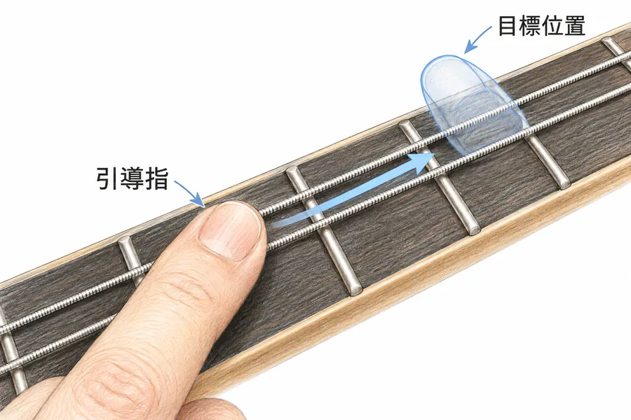

圖解 12.7　把位與換把（示意）

高把位還有一個物理事實：**琴格間距變窄**。

所以手指不需要像第一把位那麼張開。

如果仍然保持低把位的大伸展，反而容易按到相鄰的琴格，或造成緊張。

| **重點與應用** | **內容** |
|----|----|
| 核心概念 | 所謂 position，本質上是左手在指板上的參考框架。 |
| 關係與條件 | 把位選擇會改變音色與 phrasing。 |
| 應用方向 | 讀譜與找到指板位置。 |

## 12.8　調號與五度圈

**五度圈（circle of fifths）**能直接幫助理解曼陀林的調弦與調性。

G、D、A、E 正好沿著五度關係排列。

所以**標準空弦本身就是一段五度圈**。

對曼陀林而言，升號調因此往往有很自然的**空弦共鳴**和指法便利。

理解五度圈，能讓轉調更快。

| 調 | 增加的升號 | 累計 |
|---|---|---|
| G 大調 | — | — |
| D 大調 | 增加 C♯ | 1 個 |
| A 大調 | 再加 G♯ | 2 個 |
| E 大調 | 再加 D♯ | 3 個 |

與其背每個調的七個音，不如記住這個規律：

> **每往五度走一步，就多一個升號。**

降號方向則反過來理解。

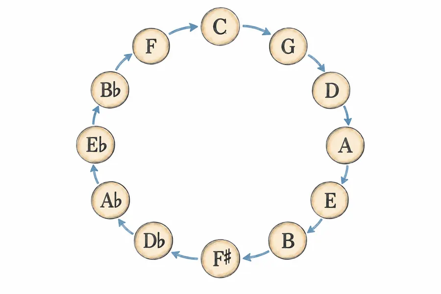

圖解 12.8　調號與五度圈（示意）

這也解釋了某些曲風為什麼偏好特定調。

**民謠提琴／藍草（fiddle / bluegrass）**曲目常喜歡 G、D、A、E。

這不只是文化慣例。

也因為空弦和五度調弦對這些調**非常友善**。

這是**樂器結構和音樂語言互相塑造**的例子。

| **重點與應用** | **內容** |
|----|----|
| 核心概念 | 五度圈能直接幫助理解曼陀林的調弦與調性。 |
| 關係與條件 | 理解五度圈能讓轉調更快。 |
| 應用方向 | 讀譜與找到指板位置。 |

## 12.9　家族樂器的記譜

CMSA 指南指出，美國與加拿大的 **C 調曼陀拉（C-tuned mandola）**，常以**中音譜號（alto clef）**或不同的轉譜方式處理。

而世界其他地區所稱的 **mandola／八度曼陀林（octave mandolin）**，又可能是 **G2–D3–A3–E4**。

其他成員也有各自的常見記譜法：

| 樂器 | 中文 | 記譜狀況 |
|---|---|---|
| mandocello | 曼陀琴 | 有各自常見記譜法 |
| Liuto Cantabile | 抒情魯特琴 | 有各自常見記譜法 |
| mando-bass | 曼陀貝斯 | 有各自常見記譜法 |

〔S716〕

這就是為什麼「看起來像同一個譜號」，還需要**先問實音**。

對編曲者而言，最安全的方法是：

1. 先建立**發聲音域（sounding range）**。
2. 再決定**記譜慣例（notation convention）**。

把小提琴聲部移給 C 調曼陀拉時，要依它的空弦與指板關係**重新安排指法**。

圖解 12.9　家族樂器的記譜（示意）

跨國樂團尤其要注意。

總譜開頭應該清楚標註**調弦（tuning）**和**移調（transposition）**。

> **常見誤解：「寫出樂器名稱就夠了。」**
> 不夠。**「曼陀拉」這個詞的地域差異很大。**
> 單寫樂器名，不足以避免排練時的誤會。

| **重點與應用** | **內容** |
|----|----|
| 核心概念 | CMSA 指南指出，美國與加拿大的 C-tuned mandola 常以 alto clef 或不同轉譜方式處理。 |
| 關係與條件 | 對編曲者而言，最安全的方法是先建立 sounding range，再決定 notation convention。 |
| 應用方向 | 讀譜與找到指板位置。 |

## 12.10　小提琴樂譜的移植

因為標準調弦相同，曼陀林常可以直接閱讀**小提琴高音譜號的音高**。

但實際演奏時，會遇到三個問題：

| 小提琴寫法 | 曼陀林必須決定 |
|---|---|
| 長的**持續音（sostenuto）** | 用顫音、重新起音（rearticulation），還是讓音自然衰減 |
| **連弓（slur）** 依賴弓向 | 撥弦模式不能照字面翻譯 |

另一方面，曼陀林有琴格和複弦。

某些快速段落反而可以利用**交替撥弦（alternate picking）**和空弦，取得清楚的**發音（articulation）**。

所以移植的重點是：**重新配器**。

CMSA 甚至指出，曼陀林演奏者可能直接讀原小提琴聲部。

這代表**音高層面**很方便。

但**不代表演奏語法相同**。〔S716〕

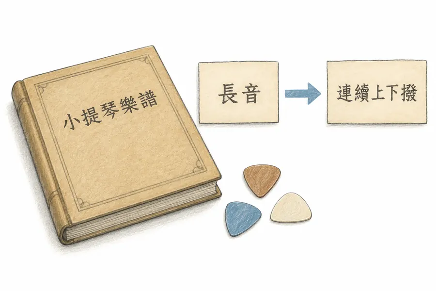

圖解 12.10　小提琴樂譜的移植（示意）

最好的練習是拿一段小提琴旋律，做兩個版本：

1. **第一版**：完全照音高讀。
2. **第二版**：重新安排顫音、空弦、換把和發音。

比較兩版，就會知道「讀譜」和「編成適合曼陀林」是**兩個層次**。

| **重點與應用** | **內容** |
|----|----|
| 核心概念 | 因標準 tuning 相同，mandolin 常可直接閱讀 violin treble-clef pitch。 |
| 關係與條件 | 另一方面，mandolin 有 frets 和 double courses，某些快速 passage 反而可以利用 alternate picking 和 open strings 取得清楚 articulation。 |
| 應用方向 | 讀譜與找到指板位置。 |

## 12.11　案例：同一旋律的指法選擇

假設旋律落在 **A4–E6**。

三種指法都彈得出來，但效果不同：

| 指法 | 做法 | 效果 |
|---|---|---|
| 第一種 | 大量使用空弦 A／E | 換把少、起音明顯 |
| 第二種 | 留在 A course 和較高把位 | 音色更一致、圓滑奏更容易 |
| 第三種 | 為了接**雙音（double stop）**，提前換到封閉把位 | 銜接更順 |

**音高完全相同，音樂效果卻不同。**

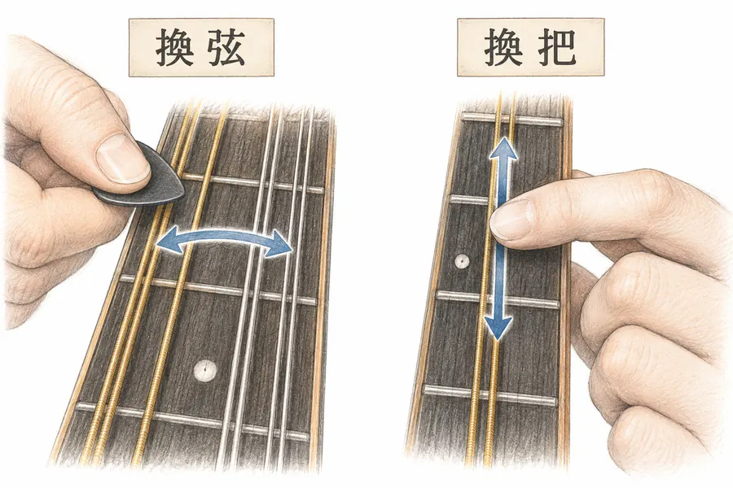

圖解 12.11　案例 同一旋律的指法選擇（示意）

這正是譜面**不能把所有答案寫死**的原因。

> **常見誤解：「TAB 標一格，就是唯一正確的按法。」**
> 初學時常會這樣誤會。
> 但專業指法其實是**配器決策**。
> 要考慮：前後樂句、動態、音色、換弦，以及下一個和弦。

練習時可以故意把同一段 4–8 小節做成三套指法，錄音比較。

最重要的目標，是建立**你能說明選擇理由**的能力。

| **重點與應用** | **內容** |
|----|----|
| 核心概念 | 假設旋律落在 A4–E6。 |
| 關係與條件 | 這正是譜面不能把所有答案寫死的原因。 |
| 應用方向 | 讀譜與找到指板位置。 |

## 12.12　案例：旋律移調與指型

如果一段旋律在 G 大調，想把每個琴格加兩格移到 A 大調，看起來很簡單。

但遇到空弦、把位邊界和音域時，很快就會變得不實用。

更穩定的方法是：

1. 先把旋律理解成**音級（scale degrees）**，例如 1–2–3–5。
2. 再在新調重新找位置。

這種**功能思維**也適合和弦。

| 原進行 | 在 G 調 | 移到 A 調 |
|---|---|---|
| I–IV–V | G–C–D | A–D–E |

只背手型，容易把轉調變成機械式的搬格。

理解功能，則能直接連到伴奏和即興。

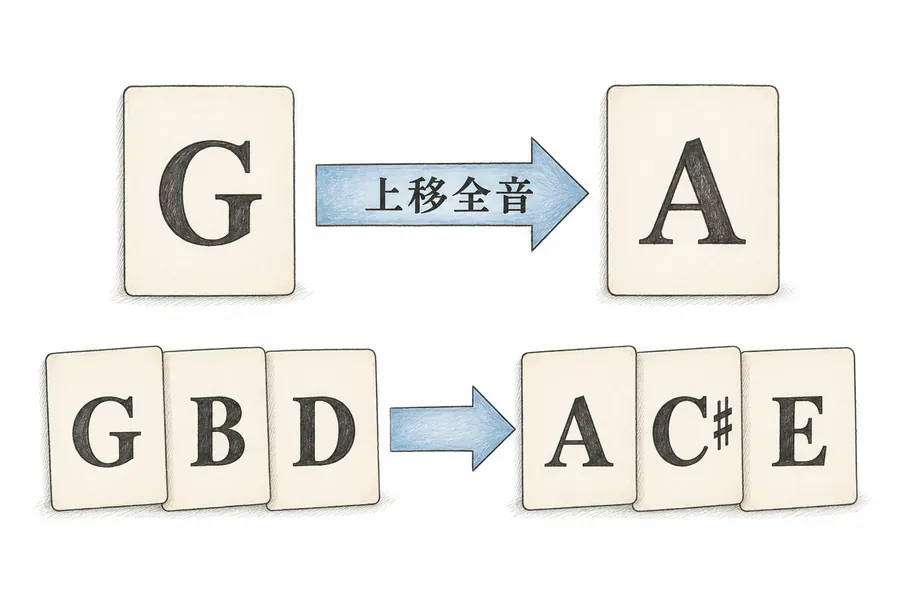

圖解 12.12　案例 旋律移調與指型（示意）

五度調弦讓**封閉指型（closed shapes）**的平移相對規律。

所以兩種方法可以結合：

1. 先用功能找到目標音。
2. 再利用可移動的幾何，快速落到指板上。

這就是「**樂理的目的，是讓手更快找到答案**」。

## 表 12-1｜指板記憶的幾個核心 Landmark（地標）

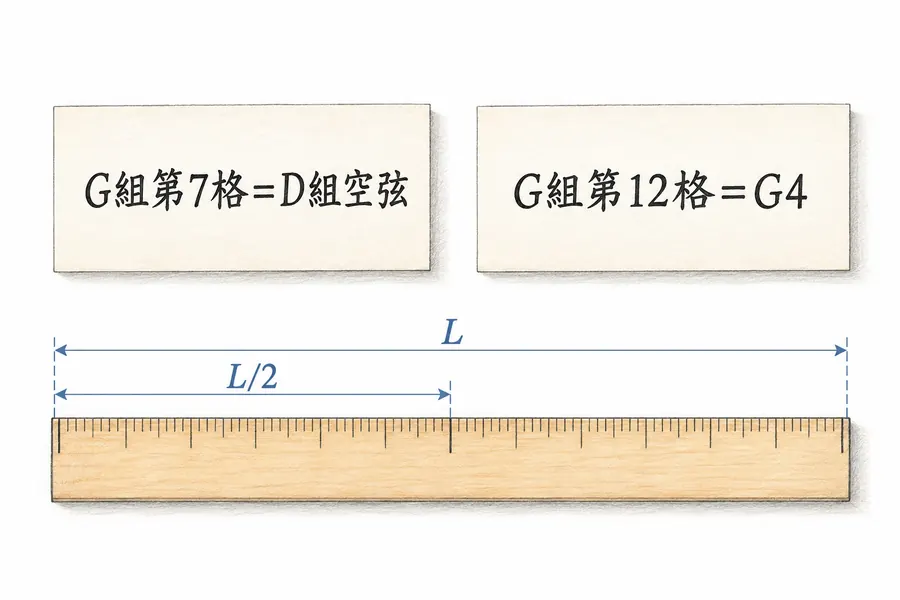

| **位置關係** | **意義** | **實務用途** |
|---------------------------------|----------------------|-------------------|
| **7 fret = 下一條 open course**（第 7 格＝下一條空弦） | 完全五度關係 | 快速找同音／換弦 |
| **12 fret = open string 八度**（第 12 格＝空弦八度） | scale length 的一半（有效弦長的一半） | 把位與 intonation |
| **5th/7th fret 周邊**（第 5／7 格附近） | 常見自然音與位置標記 | 視奏與換把 |
| **Closed shape 可平移**（封閉指型可平移） | 五度調弦幾何一致 | 移調、和弦、雙音 |

圖解 表 12-1｜指板記憶的幾個核心 Landmark（示意）

| **【指板公式】 第 n 格距 nut 的理論位置：x = L × (1 − 2^(−n/12))。第 12 格必為 L/2；實際琴橋仍需 compensation。** |
|----|

| **【歷史教學】 Munier 1891《Scuola del Mandolino》明確把第一把位列為基礎，再進入其他把位與技巧。這說明把位系統不是現代教科書才發明的概念，而是金屬弦那不勒斯曼陀林成熟教育的一部分。** |
|----|

## 自我學習題庫

學習檢查：作答、核對、複習

先自己作答，再看答案。答錯時回到本章相關小節重新讀一次。

**1. 標準曼陀林的調弦關係主要是？**

- A. 連續五度

- B. 連續四度

- C. 連續三度

- D. 任意調弦

**2. TAB 的主要限制之一是？**

- A. 不能告訴你指板位置

- B. 常無法完整呈現樂理、節奏與聲部資訊

- C. 不能寫數字

- D. 只適合鋼琴

**3. 第 12 格通常代表？**

- A. 有效弦長的一半位置附近

- B. 琴身中心

- C. 一定是最高音

- D. 尾弦板位置

**答案：1.A　2.B　3.A**

## 本章主要查證來源

查證來源：找原文、核條件、留紀錄

**【S716】Robert A. Margo / Classical Mandolin Society of America：Music Notation for Mandolin Family Instruments（v3, 2019）。** 曼陀林家族標準調弦、譜號、實音／移調記譜與地域名稱差異。

https://classicalmandolinsociety.org/wp-content/uploads/Music_Notation_for_Mandolin_Family_Instruments_v3.pdf

**【S717】Carlo Munier：Scuola del Mandolino（Firenze: Adolfo Lapini, 1891）。** 19 世紀末完整曼陀林教本；第一把位、姿勢、顫音、進階把位與裝飾技法等歷史演奏證據。

https://imslp.org/wiki/Scuola_del_Mandolino_(Munier%2C_Carlo)

**【S718】Raffaele Calace：Metodo per mandolino, Opp.37–42（Edizioni Calace, public-domain scans）。** 六冊曼陀林教本；歷史指法、把位、技巧與音樂語法參照。

https://imslp.org/wiki/Metodo_per_mandolino_(Calace%2C_Raffaele)

**【S715】D'Addario：A Complete Technical Reference for Fretted Instrument String Tensions（technical guide）。** 弦張力與 unit weight、scale length、frequency 的關係與公式。

https://www.daddario.com/globalassets/pdfs/accessories/tension_chart_13934.pdf

---
