*Mandolin Posture, Pick Control and the Foundations of Right-Hand Technique*
（曼陀林的姿勢、撥片控制與右手基礎）

## 本章重點

- 曼陀林很小，但它是「弦很緊、每次要撥兩條弦、撥片反覆高速觸弦」的樂器。琴不穩，右手就會用多餘的力氣去補。
- 檢查姿勢只看三件事：動作能不能重複、身體鬆不鬆、聲音穩不穩。
- 撥片沒有「厚就專業、薄就初學」這回事。重點是它配不配合你的手，以及你想發出什麼聲音。
- 下撥與上撥要「聽起來一樣」，這比「彈得快」更根本。
- 持續的痛、麻、無力，不是「必經的訓練代價」，要停下來檢查。

---

曼陀林看起來不大，很多人因此低估了「怎麼拿琴」的影響。

真正的關鍵在於：這是一件**高張力**、**雙弦組**、用撥片**反覆高速觸弦**的樂器。
所以只要琴體不穩，右手就會用多餘的力量去補償。
只要琴頸被左手長時間托住，換把就會變慢。
只要撥片抓得太緊，顫音（tremolo）和快速交替撥弦（alternate picking）在速度提高後就會僵硬。

十九世紀末到二十世紀初，Munier（穆尼葉）與 Calace（卡拉切）都寫過教本。

他們都把「姿勢、撥片、基本發音」放在教學系統最前面。〔S1301〕〔S1302〕

這說明一件事：**基本功從來不是入門的門檻，而是所有進階技法的共同底盤。**

本章不給你「標準答案」，而是給你判斷的原則。
因為手掌大小、前臂長度、琴體尺寸、背帶與坐姿習慣都不一樣，最適合的位置也不會一樣。

好的姿勢有三個條件：

1. 琴要穩。
2. 雙手要能自由移動。
3. 關節不要長時間被強迫固定在同一個角度。

另外，動作幅度要跟聲音需求相稱。小聲的樂句不需要用大動作。

> **一個重要的提醒**
> 演奏造成的肌肉骨骼不適，在音樂家身上並不少見。
> 近期的系統性回顧（systematic review，把多篇研究一起分析的論文）指出：重複動作、密集練習、不良的人體工學，可能一起提高風險。〔S1303〕
> 任何持續的疼痛、麻木、無力或失去控制，都不該被當成「必經的訓練代價」。

---

## 13.1　持琴穩定與雙手活動

坐著演奏時，第一個目標是：**在不靠左手大量支撐的情況下，琴體仍然穩定。**

不同琴型要處理的問題不一樣。

| 琴型 | 問題 | 傳統做法 |
|---|---|---|
| 圓背那不勒斯式（round-back Neapolitan） | 深碗狀的琴背容易在大腿上滑動 | 用身體、前臂與腿形成「多點支撐」 |
| 美式 A／F 型（A-style／F-style） | 琴體較平，但若角度太水平 | 右手可能被迫抬肩或折腕 |

所以，與其問「琴頭應該抬幾度」，不如問這個問題：

> **當左手完全放鬆時，琴頸會不會立刻往下掉？**

如果會，代表你的左手其實正在兼任「琴架」。

### 站姿與背帶

站姿通常需要背帶（strap）。
背帶的功能不是「把琴掛住」，而是**讓坐姿與站姿的琴位盡可能接近**。

如果站起來之後琴突然掉到腰的高度，會同時發生三件事：

- 右手觸弦的角度改變。
- 左手拇指的位置改變。
- 視線的位置改變。

那等於每次演出都在換一套技術。

比較可靠的做法是：

1. 先在**坐姿**找到不費力的位置。
2. 再調整背帶，讓站起來時琴接近同一個高度。
3. 用幾段最熟悉的旋律測試。
4. 確認音量、速度、準確度沒有明顯下降。

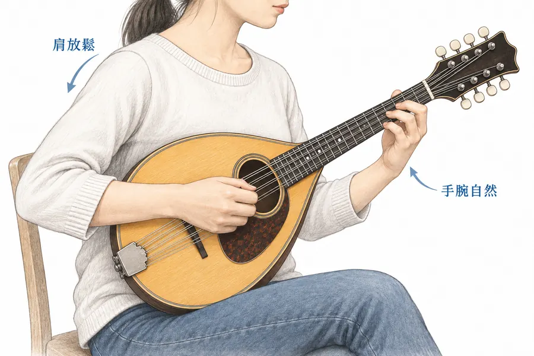

圖解 13.1　持琴穩定與雙手活動（示意）

### 肩頸也要一起評估

姿勢不只關於琴，也關於你的肩膀。

| 狀況 | 可能後果 |
|---|---|
| 琴體偏右太多 | 右肩容易向前內旋 |
| 琴頭抬得太高 | 左肩可能一直聳著 |

這些問題在十分鐘內未必會痛，但排練一小時後會開始累積。

好的姿勢重點在**允許微調**，而不是鎖死一個角度：

- 長句時，琴可以稍微轉向身體。
- 換把時，左肘的位置自然改變。
- 強奏時，前臂可以有少量參與。

把姿勢想成「動態平衡」，通常比固定某個角度更實際。

**本節重點：** 先讓琴在左手放鬆時仍然穩定。
**練習方向：** 建立穩定的持琴與撥片動作。

### 可以幫忙的配件

圓背琴的支撐可以搭配**足台**（footstool）與**止滑墊**。
譜面台則幫助視線維持在前方。

這些配件也列在島村的入門指南中。〔N01〕

試用時請照這個順序：

1. 先讓雙肩放鬆。
2. 確認左右手都還能自由活動。
3. 再調整高度與角度。

配件合不合適，以你自己的坐姿為準，不是以產品說明為準。

---

## 13.2　左手支撐與放鬆

本章的核心是右手，但**左手鬆不鬆，會直接決定右手能不能自由。**

許多初學者用拇指和食指之間的**虎口**把琴頸夾得很緊，因為這樣「感覺很安全」。
代價是：

- 食指到小指的伸展受到限制。
- 換把時必須先鬆開，再重新夾住。

更有效率的方式，是讓拇指扮演兩個角色：**位置參考**與**反作用力的來源**。
同時保留換把所需要的活動空間。

### 按弦其實不需要很大力

琴弦只要能穩定接觸在**琴格頂端**（fret crown，琴格金屬條最靠琴身的那一面）後方，就能發出清楚的聲音。

多餘的力量不會讓音「更準」。它只會：

- 增加疲勞。
- 甚至因為把弦壓得太深，讓音高稍微偏高（變尖）。

練習方法如下：

1. 故意從「明顯過度用力」開始。
2. 一邊持續撥奏，一邊慢慢減小左手壓力。
3. 減到**剛剛出現打弦雜音**（buzz）為止。
4. 再稍微加回一點點。

這樣就能找到「你」與「這把琴」之間的最低必要壓力。

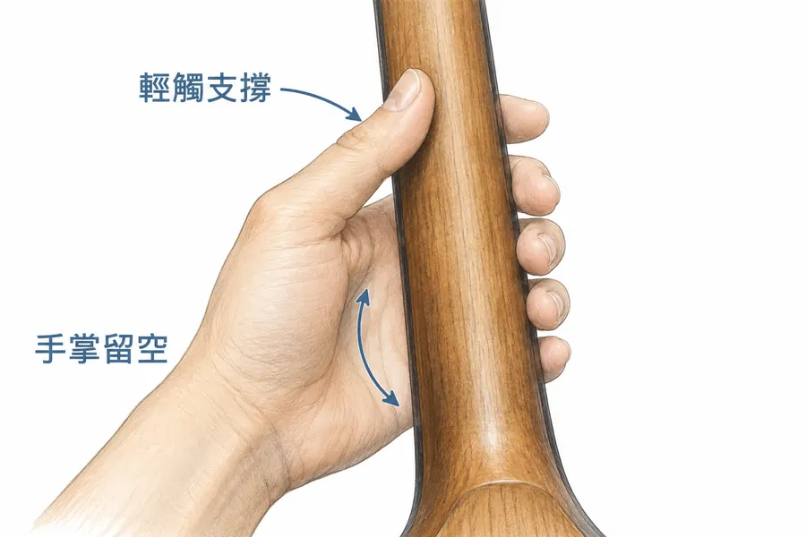

圖解 13.2　左手支撐與放鬆（示意）

### 有時候不是手太弱，是琴有問題

以下因素都會改變「必要壓力」的大小：

- 弦高（action）較高。
- 弦組較粗。
- 琴格磨損。

如果某把琴必須用很大的力量才不打弦，不一定是「手太弱」，也可能是**設定（setup）**的問題。

> **常見誤解**
> **「按不乾淨，就是我不夠用力、手不夠強。」**
> 不一定是。先檢查弦高、弦粗與琴格磨耗，再談技術。

> **順序很重要**
> 技術訓練之前，先排除樂器本身的結構障礙。
> 否則你會把「補償性的錯誤動作」練成習慣。

**本節重點：** 左手放鬆，右手才自由。
**練習方向：** 建立穩定的持琴與撥片動作。

---

## 13.3　撥片的形狀與材質

### 厚度：不是越厚越好

撥片（pick）的厚度，會改變它碰到琴弦時的**變形量**。

| 厚度 | 優點 | 缺點 |
|---|---|---|
| 很薄 | 容易彎曲，初學者可能覺得順手 | 在雙弦組上高速演奏時，過度彎曲會讓觸弦時間與回彈變得不穩定 |
| 較厚 | 變形少、輪廓清楚 | 要求更精確地控制角度（angle）與深度（depth）；入弦太深時阻力更明顯 |

> **常見誤解**
> **「厚＝專業，薄＝初學。」**
> 不成立。真正的問題是：它符不符合你的聲音與動作系統。

### 形狀與邊緣

- **尖端較尖**的撥片：起音（attack）明確。
- **圓鈍尖端**：接觸時間稍長，聲音較柔。
- **邊緣有沒有拋光**：會影響摩擦噪音。

大型三角撥片常受曼陀林玩家喜愛，原因是握持面積大，而且三個角可以輪換使用。
但這不是唯一選擇。

### 怎麼公平地比較撥片

這一點非常重要，因為大多數人比較的方法是錯的。

1. 固定同一段樂句。
2. 固定同一個撥奏位置。
3. 固定同一個音量。
4. 錄音。

不要一邊換撥片、一邊改右手角度。否則你很難知道差異是從哪裡來的。

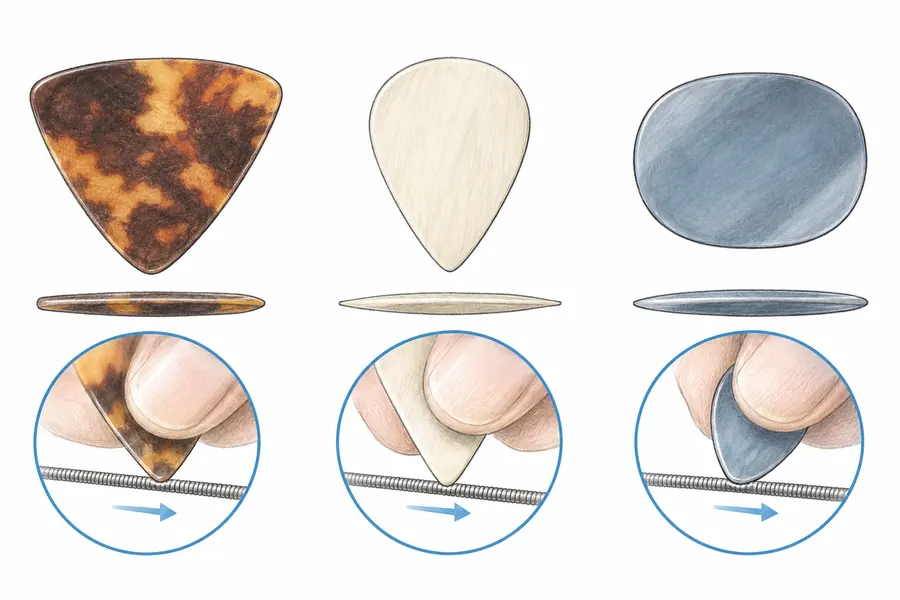

圖解 13.3　撥片的形狀與材質（示意）

### 材質：不要追逐「神奇材料」

歷史教本提醒我們：撥片材質曾經包含今日因為保育與法規而不該再使用的天然材料。

現代常見的材質有：

- 賽璐珞（celluloid）
- 德林（Delrin）類塑料
- 壓克力（acrylic）
- 各種複合材料

對學習者來說，先理解**剛性、表面摩擦、邊緣形狀**，比追逐「神奇材質」重要得多。

聲音是撥片、手、琴弦、撥奏位置與樂器本體**共同**產生的。
不適合把單一材料神化。

---

## 13.4　撥片握法

### 基本握法

常見做法是：把撥片放在**食指側面**，再由**拇指覆蓋**。

真正需要觀察的只有三件事：

1. 撥片露出的長度。
2. 拇指與食指的壓力。
3. 手指關節有沒有為了抓住它而僵直。

| 露出的長度 | 會發生什麼 |
|---|---|
| 太長 | 撥片像一支長槓桿，容易被弦扭轉 |
| 太短 | 手指可能直接撞到弦 |

多數人最後會停在「只露出足夠穿過兩根弦的尖端」附近。
但這仍應依撥片尺寸與個人習慣微調。

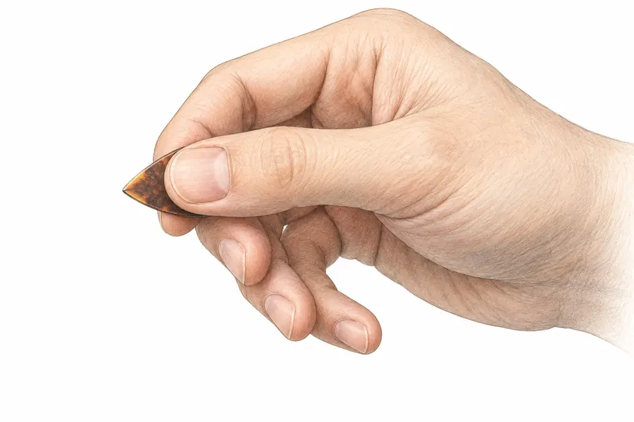

圖解 13.4　撥片握法（示意）

### 握力不是固定值

慢速柔奏可以更鬆。強奏與快速跨弦時需要稍微提高穩定度。

真正要避免的是：**整段音樂都維持最大抓力。**

一個很簡單的測試：

1. 連續演奏八小節。
2. 立刻停住。
3. 檢查三件事：拇指末端是否發白？食指是否留下明顯壓痕？前臂屈肌是否緊繃？

如果每次都這樣，通常代表你把「不讓撥片飛走」和「用力抓住撥片」混為一談了。

### 撥片角度

撥片角度可以分成兩種：

- **平面上的斜角**：撥片在琴面這個平面上轉了多少。
- **垂直方向的傾角**：撥片相對琴弦傾斜了多少。

讓撥片邊緣略帶角度穿過弦，常能減少正面撞擊的阻力。
但角度太大時，摩擦聲與刮弦聲會增加。

最好的訓練方法是：

1. 從**近乎平行**開始。
2. 小幅改變角度。
3. 每次只改一點，並且錄音。
4. 找出「聲音」與「阻力」的平衡點。

**本節重點：** 握法要能隨時調整，不是固定不變。
**練習方向：** 建立穩定的持琴與撥片動作。

---

## 13.5　下撥與上撥

交替撥弦（alternate picking）的真正基礎，是下撥（downstroke）與上撥（upstroke）要接近。

要接近的有三件事：

- 音量
- 時間感
- 觸弦深度

很多學習者的問題是：下撥很有力，上撥卻像「回程順便碰到弦」。

到了快速的八分音符或十六分音符時，就會出現兩個毛病：

- 重音固定落在某一個方向。
- 節奏開始搖晃。

### 練習步驟

1. 先在**單一弦組**（course，一組兩條同音的弦）上，用極慢的速度演奏連續八分音符。
2. 每一下都刻意讓撥片**完全離開弦組**之後再回來。
3. 如果下撥與上撥的音色差太多，先調整三件事：撥片角度、手腕路徑、握力。
4. 兩邊接近之後，再逐步加速。
5. 最後把重音移到不同位置：先試「每四下第一下重」，再試「每四下第二下重」。

第 5 步是在檢查：**兩個方向的重音，是不是都能自由控制。**

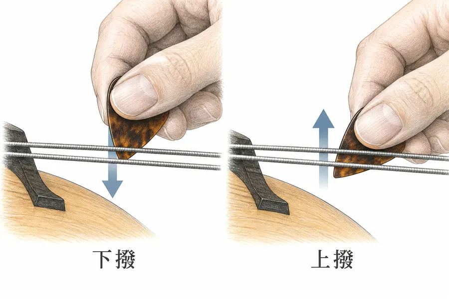

圖解 13.5　下撥與上撥（示意）

### 歷史上的記號

歷史方法中的右手記號，與現代教學符號不完全一致。
但核心問題是相同的：**撥片動作必須和拍點組織在一起。**

Calace 與 Munier 的方法，都把顫音、分奏與撥弦方向，看成可以訓練的「語法」。

分奏（division）的意思，是把一個音分成連續好幾下。

把動作和拍點、樂句綁在一起，就是他們的核心想法。〔S1301〕〔S1302〕

**本節重點：** 兩個方向要聽起來一樣。
**練習方向：** 建立穩定的持琴與撥片動作。

---

## 13.6　雙弦組的觸弦

曼陀林的**弦組（course）**由兩根同音的弦組成。

理想情況下，撥片會以穩定的路徑**先後**接觸兩根弦，兩個瞬間的起音在極短時間內合成**一個**起音（attack）。

| 入弦深度 | 會發生什麼 |
|---|---|
| 太淺 | 可能只碰到外側那一根弦 |
| 太深 | 會被第二根弦卡住 |

這就是為什麼把吉他的單弦撥奏手感「原封不動」搬到曼陀林，常會覺得右手黏住了。

### 怎麼知道自己有沒有完整穿過

1. 把速度降到非常慢。
2. 錄下單音。
3. 聽聽看：有沒有偶爾只有一根弦響？

如果偶爾只響一根，聲音會突然變薄。
如果兩根弦的調音略有差異，漏弦會更容易被聽出來。

> **這也順便提醒一件事**
> 新弦裝好之後，要把每一對（pair）分別精準調音。
> 否則你可能把「調音問題」誤以為是「右手問題」。

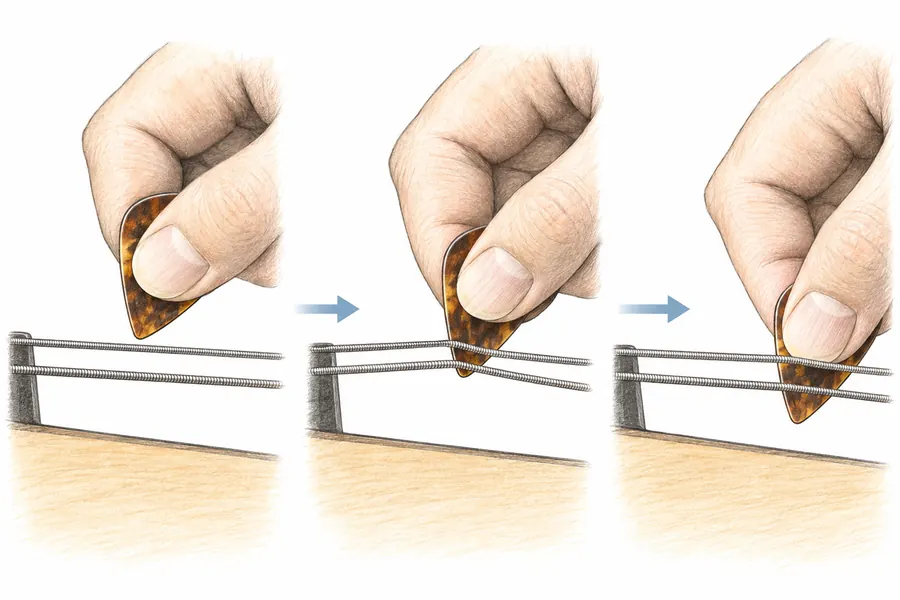

圖解 13.6　雙弦組的觸弦（示意）

### 舊弦也會改變觸感

同一個弦組裡的兩根弦，如果磨耗程度不同，表面的摩擦與彈性反應就可能不一致。

長期只換斷掉的那一根、不換整組，雖然省錢，卻會讓右手很難建立一致的回饋。

對重視演奏穩定的人來說，**成對更換**通常更合理。

**本節重點：** 撥片要完整穿過兩根弦，只合成一個起音。
**練習方向：** 建立穩定的持琴與撥片動作。

---

## 13.7　跨弦路徑

跨弦（string crossing）的難點，不只是「從 D 弦組移到 A 弦組」。

還包括一件事：**你離開前一個弦組時的方向。**

這個方向會決定下一個動作，是**內側撥弦**（inside picking）還是**外側撥弦**（outside picking）。

| 類型 | 感覺 |
|---|---|
| 內側撥弦 | 撥片「走進」兩弦之間 |
| 外側撥弦 | 撥片「繞過」外側 |

兩者沒有絕對的好壞，但手感不同。
某些句型在一種起始方向下非常自然，換另一種就像一直在跨過一道「牆」。

所以，高速樂句的**指法（fingering）與撥法（picking）必須一起設計**。

### 初學者最常犯的錯

初學者常試圖用**很大的垂直動作**去避開其他弦，結果速度一快就失控。

更有效率的方法是：

1. 把撥片的行程控制在**剛好離開弦組**就好。
2. 再利用小幅的前臂／手腕移動，對準下一個弦組。

### 練習步驟

1. 把三個弦組的琶音（arpeggio）先拆成**兩個弦**。
2. 穩定之後，再變成**三個弦**。
3. 每次失誤後，先確認錯的是「位置」還是「方向」。
4. 針對錯誤，只練那個短片段。

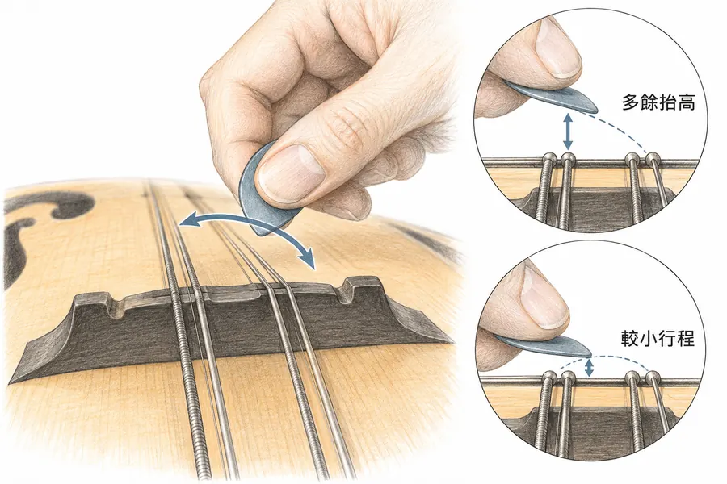

圖解 13.7　跨弦路徑（示意）

這裡也連到下一章的交叉撥弦（crosspicking）。
交叉撥弦的重點，是讓「跨弦」本身成為有規律的節奏與聲部設計。

所以先把基本的跨弦做得安靜、短距離，進階句型才不會建立在補償動作上。

**本節重點：** 離開前一個弦組的方向，決定下一個動作好不好做。
**練習方向：** 建立穩定的持琴與撥片動作。

---

## 13.8　撥奏位置與音色

同一把琴、同一根弦，只要換撥奏位置，聲音就會不同。

| 撥奏位置 | 聲音特徵 | 手感 |
|---|---|---|
| 靠近琴橋（bridge） | 高頻成分較多、起音明確 | 局部位移較小，感覺「硬」 |
| 靠近指板末端 | 較柔和 | 越往中間越柔軟 |

原因是：撥弦位置改變了弦振動的**初始形狀**，某些泛音成分被加強，某些被削弱。

### 所以音色不只是「用力或不用力」

音色製造（tone production）不只是力氣的問題。位置也是工具。

| 樂句需要 | 右手往哪裡移 |
|---|---|
| 更透明、更穿透的輪廓 | 稍微向琴橋移動 |
| 柔和的歌唱性（cantabile） | 往指板方向移一些 |

但這些改變要**小而可控**。否則右手位置大幅飄動，會讓跨弦與顫音都變得不穩。

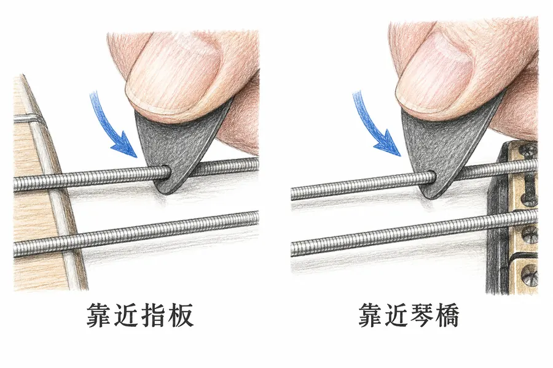

圖解 13.8　同一組複弦在不同撥弦位置的局部示意（示意）

### 建立自己的「聲音地圖」

練習時，可以在同一組**空弦 A** 上選三個位置：

1. 琴橋後方的常用區。
2. 音孔／f 孔附近。
3. 靠近指板。

用**相同的節拍**與**相同的主觀音量**錄音，再比較起音與延音（sustain）。

這會比只看器材評測，更快建立你自己的聲音地圖。

**本節重點：** 位置就是音色的第二個旋鈕。
**練習方向：** 建立穩定的持琴與撥片動作。

---

## 13.9　案例：加速時的緊繃

假設有一段 G–A–B–C 的連續八分音符：

| 速度 | 狀況 |
|---|---|
| 80 BPM | 很乾淨 |
| 120 BPM | 開始緊 |
| 140 BPM | 失控 |

最常見的錯誤，是把「速度問題」直接解讀成「手不夠快」，於是反覆從 120 加到 140。

其實真正的限制可能是：

- 撥片露出太長。
- 每次撥弦都深入太多。
- 上撥比下撥短，導致速度提升後兩個方向不對稱。

### 診斷可以反過來做

1. 先在 **140 BPM 只做一拍四下**的爆發（burst），觀察短時間內能不能放鬆完成。
2. 如果可以，代表神經與動作速度並非完全不足，而是**耐力**或**路徑累積**的問題。
3. 接著在 **100 BPM 故意把入弦深度減半**，看音色是否仍可接受。
4. 如果這時候動作突然變輕鬆，真正限制就是：**你每一下都做了太多工作。**

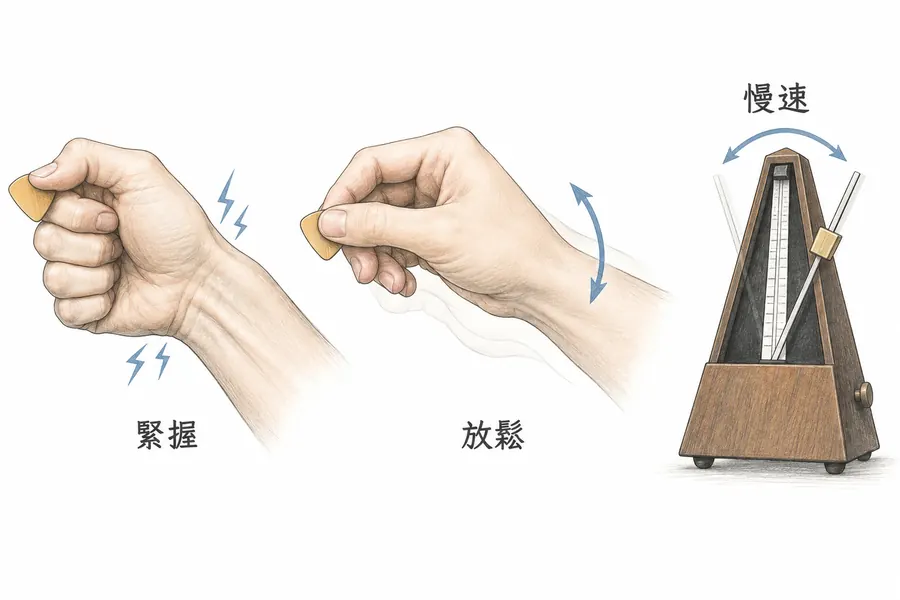

圖解 13.9　案例 加速時的緊繃（示意）

這個案例說明，基本功的目標是建立一套**可以診斷的系統**。

當演奏失敗時，你能指出「是哪一個變數失控」，才有可能有效修正。

**本節重點：** 速度卡住時，先找「哪個變數」失控。
**練習方向：** 建立穩定的持琴與撥片動作。

---

## 13.10　練習量與身體訊號

音樂家身上的肌肉骨骼不適，有相當高的盛行率。手腕、手部、肩頸都可能受影響。

系統性回顧指出：密集重複的活動、姿勢、個人身體條件等因素，常常是**一起**作用的。
而且因為研究品質與個體差異，「一套萬用預防法」並不存在。〔S1303〕

這意味著本書不能把某個姿勢宣稱為醫療上的保證。
但可以建立幾個保守原則：

1. 逐步增加負荷。
2. 定期休息。
3. 避免在明顯疼痛下硬撐。
4. 技術突然改動時，降低練習量。

### 什麼時候該停下來

如果出現以下任何一項，就不要再把問題解讀成「正常的痠」：

- 持續疼痛
- 麻木
- 刺痛
- 明顯無力
- 關節腫脹
- 動作控制突然下降

專業醫療評估特別重要，因為**肌腱過度使用、神經壓迫、關節問題、局部肌肉疲勞**的處理方式都不一樣。

文獻也強調：評估音樂家時，需要理解實際的演奏動作，而不是只看一般上肢疼痛。〔S1304〕

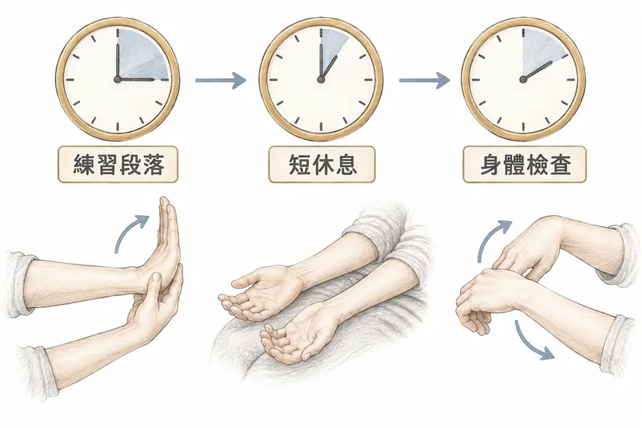

圖解 13.10　練習量與身體訊號（示意）

### 每天最值得記錄的三件事

對日常訓練來說，最實用的紀錄不是「練了幾小時」，而是：

- 哪一種動作，在第幾分鐘開始緊？
- 換了哪個撥片或姿勢之後改善？
- 速度提升時，哪個部位先疲勞？

這些資料能把身體感受，從模糊的印象變成**可以調整的練習資訊**。

---

## 表 13-1｜右手基本變數與診斷方向

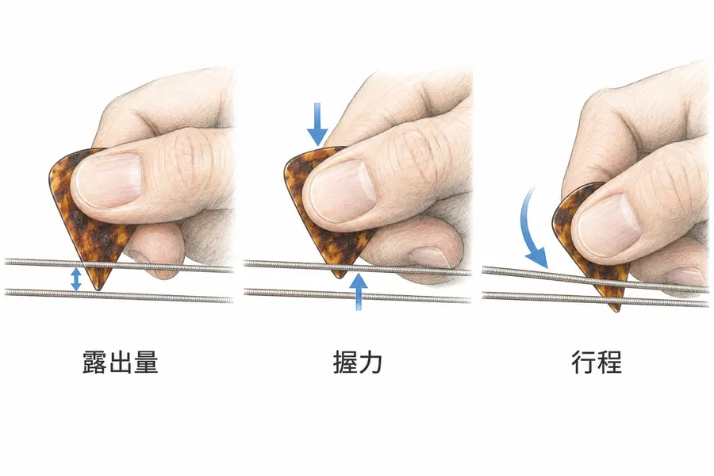

| **變數** | **太多時可能出現** | **太少時可能出現** | **先怎麼測** |
|:---|:---|:---|:---|
| **Pick depth**（入弦深度） | 卡弦、疲勞、速度受限 | 漏掉第二根弦、音量不足 | 單一弦組慢速錄音 |
| **Grip pressure**（握力） | 前臂／拇指緊、音色硬 | 撥片旋轉或掉落 | 8 小節後立刻檢查手 |
| **Edge angle**（邊緣角度） | 刮弦聲、音色過薄 | 正面阻力大 | 每次只改小角度錄音 |
| **Travel distance**（行程） | 高速失控、跨弦慢 | 可能未完全離弦 | 鏡子／慢動作錄影 |
| **Instrument stability**（琴體穩定度） | 左手夾頸、肩膀補償 | — | 左手放鬆看琴是否仍穩 |

圖解 表 13-1｜右手基本變數與診斷方向（示意）

### 把這張表當成「查表」

以後練琴卡住時，不要只問「為什麼我彈不好」。
先在上表找出一個最像的症狀，然後做對應的測試。

一次只改一個變數，你才會知道是哪一個改動有效。

---

## 自我學習題庫

學習檢查：作答、核對、複習

先自己作答，再看答案。答錯時回到本章相關小節重新讀一次。

**1. 穩定持琴的主要目的之一是？**

- A. 讓雙手減少多餘補償動作

- B. 讓琴看起來更高級

- C. 固定只能一種姿勢

- D. 提高琴盒價值

**2. 撥片握太緊常會造成？**

- A. 高速時更容易僵硬

- B. 音準自動變好

- C. 弦長變短

- D. 琴格變低

**3. 持續疼痛或麻木時應？**

- A. 硬撐

- B. 降低負荷並評估姿勢，必要時求助專業人員

- C. 換更重的琴

- D. 只加快速度

**答案：1.A　2.A　3.B**

---

## 本章主要查證來源

查證來源：找原文、核條件、留紀錄

**【S1301】Carlo Munier：Scuola del Mandolino / Metodo completo per la divisione。** 十九世紀末曼陀林姿勢、撥片與分奏訓練的歷史方法。

> https://imslp.org/wiki/Metodo_completo_per_la_divisione\_(Munier%2C_Carlo)

**【S1302】Raffaele Calace：Metodo per mandolino, Opp.37–42。** 古典右手、顫音、位置與進階技法來源。

> https://imslp.org/wiki/Metodo_per_mandolino\_(Calace%2C_Raffaele)

**【S1303】Cerda-Díaz et al.：Musculoskeletal disorders in musicians: an overview of systematic reviews (2026)。** 音樂家肌肉骨骼問題盛行率、風險因子與預防證據的系統性回顧。

> https://pubmed.ncbi.nlm.nih.gov/41691705/

**【S1304】Yang, Fufa & Wolff：A musician-centered approach to management of performance-related upper musculoskeletal injuries (2021)。** 演奏相關上肢傷害的音樂家導向評估與處理框架。

> https://pubmed.ncbi.nlm.nih.gov/34158229/

---
