*Advanced Right-Hand Technique*
（進階右手技法）

## 本章重點

- 進階右手技法不是一堆「招式」，而是同一組基本變數（方向、深度、路徑、重音、音尾）的不同組合。
- 顫音（tremolo）不是「越快越好」，它必須讓聽者仍聽得到主拍（pulse）。
- 交叉撥弦（crosspicking）的重點是「句型與拍號的關係」，不是背一個固定句型。
- 切音（chop）的關鍵在**左手的放開**，不是右手的用力。
- 速度的上限應該是「能連續重複成功」，不是「偶爾成功一次」。

---

右手的進階技法，看起來像許多彼此獨立的「招式」：

- 顫音（tremolo）
- 交叉撥弦（crosspicking）
- 琶音（arpeggio）
- 掃掠（rake）
- 切音（chop）
- 虛撥（ghost stroke）

但實際上，它們全都建立在第 13 章那同一組基礎變數上：

- 撥片方向
- 入弦深度
- 跨弦路徑
- 重音位置
- 音符結束的時間

把技法當成一張清單，容易造成「每學一招就換一套動作」。
把它們看成不同的**聲音任務**，才會發現：同一套低緊張、短路徑的右手，可以延伸出很多語法。

顫音尤其如此。

它常被描述成「高速上下撥」，但十九世紀末的曼陀林方法早已把它當作**歌唱性、長線條與動態控制**的核心。

Calace 的六冊方法與 Munier 的教本，都指向同一件事。

顫音是古典曼陀林身分（classical mandolin identity）的核心之一。

更準確地說，它是「這種樂器之所以是這種樂器」的一部分。〔S1401〕〔S1402〕

---

## 14.1　顫音的連續感

撥弦樂器有一個天生的限制：**單次起音之後，聲音會自然衰減。**

顫音的做法，是快速、規律地**重新激發**琴弦，讓聽者把多個離散的起音，知覺成一個延續的聲音。

所以，「連續感」並不等於「起音消失」。

它真正的意思是：起音的**密度**、**強弱差**與**時間間隔**，被控制到不再搶走注意力。

### 常見的錯誤：只追求密度

很多人一開始只追求速度，結果手越來越快，音樂卻像機關槍。

真正的顫音需要**脈動（pulse）**：

- 你仍然知道主拍在哪裡。
- 你仍然知道句子往哪裡走。

### 練習步驟

1. 先用明確的四等分：每拍四下。
2. 逐步提高速度。
3. 當速度足以形成連續感後，**把主拍的重音縮小**。
4. 避免變成「每四下明顯凸一個音」。

第 3 步是關鍵。它是從「節奏練習」走向「音色與句法」的轉折點。

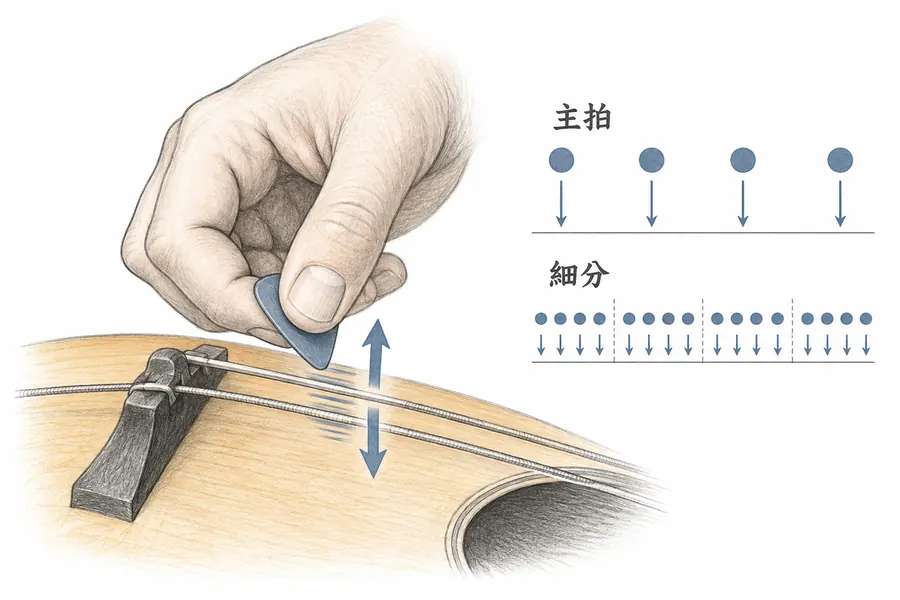

圖解 14.1　顫音的連續感（示意）

### 動態怎麼控制

動態可以由三個東西共同控制：**觸弦速度、深度、密度。**

漸強（crescendo）可以同時做三件事：

- 增加撥片的有效速度。
- 略加深觸弦。
- 提高顫音的密度。

但如果三者一起猛增，聲音會從柔和突然變硬。

更成熟的控制方式是：**先保持密度穩定，只用起音的能量做小幅變化。**
只有在很慢、需要避免顆粒感的地方，才調整密度。

---

## 14.2　單弦組顫音

單一弦組的顫音，最適合用來檢查下撥與上撥是否對稱。

先用明確的細分（subdivision，把一拍切成幾等份）：

- 八分音符
- 十六分音符
- 六連音

讓每一個起音都落在「格子」裡。

如果一加速就出現「兩下成一組」的晃動，通常代表兩件事之一：

- 某一個方向的回程比較短。
- 某一個方向只碰到弦組的其中一根弦。

> **常見誤解**
> **「顫音就是抖得越快越好。」**
> 不對。快到聽不出主拍，就變成機關槍了。顫音要服務旋律，不是取代旋律。

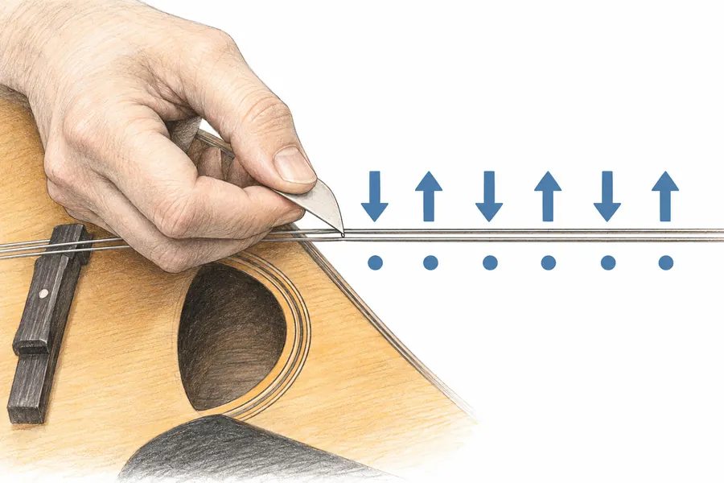

圖解 14.2　單弦組顫音（示意）

### 右手的支點要保留彈性

有人喜歡前臂靠在琴體邊緣，有人會讓小指或掌根輕觸面板。
不同琴型、不同手形，沒有唯一答案。

判斷標準有兩個：

1. 支點不能限制手腕的微幅擺動。
2. 支點不能把額外的壓力施加在薄面板上。

對圓背琴來說，琴身的支撐方式甚至會改變右手能不能找到穩定的參考點。

### 時間要慢慢加長

練習持續時間應該慢慢增加：

1. 先做到 10 秒聲音均勻。
2. 再 20 秒。
3. 再 30 秒。

這比一開始硬撐兩分鐘有效得多。

| 後半段的變化 | 可能原因 |
|---|---|
| 音量逐步變大 | 肌肉疲勞之後，用更大的力量補償 |
| 音量變小 | 握力失去穩定 |

耐力訓練的標準是「聲音均勻、動作放鬆」，然後才逐步延長時間。

**本節重點：** 單弦組顫音是檢查左右對稱的最好工具。
**練習方向：** 練習進階右手技巧。

---

## 14.3　跨弦顫音

旋律從 A 弦組轉到 E 弦組時，顫音必須**在不露出空隙的情況下**移動。

很多人會在換弦前加速，像想用更多的起音去「填補」移動的時間。
結果換弦點反而更突兀。

比較好的方法是：**把移動安排在明確的細分上。**

例如：固定在**上撥之後**換弦。穩定之後，再練習另一種方向。

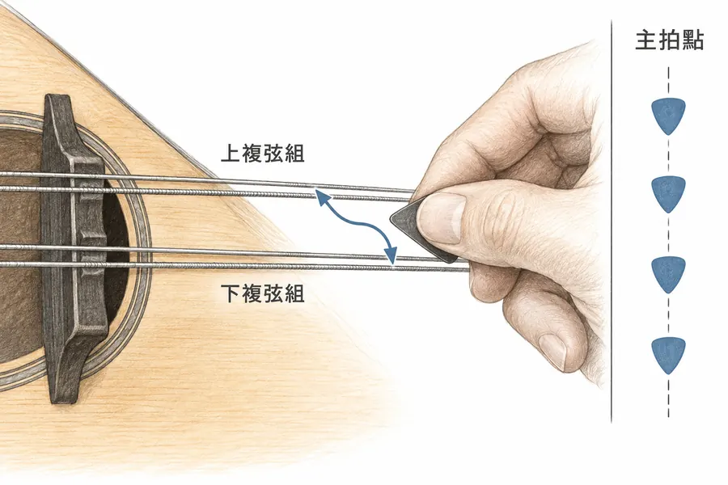

圖解 14.3　跨弦顫音（示意）

### 樂句也會影響指法選擇

| 做法 | 優點 | 風險 |
|---|---|---|
| 同一弦組用高把位完成 | 音色與顫音質感較一致 | 高把位換指可能太複雜 |
| 跨弦 | 左手較自然 | 起音的連續性可能受影響 |

所以沒有「少換弦一定更好」這種規則。
要比較的是：**起音的連續性、左手的複雜度、音色的一致程度。**

### 把左右手拆開練

實際曲目中，換弦常和換把同時發生。最有效的排練方式是拆開：

1. 右手先在空弦組上，做相同的節奏與換弦。
2. 左手單獨練換把（shift）。
3. 最後才組合。

如果把所有變因一開始就疊在一起，你很難知道斷線是誰造成的。

**本節重點：** 換弦前加速，只會讓換弦點更明顯。
**練習方向：** 練習進階右手技巧。

---

## 14.4　雙音與和弦顫音

雙音（double stop，同時按兩個音）的顫音，要同時穿過兩個弦組，右手的行程自然比單音大。

最常見的問題是：

- 低音的弦組很響，高音的弦組被吃掉。
- 或者反過來。

原因可能是撥片進入的角度、琴面的斜度，也可能是手腕路徑偏向某一側。

### 練習步驟

1. 先用**慢速下撥**反覆掃過兩個弦組。
2. 確認兩者能以相近的音量響起。
3. 再加上上撥。

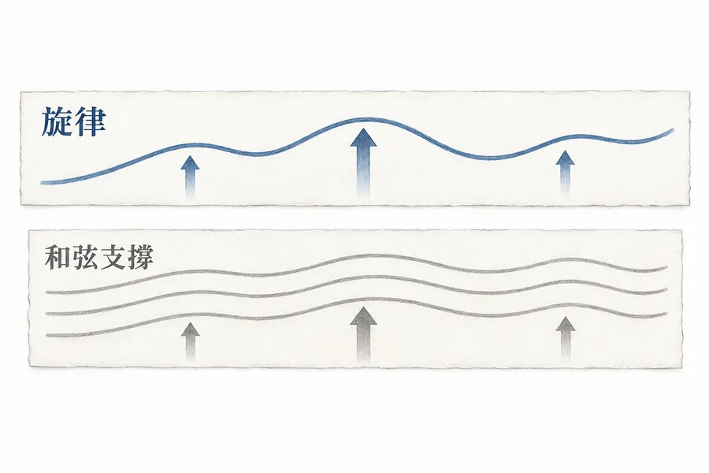

圖解 14.4　雙音與和弦顫音（示意）

### 和弦顫音的行程更大

和弦顫音通常**不適合**用單音顫音完全相同的速度。

如果強求同樣的密度，手腕很容易過度緊繃，聲音也會過飽和。

練習目標是：

- 和弦保持連續、均勻。
- 仍留得出強弱變化的空間。

古典作品中，可以利用較低的密度與較寬的動態波動，保留和聲的「呼吸」。

### 左手也會被拖下水

雙音與和弦顫音，同時也是左手壓力管理的考驗。

多個弦組同時按住時，手掌容易不自覺用力。如果右手已經很緊，兩邊會互相放大。

排練時可以故意把左手的和弦形狀保持在**最小壓力**，並確認放開（release）能在句尾瞬間完成。

**本節重點：** 兩個弦組要一樣響。
**練習方向：** 練習進階右手技巧。

---

## 14.5　交叉撥弦（Crosspicking）

交叉撥弦常用三個弦組形成循環性的句型，能創造出類似斑鳩琴滾奏（banjo roll）的織度，但保有曼陀林的起音特性。

技術上最關鍵的，是**句型與拍號的關係**。

例如：三音循環放在 4/4 拍的八分音符中，重音位置會不斷移動。
如果演奏者每三個音就固定加重，整段就會和拍子脫鉤。

### 練習時要同時數主拍

- 可以先用 **3+3+2** 的結構，對齊八個八分音符。
- 也可以讓三音句型自由跨過小節線，但主拍仍由**旋律音**或**低音（bass note）**標示出來。

交叉撥弦的音樂性，來自「哪一個音是旋律、哪一些是填充」。
旋律音與填充音應該有清楚的層次。

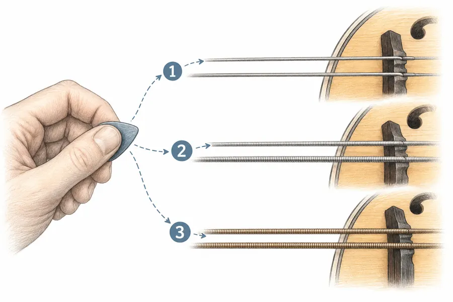

圖解 14.5　Crosspicking 交叉撥弦（示意）

### 它不是某一個固定句型的專利

這項技法在藍草音樂（bluegrass）與後來的原聲曼陀林語彙（acoustic mandolin language）中很重要。
但它不是某一個固定句型的專利。

實際演奏者會依和弦、旋律位置與撥片方向，改寫路徑。

練習應該這樣安排：

1. 從**兩個和弦**開始。
2. 先保留固定的**高音旋律**（top-note melody）。
3. 再讓內部的填充音改變。
4. 逐步理解它的編曲功能。

**本節重點：** 句型要跟拍號對得起來。
**練習方向：** 練習進階右手技巧。

---

## 14.6　琶音、掃弦與連續撥奏

### 琶音（Arpeggio）

琶音是和弦音**依序**發出。它可以用嚴格的交替撥弦，也可以讓同方向的動作連續通過多個弦組。

後者接近**掃弦（sweep）**。但「掃弦」如果被理解成「一整塊手臂掃過去」，通常會失去每個音的獨立時間。

理想情況是：**動作方向連續，但音符仍各自被清楚釋放。**

### 掃掠（Rake）

掃掠常有更明顯的姿態（gesture）：撥片像**一次動作**穿過數個悶住或按住的弦，最後落在目標音上。

它的重點在於形成通往主音的**時間張力**。

| 速度 | 結果 |
|---|---|
| 太快 | 只剩雜音 |
| 太慢 | 像普通的琶音 |

所以要依音樂的語境調整。

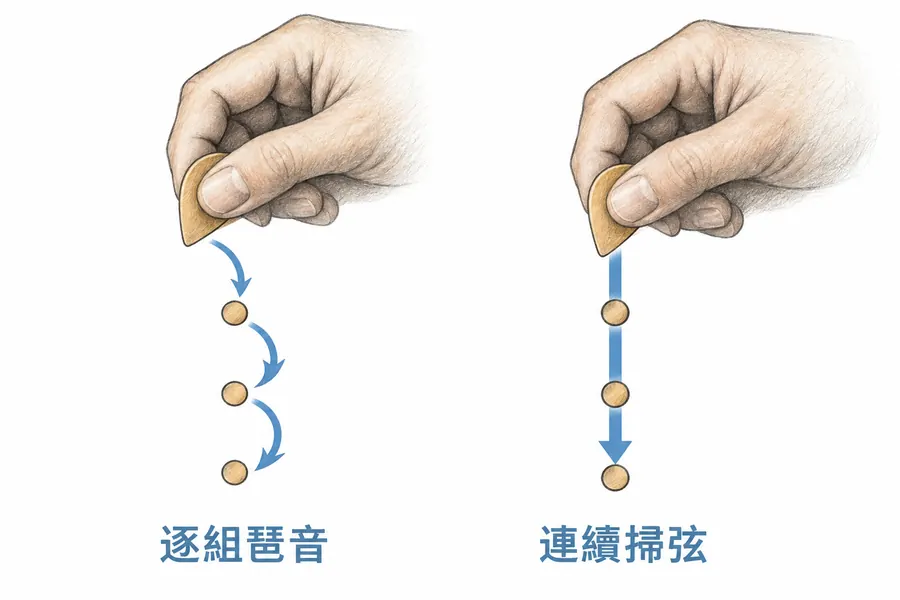

圖解 14.6　琶音 掃弦與連續撥奏（示意）

### 名稱不重要，聲音目的才重要

古典曼陀林的分解和弦、藍草的過門（fill）、爵士的伴奏（comping），都可能使用類似的物理動作。
但重音（accent）與音長（note length）不同。

把「技法名稱」和「聲音目的」綁在一起，比只背「這叫掃弦、那叫掃掠」更實用。

**本節重點：** 方向可以連續，但每個音仍要獨立。
**練習方向：** 練習進階右手技巧。

---

## 14.7　切音節奏和弦（Chop）

藍草的曼陀林切音（chop），常被比喻成**小鼓的後拍**（snare drum backbeat）。

這個比喻很有用，因為它提醒我們：切音的價值在於**時間位置**與**極短的衰減（decay）**，不只是和弦本身。

### 歷史背景

Bill Monroe（比爾・門羅）建立了藍草的合奏語法。

他讓曼陀林同時具備兩種角色：**主奏樂器（lead instrument）**與**節奏填補**。

1945 年 Earl Scruggs（厄爾・斯克魯格斯）加入 Blue Grass Boys 之後，形成了經典的五件編制。

這個編制讓各樂器之間的節奏空間變得清楚。〔S1403〕

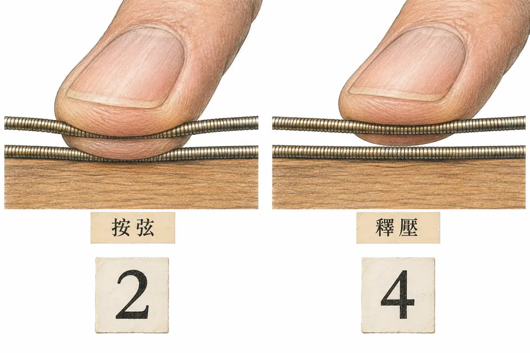

圖解 14.7　Chop 節奏和弦（示意）

### 技術核心是「放開」

切音常用**閉合指型**（closed voicing，全部由按住的音組成、不靠空弦）。

做法是：右手下撥之後，**左手立即釋放壓力**，讓和弦只留下短促的起音。

> **常見誤解**
> **「切音要敲得很大力。」**
> 不對。切音的短，是靠左手放開，不是靠右手蠻力。

> **這個「放開」比「敲下去」更重要。**

如果只增加右手的力量，而左手不消音，你會得到一個大聲、延音很長的和弦。
那個和弦會反過來把吉他與低音的空間蓋掉。

### 練習步驟

1. 先跟節拍器，**只打第 2、4 拍**。
2. 確認每一下的長度完全相同。
3. 再加入 I–IV–V 和弦。
4. 接著**跟錄音一起練**。

第 4 步很重要：真正的後拍，必須相對於低音、吉他、斑鳩琴的律動（groove）才有意義。

在房間裡單獨聽起來很響的切音，不代表放進樂團就合適。

**本節重點：** 左手放開，右手才有「短」。
**練習方向：** 練習進階右手技巧。

---

## 14.8　虛撥與悶音節奏

右手可以在**不讓弦完整發音**的情況下，維持細分。

這些悶音撥弦（muted strokes）常用來：

- 保持律動。
- 填補切分（syncopation，把重音放在非正拍的位置）。
- 準備下一個重音。

它們的價值在於「**時間存在、音高退到背景**」，所以不應該演奏得和正常音符一樣響。

### 兩種做法

| 做法 | 操作 |
|---|---|
| 左手輕觸弦 | 製造死音（dead note） |
| 右手降低入弦深度 | 讓弦不完整發音 |

重要的是：不要讓悶音撥弦變成緊張的來源。

如果為了消音而把左手完全僵住，後面的正常音符就會來不及恢復。

練習時，把兩小節的句型分成「有聲（voiced）」與「悶音（muted）」兩層，再逐步改變比例。

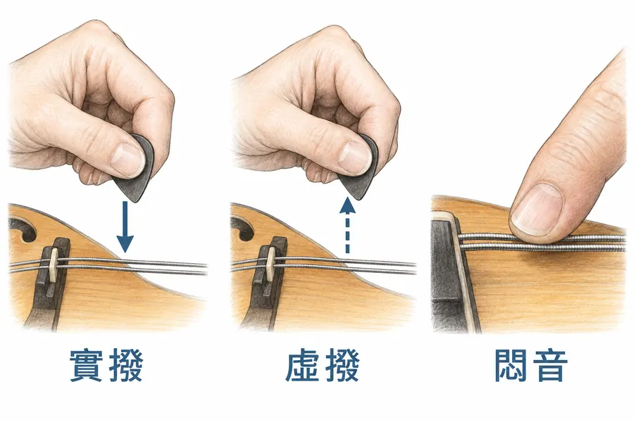

圖解 14.8　虛撥與悶音節奏（示意）

### 譜上怎麼標

譜面的標記在不同風格中沒有唯一標準。常見的有：

- x 符頭（x notehead）
- 括號
- 文字註記

編曲者應該在總譜的圖例（legend）中說明。

尤其在曼陀林樂團中，「x」也可能被解讀成特殊的敲擊或其他效果，所以更需要寫清楚。

**本節重點：** 悶音也要有清楚的時間，只是音高退到背景。
**練習方向：** 練習進階右手技巧。

---

## 14.9　速度訓練

### 先定義「可用速度」

如果一段樂句在 160 BPM 十次只能成功兩次，那麼 160 不是你的可用速度。

更實際的定義是：**在合理放鬆的情況下，連續數次保持節奏、音色與左右手同步。**

這種定義會讓練習從「挑戰極限」，變成「擴大可控區」。

### 兩種有效的方法

| 方法 | 做法 | 好處 |
|---|---|---|
| 爆發練習（burst practice） | 用目標速度只演奏 4–8 個音，然後休息，逐步延長 | 讓神經系統感受高速動作，又避免太早進入疲勞補償 |
| 節奏變化（rhythm variation） | 把四個十六分音符改成長短長短、短長短長 | 暴露不同手指轉換的弱點 |

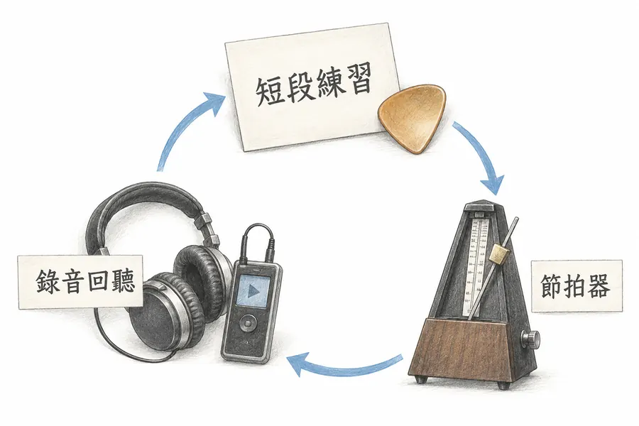

圖解 14.9　速度訓練（示意）

### 慢練也有價值

如果在極慢的速度下，仍然有這些問題：

- 撥片路徑過大
- 左手提前抬起
- 重音錯位

那麼這些問題到高速只會被放大。

慢練的重點是**保留相同的路徑**，用更大的注意力觀察細節。不是把動作變小、變隨便。

**本節重點：** 可用速度＝能連續重複成功。
**練習方向：** 練習進階右手技巧。

---

## 14.10　案例：顫音的均勻與表情

假設一位演奏者每拍能做八下，速度已經很高，但錄音裡仍聽得到明顯的「達達達」顆粒感。

### 三個檢查步驟

1. **檢查音量差**：下撥是不是比上撥大很多？
2. **檢查入弦深度**：每一下是不是都像單音強奏一樣深入？
3. **檢查句法**：是不是每四下機械性地重一次，逼著聽者聽到細分？

### 修正順序

1. 先把顫音**降速**到能明確聽見每一下。
2. 用**最小的起音**建立對稱。
3. 之後在相同密度下，做長的漸強與漸弱（crescendo／diminuendo）。
4. 當動態可以平滑改變，代表手已經不是靠固定的用力模式在維持速度。
5. 最後回到樂句，依樂句的方向安排重音。

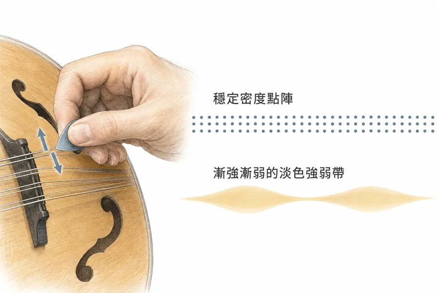

圖解 14.10　案例 顫音的均勻與表情（示意）

這個案例顯示：顫音的高級階段，是你能讓聽者**忘記**右手正在反覆上下撥，只留下旋律的呼吸。

---

## 表 14-1｜進階右手技法：聲音目的與主要失敗類型

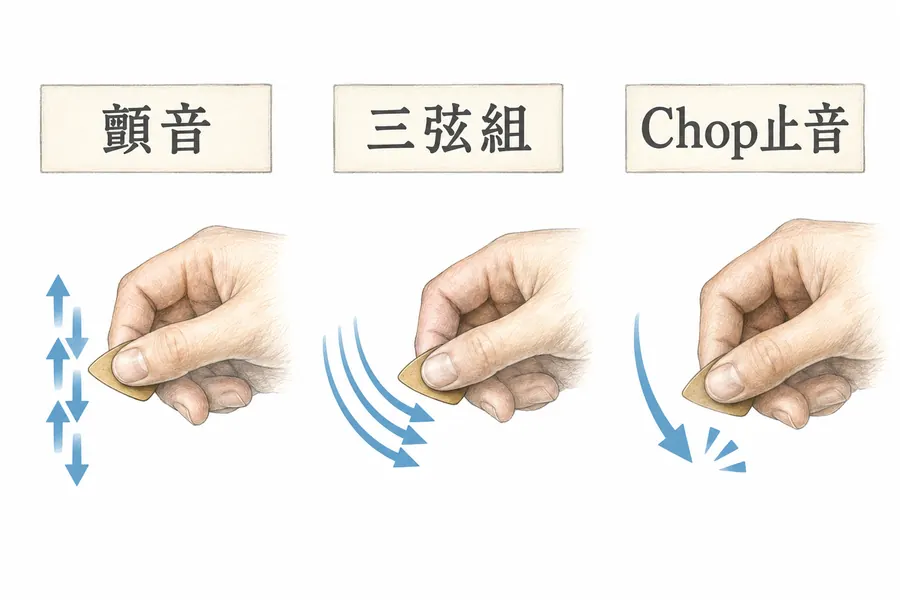

| **技法** | **主要聲音目的** | **核心控制** | **常見失敗** |
|:---|:---|:---|:---|
| **Tremolo**（顫音） | 延伸長音、歌唱性 | 下上撥對稱、密度、樂句 | 只追速度、機械重音 |
| **Crosspicking**（交叉撥弦） | 多弦循環與內嵌旋律 | 跨弦路徑、主拍、聲部平衡 | 每三音固定重音 |
| **Arpeggio／Sweep**（琶音／掃弦） | 分解和弦 | 音符獨立時間與連續動作 | 變成一團掃弦 |
| **Rake**（掃掠） | 導向目標音的姿態 | 時間寬度、最後主音 | 過快成雜音 |
| **Chop**（切音） | 2、4 拍後拍、短衰減 | 左手放開＋右手起音 | 只用力敲、延音過長 |

圖解 右手技法的動作概念；弦組依樂句安排（示意）

### 用法

這張表可以當成「症狀 → 原因」的對照表。

當某一招聽起來不對，先問：**它原本要達成什麼聲音目的？** 然後看「常見失敗」那一欄，找出你最接近的那一格。

---

## 自我學習題庫

學習檢查：作答、核對、複習

先自己作答，再看答案。答錯時回到本章相關小節重新讀一次。

**1. Tremolo 的高階目標是？**

- A. 越快越好

- B. 讓重複撥弦服務旋律與長線條

- C. 只使用下撥

- D. 固定同一音量

**2. Crosspicking 的重點包含？**

- A. 跨弦路徑與重音設計

- B. 只用左手

- C. 取消節拍

- D. 只在一根弦上彈

**3. 速度卡住時，最有效的方法常是？**

- A. 找出限制的轉換片段

- B. 整首一直重彈

- C. 把動作做更大

- D. 一直換琴

**答案：1.B　2.A　3.A**

---

## 本章主要查證來源

查證來源：找原文、核條件、留紀錄

**【S1401】Raffaele Calace：Metodo per mandolino, Opp.37–42。** Tremolo、右手控制與古典技法歷史來源。

> https://imslp.org/wiki/Metodo_per_mandolino\_(Calace%2C_Raffaele)

**【S1402】Carlo Munier：Metodo completo per la divisione。** 分奏、顫音與高階右手方法。

> https://imslp.org/wiki/Metodo_completo_per_la_divisione\_(Munier%2C_Carlo)

**【S1403】Bluegrass Music Hall of Fame & Museum：Bill Monroe biography。** Monroe、Blue Grass Boys 與 1945 年經典 bluegrass 五件編制歷史。

> https://www.bluegrasshall.org/inductees/bill-monroe/
