*Advanced Left-Hand Technique*
（進階左手技法）

## 本章重點

- 有琴格不代表「按對格子就好」。真正的音樂由**壓力、按弦位置、音符開始與結束的時間、換把路徑、左右手同步**決定。
- 按弦需要的力量，通常比你想的少得多。
- 換把的重點不是起點與終點，而是**到達的時間**。
- 揉弦（vibrato）在曼陀林上的效果比小提琴克制，不該當成「所有長音的預設裝飾」。
- 泛音只需要「輕觸節點」，不是把弦壓下去。

---

曼陀林有琴格，常讓人誤以為左手只要「按對格子」就結束了。

事實上，琴格只是把音高位置**離散化**（變成一個個格子）。真正的音樂仍由這些東西決定：

- 壓力
- 按弦位置
- 音符開始與結束的時間
- 換把路徑
- 左右手同步

十九世紀的教本，已經把把位、延伸、裝飾音與雙音放進完整的訓練系統。
這顯示曼陀林的左手，從很早就超越了「第一把位的簡單按弦」。〔S1501〕〔S1502〕

本章的核心原則只有一句：

> **越少多餘的力量，越能留下速度與表情的空間。**

所有技巧都應該建立在同一組基礎上。這些技巧包括：

- 擊弦（hammer-on）
- 勾弦（pull-off）
- 滑音（slide）
- 顫音裝飾（trill）
- 揉弦（vibrato）
- 雙音（double stop）
- 泛音（harmonics）

而那組基礎只有三句話：

- 手腕可以呼吸。
- 拇指不鎖死。
- 手指能迅速釋放。

---

## 15.1　按弦位置、壓力與時機

### 位置：靠近琴格，但不要壓在琴格上

按弦時，指尖通常落在**目標琴格後方、靠近琴格**的位置。

| 位置 | 結果 |
|---|---|
| 靠近琴格 | 用較小的力量就能讓弦穩定接觸 |
| 距離琴格太遠 | 弦在兩個琴格之間可振動的段落較長，更容易打弦（buzz） |

對雙弦的弦組（course）而言，**兩根弦都必須同時被壓實**。
因此手指的角度也要調整，避免只壓到其中一根。

### 時機：壓力「什麼時候來」和「多大」一樣重要

如果手指在右手撥擊**之前很久**就用力按住，速度快時會累積不必要的緊張。
太晚，則會出現空弦音或雜音。

練習步驟：

1. 用極慢的八分音符。
2. 在每次撥弦**前一瞬間**完成按弦。
3. 音符結束時，立刻釋放到「仍然接觸、但不再壓弦」的程度。

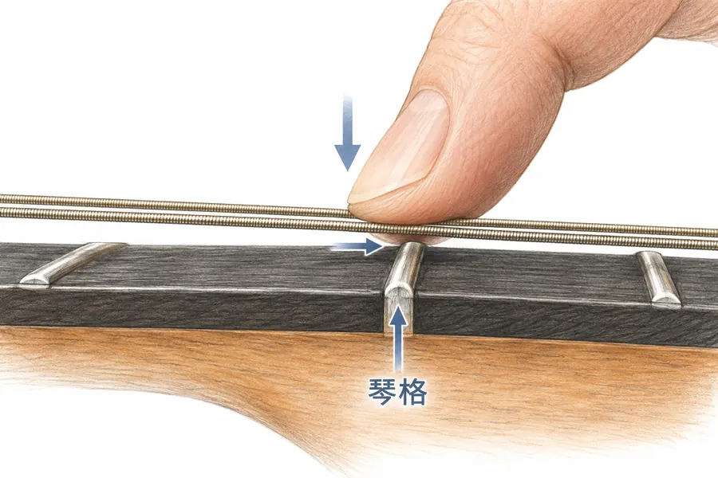

圖解 15.1　按弦位置 壓力與時機（示意）

### 不同琴，手感不同

以下因素會讓「需要多少壓力」改變：

- 弦高（action）較高
- 弦較粗
- 琴格較低

所以某位老師在自己琴上的「輕輕按」，不一定等於你琴上的實際力量。

技術判斷要和第 11 章的設定（setup）診斷連起來看。

**本節重點：** 靠近琴格、時機準確，就能用最小的力氣。
**練習方向：** 安排左手指法與換把。

---

## 15.2　手指分配與樂句準備

### 一指一格：只是起點

初學者常用「一指一格」的概念：

| 手指 | 負責的琴格 |
|---|---|
| 食指 | 第 1 格 |
| 中指 | 第 2 格 |
| 無名指 | 第 3 格 |
| 小指 | 第 4 格 |

對標準音階來說，這是很好的起點。
但真正的曲目會因為半音、把位、和弦與音色需求，改變手指的分配（finger assignment）。

專業指法的核心是：**整句能不能保持連續，並避免不必要的大跳。**

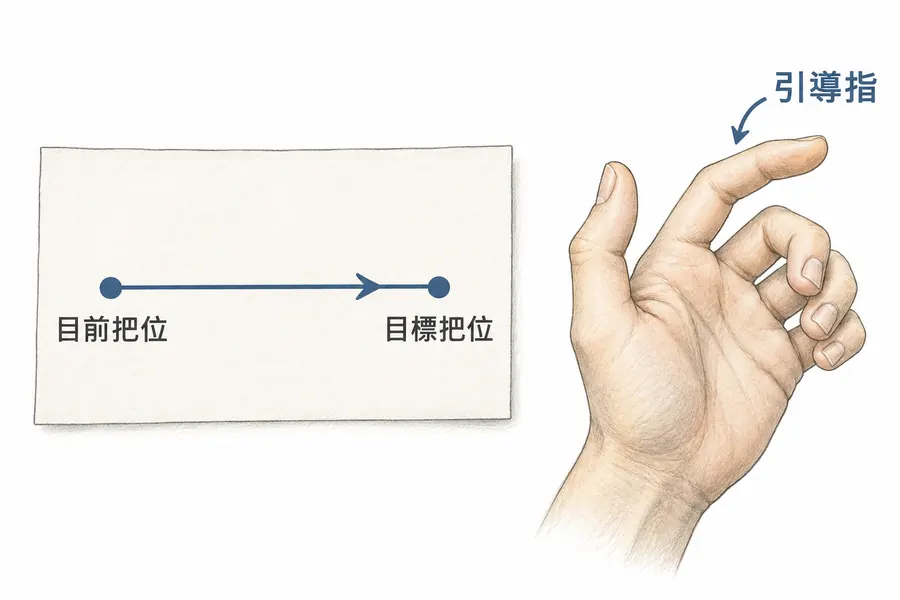

圖解 15.2　手指分配與樂句準備（示意）

### 保留手指（finger retention）

這是個重要概念：如果某個音稍後還會用到，而保留它不會造成緊張，就可以暫時不抬起。

好處是：

- 有助於雙音。
- 有助於琶音。
- 有助於連續音階。

但相反地，**所有手指一直貼著指板，也會限制速度**。

真正需要的能力是判斷：哪些音值得保留、哪些要提前放鬆。

### 從句尾往前推

最好的指法，往往是從**句尾往前推**出來的。

先找下一個高點、和弦或換弦的需求，再決定前面哪裡換把。
這比從第一個音一路「順手按」可靠得多。

**本節重點：** 指法服務整句，不是服務單一音符。
**練習方向：** 安排左手指法與換把。

---

## 15.3　換把

換把（shift）的核心是**到達時間**。

很多人只注意起點與終點，忽略了「中間的移動其實也有節奏」。

假設一段旋律要從第 3 格跳到第 10 格，左手有兩種做法：

1. 前一個音結束後**立即移動**。
2. 利用滑音形成表情。

不同做法會直接影響樂句的呼吸（phrasing）。

### 導引指（guide finger）

導引指可以減少「空間上的不確定感」。做法是：

1. 某根手指釋放按弦壓力。
2. 但仍**輕觸著弦**。
3. 沿著弦滑到新位置。
4. 再重新壓下。

這是在建立**路徑感**。

高速換把時，導引指可能只保留極輕的接觸，甚至完全離弦。
但身體仍應該知道「要沿哪一條線移動」。

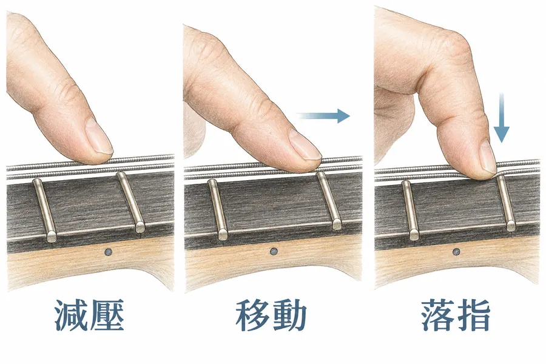

圖解 15.3　換把（示意）

### 把移動排進拍點裡

練習時可以固定節拍器，把「移動本身」安排在特定的細分上：

1. 四分音符的長音持續到第 3 拍結束。
2. 在第 4 拍完成換把。
3. 第 1 拍落在新音上。

穩定之後，再縮短移動的時間。

這比「無節奏地來回滑十次」更容易建立可重複的動作。

---

## 15.4　手指伸展

標準曼陀林的弦長（scale）較短，第一把位常常用四根手指就能涵蓋多個音。

但某些調性與半音階段落（chromatic passage），需要向前或向後的**延伸**（extension）。

伸展的原則是：**以單一手指的局部移動為主，手掌維持自然形狀。**
通常是讓某一根手指超出目前的位置，其他手指仍維持參考。

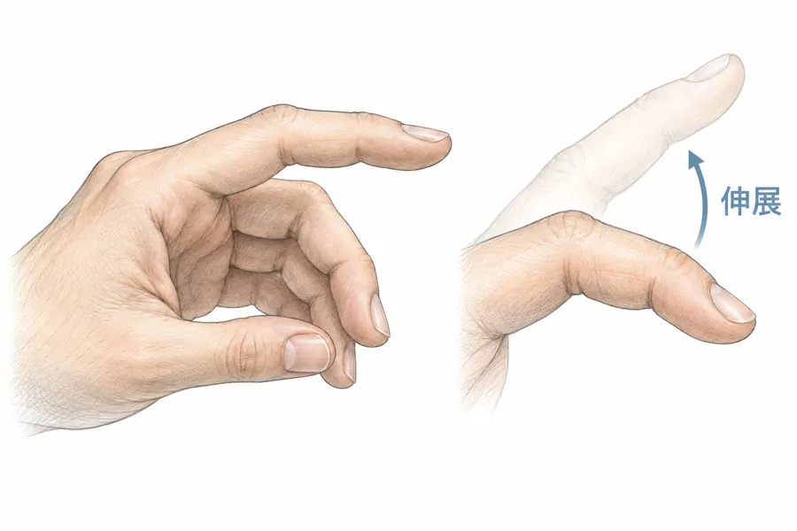

圖解 15.4　手指伸展（示意）

### 手小的人可以更早換把

手小的演奏者可以**更早換把**，用換把來維持自然的手形。

這也是為什麼「標準指法」只能當起點。
如果換把不會破壞連奏（legato），用移動換取較自然的手形，往往更健康。

### 大琴的伸展成本高得多

家族裡體型較大的樂器，弦長明顯更長，伸展的成本也明顯增加。

這些樂器包括：

- 曼陀拉（mandola）
- 八度曼陀林（octave mandolin）
- 曼陀林琴（mandocello）

把標準曼陀林的一指一格與大跨度**直接搬過去**，可能造成過度伸展。

編排指法時，應該重新考慮把位，依新樂器的弦長來安排手指。

**本節重點：** 伸展是局部動作，不是整個手掌拉開。
**練習方向：** 安排左手指法與換把。

---

## 15.5　擊弦與勾弦

### 擊弦（Hammer-on）

做法是：左手手指**快速落下**，讓琴弦獲得新的振動節點，同時保持足夠的能量。

聲音太弱時，常見原因有三個：

- 落點離琴格太遠。
- 手指的行程太大。
- 前一個音本來就缺乏能量。

有效的擊弦，靠的是**快速、短距離**的手指動作，不是大力。

### 勾弦（Pull-off）

勾弦**不是**把手指垂直抬起。

如果只向上離開，音量可能不足。
通常需要帶一點**橫向的釋放**，像輕輕撥動琴弦。

但動作太大，會讓音高彎掉，或碰到其他弦組。
在雙弦的弦組上，還要確定兩根弦都被一致地釋放。

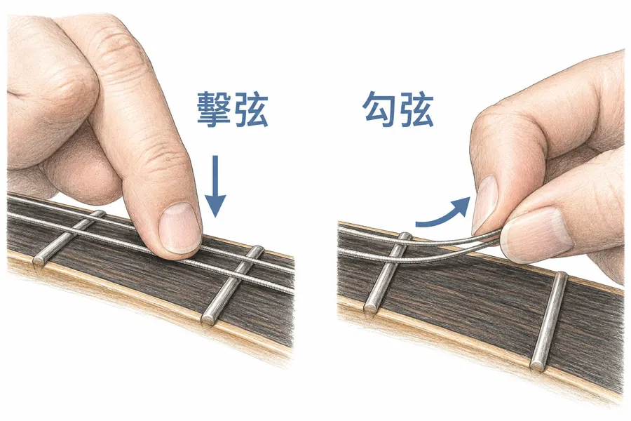

圖解 15.5　擊弦與勾弦（示意）

> **常見誤解**
> **「擊弦要用力搥下去。」**
> 不對。真正需要的是速度與短距離。用力只會讓手指變慢、變緊。

### 要放進節拍裡

練習時要把擊弦／勾弦放在節拍裡。

例如：四個十六分音符中，只有**第一個音**用右手起音，其餘三個用左手完成。

如果節拍開始拖，表示左手的裝飾技法還沒有真正成為「節奏語言」。

**本節重點：** 左手發的音，也要有節奏。
**練習方向：** 安排左手指法與換把。

---

## 15.6　滑音與滑奏

滑音（slide）有兩種完全不同的用途：

| 用途 | 要求 |
|---|---|
| 只是為了換把 | 應盡量安靜 |
| 故意讓中間的音高被聽見 | 這是表情手段 |

如果兩者不區分，演奏者可能在**所有**換把時都留下滑音。
久而久之，這會變成一個不必要的風格標記。

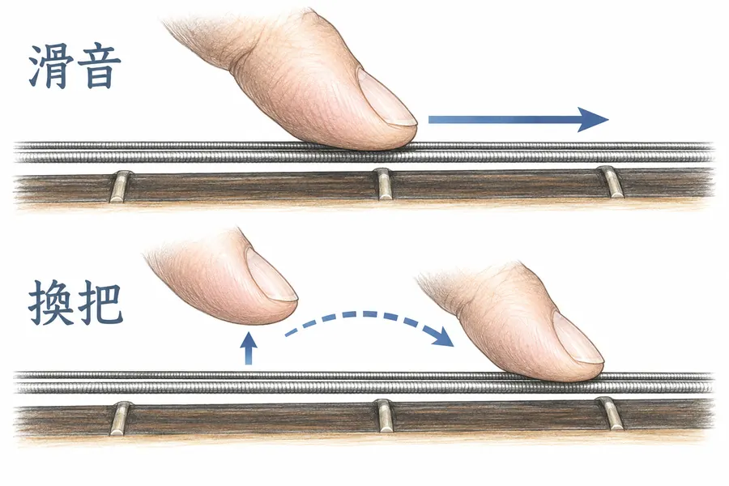

圖解 15.6　滑音與滑奏（示意）

### 滑奏（glissando）在有格樂器上

有格樂器（fretted instrument）的滑奏，是手指跨過一連串琴格，聽到的是**階梯式**的變化。

會改變效果的因素有：

- 速度
- 壓力
- 右手是否重新發音

古典曲目中的 portamento（滑音唱法）、民謠的 slide、藍調風格的 slide，可能使用類似的物理動作。

但這三者的語法不同。

### 雙音滑音更難

雙音滑音要特別注意**兩根手指的壓力與距離是否同步**。

如果其中一根手指先到，新的和聲會短暫錯位。

慢速錄音是最好的檢查工具。

**本節重點：** 先決定「這次滑音要不要被聽見」。
**練習方向：** 安排左手指法與換把。

---

## 15.7　顫音裝飾與倚音

### 顫音裝飾（Trill）

顫音裝飾是主音與鄰音快速交替。

最容易出現的問題是：起音之後越彈越快，最後無法準時落回主音。

練習時應該**先限定次數**：

1. 一拍內 4 次。
2. 一拍內 6 次。
3. 一拍內 8 次。

之後再逐步增加自由度。

這能讓顫音裝飾保有拍點，讓裝飾音與主拍保持一致。

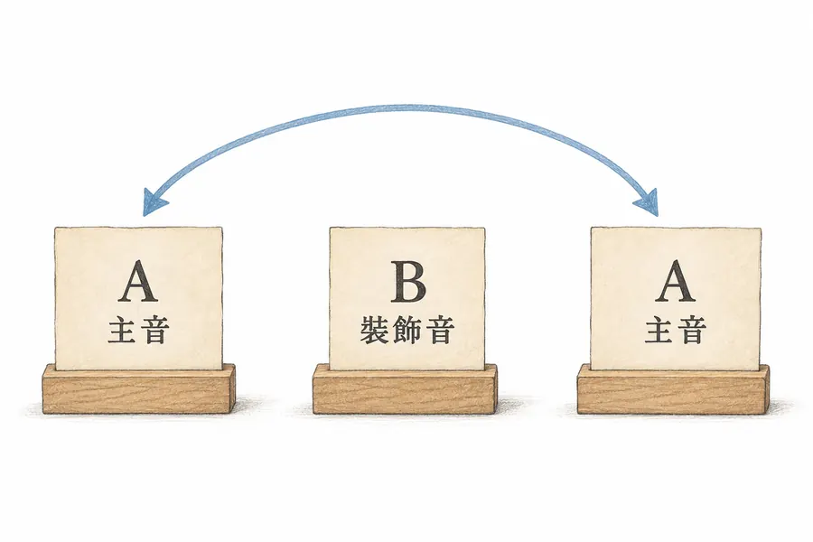

圖解 15.7　顫音裝飾與倚音（示意）

### 倚音（Grace note）

倚音的長度與落拍位置，依風格而異。

| 風格 | 慣例 |
|---|---|
| 古典裝飾音 | 有自己的時間規則 |
| 愛爾蘭的 cut／裝飾 | 又有另一套 |
| 藍草的滑進（slide-in） | 也不同 |

讀譜時要同時看三件事：**年代、作曲家、版本編輯慣例。**

歷史方法提供的，是**某一個時代**的技術證據。
適用範圍應該和曲目年代、風格一起確認。

學習者可以把 Calace、Munier 的裝飾法，視為古典傳統的重要座標。

然後再與實際曲目、實際錄音比較。〔S1501〕〔S1502〕

**本節重點：** 裝飾音也要有拍點。
**練習方向：** 安排左手指法與換把。

---

## 15.8　揉弦

### 曼陀林的揉弦，和小提琴不一樣

在小提琴上，手指沿弦長方向搖動，可以**連續改變**有效弦長。

但在有琴格的曼陀林上，琴格固定了發音的終點。
所以同樣的動作，不會產生同樣幅度的音高變化（pitch modulation）。

曼陀林的揉弦（vibrato）通常依靠：

- 沿弦方向的微小摩擦
- 壓力變化
- 輕微的橫向推弦（lateral bending）

效果比無格弦樂器**克制**得多。

> **常見誤解**
> **「揉弦就是學小提琴那樣大力搖。」**
> 在曼陀林上做不到，也不該硬做。這裡的揉弦是「細微的音色與音高變化」。

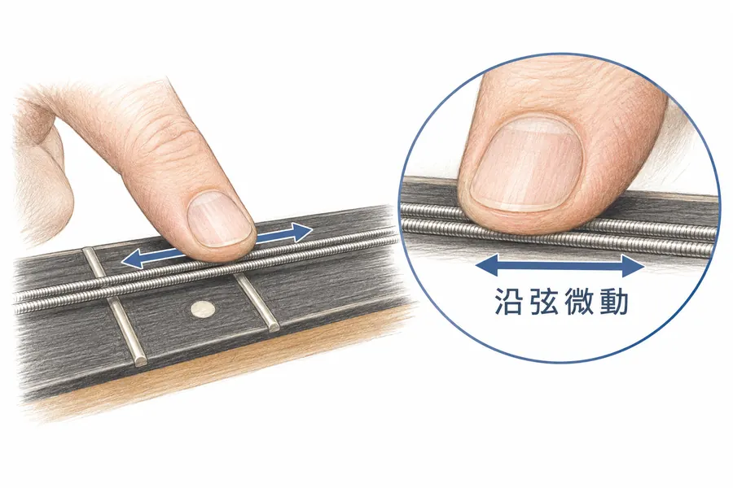

圖解 15.8　揉弦（示意）

### 不是每個長音都需要

因為效果克制，揉弦不適合當成「讓所有長音更美」的預設。

| 場合 | 適合度 |
|---|---|
| 某些古典的歌唱性段落、慢歌 | 可以使用 |
| 快速的民謠旋律 | 過度使用不合適 |
| 藍草的獨奏段（break） | 過度使用不合適 |
| 歷史風格演奏 | 過度使用不合適 |

**先決定音樂需不需要，再決定動作。**

### 用錄音檢查

練習時可錄長音，比較三種版本：

1. 完全沒有揉弦。
2. 慢的揉弦。
3. 快的揉弦。

| 聽到的結果 | 判斷 |
|---|---|
| 音高像吉他推弦（bend）一樣上下大幅擺動 | 幅度可能過大 |
| 完全聽不出差異 | 可能只是手在晃，沒有真正影響到弦 |

**本節重點：** 曼陀林的揉弦是「細微」，不是「大幅」。
**練習方向：** 安排左手指法與換把。

---

## 15.9　雙音

雙音（double stop）是和聲在指板上的基本組合。

| 音程 | 作用 |
|---|---|
| 三度 | 能直接顯示大調（major）或小調（minor） |
| 六度 | 常帶來較開闊的聲響 |
| 八度 | 可以加厚旋律，但不改變和聲功能 |

學習雙音最好的方法，是**沿著音階 harmonize**（把音階的每個音都加上另一個音）。

這樣做能把「音程關係」與「指型」連在一起。

### 為什麼要理解，而不是只背形狀

以 G 大調音階為例，每個音上方加三度，會得到：

| 下方音 | 上方三度 | 三度種類 |
|---|---|---|
| G | B | 大三度 |
| A | C | 小三度 |
| B | D | 小三度 |

大／小三度會**依調內音自動變化**。

理解這個規律之後，移到 D 調、A 調或其他調，就能重新推導。
只背形狀，容易在跨調時失去方向。

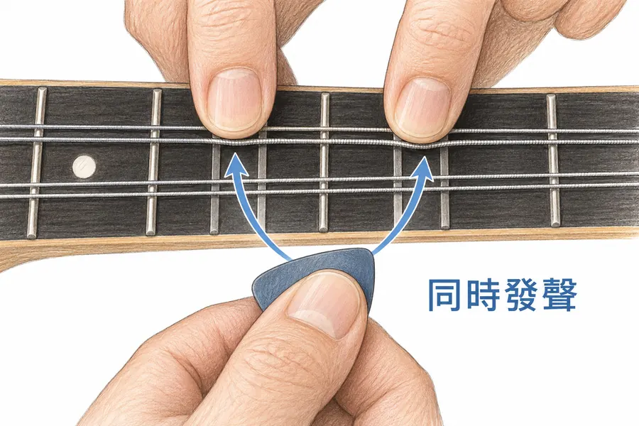

圖解 15.9　雙音（示意）

### 右手也會影響雙音

兩個弦組必須**一起**被撥到。
而左手要讓四根實體弦都乾淨發音。

如果有一根弦打弦（buzz），聲音會產生奇怪的拍頻（beating），常被誤以為是調音（tuning）問題。

**本節重點：** 沿音階練習，比背形狀可靠。
**練習方向：** 安排左手指法與換把。

---

## 15.10　泛音

### 自然泛音（Natural harmonics）

自然泛音在弦的**整數分割點**形成。

| 位置 | 弦長比例 | 產生的音高 |
|---|---|---|
| 第 12 格附近 | 1/2 | 高一個八度 |
| 第 7 格附近 | 1/3 | 高十二度 |
| 第 5 格附近 | 1/4 | 高兩個八度 |

演奏時，手指**只輕觸節點，不把弦壓到琴格**。

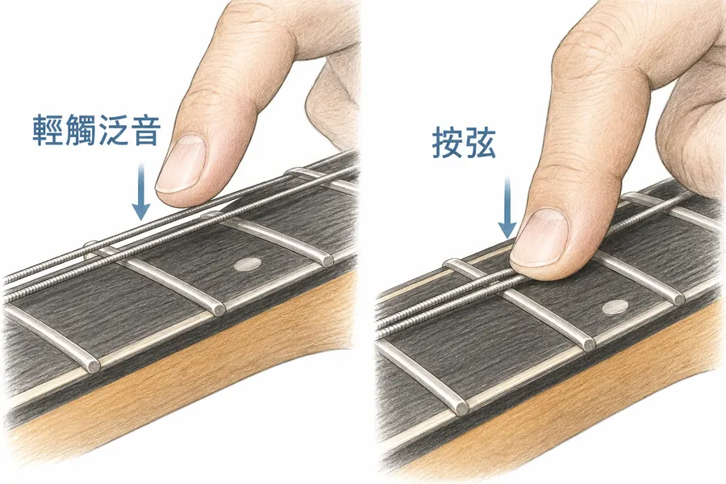

圖解 15.10　泛音（示意）

> **常見誤解**
> **「泛音要把弦按緊。」**
> 剛好相反。按緊就變成普通的音，不是泛音了。

### 雙弦的泛音更難

雙弦弦組的泛音，要求**兩根弦都在節點附近被輕觸**。
所以手指的接觸面與角度必須一致。

### 順便檢查琴橋位置

自然泛音也可以用來快速檢查琴橋的位置。

第 12 格的泛音與按第 12 格實音的差異，是第 11 章音準（intonation）診斷的重要基準之一。

### 人工泛音（Artificial harmonics）

人工泛音需要**一手按實音、另一手建立新的節點並發音**。
對曼陀林而言，協調難度比較高。

它是一種色彩性的技法。
在基礎的自然泛音與音準概念還沒穩定之前，不應該急著追求。

**本節重點：** 輕觸，不壓下。
**練習方向：** 安排左手指法與換把。

---

## 15.11　左右手同步

高速演奏最常見的問題是：

- 右手已經撥下一個音，左手還沒到。
- 或左手太早抬起，出現短暫的空弦音（open string）。

這種同步誤差，在曼陀林清楚的起音下特別容易被聽見。

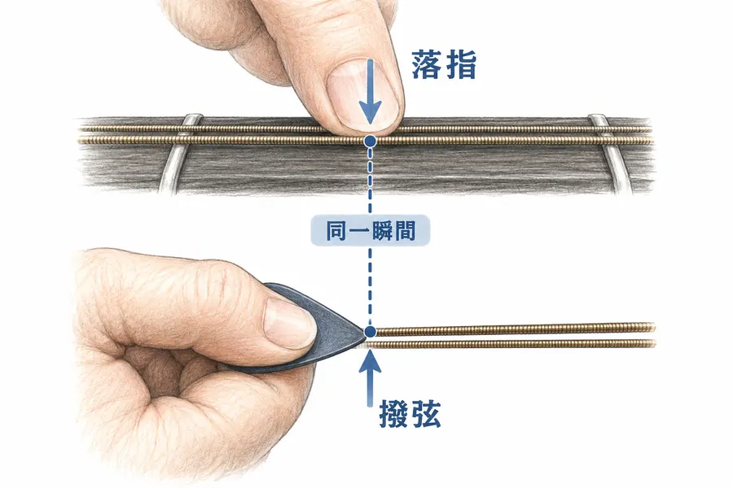

圖解 15.11　左右手同步（示意）

### 解法：把「轉換」放大

1. 例如兩個音 E–F# 反覆，只練「右手撥弦」與「左手落指」的**同一瞬間**。
2. 接著練 F# 結束、下一個音開始的**釋放**。

音符結束的時間，決定了連奏、斷奏（staccato）與樂句的清晰度。

### 用慢速播放錄音

錄音時可以降低速度播放，聽聽看有沒有出現：

- 細小的「空隙」。
- 不該有的空弦雜音（open-string blip）。

這些在現場演奏時，通常很難靠手感察覺。

**本節重點：** 同步問題要「放大」才看得見。
**練習方向：** 安排左手指法與換把。

---

## 15.12　案例：高把位旋律的指法

假設一段旋律要從第一把位一路升到 E6。有兩種做法：

| 做法 | 做法說明 | 優點 | 缺點 |
|---|---|---|---|
| A | 最後才一次跳到高把位 | 移動次數少 | 把**最大**的換把放在最緊張的快速節點 |
| B | 在前一個長音時提前換把 | 利用音樂空間分散難度 | 移動次數多 |

A 看起來「少移動」，其實是把風險集中在最糟的地方。
B 看起來「多移動」，其實是把風險分散到安全的位置。

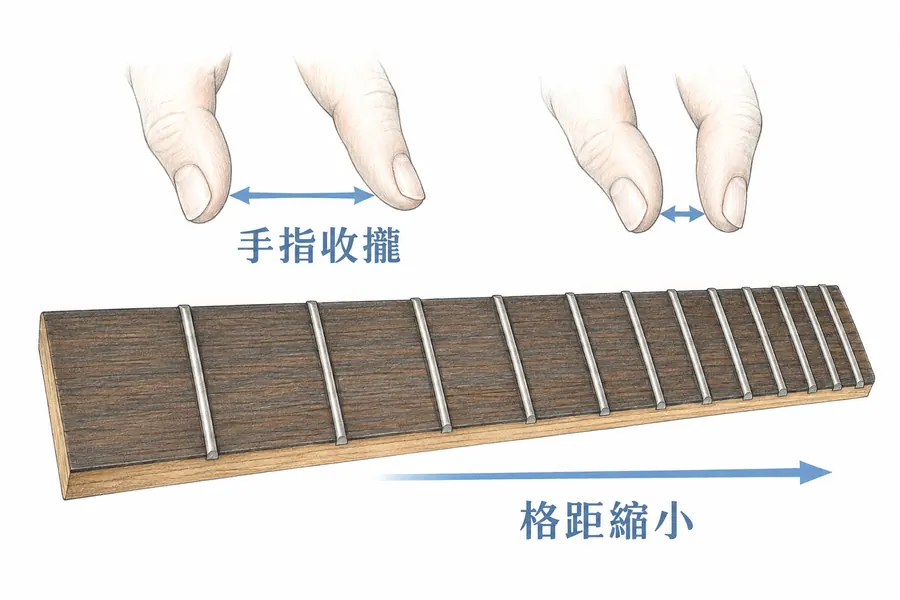

圖解 15.12　案例 高把位旋律的指法（示意）

### 比較指法要看三件事

1. 距離。
2. 準備時間。
3. 落點。

真正要比較的是：**每一次換把有多少準備時間？能不能用導引指？換把之後哪一根手指要立刻工作？**

專業的指法常看起來比較複雜。實際上是把風險放到更安全的位置。

### 練習方法

為同一段做兩套指法，用**相同的 BPM** 錄下來，比較：

- 成功率
- 音色
- 樂句的連續性

依這三項選擇指法，並把譜上的指法當作**參考**，而不是規定。

---

## 表 15-1｜左手技法與最重要的檢查點

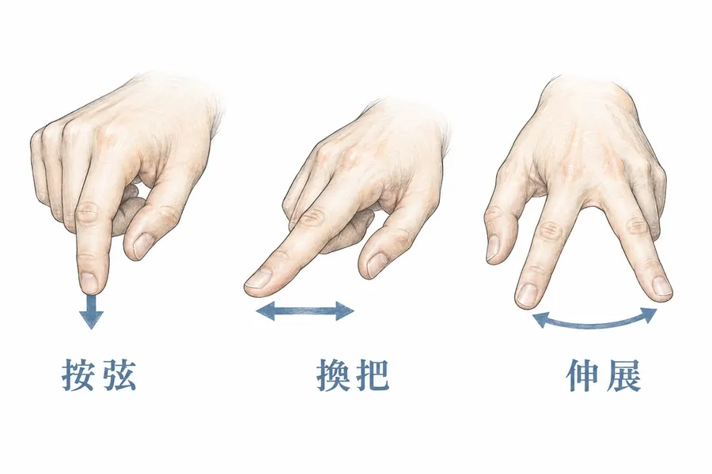

| **技法** | **真正要控制** | **最常見誤區** | **練習焦點** |
|:---|:---|:---|:---|
| **按弦** | 最低必要壓力與琴格後位置 | 「越用力越乾淨」 | 逐步減壓至打弦再加回 |
| **Shift**（換把） | 到達時間與路徑 | 只看起點與終點 | 把移動安排進拍點 |
| **Hammer／Pull**（擊弦／勾弦） | 左手發音仍有節奏 | 只追音量 | 固定細分 |
| **Vibrato**（揉弦） | 細微的音高／色彩變化 | 照搬小提琴的大幅搖動 | 錄音比較幅度 |
| **Double stop**（雙音） | 兩聲部的音程與四根弦的發音 | 只背形狀 | 沿音階 harmonize |

圖解 表 15-1｜左手技法與最重要的檢查點（示意）

---

## 自我學習題庫

學習檢查：作答、核對、複習

先自己作答，再看答案。答錯時回到本章相關小節重新讀一次。

**1. 換把時 guide finger 的作用之一是？**

- A. 提供移動路徑感

- B. 增加琴弦張力

- C. 降低琴橋

- D. 改變調性

**2. Hammer-on 聲音太弱時，應先檢查？**

- A. 落點與動作效率

- B. 琴盒材質

- C. 品牌年份

- D. 背帶長度

**3. 高速同步問題常發生在？**

- A. 左右手發音時間沒有對齊

- B. 木材顏色不同

- C. 琴盒太大

- D. 音孔太圓

**答案：1.A　2.A　3.A**

---

## 本章主要查證來源

查證來源：找原文、核條件、留紀錄

**【S1501】Raffaele Calace：Metodo per mandolino, Opp.37–42。** 換把、裝飾、雙音與左手技法歷史方法。

> https://imslp.org/wiki/Metodo_per_mandolino\_(Calace%2C_Raffaele)

**【S1502】Carlo Munier：Scuola del Mandolino / Metodo completo per la divisione。** 位置、裝飾與技巧訓練歷史來源。

> https://imslp.org/wiki/Metodo_completo_per_la_divisione\_(Munier%2C_Carlo)

---
