*Harmony, Chords and Accompaniment on the Mandolin*
（曼陀林的和聲、和弦與伴奏）

## 本章重點

- 曼陀林只有四組弦，所以一個和弦**最多只能同時放下四個音**。這逼迫你思考「哪些音一定要留」。
- 同一個和弦名稱，可以有很多種排法（voicing），聽起來不一樣。
- 第三音決定大調或小調的性格；七和弦的第七音常有功能，通常優先保留。
- 四組弦的限制，讓「省略什麼」變成一種編曲能力。
- 學會一百個和弦形狀，不等於會伴奏。真正決定風格的是音長、節奏、音域與樂團空間。

---

曼陀林只有四組弦，這件事反而讓和聲學習變得很直接。

因為一個四音和弦，最多只能在同一時間完整放進四個弦組。
所以你**必須做取捨**：

- 哪些音一定要保留？
- 哪些音可以重複？
- 根音需不需要自己彈？

這些問題，把「和弦圖」推向真正的編曲與配器思維。

| 樂器 | 聲部數量 | 結果 |
|---|---|---|
| 吉他 | 六根弦，可以堆疊大量聲部 | 少一個音，比較不容易被發現 |
| 曼陀林 | 四個弦組 | **每一個音都更重要** |

本章從音程、聲部連接（voice leading）、節奏功能與風格用途出發。

你會看到：同一個 G 大調和弦可以有很多種排法；同一個 D7 也不一定非得包含完整的四個音。

藍草切音、古典分解和弦、爵士伴奏（comping）、和弦旋律（chord melody）都使用和弦。
但它們真正需要的聲音，完全不同。

---

## 16.1　三和弦

四種基本三和弦（triad）：

| 名稱 | 組成 | 與大三和弦的不同 |
|---|---|---|
| **Major triad**（大三和弦） | 根音＋大三度＋完全五度 | — |
| **Minor triad**（小三和弦） | 根音＋小三度＋完全五度 | 第三音降半音 |
| **Diminished triad**（減三和弦） | 根音＋小三度＋減五度 | 同時有小三度與減五度 |
| **Augmented triad**（增三和弦） | 根音＋大三度＋增五度 | 第五音升高 |

這四種基本結構，是所有實際排法的出發點。

當你看到 G7、Gmaj7、G6、G9，最先要知道的仍然是 **G–B–D** 這個骨架。

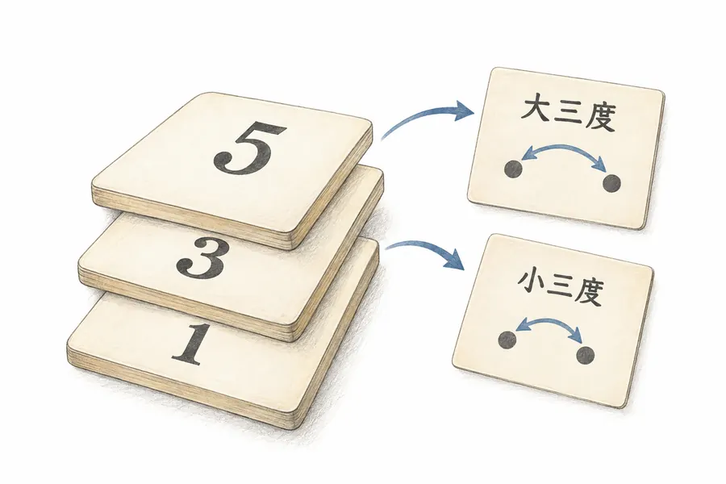

圖解 16.1　三和弦（示意）

### 四個弦組，必然有音要重複

在四個弦組上，三和弦自然會出現某個音的重複。

| 排法 | 重複的音 | 最高聲部 |
|---|---|---|
| G–B–D–G | 根音 | 根音 |
| G–D–G–B | 根音 | 大三度 |

兩者的和弦名稱相同，但**聽感不同**。

這就是排法（voicing）：**和弦音集合相同，不同的排列會改變聲部的重心。**

### 該省略什麼？

| 音 | 能不能省 | 原因 |
|---|---|---|
| 第五音 | 常是第一個可省略的候選 | 尤其當它沒有被改變（alteration）時 |
| 根音 | 有時可以省略 | 例如和低音手合奏時，低音已經清楚提供了根音 |
| 第三音 | 通常優先保留 | 它決定 major／minor 的性格 |
| 第七音 | 通常優先保留 | 在七和弦中常具有功能性 |

所以當你和低音手一起演奏時，曼陀林可以把有限的弦組，留給第三音、第七音與張力音（tension）。

**本節重點：** 先認得骨架，再談變化。
**練習方向：** 理解和弦與伴奏。

---

## 16.2　和弦轉位與聲部連接

### 三種轉位

| 最低聲部是哪個音 | 名稱 |
|---|---|
| 根音 | 原位（root position） |
| 第三音 | 第一轉位（first inversion） |
| 第五音 | 第二轉位（second inversion） |

曼陀林最低聲部的音，受四弦組的配置限制。
實際演奏時，不一定能像鋼琴那樣完整呈現低音的轉位。

但轉位的概念仍然非常有用，因為它告訴你：**這個排法內部的方向是什麼。**

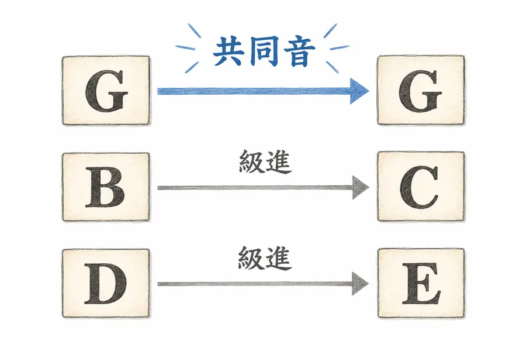

圖解 16.2　和弦轉位與聲部連接（示意）

### 聲部連接（voice leading）：讓手少移動

如果 G 大調之後要到 C 大調，不一定要整隻手跳到另一個很遠的形狀。

可以這樣做：

1. **保留**共同音 G。
2. 讓 B 移到 C。
3. 讓 D 移到 E。

這種「最小移動」就是聲部連接（voice leading）。

它讓伴奏聽起來像好幾條旋律線自然前進，保留聲部之間的連接。

### 練習：聽最高聲部

熟悉開放的 G、C、D 和弦之後，再練習閉合和弦的聲部連接。

選三個閉合排法，試著讓**最高聲部**走成：

- G–G–F#–G，或
- B–C–A–B

當你開始「聽最高聲部」，就會發現：**伴奏其實也是一種旋律設計。**

---

## 16.3　七和弦

三種常見的七和弦：

| 名稱 | 組成 |
|---|---|
| **Dominant 7**（屬七和弦） | 大三和弦＋小七度 |
| **Major 7**（大七和弦） | 大三和弦＋大七度 |
| **Minor 7**（小七和弦） | 小三和弦＋小七度 |

這些和弦的差異不只是「色彩」，也改變了**功能**。

### 三全音：張力的來源

屬七和弦的第三音與第七音，形成**三全音（tritone）**。
在傳統調性和聲中，這是推向主和弦（tonic）的重要張力來源。

以 D7 到 G 為例：

| 音 | 走向 |
|---|---|
| D7 的 F# | 常往 G **上行** |
| D7 的 C | 常往 B **下行** |

這兩條半音／全音的解決，比「根音從 D 跳到 G」更能讓耳朵聽出終止式（cadence）。

所以在四弦組的曼陀林上，即使省略第五音 A，只要保留 F# 和 C，和聲功能依然非常清楚。

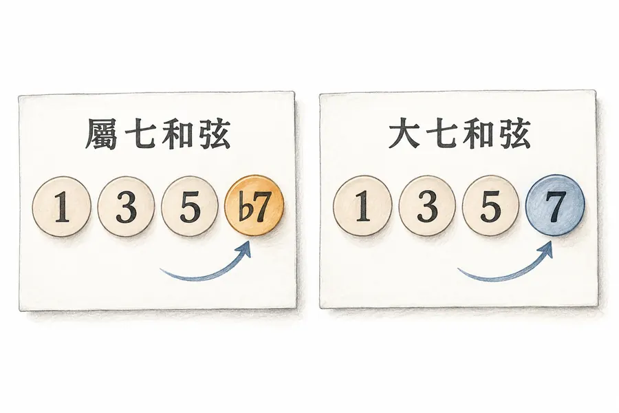

圖解 16.3　七和弦（示意）

### 半減七與減七

**m7b5**（半減七和弦）與 **diminished 7**（減七和弦）常見於小調，或作為半音經過和聲（chromatic passing harmony）。

因為它們內部的音程對稱性較高，**可移動的形狀**特別方便。

但也容易因為只背形狀，而不知道它的功能。

> **每次學新的減七形狀，都要問一句：**
> **「它在什麼調裡，解決到哪個和弦？」**

**本節重點：** 保留三音與七音，功能就清楚了。
**練習方向：** 理解和弦與伴奏。

---

## 16.4　六和弦與延伸和弦

理論上，13 和弦可以包含 1–3–5–b7–9–11–13，多達七個不同的級數。

四弦組的曼陀林，不可能完整發出。

真正的爵士／流行排法，會**有意省略**不重要的音。

它保留的是兩種東西：

- 能辨認和聲的**引導音（guide tones）**
- 有特色的張力音

### 例：G13

G13 可以只用 **B–F–E–A**：

| 音 | 角色 |
|---|---|
| B | 第三音 |
| F | 小七度 |
| E | 第十三音 |
| A | 第九音 |

這裡**沒有根音 G，也沒有第五音 D**。

如果低音已經提供了 G，聽感仍然成立。
相反地，如果是無低音的獨奏，完全省略根音可能讓聽者失去方向。

所以排法必須依**合奏情境（ensemble context）**決定，同時確認低音與其他聲部的分工。

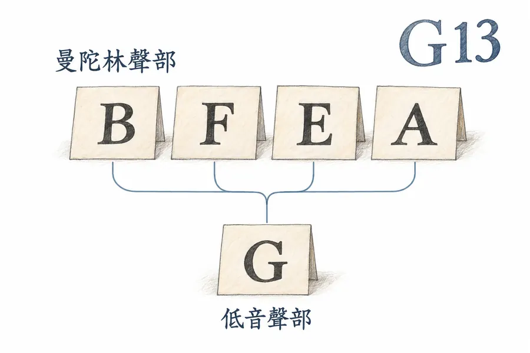

圖解 16.4　六和弦與延伸和弦（示意）

### Add9 和 sus2 差在哪裡

| 和弦 | 音 | 第三音 |
|---|---|---|
| Gadd9 | G–B–D–A | **保留**大三度 B |
| Gsus2 | G–A–D | 用 A **取代** B，第三音消失 |

字面上只差一點，功能與聽感卻不同。

> **讀和弦記號時，先把音程拆出來，比直接查和弦字典可靠。**

**本節重點：** 四條弦就是不夠，所以要懂得「有意識地省」。
**練習方向：** 理解和弦與伴奏。

---

## 16.5　開放和弦與持續音

G–D–A–E 的空弦，對 G、D、A、E 等調非常友善。

這也是小提琴曲（fiddle tunes）、藍草、塞爾特（Celtic）曲目，常常利用**持續音（drone）**的結構原因之一。

空弦不只省力，還有不同於按弦音的起音與延音，能讓音色更開放。

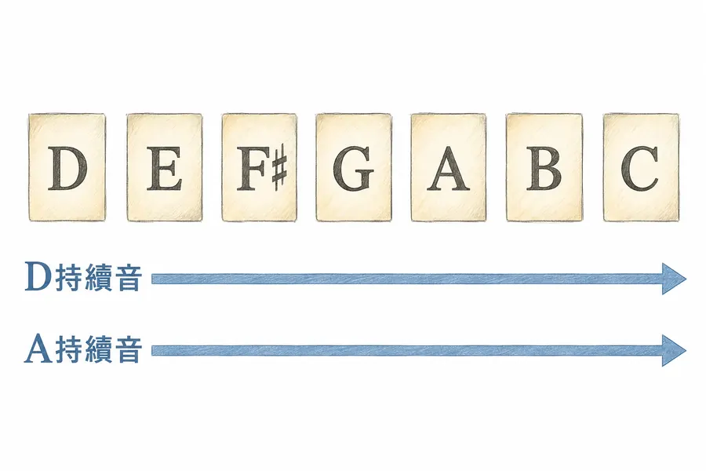

圖解 16.5　開放和弦與持續音（示意）

### 但開放和弦會綁定調性

某個利用空弦 G／D 的漂亮 G 和弦，移到 Ab 就**無法整體平移**。

這正是閉合形狀（closed shape）的價值。

演奏者應該把「開放排法」和「可移動排法」視為**兩套工具**，依音色與調性選擇使用。

### 持續音也能建立調中心

持續音還能在調式音樂（modal music）中提供調中心（tonal center）。

例如在 D 米克索利地安（Mixolydian）的旋律上持續開放的 D／A，會比每小節換完整的功能和弦，更符合某些民謠語法。

> **這提醒我們一件事**
> 和聲不一定等於「每一拍都堆和弦」。
> 有時候一個持續音，就足以建立整個空間。

> **常見誤解**
> **「和弦越多、越滿，伴奏就越專業。」**
> 不一定。曼陀林只有四組弦，塞滿反而會和吉他、低音打架。

**本節重點：** 空弦好聽，但不能移動。
**練習方向：** 理解和弦與伴奏。

---

## 16.6　可移動和弦指型

**閉合和弦（closed chord）**指的是：所有需要的聲音都由按住的音產生，沒有依賴空弦。

好處是整個形狀可以**沿著指板移動**，特別適合：

- 快速轉調
- 切音（chop）
- 爵士伴奏

而且因為所有音都在左手控制下，放開（release）也能非常整齊。

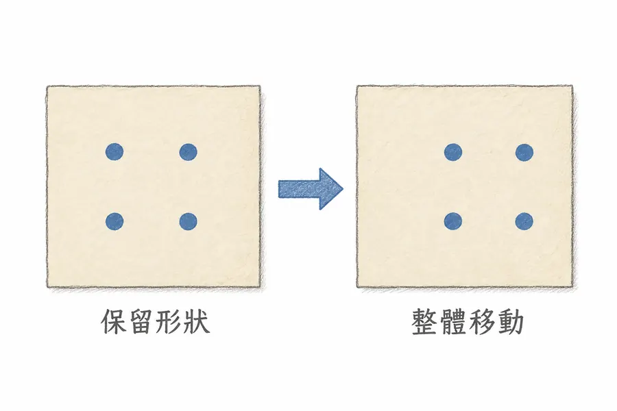

圖解 16.6　可移動形狀的概念；圓點表示相對位置（示意）

### 但代價是伸展

閉合形狀常要求更大的伸展，尤其在低把位。

如果只追求「標準的切音形狀」，手小的演奏者可能長期維持不自然的跨度。

替代方案有三個：

1. 省略第五音。
2. 換不同的轉位。
3. 移到更高的把位。

**功能比固定形狀重要。**

### 怎麼練

把「半音移動」和「常見的和聲進行」搭配在一起。

最好配合**五度圈**（circle of fifths）：

- G–C–F–Bb…
- 或 G–D–A–E…

這會把手型和實際的和聲移動連起來。

**本節重點：** 能移動是最大優點，伸展是最大成本。
**練習方向：** 理解和弦與伴奏。

---

## 16.7　切音的和弦配置

藍草切音常在**第 2、4 拍**形成短促的後拍。

這時候，排法最大的要求是：

1. 右手的起音要集中。
2. 左手能立即放開。
3. 音符不要拖到下一拍。

閉合形狀因此非常合適。

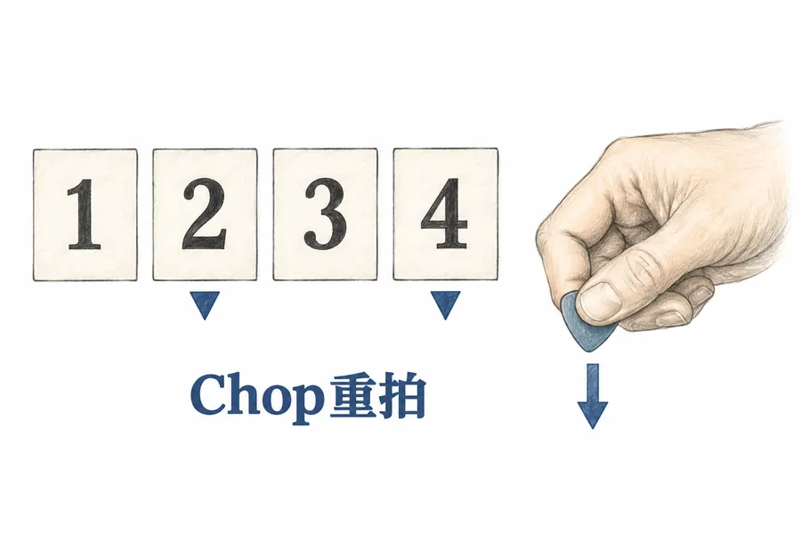

圖解 16.7　Chop 和弦配置（示意）

### 沒有唯一的「門羅和弦」

典型的切音和弦常省略重複音，讓四個弦組都有足夠的張力，而且手形可以控制。

不同演奏者會依調性、琴頸位置與個人手型選排法。
**沒有唯一一種「Monroe chord」（門羅和弦）。**

Bill Monroe 在藍草歷史中的核心地位，是確立曼陀林主奏／節奏語法的重要背景。
但後世的切音技術，已經發展出多種手型與時間安排。〔S1601〕

### 和吉他一起伴奏時

曼陀林不需要把每個拍子都填滿。

切音的價值，常在**吉他的刷弦之間**出現，形成互補。

如果兩件樂器同時在每一拍做大和弦，頻譜與節奏都會變得擁擠。

**本節重點：** 切音要和吉他「錯開」，不是疊上去。
**練習方向：** 理解和弦與伴奏。

---

## 16.8　功能和聲

在大調中，各級和弦有不同功能：

| 級數 | 功能 | 白話 |
|---|---|---|
| I | 主和弦（tonic），提供穩定感 | 「在家」 |
| ii／IV | 前屬和弦（predominant） | 「準備離家」 |
| V／vii° | 屬和弦（dominant），製造回到主和弦的張力 | 「想回家」 |

這套功能思維，能把幾百個和弦進行壓縮成少數幾個方向：

> **離家 → 增加張力 → 回家。**

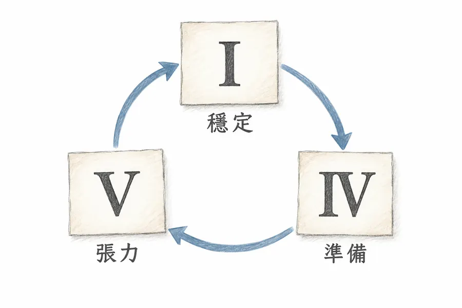

圖解 16.8　功能和聲（示意）

### 例：I–vi–ii–V

看起來有四個和弦，實際上可以理解成「主和弦區逐步走向屬和弦」。

曼陀林伴奏時，便能用聲部連接把內聲部連起來，讓相鄰的和弦以較小的幅度移動。

### 小調比較複雜

小調更複雜，因為和聲小音階（harmonic minor）常升高第七級，製造屬和弦的**導音（leading tone）**。

所以看到 E7 出現在 A 小調，不應該驚訝：**G# 就是為了推向 A。**

把這些音程關係理解之後，和弦記號便能顯示聲部走向與功能。

**本節重點：** 和弦進行就是「離家與回家」的路線圖。
**練習方向：** 理解和弦與伴奏。

---

## 16.9　十二小節藍調

最基本的十二小節藍調（12-bar blues），可以用 I7–IV7–V7 組成。
但不同地區與年代，有大量變體。

對曼陀林而言，學藍調的價值不只在和弦，還包括：

- 搖擺（shuffle）
- 切分（syncopation）
- 呼應（call-and-response）
- 藍調音階的樂句（blues scale phrasing）

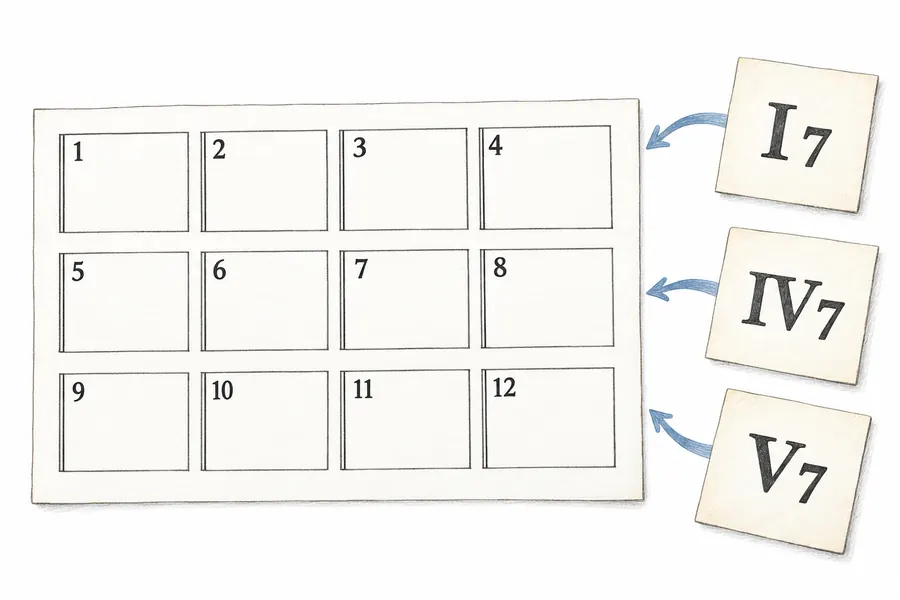

圖解 16.9　十二小節藍調（示意）

| 角色 | 可以怎麼做 |
|---|---|
| 伴奏（comping） | 短和弦、雙音、小型反覆樂句（riff），不一定要每拍全和弦 |
| 主奏（lead） | 要聽和弦的變化 |

主奏時，在 I7 上使用小調五聲音階（minor pentatonic）來製造藍調張力很常見。
但到了 IV7、V7 時，如果能用和弦音（chord tones）標示變化，獨奏會更有方向。

> **即興的重要原則**
> **音階是素材，不是和聲的答案。**
> 每一個和弦的第三音、第七音，都能提供更清楚的和聲地標（harmonic landmark）。

**本節重點：** 藍調不是只有和弦，還有節奏語言。
**練習方向：** 理解和弦與伴奏。

---

## 16.10　調式和聲

多利安（Dorian）、米克索利地安（Mixolydian）等調式（mode），在民謠裡很常見。

塞爾特與老時光（old-time）音樂也用得很多。

它們有明確的調中心，但和傳統大調／小調的功能和聲不完全相同。

例如 D 米克索利地安有 **C 本位**（C natural）。
如果硬用 A 大調（含 C#）當屬和弦，就會改變原本的調式色彩。

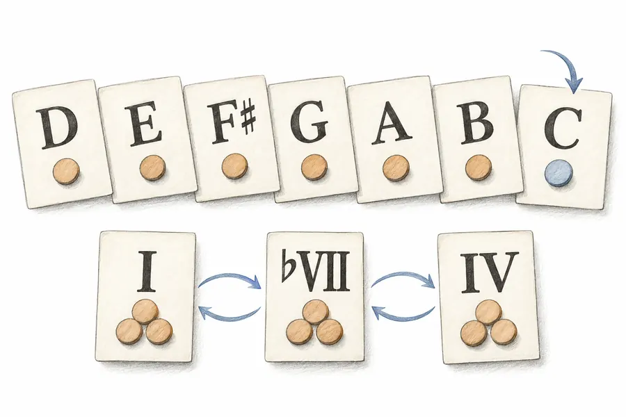

圖解 16.10　D Mixolydian音階與可用和聲材料（示意）

### 調式音樂常用簡單的材料

這類音樂常依賴：

- 持續音（drone）
- I–bVII
- I–IV

曼陀林的空弦特別適合這種語法。

理解調式最好的方法，是**以大調音階為基準**，看哪一個級數被改變了，然後聽這個改變如何影響可用的和弦。

### 兩種語法可以混用，但要有意識

功能和聲與調式和聲可以混合，但必須是**有意識的選擇**。

| 版本 | 做法 |
|---|---|
| 流行跨界改編 | 可能故意加入次要屬和弦（secondary dominant） |
| 傳統版本 | 可能只保留兩個和弦 |

兩者的差別，是風格選擇。

**本節重點：** 調式音樂的重點是「哪個音被改變了」。
**練習方向：** 理解和弦與伴奏。

---

## 16.11　和弦旋律

和弦旋律（chord melody）的核心是：

> **讓最高音（top note）清楚保持旋律，再用剩下的弦組，選擇最少但有效的和聲。**

如果低聲部移動太多，聽者會把注意力轉向和弦變化，旋律反而被埋掉。

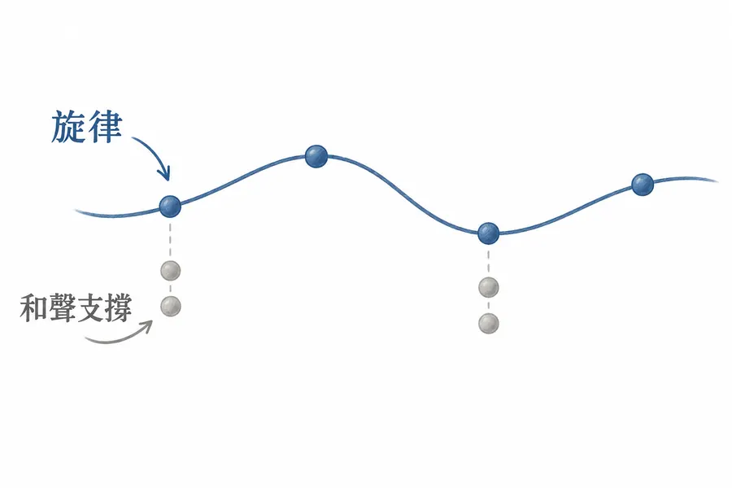

圖解 16.11　和弦旋律（示意）

### 實作步驟

1. 先把旋律**單獨**編好指法。
2. 標出每個強拍上的和弦音（chord tone）。
3. 只在和聲需要時，加入 1–3 個低音。
4. 弱拍可以保持單音。

這種「疏密」的安排，比全程四音塊狀和弦，更像撥弦樂器自然的織度（texture）。

### 加顫音的和弦旋律

這還多一層問題：**哪些聲部需要持續、哪些只需要一次起音？**

| 做法 | 效果 |
|---|---|
| 只讓旋律顫音，下面的和弦每拍一次 | 旋律清楚，伴奏有顆粒 |
| 整個和弦都顫音 | 聲音厚，但容易糊 |

把右手的織度分層，會比全程同樣密度更有呼吸。

**本節重點：** 旋律優先，和聲是支援。
**練習方向：** 理解和弦與伴奏。

---

## 16.12　案例：I、IV、V 的伴奏選擇

以 G–C–D 為例，同一個和弦進行可以有四種完全不同的做法。

| 做法 | 手法 | 聽起來像 |
|---|---|---|
| 1 | 開放和弦，每拍刷弦 | 直接的民謠伴奏 |
| 2 | 閉合切音，只打第 2、4 拍 | 藍草合奏語法 |
| 3 | 三音聲部連接，每兩拍換和弦 | 室內樂式的伴奏（chamber comping） |
| 4 | 琶音加持續音 | 創作歌手（singer-songwriter）或調式原聲織度 |

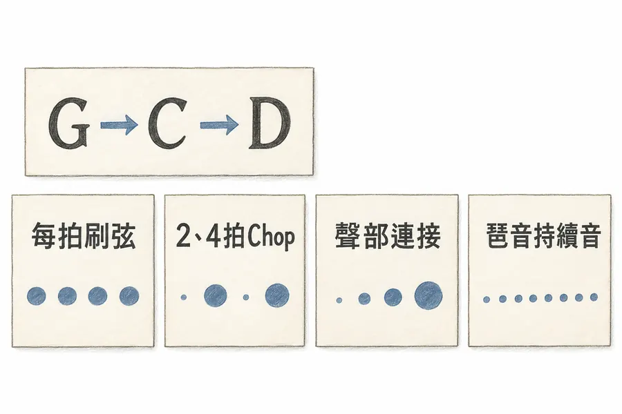

圖解 16.12　案例 I IV V 的伴奏選擇（示意）

### 真正改變風格的是這些

和弦名稱完全相同，但真正改變風格的是：

- 音長（note length）
- 節奏
- 音域（register）
- 空弦的共鳴
- 樂團裡的空間

> **這就是為什麼：學會一百個和弦形狀，不等於會伴奏。**

> **常見誤解**
> **「背完和弦表就會伴奏了。」**
> 背形狀只是第一步。真正決定風格的是音長、節奏與樂團裡的空間。

### 練習方法

固定同一個和弦進行，連續做四種織度，並且**全部錄音**。

如果每一版只是音量不同，而節奏語法沒變，代表你仍在「換和弦」，而不是在「設計伴奏」。

---

## 表 16-1｜常用和弦公式與四弦組取捨

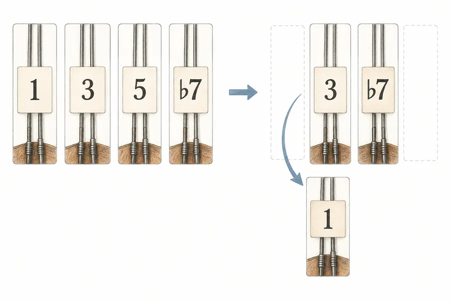

| **和弦** | **音程公式** | **最值得保留** | **常見可省略** |
|:---|:---|:---|:---|
| **Major**（大三和弦） | 1–3–5 | 3 | 重複的 1 或 5 |
| **Minor**（小三和弦） | 1–b3–5 | b3 | 重複的 1 或 5 |
| **Dominant 7**（屬七） | 1–3–5–b7 | 3、b7 | 5；有低音時可省 1 |
| **Maj7**（大七） | 1–3–5–7 | 3、7 | 5 |
| **m7**（小七） | 1–b3–5–b7 | b3、b7 | 5 |
| **13**（十三和弦） | 1–3–5–b7–9–11–13 | 3、b7、13（依語境） | 5、11，甚至根音 |

圖解 表 16-1｜常用和弦公式與四 course 取捨（示意）

---

## 自我學習題庫

學習檢查：作答、核對、複習

先自己作答，再看答案。答錯時回到本章相關小節重新讀一次。

**1. Major triad 的組成音程是？**

- A. 1–3–5

- B. 1–♭3–5

- C. 1–4–5

- D. 1–2–6

**2. 轉位在實際伴奏上的重要用途是？**

- A. 讓和弦連接更順

- B. 讓琴弦變粗

- C. 提高琴橋

- D. 改變木材

**3. Chord melody 最重要的是？**

- A. 讓旋律音清楚，和聲支援它

- B. 每個音都塞最大和弦

- C. 只保留低音

- D. 完全不管旋律

**答案：1.A　2.A　3.A**

---

## 本章主要查證來源

查證來源：找原文、核條件、留紀錄

**【S1601】Bluegrass Music Hall of Fame & Museum：Bill Monroe biography。** Bluegrass 形成與 mandolin 的 ensemble 角色背景。

> https://www.bluegrasshall.org/inductees/bill-monroe/
