*Tone, Expression, Practice and Performance*
（音色、表現、練習與演出）

## 本章重點

- 進階階段最大的改變：**演奏前，你就知道自己要什麼聲音。**
- 練習要用「問題與驗證」計量，不要用「時間」計量。
- 慢練的重點不是「變慢」，而是「用同樣的路徑，換取更多注意力」。
- 視奏與記憶都要有「整體地圖」，不能只靠肌肉記憶。
- 演出前最危險的事：因為焦慮而突然加倍練習量、換弦、換撥片、改指法。

---

到了進階階段，最大的改變是：**你能在演奏前，就先知道自己要什麼聲音。**

右手的位子、撥片角度、動態、發音法（articulation）、顫音密度、左手指法，全都只是工具。

真正的專業感，來自這些工具能不能穩定地服務**樂句、風格與樂團角色**。

練習方式也會改變。

| 階段 | 計量方式 | 例子 |
|---|---|---|
| 初學者 | 用**時間**計量 | 「今天練一小時」 |
| 進階者 | 用**問題與驗證**計量 | 「第 36 小節在 132 BPM 的跨弦不穩，我用兩種撥法測試，最後方案 B 連續五次成功」 |

這個差異看起來只是筆記方法。
但實際上，它決定你能不能在有時間限制的情況下持續進步。

---

## 17.1　音色控制

同一把曼陀林，可以很亮、很硬，也可以圓潤、柔和。

最直接的變數是撥奏位置（pick position）：

| 位置 | 結果 |
|---|---|
| 靠琴橋 | 高頻較多，起音更明顯 |
| 靠指板 | 較柔和 |

另外，撥片的邊緣角度、速度、深度也會改變瞬間的起音（transient）。

這些參數會**互相作用**。所以比較聲音時，應該把「樂器」與「撥奏方式」一起記錄下來。

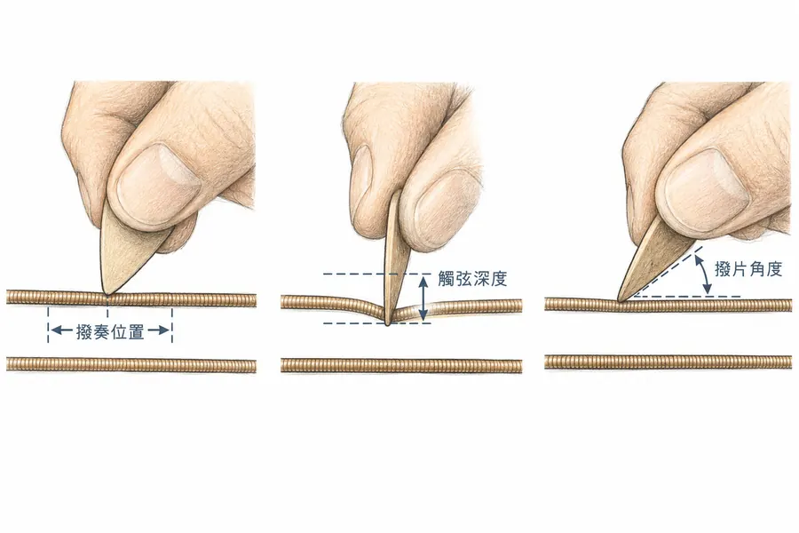

圖解 17.1　音色控制（示意）

### 建立自己的音色地圖（tone map）

1. 選一個空弦 A。
2. 選同一個按住的 D。
3. 選同一段顫音。
4. 在**三個右手位置**分別錄音。
5. 再改變撥片角度，各錄一次。

這些錄音能告訴你：**這把琴真正可用的音色範圍有多寬。**

也能避免把「演奏問題」全都推給器材。

### 琴型只是方向，不是結論

不同琴型的反應也不同。

F 孔、拱面（F-hole carved-top）常被藍草玩家重視它的穿透力（cut）與起音。
但同一類型裡面，材料、音樑（bracing）、設定（setup）的差異很大。

橢圓音孔（oval-hole）、圓背（roundback）也不是天生只能柔和。

> 市場上的說法可以提供方向。
> 最後仍要以**具體的樂器和具體的手法**判斷。

**本節重點：** 音色是可以被測量與記錄的，不是玄學。
**練習方向：** 安排音色、表情與練習。

---

## 17.2　強弱變化

### 弱奏（piano）不是「把力氣降到最低」

如果只是把撥片的力氣降到最低，容易**失去起音的核心**，音符會變得模糊。

有效的弱奏仍然需要清楚地接觸弦。
只是把速度、深度與撥奏位置，調整到較低的能量。

反之，強奏（forte）的重點是：**提高起音的能量，同時保持放鬆。**

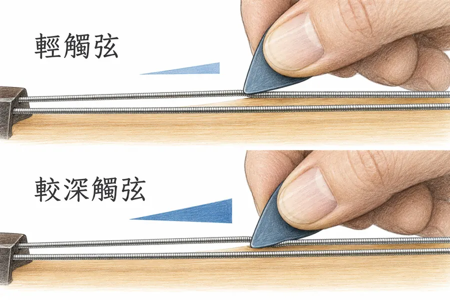

圖解 17.2　強弱變化（示意）

### 漸強（crescendo）有三種手段

1. 每一個起音稍微增加能量。
2. 把顫音的密度微調。
3. 右手位置略往琴橋移動。

真正的樂句常**混合**這些手段。

> **只用「越來越用力」會怎樣？**
> 最後幾個音往往變硬，速度（tempo）也會跟著加速。

### 檢查方法

1. 用 8 拍或 16 拍做長漸強。
2. 要求音量**連續**增加，但節拍器的速度不變。
3. 錄音後看波形／聽感，是否在中間突然「跳級」。

這是一種非常直接的動態控制檢查。

**本節重點：** 小聲也要有清楚的起音。
**練習方向：** 安排音色、表情與練習。

---

## 17.3　奏法與音長

| 奏法 | 要求 |
|---|---|
| **Legato**（連奏） | 起音之間沒有不必要的空隙，音尾彼此接近 |
| **Staccato**（斷奏） | 主動縮短音長；可靠左手放開、右手制音（damping），或兩者配合 |
| **Tenuto**（保持） | 完整保留時值 |
| **Accent**（重音） | 改變起音的能量與句法重點 |

因為曼陀林的起音非常明確，發音法（articulation）的變化會非常顯眼。

古典譜上同樣是八分音符，斷奏、半斷奏（portato）、保持音的差異，不應該只用「短一點／長一點」模糊帶過。

> **應該實際規劃：每一個音在拍子裡佔多長。**

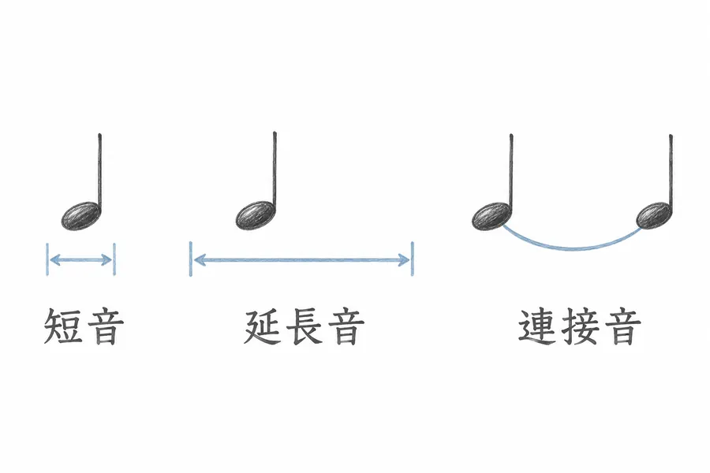

圖解 17.3　奏法與音長（示意）

### 風格會決定發音法

在藍草或老時光音樂中，發音法常由**風格**決定。

| 場合 | 音長要求 |
|---|---|
| 小提琴曲（fiddle tune） | 需要有推進感（drive），但每個音都極短會失去流動（flow） |
| 切音（chop） | 恰恰需要極短的衰減 |

**風格感常藏在音長裡。** 裝飾音則是配合句法加入的。

**本節重點：** 音長要「設計」，不是「差不多」。
**練習方向：** 安排音色、表情與練習。

---

## 17.4　樂句與呼吸

一句旋律通常有四個階段：

1. 起點
2. 發展
3. 最高張力
4. 釋放

如果每一個小節都用相同的音量、相同的顫音、相同的起音，樂句就會變成一片「資訊平面」——什麼都一樣，等於什麼都沒說。

**先唱出旋律，找出哪個音最重要，再設計右手與指法。**
這往往比先決定技巧更自然。

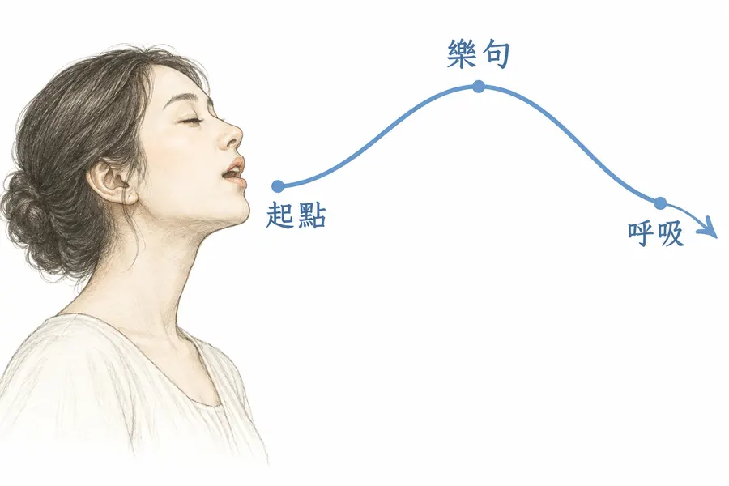

圖解 17.4　樂句與呼吸（示意）

### 顫音樂句特別需要呼吸

長線條**不等於**從第一個音到最後一個音都保持相同密度。

可以這樣安排：

| 位置 | 做法 |
|---|---|
| 句首 | 較透明 |
| 接近高點 | 稍微增加能量 |
| 句尾 | 讓起音稍微放鬆 |

練習目標是讓顫音呈現清楚的樂句、方向與呼吸。

### 指法也服務樂句

同一個音，用空弦演奏，聲音比較獨立。
留在同一弦組的高把位，可能更連續。

選擇位置時，除了問「哪個比較容易」，還要多問一句：

> **「這一句要不要換音色？」**

**本節重點：** 樂句有形狀，不是平的。
**練習方向：** 安排音色、表情與練習。

---

## 17.5　彈性速度

彈性速度（rubato）指的是**局部的時間彈性**。

古典慢板常在到達重要音之前稍微延伸，再於後面補回來。

但如果每一句都用同樣的方式拖拍，它就會變成**習慣**，而不是表情。

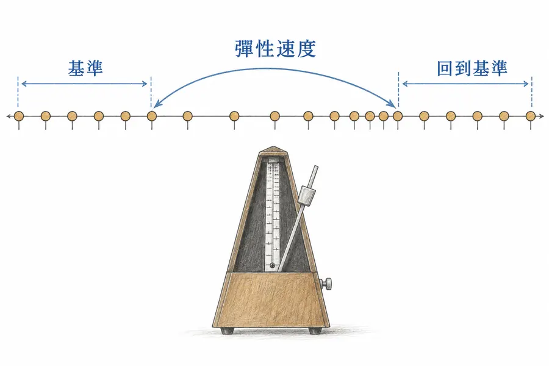

圖解 17.5　彈性速度（示意）

### 練習步驟

1. 先用節拍器，完全嚴格（strict），把內在的脈動建立清楚。
2. 關掉節拍器，做自由版本。
3. 再開節拍器，檢查整句的總時間有沒有失控。

這能區分兩種情況：

| 情況 | 意思 |
|---|---|
| 有意識的伸縮 | 這是 rubato |
| 因為技術困難而自然變慢 | 這是問題，不是表情 |

### 不同風格的容許度不同

| 風格 | 彈性 |
|---|---|
| 藍草獨奏段（break） | 通常必須牢牢鎖在律動（groove）裡 |
| 十九世紀浪漫派獨奏 | 可以有較大的彈性 |

> **所謂的「音樂性」，從來都是「符合語法」。**

**本節重點：** 先有嚴格的拍子，才談彈性。
**練習方向：** 安排音色、表情與練習。

---

## 17.6　可用速度的評估

### 四個條件

可用速度應該同時包含四件事：

1. 節奏準。
2. 音色可接受。
3. 左右手同步。
4. 可連續重複。

如果只能偶爾成功一次，這個 BPM 不應該算成你的能力上限。

這個定義雖然保守，卻更接近舞台的實際需求。

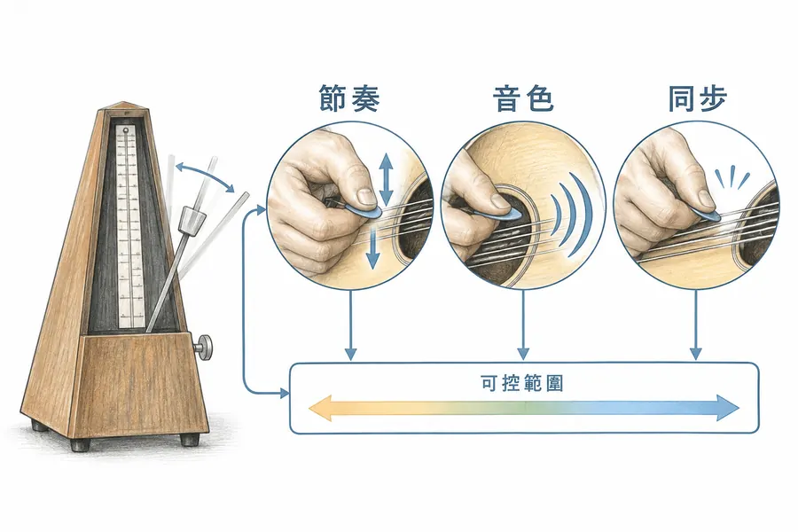

圖解 17.6　可用速度的評估（示意）

### 兩種提升速度的方法

| 方法 | 做法 |
|---|---|
| 增量法 | 從完全可控的速度開始，每次增加 2–4 BPM；一旦出現失敗類型，就退回確認 |
| 爆發法（burst） | 用目標速度只演奏幾個音，逐步延長 |

兩種方法都比「每天直接測最大 BPM」更能保留放鬆的動作。

### 特別注意「轉換」

很多段落更準確地說，是**某兩根手指的轉換**、或**某一次跨弦**在限制速度。

把一整個小節縮成 2–4 個音反覆練，往往比連續跑整段有效。

**本節重點：** 可用速度是「能重複」，不是「偶爾行」。
**練習方向：** 安排音色、表情與練習。

---

## 17.7　慢練與動作檢查

### 慢練最重要的原則

> **慢練時，要保留原速所需要的動作大小。**

如果原速需要小幅的手腕動作，慢速也應該維持同樣的路徑，只把時間拉開。

否則你會練出一套「只能慢速存在」的動作，上速度之後仍要重新學。

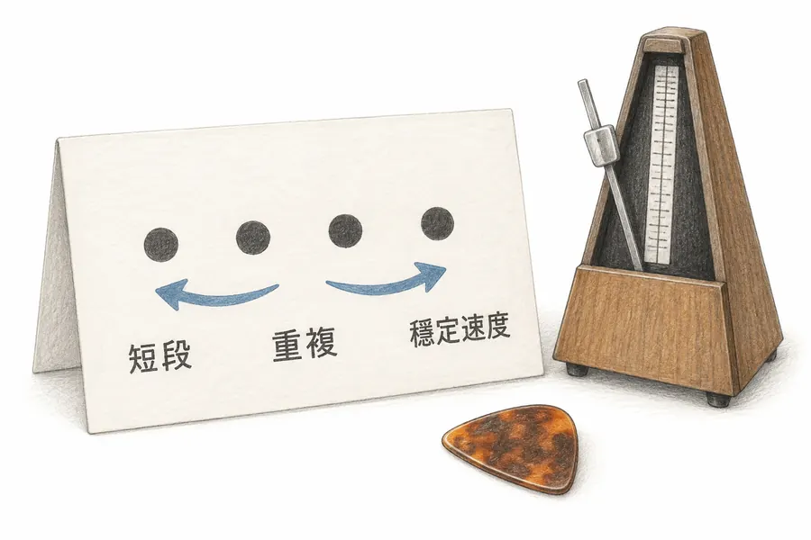

圖解 17.7　慢練與動作檢查（示意）

### 慢速最適合檢查這些事

- 撥片是不是每次都離弦一樣遠？
- 左手是不是提前抬起？
- 換把是不是準時？
- 重音是不是由音樂決定，而不是由手指方便決定？

> **一次只把注意力放在一個變數上。**
> 不要同時評估十件事。

> **常見誤解**
> **「慢練就是把動作縮小、放慢就好。」**
> 不對。慢練要保留原速的路徑，只把時間拉開。

### 也可以拆開練（silent practice）

有兩種拆解法：

1. 左手按完整段落，但右手只輕觸（不真正發聲）。
2. 右手在空弦上做原本的句型。

這些拆解能把「同步問題」定位到**單側**。

**本節重點：** 慢練要保留路徑，不是把動作縮小。
**練習方向：** 安排音色、表情與練習。

---

## 17.8　視奏與拍點

### 先掃描，再開始

視奏時，先掃描這五件事：

1. 調號（key signature）
2. 拍號（meter）
3. 速度（tempo）
4. 最高音與最低音
5. 重複的句型

如果一開始只盯著第一個音，後面每一小節都會像一個「新事件」。

先建立整體地圖，能大幅降低驚訝。

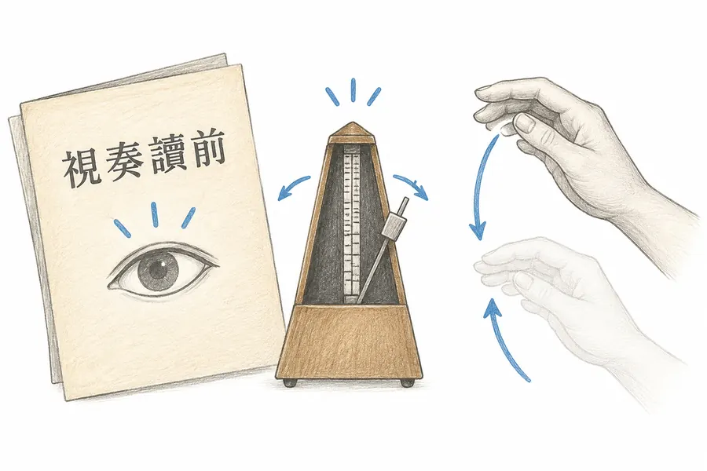

圖解 17.8　視奏與拍點（示意）

### 不要因為一個錯音就停住

真正演奏時，不要因為單音錯誤而停下來。

合奏視奏（ensemble sight-reading）最重要的是**時間的連續性**。

> 漏掉一個裝飾音，通常比全團因為你停拍更可接受。

> **常見誤解**
> **「視奏要一個音都不漏。」**
> 在合奏裡，時間連續比零失誤重要得多。

可以刻意選低於自己能力的陌生譜，每天 5–10 分鐘，**一次通過、不回頭**。
這是在訓練「繼續往前走」的能力。

### 家族樂器的譜可能不只一種

曼陀林家族的記譜，還可能遇到：

- 曼陀拉的中音譜號（alto clef）
- 通用記譜（universal notation）
- 移調高音譜號（transposed treble clef）

CMSA（美國古典曼陀林協會）的記譜指南顯示：歷史與地域的系統並不單一。

所以高階的視奏能力，也包含**先辨識譜面的慣例**。〔S1701〕

**本節重點：** 先看地圖，再上路。
**練習方向：** 安排音色、表情與練習。

---

## 17.9　記憶與段落線索

### 只靠肌肉記憶很危險

只靠肌肉記憶的曲子，一旦某處失誤，就很容易完全斷線。

更穩定的記憶方式（memorization），同時包含五種線索：

1. 和聲
2. 曲式（form）
3. 旋律
4. 指板上的地標（fingerboard landmarks）
5. 聽覺的預期

> **檢查標準：你應該能從任何一個排練記號（rehearsal mark）開始。**
> 讓各段都能獨立接續。

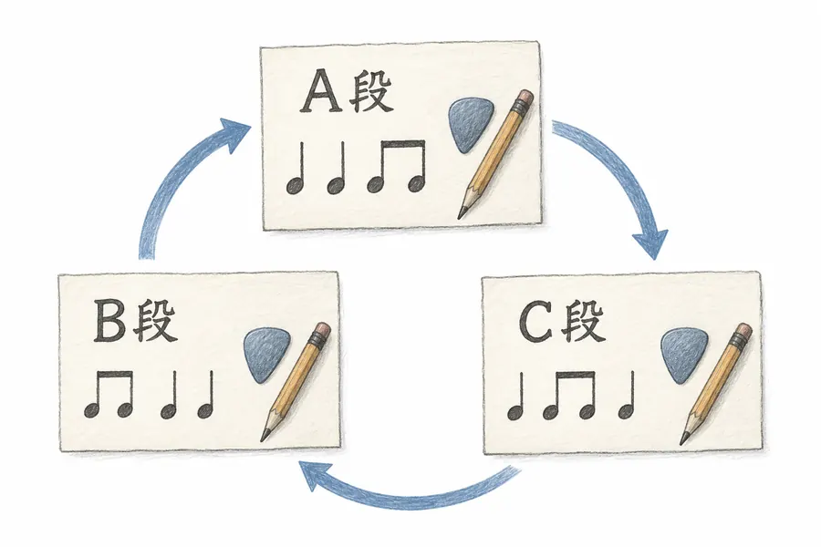

圖解 17.9　記憶與段落線索（示意）

### 可以做的練習

- 把曲子分成幾個**和聲段落**，寫下 I–vi–ii–V 或主要的轉調。
- 閉上眼睛，說出某一小節的第一個音在哪個弦組。

這些看起來「離開演奏」的工作，實際上能在舞台壓力下提供更多**恢復路徑**。

對即興音樂更是如此：記住和弦形式（chord form）、動機（motif）與樂句詞彙，比背完整的獨奏更有用。

**本節重點：** 記憶要多線索，不能只有手指。
**練習方向：** 安排音色、表情與練習。

---

## 17.10　聽覺訓練

節拍器（metronome）告訴你時間，調音器（tuner）告訴你音高。
但真正的音樂，仍由**耳朵**判斷。

| 練習 | 耳朵要聽什麼 |
|---|---|
| 練音階 | 唱出級數（degree），聽導音（leading tone） |
| 練顫音 | 密度是否平滑 |
| 練和弦 | 最高聲部是否真正連續 |

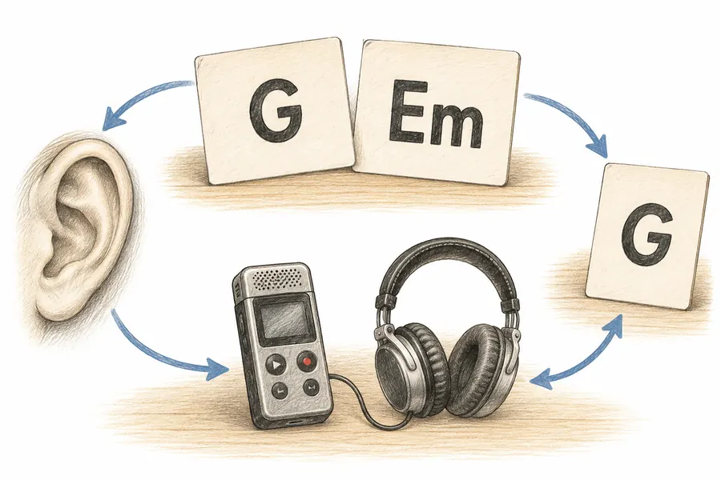

圖解 17.10　聽覺訓練（示意）

### 錄音是最直接的工具

演奏的當下，大腦同時處理觸覺、視覺與動作，常會**高估**自己的流暢度。

手機近距離錄音雖然不等於專業錄音，但足以聽出：

- 時間（timing）
- 雜音（noise）
- 平衡（balance）

### 更進一步：呼應練習

- 先唱一句，再在曼陀林上找出它。
- 或先聽一段和弦進行，再**不用譜**找出根音與第三音。

這會讓樂理從紙面，變成耳朵的反應。

**本節重點：** 節拍器和調音器是輔助，耳朵才是裁判。
**練習方向：** 安排音色、表情與練習。

---

## 17.11　練習日誌

### 一份有效日誌至少要有六欄

1. 曲目／小節
2. 今天的可控 BPM
3. 主要問題
4. 採用的策略
5. 成功的驗證方式
6. 下次要做什麼

**範例：**

> 「第 42–45 小節，右手跨弦，126 BPM 連續 5 次。132 BPM 時上撥漏弦。下次先改入弦深度。」

這比「練了 30 分鐘」提供多得多的決策資訊。

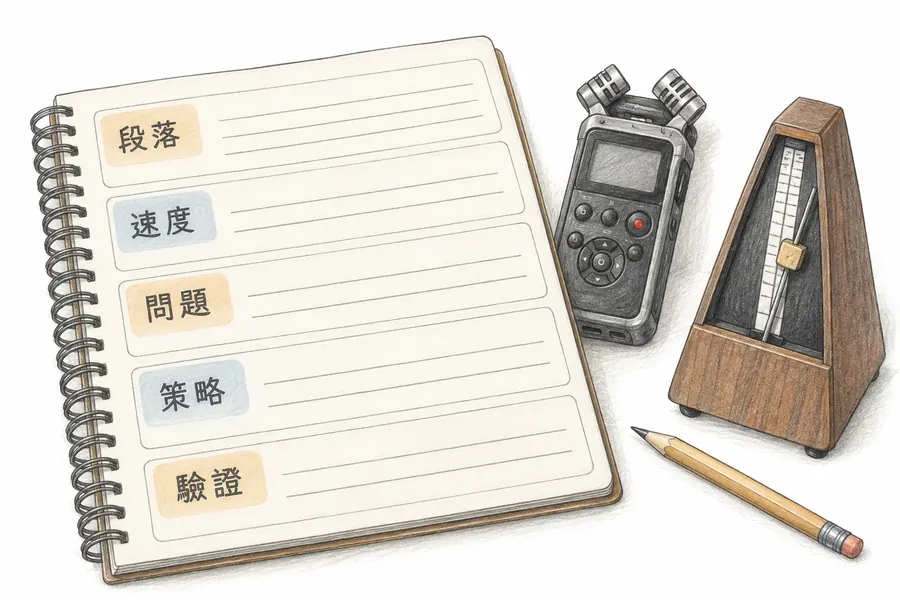

圖解 17.11　練習日誌（示意）

### 也要記錄身體狀態

如果同一個技巧**每次都在 25 分鐘後開始肩緊**，就應該調整休息與姿勢，及早安排動作調整。

音樂家的肌肉骨骼問題，通常由多種因素共同造成。
系統性回顧也強調練習強度與人體工學等風險。〔S1702〕

> 日誌的目的，是避免你**每天重新猜一次問題**。
> 每次只寫兩三行就足夠。

**本節重點：** 記錄「問題—方法—結果」，不是記錄時數。
**練習方向：** 安排音色、表情與練習。

---

## 17.12　舞台與錄音準備

### 演出前最危險的行為

就是因為焦慮，而突然做這些事：

- 加倍練習量
- 換新的弦的規格（gauge）
- 換撥片
- 徹底改指法

新的動作需要適應期，密集的負荷也可能增加不適的風險。

> **最後一週應該以「穩定」為主：**
> 整體跑過（runs）、修補問題小段、恢復。

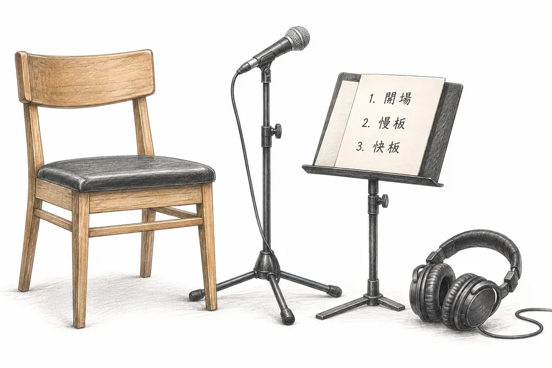

圖解 17.12　舞台與錄音準備（示意）

### 器材與環境

| 項目 | 要做的事 |
|---|---|
| 新弦 | 要預留穩定時間（settle time） |
| 浮動琴橋 | 換弦時要確認琴橋的位置 |
| 現場環境 | 濕度、溫度與拾音器（pickup）的反應都可能改變 |
| 音控（soundcheck） | 要實際測強奏、顫音與切音 |

音控時要**模擬演出時的音量和音色**，不是只測「有沒有聲音」。

### 失誤管理也要排練

- 故意在練習中跳過一小節，從下一個樂句繼續。
- 讓同伴隨機喊出排練記號。

> **真正的專業是：錯誤發生之後，音樂仍然能繼續。**

---

## 表 17-1｜練習日誌最少要留下什麼

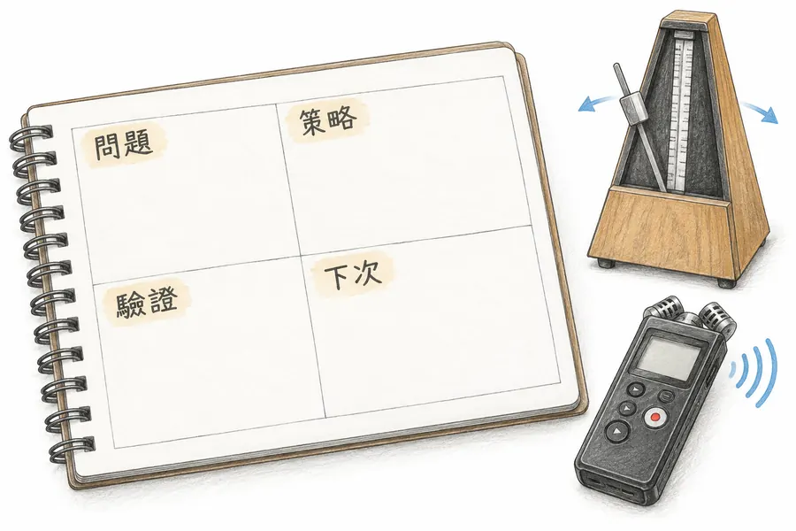

| **曲目／小節** | **可控 BPM** | **失敗類型** | **採用策略** | **驗證標準** |
|:---|:---|:---|:---|:---|
| **第 42–45 小節** | 126 | 上撥漏掉 E 弦組 | 減少入弦深度＋2 音轉換 | 連續 5 次不漏弦 |
| **慢板第 8–12 小節** | 每拍 60 | 顫音動態不平 | 固定密度，只改起音 | 16 拍漸強無跳級 |
| **切音 G–C–D** | 每拍 112 | 第 2、4 拍延音太長 | 縮短左手放開的時間 | 與錄音的後拍對齊 |

圖解 表 17-1｜練習日誌最少要留下什麼（示意）

---

## 自我學習題庫

學習檢查：作答、核對、複習

先自己作答，再看答案。答錯時回到本章相關小節重新讀一次。

**1. Rubato 指的是？**

- A. 有控制的局部時間彈性

- B. 完全沒有節拍

- C. 只加快

- D. 只放慢

**2. 有效慢練的重點是？**

- A. 保留正確動作路徑並觀察細節

- B. 把動作誇張放大

- C. 只看速度數字

- D. 停止聽聲音

**3. 練習日誌最有用的內容是？**

- A. 記錄問題、方法與結果

- B. 只寫練了幾小時

- C. 只寫歌曲名稱

- D. 只記心情

**答案：1.A　2.A　3.A**

---

## 本章主要查證來源

查證來源：找原文、核條件、留紀錄

**【S1701】Classical Mandolin Society of America：Music Notation for Mandolin Family Instruments。** 家族視奏可能遇到的 clef 與 transposition conventions。

> https://classicalmandolinsociety.org/wp-content/uploads/Music_Notation_for_Mandolin_Family_Instruments_v3.pdf

**【S1702】Cerda-Díaz et al.：Musculoskeletal disorders in musicians (2026)。** 演奏負荷、人體工學等風險因子的綜合證據。

> https://pubmed.ncbi.nlm.nih.gov/41691705/

---

將已學技法放入各地音樂傳統，練習聽辨風格與安排合奏聲部。

閱讀範圍　第 18 章至第 18 章

---
