## 本章重點

- 曼陀林不是「只屬於一種音樂」的樂器。同一件樂器，在不同傳統裡有完全不同的右手語法與合奏角色。
- 判斷一種風格，要看四件事：拍點放在哪裡、音拉多長、裝飾怎麼加、合奏時誰負責什麼。
- 藍草音樂（bluegrass）裡的曼陀林有兩份工作：領奏（lead）與切音伴奏（chop）。只會一種，等於只學了一半。
- 曼陀林樂團最常見的毛病，是所有高音聲部同時顫音，把中高頻塞得太滿。
- 真正的「跨風格」不是換一把琴，而是換一套時間感與裝飾語彙。

## 開場：一件樂器，很多種音樂

曼陀林最有趣的地方之一，是它並沒有只屬於一種音樂。

它出現過的地方很多：

- 十八世紀義大利的室內樂與協奏作品
- 十九世紀的沙龍（salon）與曼陀林樂團（mandolin orchestra）
- 那不勒斯歌曲
- 美國的曼陀林熱潮（mandolin craze）
- 老式弦樂隊（old-time string band）
- Bill Monroe 之後的藍草音樂
- 愛爾蘭舞曲
- 巴西的秀羅（choro）
- 爵士樂
- 二十一世紀的創作歌手、電影配樂、電曼陀林跨界

這些傳統用的可能都叫「mandolin」。但右手語法、音長（note length）、伴奏位置、音色、合奏角色，並不一樣。

所以學風格時，要一起掌握四件事：拍點、音長、裝飾、合奏分工。

真正的問題是這幾個：

- 這個傳統怎麼處理「時間」？
- 旋律和伴奏，誰先誰後？
- 需要多少延音（sustain）？
- 重音落在哪裡？
- 即興和看譜，各佔多少？

本章把技法放回歷史與合奏情境裡。這樣「風格」才不會只是表面模仿。

## 18.1　古典與巴洛克曲目

今天很多演奏者，會把韋瓦第（Vivaldi）、胡麥爾（Hummel）、貝多芬（Beethoven）和曼陀林有關的作品，放進現代八弦 G–D–A–E 樂器的曲目裡。

但歷史上的曼陀林（mandolino）不一定長成今天的樣子。

不同城市、不同年代，用過羊腸弦（gut strings）、不同數量的弦組、不同調弦。

所以「這首曲子原作是寫給曼陀林的」這句話，還要先問一句：寫給哪一種曼陀林？

不能直接假設它和現代樂器完全一樣。

現代演奏當然可以用標準曼陀林。但只要配器一改，效果就會變。

羊腸弦古琴的起音（attack）、延音、力度反應，都和現代鋼弦不同。

有些連續分解和弦（arpeggio）在現代金屬弦上更明亮。有些長音則要靠顫音（tremolo）重新塑形。

負責任的演奏，重點是知道自己做了哪一種「翻譯」。

到了十九世紀，義大利演奏家與教育家建立了更明確的現代曼陀林技法。

穆尼耶（Munier）、卡拉切（Calace）的教本，把顫音、把位（positions）、雙音（double stops）、裝飾音（ornaments）系統化。〔S1801〕〔S1802〕

今天古典曼陀林的許多核心語法，就是從這裡來的。

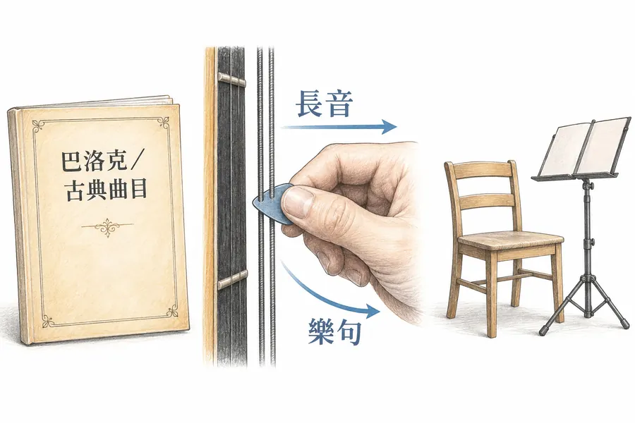

圖解 18.1　古典與巴洛克曲目（示意）

> **常見誤解：譜上寫「為曼陀林而作」，就代表現代曼陀林可以照原樣彈。**
> 其實歷史上的曼陀林有不同弦數、不同調弦、不同弦材。同一首曲子放到不同型制上，音量、延音、音色都會變。這不是錯，這叫「改編」。重點是知道自己改了什麼。

## 18.2　那不勒斯歌曲

那不勒斯歌曲常讓人聯想到曼陀林。這個文化連結，是在十九世紀後期到二十世紀的大眾傳播中慢慢固定下來的。

但實際伴奏不只是「一直顫音」。

旋律樂器、歌者、吉他伴奏之間，是有呼吸的。

曼陀林可能負責間奏（interlude）、副旋律（countermelody）、分解和弦，或裝飾性的顫音。

如果是在伴奏歌手，最重要的一件事是：不要和人聲的子音起音（consonant attack）搶位置。

顫音可以稍微晚一點點進入，等字頭出來再跟上。句尾再收掉。

只有在間奏時，才把音量與音色往前推。

這種「退後／前進」的合奏意識，比從頭到尾維持同樣音量，更接近真正的歌唱伴奏。

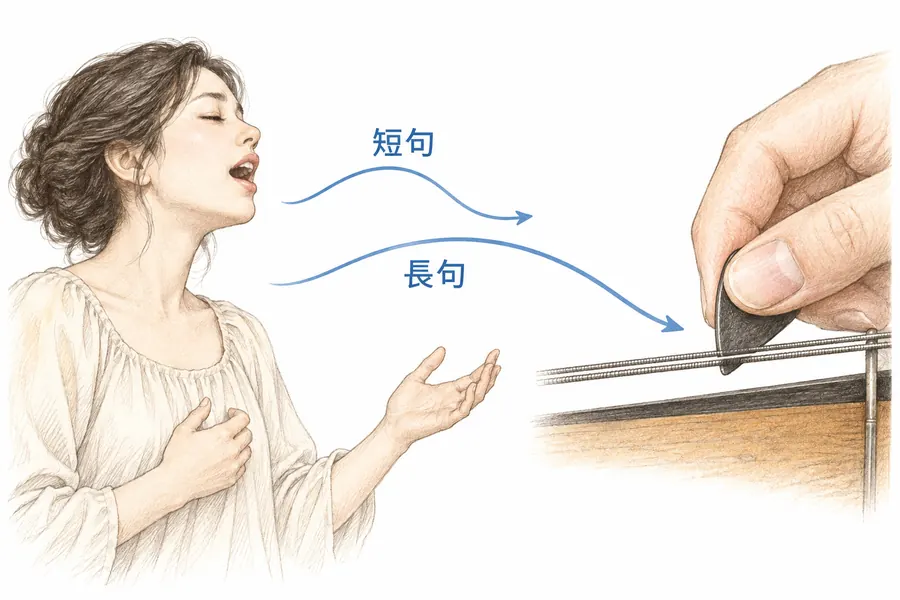

圖解 18.2　那不勒斯歌曲（示意）

> **常見誤解：「曼陀林就是那不勒斯民謠樂器」。**
> 這是被觀光文化簡化後的印象。現代觀光常把曼陀林變成義大利的刻板符號。它在義大利文化中確實重要，但歷史上它擔負的功能，遠比單一形象廣得多。專業寫作要避免這種「反向定義」。

## 18.3　美國曼陀林熱潮與合奏

美國國會圖書館（Library of Congress）整理的美國曼陀林歷史指出：

1880 年代開始的熱潮，和五件事密切相關。

這五件事是：巡演、商業表演、樂器製造、出版市場、學校社團。

到了 1890 年代，美國各地的曼陀林社團（mandolin clubs）與樂團大量出現。

「斑鳩琴、曼陀林與吉他」（Banjo, Mandolin and Guitar，簡稱 BMG）文化，把職業演奏者、教師、製造商、業餘社團串成一條完整產業。〔S1803〕

這段歷史很重要。因為它提醒我們一件事：

美式曼陀林並不是從義大利移民一路直接跳到 Bill Monroe。

在藍草音樂出現之前幾十年，美國就已經有大量合奏教材、方法書，以及各種家族樂器。

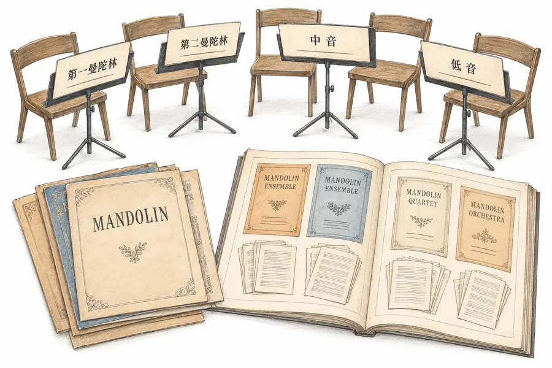

圖解 18.3　美國曼陀林熱潮與合奏（示意）

國會圖書館保存的 1915 年《婦運者進行曲》（The Suffragettes: March），甚至明列出曼陀林樂團的編制。

裡面包含：多把曼陀林、曼陀拉（mandola）、曼陀大提琴（mandoloncello）、吉他、斑鳩琴、鋼琴。

這直接證明了當時的樂團化程度。〔S1804〕

這套合奏傳統，也推動了三件事：大型家族樂器、通用記譜法（universal notation）、製造業發展。

懂了這段背景，才會明白 Gibson 後來做曼陀拉、曼陀大提琴、曼陀低音琴（mando-bass），重點是在回應當時的樂團市場。

## 18.4　藍草音樂（Bluegrass）

藍草音樂名人堂（Bluegrass Music Hall of Fame）稱 Bill Monroe 為藍草音樂的核心奠基人物。

他把早期的弦樂隊（string band）、藍調（blues）、福音詩歌（gospel）、小提琴音樂（fiddle）、爵士等元素，重新組合起來。

1945 年，Earl Scruggs 加入「藍草男孩」（Blue Grass Boys）。

之後，曼陀林、小提琴、斑鳩琴、吉他、貝斯這五件編制，成為經典藍草音色的重要標準。〔S1805〕

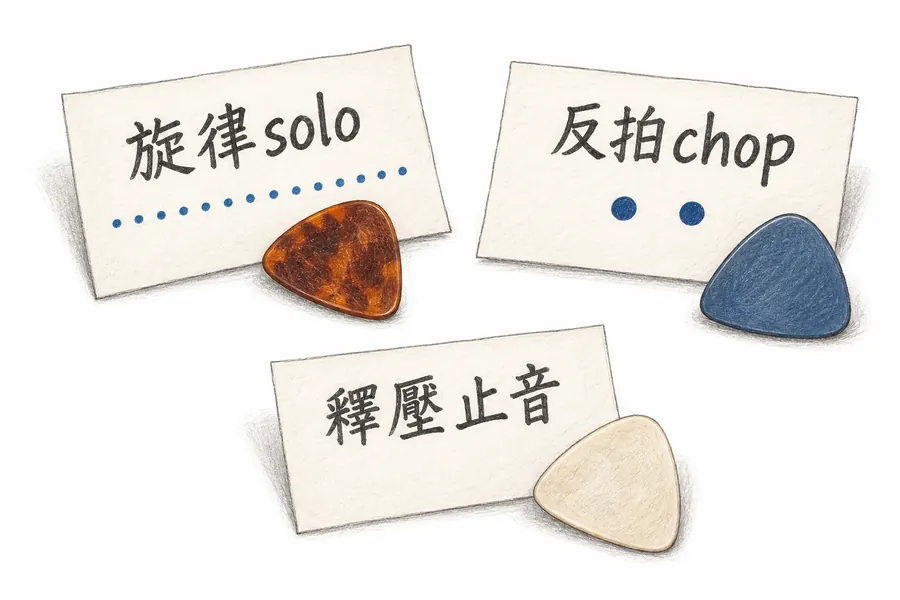

圖解 18.4　Bluegrass 藍草音樂（示意）

曼陀林在這個合奏裡，有兩套截然不同的任務。

| 任務 | 要做什麼 | 技術重點 |
|:---|:---|:---|
| 領奏（lead break） | 把旋律推到前面 | 清楚的單音起音、滑音（slides）、雙音、藍調語氣、快速交替撥弦（alternate picking） |
| 伴奏（chop） | 在 2、4 拍打出短促的後拍（backbeat） | 短、乾、乾淨，不能拖 |

如果只會領奏、不懂得讓出空間；或只會切音、不理解樂句（phrase），那就只掌握了半套語法。

> **常見誤解：Monroe 風格＝所有藍草曼陀林。**
> 並不是。後來的演奏者發展出交叉撥弦（crosspicking）、更複雜的和聲、爵士影響，以及新的聲響。Sam Bush 推動了新草音樂（newgrass）；David Grisman 融合藍草與爵士等來源，建立了所謂的「Dawg music」。藍草名人堂的 Grisman 傳記，也把這種跨界定位視為他的重要貢獻。〔S1806〕

## 18.5　老式傳統音樂（Old time）

老式音樂（old-time）的曲目，常和小提琴曲調（fiddle tunes）、方塊舞（square dance）、斑鳩琴加吉他的弦樂隊文化連在一起。

曼陀林可能跟著小提琴吹旋律，也可能只提供節奏。

它的語法通常更重視「連續不斷的舞蹈脈動」。藍草音樂則常安排各樂器輪流獨奏。

演奏小提琴曲調時，空弦（open strings）、持續低音（drones）、雙音都很重要。

如果彈得太乾淨、每個音都像古典練習曲一樣分開，反而可能失去律動（groove）。

有些裝飾音和「弓法造成的重音」，需要轉譯成撥弦模式（pick pattern）。讓撥弦動作呈現原曲的重音與呼吸。

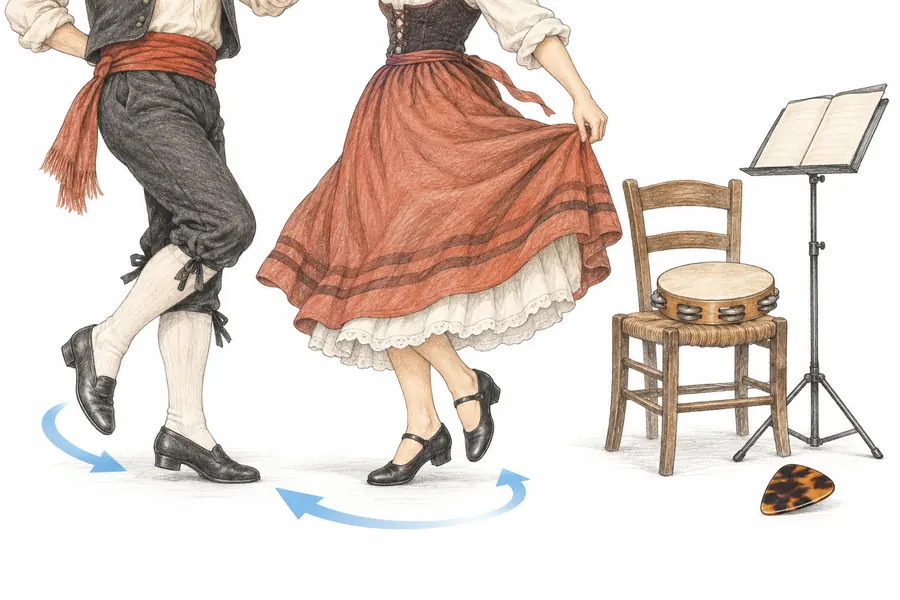

圖解 18.5　Old time 傳統音樂（示意）

學老式音樂最有效的方法，是跟代表錄音一起反覆演奏。

先抓樂句長度、弱起音（pickup notes）、重音，再加裝飾。

樂譜只能記下音高與節奏骨架。真正的細微時間差（microtiming），通常存在於口耳相傳與錄音裡。

## 18.6　愛爾蘭傳統音樂

愛爾蘭傳統音樂檔案館（Irish Traditional Music Archive，簡稱 ITMA）的館藏與出版資料顯示：

曼陀林已經成為當代愛爾蘭傳統音樂中看得見的樂器。

也有專門研究在討論它的角色。

ITMA 也收錄 Brendan O'Regan 等曼陀林／愛爾蘭長頸魯特琴（bouzouki）／吉他演奏者的里爾舞曲（reel）、吉格舞曲（jig）、角笛舞曲（hornpipe）作品。〔S1807〕

在愛爾蘭舞曲裡，曼陀林常以單音旋律為主。

重點是 reel、jig 這種特定節奏的律動感（lift）。

右手要注意重音模式（accent pattern）與裝飾音的時間點。

三連音（triplet）、切音（cut）、滾音（roll）這類裝飾，必須依照撥弦動作重新設計。不能機械式模仿笛子或小提琴。

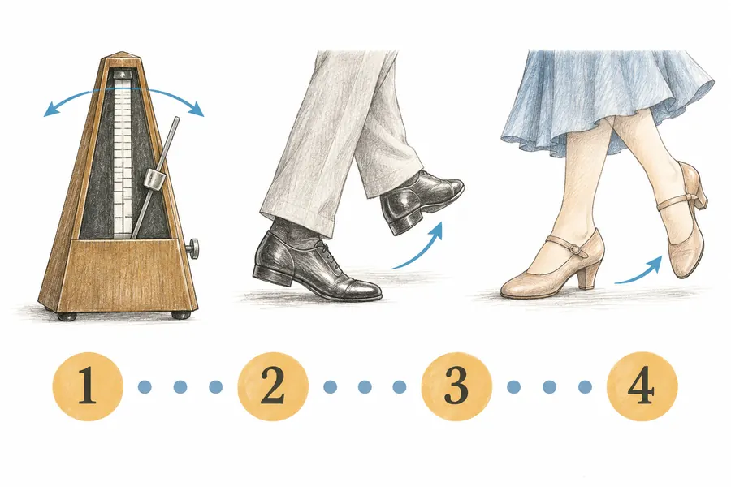

圖解 18.6　愛爾蘭傳統音樂（示意）

八度曼陀林（octave mandolin）、愛爾蘭長頸魯特琴，也常出現在同一個音樂圈裡。

這些樂器的名稱和調弦很容易搞混。

標準曼陀林的高音起音，很適合拉旋律。

八度樂器則常更適合伴奏，或負責低音域的旋律。

編曲時要看實際的調弦與音域（register），再決定各樂器的聲部分工。

## 18.7　秀羅（Choro）與巴西的 Bandolim

巴西秀羅（choro）裡的班多林（bandolim），雖然和曼陀林同屬一個家族，但已經發展出自己的演奏文化。

Jacob do Bandolim 是二十世紀最具代表性的人物之一。

莫雷拉・塞勒斯研究所（Instituto Moreira Salles，簡稱 IMS）保存了大量與 Jacob、「黃金時代」（Época de Ouro）樂團、作曲家 Radamés Gnattali 相關的錄音與文獻。

例如 IMS 對《肖像》（Retratos）的資料就記錄了：Jacob 在 1964 年錄製這部作品，並呈現他和作曲家／編曲者之間的密切合作。〔S1808〕

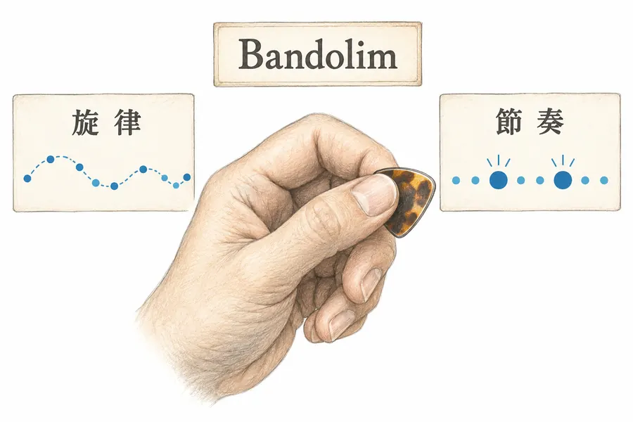

圖解 18.7　Choro 與巴西 Bandolim（示意）

秀羅的旋律常有高度切分音（syncopation）、快速裝飾、精準的觸弦方式（articulation），加上複雜的和聲背景。

> **常見誤解：Bandolim 只是「巴西版的顫音曼陀林」。**
> 並不是。很多段落靠的是清楚的單音起音、細密的樂句處理，以及和吉他（violão）、小四弦琴（cavaquinho）、手鼓（pandeiro）之間的對話。

伴奏小組（regional）的節奏與和聲流動，是獨奏旋律不能忽略的基礎。

Jacob 在 1964 年的書信裡甚至提到：為了 Gnattali 的《肖像》，他從「一直排練」轉向更細緻地「研究」作品。

這反映出一件事：班多林的曲目，同時跨越了口傳的秀羅與書面的室內樂寫作。〔S1809〕

## 18.8　爵士搖擺（Swing）與 Dawg

曼陀林在爵士樂裡不是主流樂器。所以演奏者必須主動解決幾個問題：伴奏和弦（comping）要放哪個音域、和弦要省略什麼、延音怎麼處理。

四個弦組的限制，反而有利於精簡的聲部排列（voicing）。

三音（third）、七音（seventh）、延伸音（tension）可以清楚呈現。低音與根音交給其他樂器。

搖擺語法需要八分音符的感覺（eighth-note feel），不能只是把古典的交替撥弦加快。

重音、音長、樂句位置，才決定搖不搖擺。

和弦伴奏可以用短促的和弦點（chord stabs）、聲部連貫的三音形狀（voice-led three-note shapes），或分解和弦織體。

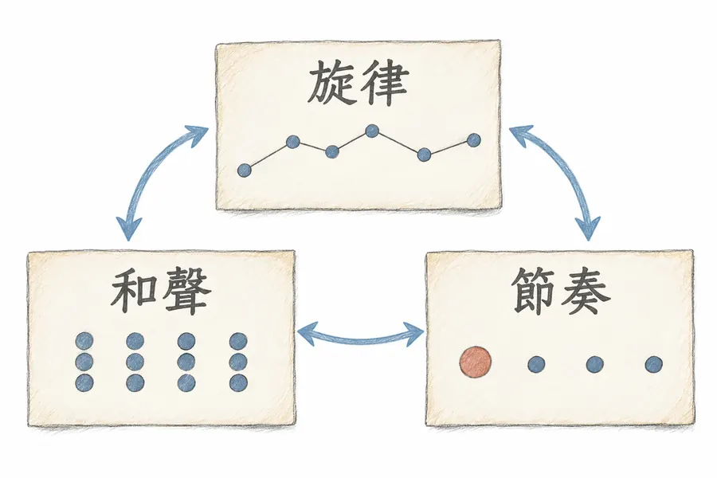

圖解 18.8　爵士 Swing 與 Dawg（示意）

David Grisman 的「Dawg music」是重要的跨界案例。

藍草名人堂形容他的風格受到藍草、爵士等多種來源影響，並形成獨特的語言。

這種音樂提醒我們：不同傳統可以互相結合，長出新的音樂語言。〔S1806〕

## 18.9　流行音樂與影視配樂

在現代製作裡，曼陀林不一定會用到完整的傳統技法。

它可能只負責三件事之一：

- 用空弦分解和弦，提供高頻的亮點（sparkle）
- 用顫音製造懷舊色彩
- 加 double 木吉他、小提琴線條或合成器固定音型（synth ostinato）

這時候最重要的，是編曲上留給它多少空間（arrangement space）。

錄音時，雙弦同時發聲的起音，很容易占據 2–5 kHz 這個頻段。

如果同時和木吉他、明亮的鋼琴、Hi-hat 密集演奏，整個聲音會顯得擁擠。

編曲可以從四個地方留位置：音域、音符密度、麥克風位置（mic placement）、等化（EQ）。

讓曼陀林和其他聲部都能被清楚聽見。

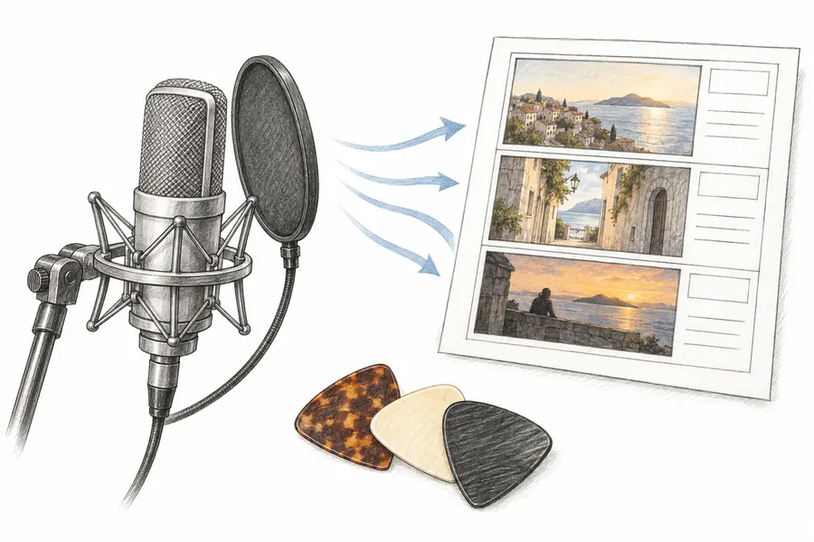

圖解 18.9　流行音樂與影視配樂（示意）

電曼陀林（electric mandolin）又開啟了另一套語法。

實心琴身（solid-body）可以用延音、效果器、破音（overdrive），甚至做成五弦來增加低音 C。

> **常見誤解：這些聲音「不算真正的曼陀林」。**
> 不該這樣看。它們是這個樂器家族持續演化的一部分，不是偏離。

## 18.10　曼陀林樂團的編制

歷史上的曼陀林樂團，通常包含這些聲部：曼陀林一、曼陀林二、曼陀拉、曼陀大提琴、吉他、貝斯。

美國早期甚至會加入斑鳩琴和鋼琴。

美國古典曼陀林協會（Classical Mandolin Society of America，簡稱 CMSA）與國會圖書館的資料都顯示一件事：

家族樂器與記譜制度，是這個樂團傳統的重要部分。〔S1804〕〔S18010〕

編曲時最常見的問題是：所有上聲部同時顫音。

結果就是中高頻過度密集，聽起來像一團霧。

更有效的做法是分工織體（texture）：

| 聲部 | 角色 | 建議手法 |
|:---|:---|:---|
| 曼陀林一 | 主旋律 | 持續顫音 |
| 曼陀林二 | 內聲部節奏 | 節奏型單音 |
| 曼陀拉 | 中聲部支撐 | 較長的音 |
| 曼陀大提琴 | 對位線條 | 副旋律（counterline） |
| 吉他／貝斯 | 建立脈動 | 和弦與低音 |

各聲部可以依角色選用顫音、單音或分解和弦，形成清楚的層次。

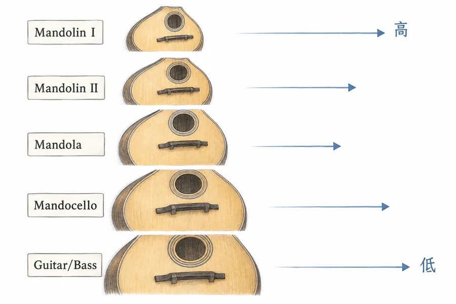

圖解 18.10　曼陀林樂團的編制（示意）

音域重疊要特別小心。

如果曼陀林二和曼陀拉都在同一個音域做密集和聲，聲音會混濁。

把其中一個聲部移到更低的地方，或改成節奏型，清晰度通常會好很多。

## 18.11　弦樂與鋼琴作品的改編

小提琴一聲部（Violin I），通常可以直接對應到曼陀林一的音域。但延音不一樣。

中提琴（Viola）要對應到 C 調的曼陀拉時，還要處理譜號（clef）與記譜慣例的問題。

大提琴（Cello）的線條要交給曼陀大提琴時，也要確認有效弦長（scale）、調弦、可用的低音。

CMSA 的記譜指南特別提醒：曼陀拉、曼陀大提琴的歷史記譜法，存在多種不同系統。〔S18010〕

弓弦樂器的長音鋪底（pad），如果全部改成顫音，改編聽起來會太厚。

可以把原本一條持續的內聲部，改成分解和弦、重複脈動，或交給吉他延音。

把真正需要歌唱性（cantabile）的線條，留給顫音。

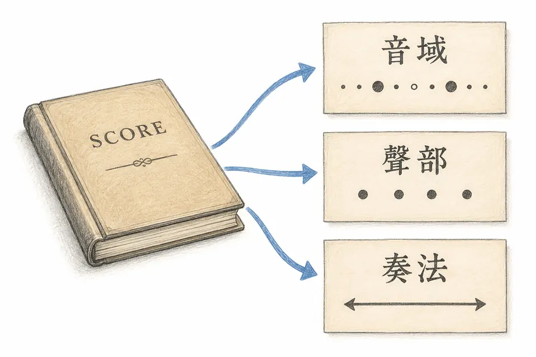

圖解 18.11　弦樂與鋼琴作品的改編（示意）

鋼琴改編則是相反的問題。

原作可能同時有十個音在響。曼陀林樂團必須先找出和聲功能，再決定哪些聲部要保留。

改編時要重新安排音域、聲部與和聲密度。

## 18.12　案例：同一首 Reel 的跨風格演奏

同一首 reel（里爾舞曲），在三種風格裡會長得很不一樣。

| 風格 | 追求什麼 | 會加入什麼 |
|:---|:---|:---|
| 古典 | 均勻的觸弦、清楚的樂句 | 少量顫音 |
| 藍草 | 推進感與獨奏張力 | 切音伴奏、雙音、領奏式重音 |
| 愛爾蘭 | 舞蹈律動 | 裝飾音、連續不斷的旋律 |

音高可以九成相同，聽起來卻完全不同。

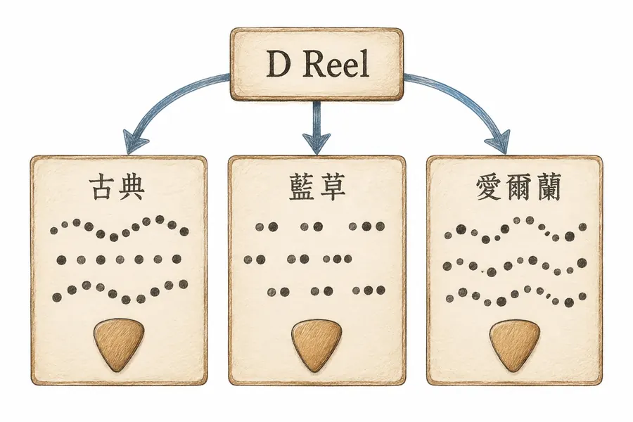

圖解 18.12　同一旋律的風格改編思路；點線表示相對密度（示意）

> **常見誤解：換一把琴，就等於換一種風格。**
> 不是。如果右手語法不變，例如拿 F 型琴演奏所有音樂都用 Monroe 式起音，那只是音色變了，不是風格轉換。真正的跨風格，要學時間感（time feel）、裝飾語彙、合奏互動，還有錄音傳統。

最好的學習方法是：每種風格選 3–5 位代表演奏者與錄音。

先模仿樂句，再分析技巧。

這比先看「十個愛爾蘭曼陀林樂句」更能建立真正的語言。

## 表 18-1｜不同音樂傳統中的曼陀林角色

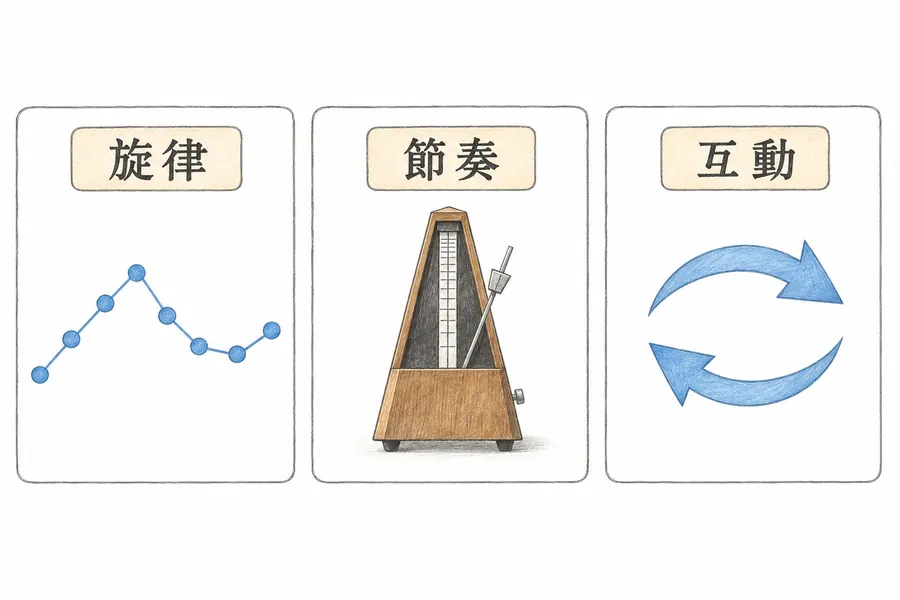

| 傳統 | 典型角色 | 右手重點 | 和聲／節奏 | 學習優先順序 |
|:---|:---|:---|:---|:---|
| **義大利古典** | 獨奏／室內樂旋律 | 顫音、觸弦方式 | 以譜面為主 | 歷史型制＋方法書＋錄音 |
| **藍草** | 領奏＋後拍 | 單音、雙音、切音 | 2/4 拍律動 | Monroe 系譜＋即興合奏（jam） |
| **愛爾蘭** | 舞曲旋律 | 單音、三連音與裝飾 | reel／jig 律動 | 大量跟錄音 |
| **秀羅** | 獨奏旋律 | 精準觸弦、裝飾音 | 伴奏組和聲與切分音 | Jacob／黃金時代錄音 |
| **爵士／Dawg** | 即興＋伴奏和弦 | 搖擺、交叉撥弦 | 延伸和聲 | 聲部連接＋語彙 |

圖解 表 18-1｜不同音樂傳統中的 Mandolin 角色（示意）

## 自我學習題庫

學習檢查：作答、核對、複習

先自己作答，再看答案。答錯時回到本章相關小節重新讀一次。

**1. 藍草音樂中，曼陀林常見的節奏角色是？**

- A. 切音後拍（chop backbeat）
- B. 持續的琴弓長音
- C. 只彈低音
- D. 完全不伴奏

**2. 演奏愛爾蘭舞曲時，重要重點之一是？**

- A. 節奏律動與裝飾音的時間點
- B. 只追求最大音量
- C. 全部改成顫音
- D. 取消重音

**3. 曼陀林樂團編曲時要注意？**

- A. 不同家族樂器的音域與角色
- B. 所有聲部都彈一樣
- C. 只看琴身大小
- D. 只用一個和弦

**答案：1.A　2.A　3.A**

## 本章主要查證來源

查證來源：找原文、核條件、留紀錄

**【S1801】Carlo Munier：Scuola del Mandolino 等教本。** 十九至二十世紀古典曼陀林技術系統。

> https://imslp.org/wiki/Metodo_completo_per_la_divisione_(Munier%2C_Carlo)

**【S1802】Raffaele Calace：Metodo per mandolino, Opp.37–42。** 古典曼陀林技法與歷史教學系統。

> https://imslp.org/wiki/Metodo_per_mandolino_(Calace%2C_Raffaele)

**【S1803】Library of Congress, NLS Music Notes：From Baroque to Bluegrass, a Globe-Trotting Instrument（2020）。** 美國曼陀林熱潮、BMG 文化與藍草音樂前史。

> https://blogs.loc.gov/nls-music-notes/2020/08/from-baroque-to-bluegrass-a-globe-trotting-instrument/

**【S1804】Library of Congress：The Suffragettes: March（1915）。** 歷史曼陀林樂團的實際編制（三把曼陀林、曼陀拉、曼陀大提琴、吉他、斑鳩琴、鋼琴）。

> https://www.loc.gov/item/2017562356/

**【S1805】Bluegrass Music Hall of Fame & Museum：Bill Monroe biography。** 藍草音樂歷史、Monroe 的影響與 1945 年經典編制。

> https://www.bluegrasshall.org/inductees/bill-monroe/

**【S1806】Bluegrass Music Hall of Fame & Museum：David Grisman biography。** Dawg music、藍草與爵士的跨界背景。

> https://www.bluegrasshall.org/inductees/david-grisman/

**【S1807】Irish Traditional Music Archive：Brendan O'Regan compositions / publications。** 曼陀林在當代愛爾蘭傳統音樂中可查證的館藏與研究線索。

> https://www.itma.ie/saothar/brendan-oregan/

**【S1808】Instituto Moreira Salles / Rádio Batuta：Suíte Retratos, 3º movimento – Anacleto de Medeiros。** Jacob do Bandolim 1964 年《Retratos》錄音與秀羅歷史資料。

> https://radiobatuta.ims.com.br/programas/equipe-ims-bia-paes-leme/suite-retratos-3-movimento-anacleto-de-medeiros

**【S1809】Instituto Moreira Salles：Jacob do Bandolim 1964 letter to Radamés Gnattali。** Jacob 對《Retratos》學習與研究過程的第一手書信。

> https://correio.ims.com.br/carta/valeu-ora-se-valeu/

**【S18010】Classical Mandolin Society of America：Music Notation for Mandolin Family Instruments。** 曼陀拉、曼陀大提琴等家族樂器的記譜系統與地域差異。

> https://classicalmandolinsociety.org/wp-content/uploads/Music_Notation_for_Mandolin_Family_Instruments_v3.pdf

---

**Part F　選琴、研究與日常照護**

認識製琴師與型號資料，綜合結構和演奏需求，完成選琴、紀錄與照護。

閱讀範圍　第 19 章至第 21 章

---
