## 本章重點

- 品牌史最容易寫成神話。原廠說「我們首創」，是重要線索，但那是品牌自述，不是定論。
- 判斷一把琴的來歷，要把四種證據分開：品牌自述、原始專利、館藏實物、型錄與後世研究。
- 「設計在某一刻出現」和「後世某種風格採用了它」，是兩件事，不能混為一談。
- 琴的型制（A 型／F 型）和它的等級、價格，是兩個不同的欄位。
- 市場上流傳的規格經常是錯的。原廠型錄與實物尺寸，比賣場描述可靠。

## 開場：為什麼品牌史容易變成神話

品牌史最容易寫成神話。

原廠網站自然會強調「創新」、「傳奇」、「第一」。

二手市場則常把型號年份、木材、製造地，一個抄一個。

真正可靠的樂器史，需要把這幾樣東西分開來看：品牌自述、原始專利、館藏實物、型錄、後世研究。

本章挑幾個關鍵傳統，說明三件事：

- 設計如何改變
- 哪些說法可以直接證實
- 哪些說法仍然需要保留條件

第 20 章會進一步把品牌拆成「一個型號一列」的資料庫。

本章要回答的是更大的問題：為什麼這些型號會出現？它們是在什麼市場、什麼音樂、什麼製造技術背景下成立的？

## 品牌快速對照表

先看地圖，再看細節。

| 品牌／人物 | 國家／地區 | 年代 | 最有名的是 |
|:---|:---|:---|:---|
| Vinaccia 家族 | 義大利・那不勒斯 | 十八世紀 | 早期那不勒斯式曼陀林；1781 年館藏實物 |
| Fabricatore 家族 | 義大利・那不勒斯 | 本書未載明年份 | 那不勒斯製琴世家 |
| Embergher | 義大利・羅馬 | 本書提及於十九世紀末的脈絡 | 羅馬學派；不同的琴體比例與音樂會用琴 |
| Calace | 義大利・那不勒斯 | 官方追溯到 1825 年，至今 | 家族工坊延續；演奏、作曲、教學與製琴合一 |
| Orville H. Gibson／Gibson | 美國 | 1898 年專利；1923 年 F-5 | 雕削面板與背板、F 形音孔、F5 型制 |
| C. F. Martin | 美國 | 曼陀林熱潮時期 | 大量曼陀林，含圓背與平背 |
| Washburn（Lyon & Healy） | 美國 | 曼陀林熱潮時期 | 曼陀林熱潮時期的大量生產 |
| Vega | 美國 | 曼陀林熱潮時期 | 曼陀林熱潮時期的大量生產 |
| Suzuki | 日本 | 2016 年官方型錄可查 | 學校與大學樂團用的量產琴，含中低音家族樂器 |
| Collings | 美國（本書歸於美式手工琴） | 現代 | 高階 F 型手工琴，規格精密 |
| Northfield | 美國／中國（分工製造） | 現代 | Big Mon 加大琴身；跨國製造流程 |
| Eastman | 本書未載明產地 | 現代 | 量產的實木 F 型琴 |

## 19.1　Vinaccia 與那不勒斯傳統

Vinaccia 家族常出現在曼陀林的起源故事裡。

但「某一位 Vinaccia 發明了現代曼陀林」這種一句話，需要很小心。

更可靠的做法，是看保存下來的實物。

大都會藝術博物館（Metropolitan Museum of Art，簡稱 Met）收藏的 1781 年 Antonio Vinaccia 曼陀林，具備這些特徵：

- 八根金屬弦
- 四組同音弦組（course）
- 與小提琴相同的 G–D–A–E 調弦
- 深的圓背（bowlback）
- 折面面板（soundboard）

這些都是後來「那不勒斯式」的重要特徵。〔S1901〕

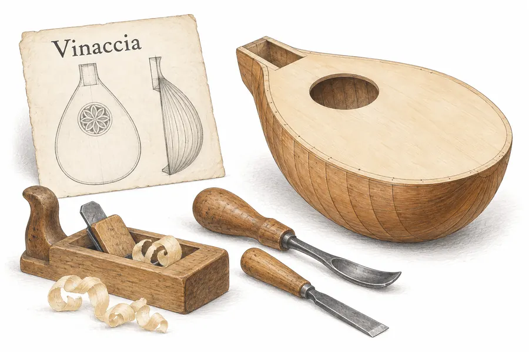

圖解 19.1　Vinaccia 與那不勒斯傳統（示意）

這類實物證據告訴我們：到十八世紀後期，後世熟悉的核心配置已經成熟。

但「成熟」不等於「某一天突然被某一個人創造出來」。

當時義大利各地還有不同的曼陀林系統（mandolino system）。

所以更合理的歷史敘述是這樣：

那不勒斯的工坊，逐步整合了金屬弦、四弦組、五度調弦與特定的琴體結構。

最後，它成為十九世紀最有影響力的系統之一。

> **常見誤解：有一位 Vinaccia 在某一年「發明」了現代曼陀林。**
> 這種一句話式的說法過度簡化。可靠的說法是「逐步整合、趨於成熟」，而不是「單一人物、單一瞬間」。

收藏者讀 Vinaccia 標籤（label）時，還要注意三件事：這個家族有好幾代製琴師、名字會重複、後世也有仿製標籤。

流傳紀錄（provenance）、結構特徵、紙張與字體，都比單一個標籤重要。

## 19.2　Fabricatore、Embergher 與義大利工坊

Fabricatore 家族同樣是那不勒斯製琴的重要名字。

羅馬的 Embergher，則發展出不同的琴體比例、結構，以及音樂會用琴（concert instrument）。

十九世紀末的義大利曼陀林世界，並不是一條單線。

那不勒斯、羅馬、米蘭等城市，各有自己的工坊、演奏家與市場偏好（market preference）。

這些差異會表現在這些地方：

- 圓背木條（bowl ribs）的數量
- 面板的彎折（soundboard bend）
- 琴頭（headstock）
- 指板延伸（fingerboard extension）
- 有效弦長
- 裝飾

研究古琴時，如果只用「義大利圓背」一欄把所有琴歸類，就會丟掉真正的地域資訊。

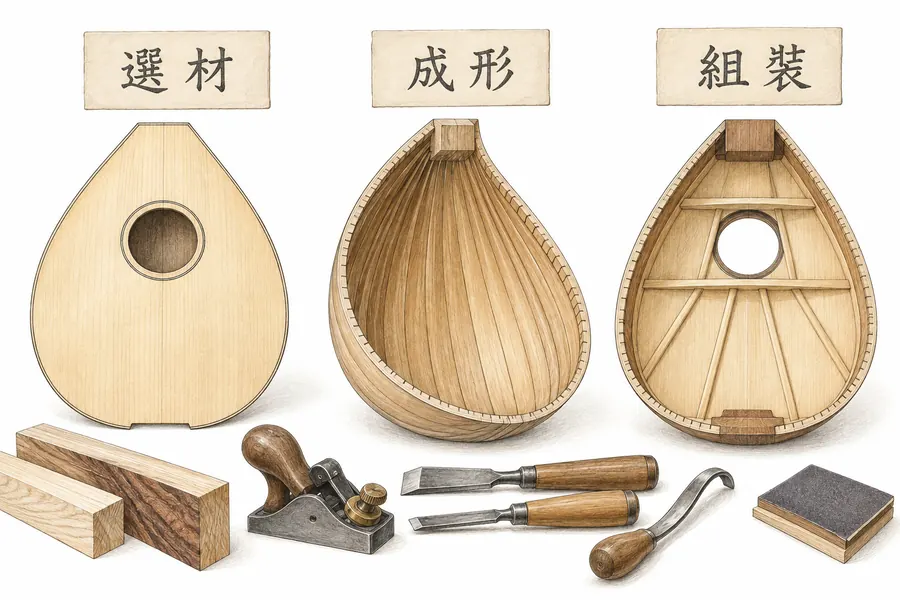

圖解 19.2　Fabricatore Embergher 與義大利工坊（示意）

對現代演奏者來說，理解多學派的價值在於一件事：圓背的音色不是只有一種固定答案。

不同的結構、尺寸與調整設定（setup），可以產生相當大的起音、投射力（projection）、延音差異。

## 19.3　Calace 的家族與產品

Calace 官方資料把工坊創立追溯到 1825 年，至今仍在那不勒斯製作曼陀林家族樂器。

現行官網直接列出多款曼陀林、曼陀拉、曼陀大提琴、魯特琴型樂器（liuto）的規格。

規格包含有效弦長、木條數、木材與調弦。

這讓 Calace 成為研究「歷史傳統如何延續到今天」的重要案例。〔S1902〕

例如現行的曼陀林型號 13、15、16Bis、Cl.A／B／C／D 等，大多使用 33.5 cm 的有效弦長。

但它們在玫瑰木（rosewood）或楓木（maple）琴身、木條數量、指板琴格數、裝飾、琴頭構造上，形成不同層級。

官方資料也顯示：八弦與十弦的曼陀大提琴同時存在。

所以家族名稱應該和原廠的弦數、調弦資料一起核對，不能只看名字。〔S1903〕

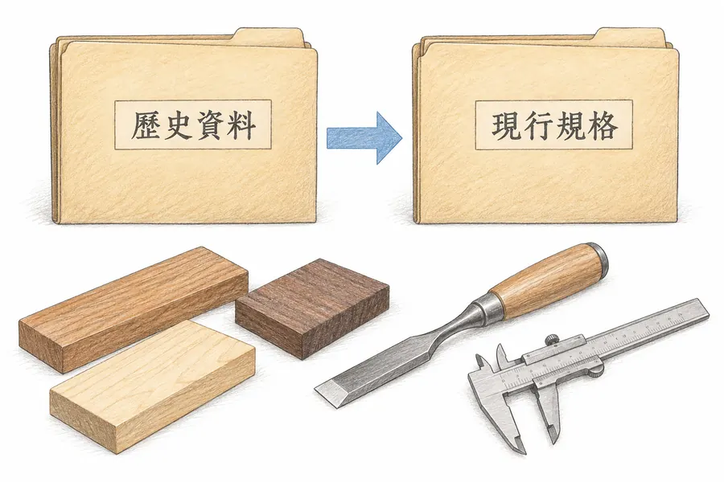

圖解 19.3　歷史與現行規格分開查閱（示意）

Raffaele Calace 本人同時是演奏家、作曲家與教育家。

他的六冊《曼陀林教本》（Metodo per mandolino），留下大量技法證據。

品牌史在這裡的重點是：曲目、教本、演奏實踐與製琴，是互相支撐的四件事。〔S1904〕

## 19.4　Orville Gibson 的設計

Orville H. Gibson 在 1898 年取得美國專利 US598245A。

這份專利明確描述他的改良理念：他批評當時的樂器由太多彎曲、拼接、內部支撐、膠合零件構成。

於是他提出兩個方向：雕削的面板與背板（carved top/back），以及整體化的琴身與琴頸結構。

這份專利，是理解 Gibson 早期設計最可靠的一手來源之一。〔S1905〕

Met 收藏的 1898 年 Orville Gibson 曼陀林，把專利變成看得見的實物：

- 雲杉雕削面板（spruce carved top）
- 胡桃木雕削背板（walnut carved back）
- 浮動琴橋（floating bridge）
- 尾板（tailpiece）
- 橢圓音孔（oval soundhole）
- 仍保留那不勒斯式的八弦四弦組

這說明：美式雕削琴身（carved-body）更準確地說，是對聲學結構的重新設計，而不是造型花樣。〔S1906〕

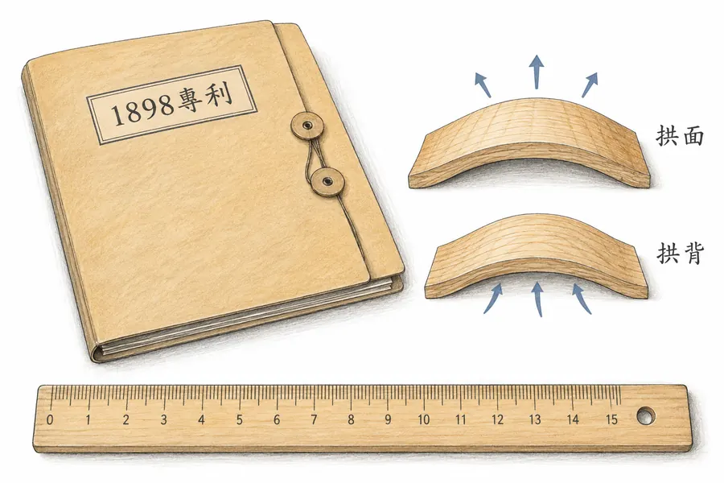

圖解 19.4　Orville Gibson 的設計（示意）

後來的 A 型（A-style）與 F 型（F-style），都建立在這條雕削面板背板的路線上。

外型的捲曲（scroll）、尖角（points）很顯眼。

但真正有長期影響的，是雕削的板、琴橋系統、琴頸與琴身的幾何關係，以及後續音樑（bracing）的發展。

## 19.5　Lloyd Loar 與 F5

Gibson 現代官方的 F-5 歷史頁，把 1923 年 F-5 的關鍵改變列為這幾項：

- F 形音孔（f-holes）
- 較長的琴頸
- 琴橋位置改變
- 重新設計的音樑
- 加高的指板延伸（raised fingerboard extension）

這些設計，確實在現存的 Loar 簽名 F-5，以及後續的藍草樂器中產生巨大影響。〔S1907〕

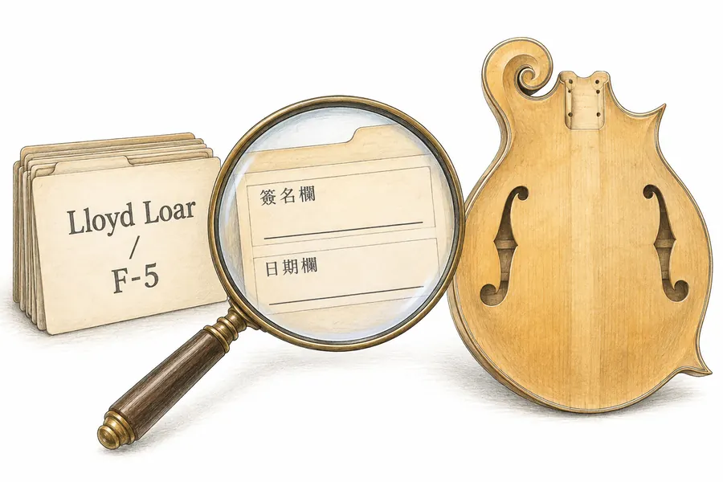

圖解 19.5　Lloyd Loar 與 F5（示意）

> **常見誤解：「Loar 發明了藍草音色」。**
> 這是後見之明。F-5 出現的時候，藍草音樂還要二十多年才成形。真正讓這個型制和藍草身分強烈綁在一起的，是後來 Bill Monroe 等演奏者的使用與錄音文化。歷史因果要分成兩段看：「設計出現」與「後世風格採用」。

Gibson 官方現行的 1923 F-5 Master Model 復刻版（reissue），也提供了材料基準：

- 紅雲杉面板（Red Spruce top）
- 花紋楓木的琴身、背板、琴頸（figured maple）
- 黑檀指板與琴橋（ebony fingerboard／bridge）

現代復刻可以幫我們理解：官方認為哪些歷史特徵值得保留。

但不能用它反推「所有 1920 年代的原琴都完全相同」。〔S1907〕

## 19.6　美國黃金時代的其他品牌

曼陀林熱潮帶來巨大的市場，而且不只 Gibson 一家。

C. F. Martin、Washburn（Lyon & Healy）、Vega 等，都製作了大量曼陀林，包含圓背、平背（flatback），以及不同裝飾等級。

這些品牌反映的是「家庭音樂、學校社團、曼陀林樂團」的市場，而不只是職業舞台。

圖解 19.6　美國黃金時代的其他品牌（示意）

研究這些琴時，型錄（catalog）比後世的價格指南更重要。

同一個品牌，可能在幾十年內改變型號代碼、材料與製造地。

如果只看琴頭標誌（headstock logo），很容易誤判年代。

Martin 等公司保存的檔案與研究指南，可以提供序號、型錄與生產紀錄。

但仍然要一個型號一個型號核對。〔S1908〕

收藏價值還要一起評估三件事：稀有程度、原裝狀態、保存情形。

某些大量生產的學生型號（student model），歷史上有趣，但市場價格不高。

某些短期生產的高階型號，則因為稀有、原裝、可演奏，而大幅增值。

## 19.7　Suzuki 與日本製琴

日本的曼陀林文化，長期和大學、學校樂團一起發展。

所以市場不只需要標準曼陀林，也需要曼陀拉、曼陀大提琴等合奏樂器。

鈴木（Suzuki）是其中最重要的量產品牌之一。

2016 年的官方型錄，可以直接確認 M-30、M-60、M-80、M-100、MD 系列與 MC-836 等型號的材料、價格與尺寸。

這是修正二手市場錯誤標示的重要一手資料。〔S1909〕

MC-836 是典型案例。

二手市場的資料，曾經出現「大型圓背」的描述。

但 Suzuki 官方型錄明確列出：574 mm 的振動長度（vibration length）、雲杉面板、玫瑰木平背琴身、桃花心木琴頸、玫瑰木指板。

> **常見誤解：「這個型號存在」就等於「網路上流傳的規格正確」。**
> 這是兩件事。型號存在，不代表那些規格是對的。

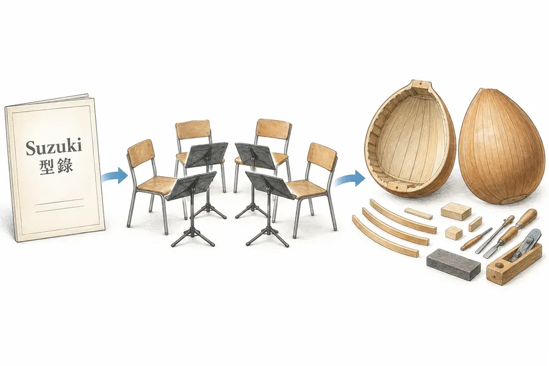

圖解 19.7　Suzuki 與日本製琴（示意）

日本二手市場上有很多已停產的舊型號。

所以判斷年份時，要結合型錄、標籤、琴頭與標誌、五金件、琴盒，以及實際測量尺寸。

不能因為型號數字相近，就推測材料也相同。

## 19.8　現代美式手工琴

現代的高階 F 型琴，並不是只複製 1920 年代。

以 Collings MF5 的官方規格為例，它使用：

- 阿迪朗達克雲杉（Adirondack spruce）
- 東部花紋楓木（Eastern flamed maple）
- 音樑（tone bars）
- 13 7/8 吋有效弦長
- 複合弧度黑檀指板（compound-radius ebony fingerboard）

它的橢圓音孔版本 MF5 O，則改用 X 型音樑（X-brace）。

這顯示同一個品牌，會用「音孔形狀＋音樑形式」的組合，來區分不同的聲學目標。〔S1910〕〔S1911〕

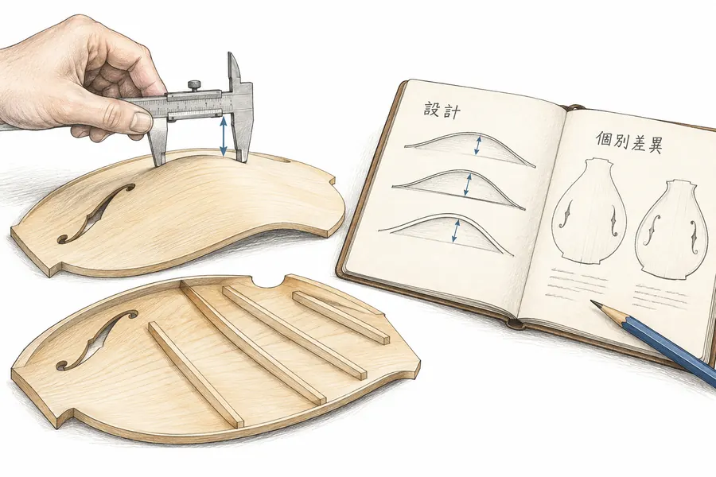

圖解 19.8　現代美式手工琴（示意）

Northfield 的 Big Mon，則把琴身稍微加寬，並調整厚度（depth），希望增加中低頻的反應。

官方甚至明確說明：琴身最寬處增加了大約 5 mm。

這是一個很好的現代案例。傳統的 F5 輪廓，可以做小幅度的比例修改，讓外形比例和材料配置一起發展。〔S1912〕

製造地也變得全球化了。

Northfield 公開說明：不同系列可能在密西根（Michigan）選材與加工。

接著在山東青島（Qingdao）組裝與塗裝，再回到密西根做最終調整。

這提醒收藏者：「品牌國籍」不能直接等於全部製造地。〔S1913〕

## 19.9　現代量產琴

Eastman 的 MD315、MD515，都是 F 型、F 形音孔、實木雲杉面板、實木楓木背側板、13 7/8 吋有效弦長。

差別在塗裝（finish）、裝飾與五金件。

官方規格也列出弦距（action）、上弦枕寬度（nut width）、指板弧度（fingerboard radius）等實用的調整資訊。

這種資料適合用來比較同品牌的系列，把「外形」和「實際規格」分開判讀。〔S1914〕〔S1915〕

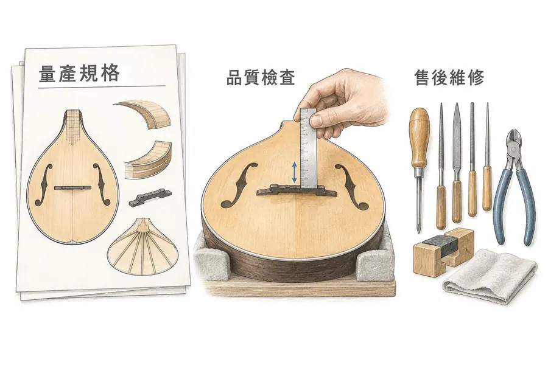

圖解 19.9　現代量產琴（示意）

更高階的 MD814/v，使用阿迪朗達克雲杉、花紋明顯的楓木、古董塗裝（antique varnish）等配置。

但材料升級，仍然不等於「一定比某一把 MD315 聲音好」。

個體的厚薄分布（graduation）、調整設定、演奏者偏好，都還會影響結果。

> **常見誤解：有捲曲（scroll）的 F 型琴，等級一定比較高。**
> 這是市場上最常見的誤區之一。實際上，A 型可以是頂級手工琴，F 型也可以是入門層級。型制和產品定位，是兩個不同的欄位。

## 19.10　品牌史的證據判讀

如果原廠寫「我們發明了現代曼陀林」，這是重要的資料來源，但它屬於品牌自述。

更嚴格的寫法，會再去尋找專利、同期型錄、館藏實物或外部研究。

例如 Gibson 的雕削結構（carved construction），可以用 1898 年專利和 Met 的 1898 年實物交叉確認。

所以它的歷史位置比較穩固。〔S1905〕〔S1906〕

相反地，如果只有二手賣場寫「1960 年代稀有職業級型號」，卻沒有型錄或序號系統，就應該標成「待考證」。

價格越高的古琴，越不能用賣場廣告來自我證明。

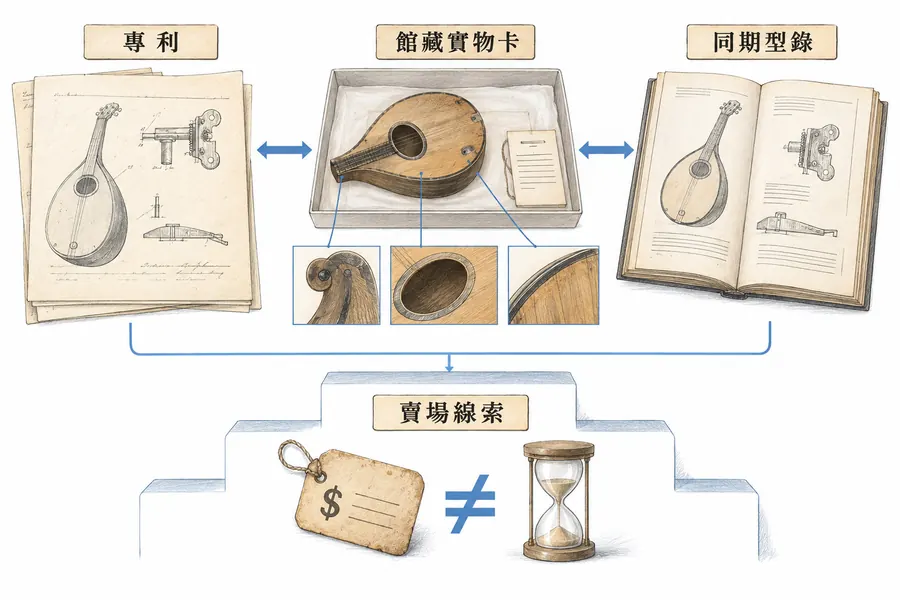

圖解 19.10　品牌史的證據判讀（示意）

所以本書第 20 章，把「存在性、年代、木材、規格、價格」分開評等，分別標示每一項資訊的可信程度。

這種做法雖然麻煩，但可以避免一件事：一個經過官方確認的型號名稱，順便替未經確認的木材背書。

## 19.11　案例：F 型的設計差異

比較 F 型琴，要分三層看。

| 層次 | 內容 |
|:---|:---|
| 第一層：結構 | 音孔、音樑、有效弦長、琴身尺寸、琴頸接合（neck joint） |
| 第二層：材料與塗裝 | 木材種類、等級、漆 |
| 第三層：裝飾與價格 | 鑲邊、塗裝細節、市場定位 |

如果一開始只看品牌光環（prestige），或只看花紋楓木漂不漂亮，就容易忽略真正影響手感與聲學的設計。

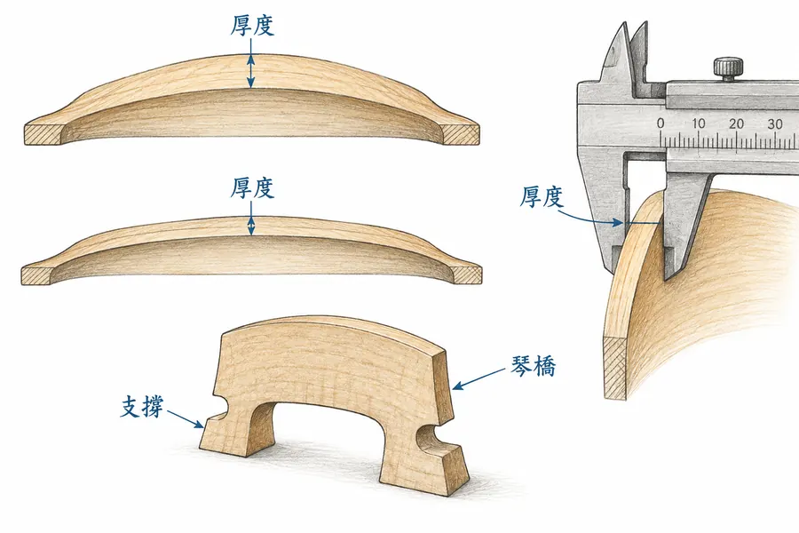

圖解 19.11　案例 F style 的設計差異（示意）

實際案例的差異是這樣的：

- Gibson 1923 復刻版的價值，有一部分在歷史重現（reproduction）。
- Collings MF5 強調當代精密製造與特定音樑。
- Northfield Big Mon 修改了琴身比例。
- Eastman MD315／515 提供較大規模量產的實木 F 型琴。

它們服務的市場、價格與製造方式不同。

不能用單一句「誰最好」的結論，取代實際用途。

對買家來說，最好的問題是這幾個：

- 我要什麼樣的琴頸寬度？
- 我要什麼樣的調整設定？
- 我要什麼樣的反應（response）與音量？
- 我要什麼風格？
- 我能負擔多少保養成本？

品牌史提供背景脈絡，但不應該變成購買決策的唯一替代品。

## 表 19-1｜重要製琴節點與本書採用的證據類型

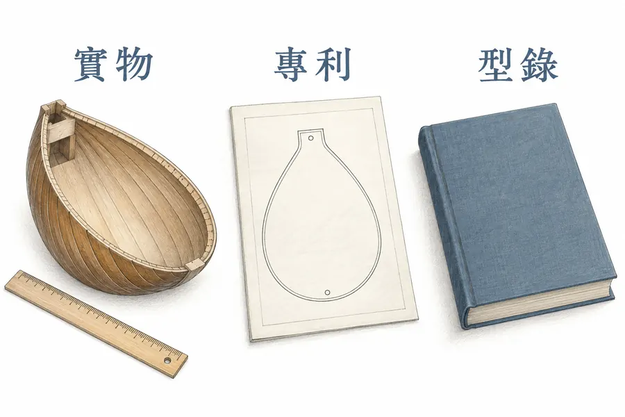

| 人物／品牌 | 節點 | 可直接證實的內容 | 主要證據 |
|:---|:---|:---|:---|
| **Vinaccia** | 1781 年 Met 實物 | 八弦四弦組、GDAE、圓背、折面面板 | 館藏實物 |
| **Orville Gibson** | 1898 年專利＋Met 實物 | 雕削結構的理念與實物結構 | 專利＋館藏 |
| **Gibson F-5** | 1920 年代／1923 年 | F 形音孔、長琴頸、音樑等官方歷史節點 | 原廠歷史＋現存琴 |
| **Calace** | 1825 年至現代 | 現行家族規格、工坊延續 | 官方規格＋方法書 |
| **Suzuki** | 2016 年型錄 | 家族型號規格與當時價格 | 原廠型錄 |
| **Collings／Northfield／Eastman** | 現代 | 現行規格、製造流程 | 官方技術頁 |

圖解 表 19-1｜重要製琴節點與本書採用的證據類型（示意）

## 自我學習題庫

學習檢查：作答、核對、複習

先自己作答，再看答案。答錯時回到本章相關小節重新讀一次。

**1. 研究品牌歷史時，最可靠的做法是？**

- A. 官方資料、館藏、型錄與實物交叉比對
- B. 只看品牌廣告
- C. 只看賣場
- D. 只看論壇

**2. Orville Gibson 1898 年專利的重要性在於？**

- A. 提出新的雕削結構思路
- B. 發明電子音箱
- C. 取消琴弦
- D. 改成無琴格

**3. Raffaele Calace 的角色包括？**

- A. 製琴、演奏與作曲／教育
- B. 只有經銷商
- C. 只有收藏家
- D. 只有指揮

**答案：1.A　2.A　3.A**

## 本章主要查證來源

查證來源：找原文、核條件、留紀錄

**【S1901】The Metropolitan Museum of Art：Antonius Vinaccia Mandolin, 1781。** 23 根木條、八弦四弦組、GDAE 與那不勒斯式折面結構的館藏實物。

> https://www.metmuseum.org/art/collection/search/504543

**【S1902】Liuteria Calace：Official history / home。** Calace 工坊官方沿革、創立年份與現址。

> https://www.calace.it/en/

**【S1903】Liuteria Calace：Current mandolins / mandoloncelli & liuti specifications。** 現行型號的有效弦長、調弦、木條、木材與弦數。

> https://www.calace.it/en/mandolini

**【S1904】Raffaele Calace：Metodo per mandolino, Opp.37–42。** Calace 身為作曲與教育傳統的一手方法資料。

> https://imslp.org/wiki/Metodo_per_mandolino_(Calace%2C_Raffaele)

**【S1905】United States Patent Office / Orville H. Gibson：US598245A Mandolin patent（1898）。** Orville Gibson 雕削結構與琴身／琴頸設計的一手專利。

> https://patents.google.com/patent/US598245A/en

**【S1906】The Metropolitan Museum of Art：Orville Gibson Mandolin, 1898。** 雲杉雕削面板、胡桃木雕削背板、浮動琴橋、橢圓音孔的實物。

> https://www.metmuseum.org/art/collection/search/700485

**【S1907】Gibson：Gibson Mandolins / 1923 F-5 Master Model Reissue。** F-5 設計史與現行復刻規格；屬原廠自述與產品資料。

> https://www.gibson.com/pages/gibson-mandolins

**【S1908】C. F. Martin & Co.：Hutton's Guide to Martin Guitars: 1833–1969（archival research guide）。** Martin 歷史研究資源；用於說明檔案型研究方法。

> https://www.martinguitar.com/gear-accessories/apparel-merch/18B0033.html

**【S1909】Suzuki Music／鈴木バイオリン製造：Suzuki Music 2016 Catalog – Mandolin / Mandola / Mandocello。** M-30、M-60、M-80、M-100、MD 系列、MC-836 的官方規格與當時價格。

> （本書前期查證所使用的 2016 官方型錄）

**【S1910】Collings Guitars：MF5 official specifications。** 阿迪朗達克雲杉、東部花紋楓木、音樑、13 7/8 吋有效弦長等現行規格。

> https://collingsguitars.com/mandolins/mf5/

**【S1911】Collings Guitars：MF5 O official specifications。** 橢圓音孔、X 型音樑與現行規格。

> https://collingsguitars.com/mandolins/mf5-o/

**【S1912】Northfield Mandolins：Big Mon official page。** 琴身寬度增加約 5 mm 與設計目的之原廠說明。

> https://www.northfieldinstruments.com/big-mon

**【S1913】Northfield Mandolins：How Northfield Works。** 材料、密西根／青島的製造分工與最終調整資訊。

> https://www.northfieldinstruments.com/how-northfield-works

**【S1914】Eastman Guitars：MD315 official specifications。** F 型、實木雲杉／楓木、有效弦長、指板弧度、弦距等現行規格。

> https://www.eastmanguitars.com/md315

**【S1915】Eastman Guitars：MD515 official specifications。** F 型、實木雲杉／楓木、塗裝與現行規格。

> https://www.eastmanguitars.com/md515/

---
