*World Mandolin Family Model, Material and Specification Database（世界曼陀林家族型號・材料・規格資料庫）*

## 本章重點

- 「這個型號真的存在」和「這把琴的木材是雲杉」是兩個不同的問題，要分開查。
- 查證順序是：型號存不存在 → 什麼年代 → 規格 → 木材 → 價格。
- 同一個型號的每一欄，可以有不同等級的可信度（A／B／C／D）。
- 官方網站只保證「現在生產的這一款」，不能自動套到同名老琴上。
- 查不到就寫「未取得可靠資料」。留白是研究結果，不是偷懶。

## 20.0　這一章為什麼長得不一樣

前面幾章談原理。這一章談的是一份可以不斷更新的研究資料庫。

它的做法，是把每一把琴拆成幾個獨立欄位：型號、家族、結構、調弦、弦長、木材、價格、資料來源。每一個欄位都要能單獨被查證。

這個做法來自實際的困擾。作者整理鈴木（Suzuki）、Calace 等品牌時，一再遇到同一種情況。

型號名稱確實存在，但網路上流傳的木材、年份或價格可能是錯的。而且同一個系列裡的琴，不能互相推測。

所以本章堅持「一個明確型號一列」。M-30、M-60、M-80、M-100 各有官方資料，就分成四列。

同一個型號如果跨年代改過規格，只要年代能確認，也拆成不同列。

表格裡的空白、「未取得可靠資料」和 D 級標記，都是研究結果的一部分，不是表格沒做完。

## 20.1　樂器家族的確認

商品名稱會因地區而不同。同樣叫 Mandola（曼陀拉），在美國常指 C–G–D–A 的中音樂器；在其他地區，可能指 G–D–A–E、低八度的樂器。

Mandocello（曼陀切羅）、Mandoloncello（曼陀隆切羅）、Liuto Cantabile（康塔比萊魯特琴）的用法，也會因義大利、日本、英美傳統而不一樣。

CMSA（美國古典曼陀林協會）的家族記譜指南，明確記錄了這些差異。所以本資料庫不靠商品名稱分類，而是優先看四件事：調弦（tuning）、實際發聲音域（sounding range）、弦組數（course）、弦長（scale）。〔S2001〕

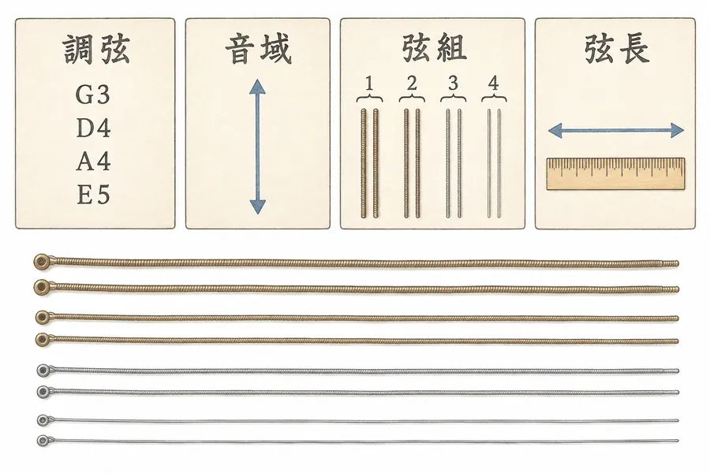

圖解 20.1　資料庫辨識的四項座標（示意）

分類完之後，「結構」要另外列。圓背（bowlback）、平背（flatback）、雕刻面板（carved-top）、F 型（F-style）、A 型（A-style）、平頂（flat-top），都不應該和家族名稱混在一起。

這樣才不會把「Mandola」當成一種外型，也不會把 F-style 當成一個音域家族。

這個原則對搜尋也很實用。如果你只用「mandola」去搜國際市場，會同時跳出 C 調弦和 G 調弦的樂器。先確認實際調弦，才能回到正確的資料群。

| 重點與應用 | 內容 |
|----|----|
| 核心概念 | 商品名稱有地域差異。 |
| 關係與條件 | CMSA 的家族記譜指南明確記錄這些差異，所以本資料庫不以商品名稱單獨分類，而優先看調弦、發聲音域、弦組數與弦長。 |
| 應用方向 | 查型號、規格與可信度。 |

> **常見誤解：「Mandola 就是一種琴身外型」**
> 不對。Mandola 講的是「音域家族」，圓背、平背講的是「結構」。
> 這兩件事要分開講，否則你會把一整套分類搞混。

## 20.2　型號、年代與規格的分項查證

資料表的每一列，至少要回答五個不同的真實性問題。

1. 這個型號（model number）真的存在嗎？
2. 它是什麼年代生產的？
3. 弦長、調弦、弦組數這些規格，能確認嗎？
4. 面板、背板、側板、琴頸、指板的木材，能確認嗎？
5. 價格是哪一種價格？當年牌價、經銷價、今天的新琴價、刊登價，還是成交價？

所以本書用 A／B／C／D 標記可信度時，不會把整列一次評分。

最理想的情況是「型號 A、年代 A、木材 A、價格 A」。也可能出現「型號 A、年代 B、木材 D、價格 C」。

後面這種列，不應該被寫成一張看起來很完整、其實一半是猜的規格表。

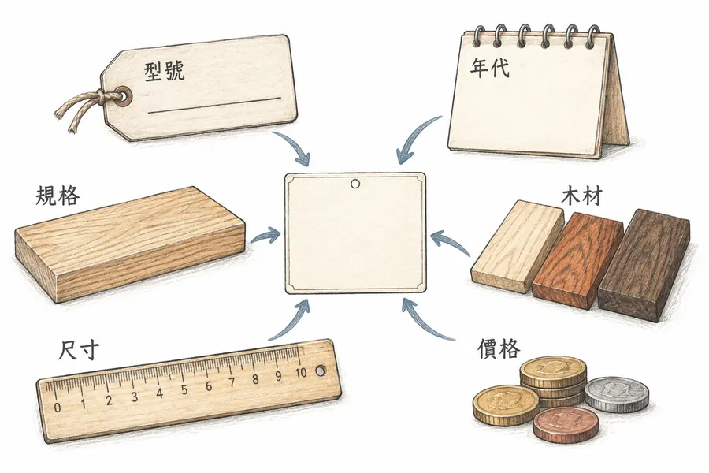

圖解 20.2　型號 年代與規格的分項查證（示意）

官方資料也不是萬能答案。

現行官網適合確認「現行產品」。但如果品牌歷史頁寫「世界第一」「革命性設計」，還是要用專利或館藏資料交叉確認。

反過來，博物館的實物非常適合確認「那一把琴」的材料與尺寸，卻不一定代表整個生產期都完全一樣。

> **常見誤解：「同一個系列，材料一定一樣」**
> 不一定。同系列的高低階，可能同時改掉琴身木條數、木種、指板格數與琴頭構造。
> 所以要一個型號一個型號查。

## 20.3　依結構記錄木材

平背琴和雕刻琴，可以分成面板（top）、背板（back）、側板（sides）三部分。

圓背琴的背面是許多木條（ribs／staves）拼成的，硬塞進「背板／側板」欄位會失真。這就是本資料庫改用「琴體／ribs」概念的原因。

結構上不適用的欄位，要寫「不適用」。這樣讀者才分得清「不適用」和「資料待查」。

木材名稱只寫到來源能支持的程度。

原廠只寫玫瑰木（rosewood），本書不會擅自翻成印度玫瑰木（Indian rosewood）。

原廠只寫雲杉（spruce），也不會因為同品牌高階型號用阿迪朗達克雲杉（Adirondack spruce），就推測這一款也是。

商業名稱和植物學上的樹種（species），不是同一個層次。

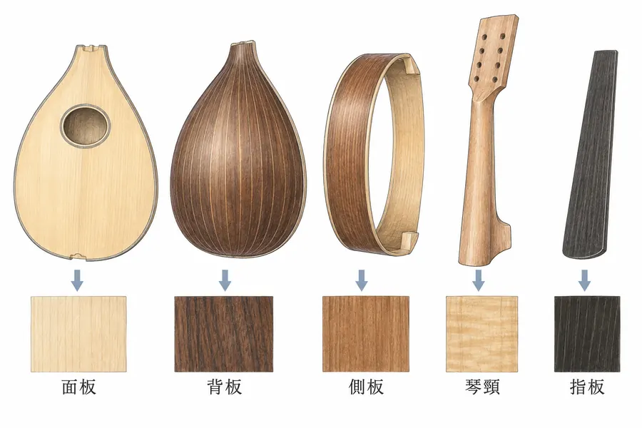

圖解 20.3　依結構記錄木材（示意）

花紋木（figured）、火焰紋（flamed）、AAA 這類說法，是視覺上或商業上的等級，不等於不同樹種。

它們可以記在「特殊工藝／等級」欄，但不能取代真正的樹種欄。

| 重點與應用 | 內容 |
|----|----|
| 核心概念 | 平背琴與雕刻琴可以分面板、背板、側板；圓背琴的背由 ribs 構成。 |
| 關係與條件 | 木材名稱只寫到來源能支持的程度。 |
| 應用方向 | 查型號、規格與可信度。 |

## 20.4　弦長、全長與琴體長

二手賣場常寫「弦長 67 cm」。實際上，他量到的可能是琴枕（nut）到琴尾板（tailpiece），甚至是整把琴的長度。

弦長（scale length）的定義是「有效振動長度」，通常是琴枕到琴橋絃枕（bridge saddle）。

浮動琴橋（floating bridge）的位置如果跑掉，量出來的數字還會反映錯誤的設定。所以優先採用原廠的技術規格。

如果只有實物可以量，就要記錄「你怎麼量的」和誤差。老琴的琴橋可能不是原裝，也可能移動過，不能把現況直接當成原始設計。

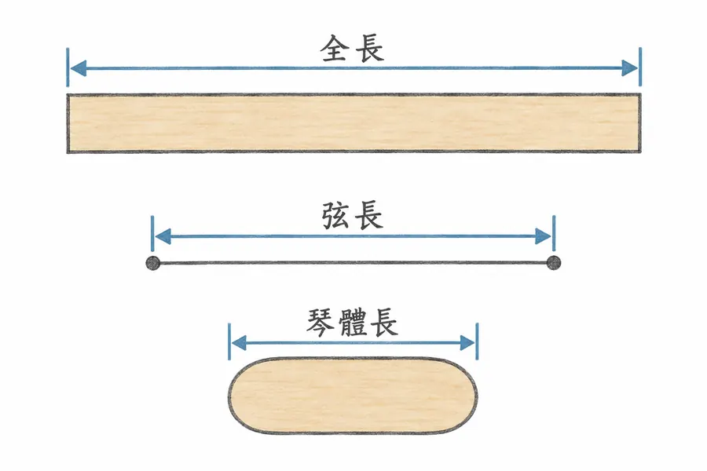

圖解 20.4　弦長 全長與琴體長（示意）

家族分類高度依賴弦長。標準曼陀林常見約 33–35 cm。八度曼陀林（octave mandolin）、曼陀拉、曼陀切羅則逐步變長。

但每個傳統都有自己的範圍，不能用單一個門檻值自動分類。

| 重點與應用 | 內容 |
|----|----|
| 核心概念 | 二手賣場寫的「弦長 67 cm」，可能量的是琴枕到琴尾板，甚至整把琴。 |
| 關係與條件 | 家族分類高度依賴弦長：標準曼陀林約 33–35 cm 常見，其他家族逐步變長。 |
| 應用方向 | 查型號、規格與可信度。 |

## 20.5　價格資料與日期

「這把琴當年售價 20,000」，如果沒有年份、幣別和價格性質，幾乎沒辦法比較。

原廠牌價（list price）、街價、拍賣落槌價、二手刊登價、整備後商店售價，全部不一樣。

所以本章把價格當成「會隨時間變動的資料」。

跨年代比較還要考慮通膨、匯率、稅金、地區代理差異。

1923 年 Gibson F-5 的官方歷史頁提到，當時售價 250 美元。這個數字在歷史敘述上很重要，但不能不調整購買力，就直接和今天的美元做「漲了幾倍」的比較。〔S2002〕

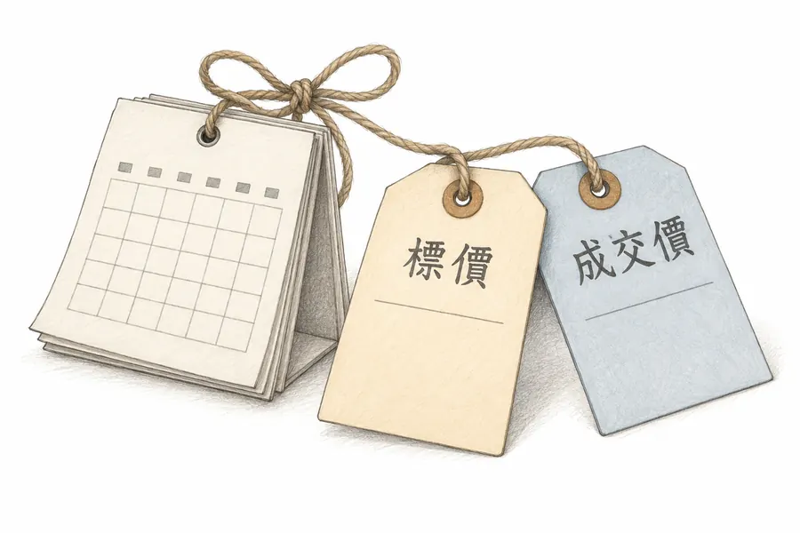

圖解 20.5　價格資料與日期（示意）

二手行情尤其要分清楚「刊登」（listing）和「成交」（sold）。

賣家喊價只能顯示市場期待，不能證明成交價。如果沒有可信的成交紀錄，本書寧可給範圍和日期，不假裝精確。

> **常見誤解：「賣家開的價，就是這把琴的行情」**
> 開價只代表賣家的期待。真正有參考價值的是「成交價」，而且要記下日期與品況。

| 重點與應用 | 內容 |
|----|----|
| 核心概念 | 沒有年份、幣別與價格性質的售價，幾乎無法比較。 |
| 關係與條件 | 跨年代比較還有通膨、匯率、稅、地區代理差異。 |
| 應用方向 | 查型號、規格與可信度。 |

## 20.6　官方規格覆核案例一：Calace

Calace（卡拉切）官網提供的欄位非常完整，很適合資料庫使用。

現行的曼陀林型號 24／26、13、15、16Bis 等，明列 33.5 cm 弦長、調弦、ribs 數、琴身材料、面板、指板。

曼陀隆切羅（Mandoloncello）頁面則明列 61 cm 弦長，而且同時有 8 弦四弦組與 10 弦五弦組兩種版本。〔S2003〕〔S2004〕

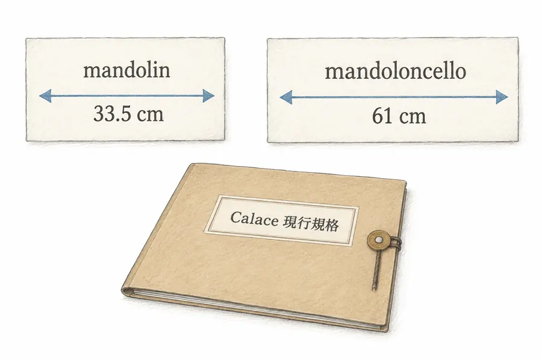

圖解 20.6　官方規格覆核案例一（示意）

這些資料可以直接得到 A 級的「現行官方規格」。但仍然要標註查閱日期，因為未來產品可能改版。

現行資料也不能自動套用到同名的歷史型號上。

Calace 這個案例還說明另一件事：同品牌的高低階，不一定只差裝飾。

琴身 ribs 數量、楓木或玫瑰木、指板格數、琴頭構造，都可能同時改變。所以資料庫必須一個型號一個型號列欄位。

| 重點與應用 | 內容 |
|----|----|
| 核心概念 | Calace 官網提供非常適合資料庫使用的詳細欄位。 |
| 關係與條件 | 曼陀隆切羅頁面明列 61 cm 弦長，並同時有 8 弦四弦組與 10 弦五弦組版本。 |
| 應用方向 | 查型號、規格與可信度。 |

## 20.7　官方規格覆核案例二：Gibson、Collings、Eastman

Gibson 現行的 1923 F-5 Master Model Reissue 官方頁，提供的規格非常完整。

它列出紅雲杉面板（red spruce top）、花紋紅楓木琴身／背板／琴頸（figured red maple），以及黑檀指板與琴橋（ebony fingerboard／bridge）。頁面也說明設計歷史。

這適合確認「現行復刻版」，但不能把復刻版的規格，當成每一把 1923 年原版的普遍實測結果。〔S2002〕

Collings MF5 官方頁提供阿迪朗達克雲杉、東部火焰楓木（Eastern flamed maple）、音梁（tone bars）、13 7/8 吋弦長、複合半徑（compound radius）等完整現代規格。

Eastman MD315 則提供全單雲杉（solid spruce）、全單楓木（solid maple）、13 7/8 吋弦長、12 吋指板半徑、弦距（action height）等。

這兩個案例顯示，現代官方頁的欄位完整度可以非常高。〔S2005〕〔S2006〕

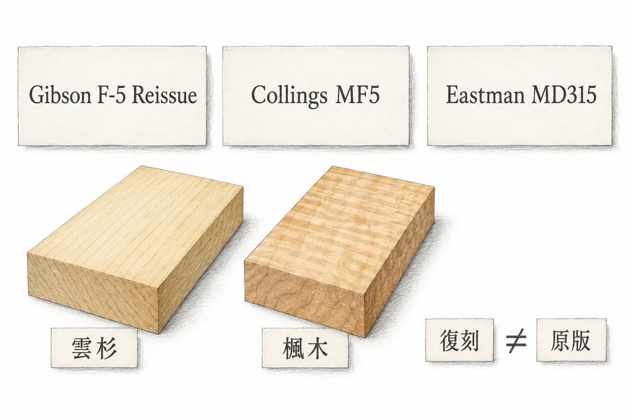

圖解 20.7　官方規格覆核案例二（示意）

但比較時要避免「規格表競賽」（spec sheet racing）。

更多鑲邊、更多花紋、更亮的漆，不會自動等於聲音更好。資料庫的工作是保存事實，好壞評價是另一件事。

> **常見誤解：「規格欄位越多，琴就越好」**
> 不是。規格表長，只代表資料完整。
> 聲音好不好，要回到第 16、17 章的原理，以及你自己試彈的感受。

| 重點與應用 | 內容 |
|----|----|
| 核心概念 | Gibson 現行復刻頁提供紅雲杉、花紋紅楓木、黑檀等規格，並說明設計歷史。 |
| 關係與條件 | Collings MF5 提供阿迪朗達克雲杉、東部火焰楓木、音梁、13 7/8 吋弦長、複合半徑。 |
| 應用方向 | 查型號、規格與可信度。 |

## 20.8　官方規格覆核案例三：Northfield

Northfield（北地）不只公開型號規格，還公開部分製造流程與材料來源。

官方說明指出，Big Mon 等系列可能在密西根（Michigan）選材與加工，在山東青島（Qingdao）組裝與上漆，再回到密西根做設定（setup）。

這表示「品牌所在地」和「每一道工序的所在地」，可以是不同的。〔S2007〕

對收藏者來說，這類資料非常重要。只寫「美國品牌」（USA brand），回答不了「製造產地」這個問題。

反過來，也不應該因為某一道工序在中國完成，就忽略設計、材料選擇與最終設定裡的跨國分工。

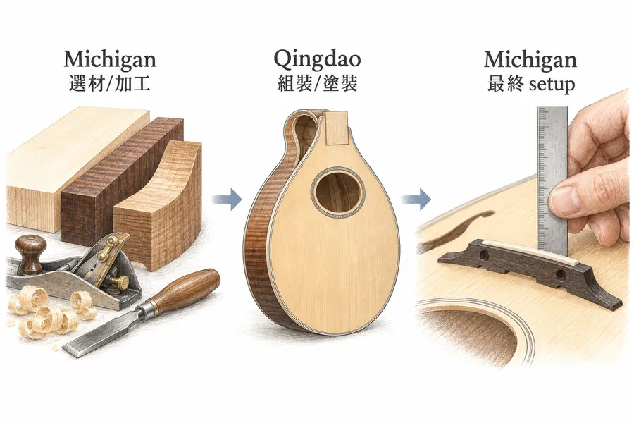

圖解 20.8　官方規格覆核案例三（示意）

資料庫如果有「國別／製造地」欄，應該盡可能寫成可驗證的多段資訊，把品牌所在地和製造分工分開交代。

| 重點與應用 | 內容 |
|----|----|
| 核心概念 | Northfield 不只公開規格，還公開部分製造流程與材料來源。 |
| 關係與條件 | 對收藏者而言，這種「多段製造地」的資訊非常重要。 |
| 應用方向 | 查型號、規格與可信度。 |

## 20.9　Suzuki 型錄的使用

鈴木（Suzuki）2016 年官方型錄，直接列出多個曼陀林家族型號，包括 M-30、M-60、M-80、M-100、MD-4、MC-836 等。

前期查證中最重要的發現之一，是 MC-836。

官方資料明列：雲杉面板、玫瑰木平背琴身、桃花心木琴頸、玫瑰木指板，以及 574 mm 的振動長度。

這和部分二手頁面長期複製的「大型圓背」描述不符。〔S2008〕

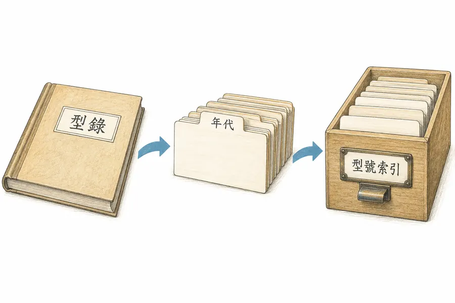

圖解 20.9　Suzuki 型錄的使用（示意）

這種錯誤為什麼會擴散？因為賣場互相引用。新頁面看起來像「多來源交叉確認」，實際上它們可能都來自同一個沒查證過的說法。

來源數量不等於來源獨立性。

所以資料庫記錄來源時，要優先保存原始型錄的檔名、年份與頁面，並保留原始檔案，方便日後覆核。

> **常見誤解：「很多網站都這樣寫，所以應該是對的」**
> 十個網站寫同一句話，可能只是十次抄同一個來源。
> 判斷重點是：這些來源是不是「各自獨立」查到的。

| 重點與應用 | 內容 |
|----|----|
| 核心概念 | Suzuki 2016 官方型錄列出 M-30、M-60、M-80、M-100、MD-4、MC-836 等家族型號。 |
| 關係與條件 | MC-836 官方資料為雲杉面板、玫瑰木平背、桃花心木琴頸、玫瑰木指板、574 mm 振動長度，與二手頁面流傳的「大型圓背」不符。 |
| 應用方向 | 查型號、規格與可信度。 |

## 20.10　資料庫的篩選與閱讀

假設你想找一把 33–35 cm、雲杉面板、玫瑰木圓背的職業級曼陀林。

你可以先用家族、弦長、面板、琴身材料篩選，再回到來源，逐列看每一列的注意事項（caveat）。資料庫幫你定位資料；重要判斷仍要核對原始文件。

如果你要買老琴，先用「型號存在性」和「年代」排除明顯誤標，再看實物品況。

如果你要研究製琴史，可以從同品牌不同年代的材料與結構變化，找出趨勢。

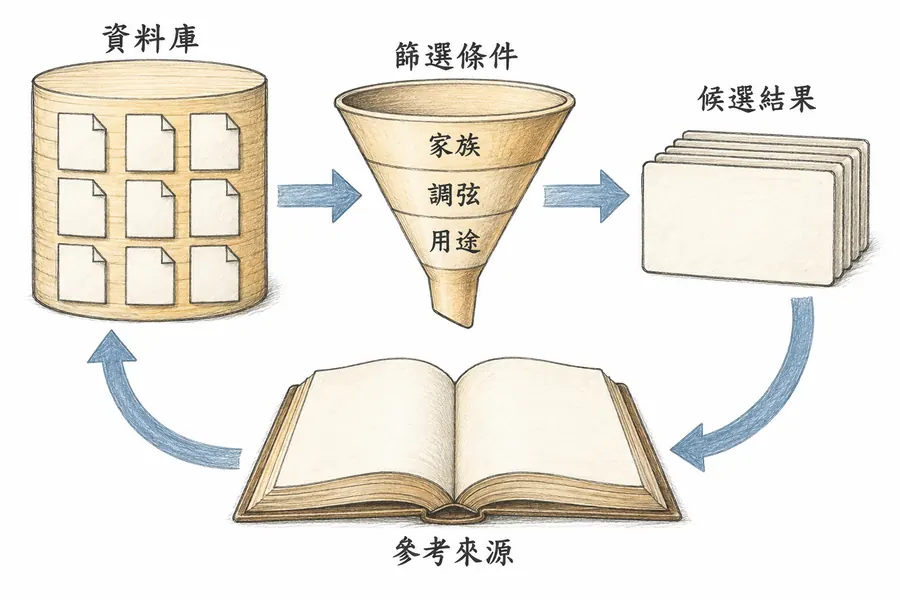

圖解 20.10　資料庫的篩選與閱讀（示意）

最重要的是保留「不知道」。

真正的專業資料庫允許未知存在，因為未來一份型錄、或一把有來源履歷（provenance）的實物，都可能改變答案。

把每個空格都填滿，反而會讓錯誤變得難以追蹤。

| 重點與應用 | 內容 |
|----|----|
| 核心概念 | 先用家族、弦長、面板、琴身材料篩選，再回來源看每一列的注意事項。 |
| 關係與條件 | 買老琴先用型號存在性與年代排除誤標，再看實物品況。 |
| 應用方向 | 查型號、規格與可信度。 |

## 20.11　查證等級與證據範圍

| 等級 | 可以採用的證據 | 使用方式 |
|:---|:---|:---|
| **A** | 原廠同期型錄、官方現行技術頁、專利、博物館館藏實物、可靠的原始文件 | 可直接引用 |
| **B** | 多個彼此獨立的高品質來源，且說法一致（專業研究、可信的收藏文獻） | 可引用，但要註明來源不只一個 |
| **C** | 可由實物或專業商家支持，但缺乏原始型錄 | 列為暫定 |
| **D** | 只有一般賣場、論壇、單一沒有來源履歷的說法，或來源互相矛盾 | 只能當線索 |

同一列的不同欄位，可以有不同等級。

「型號存在」是 A，不代表「價格」也是 A。木材是 A，也不代表年代是 A。

如果表格空間有限，可以在「查證／來源」欄用簡碼記錄，例如「存在 A／木材 B／價格 D」。

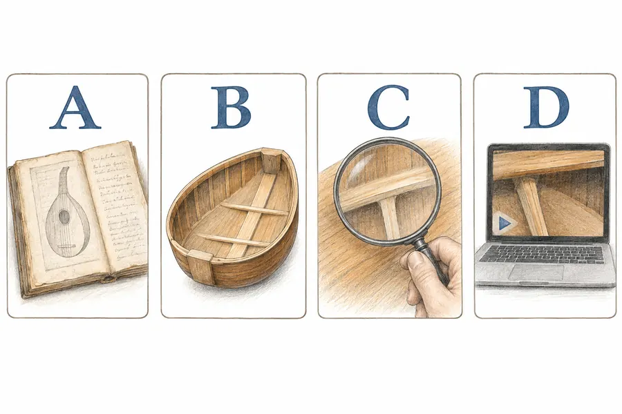

圖解 20.11　查證等級與證據範圍（示意）

本章主表沿用前期「一型號一列」工作檔的 203 個逐列項目，並保留不確定性，不用同系列去補完缺欄。

後續如果新增資料，應該另存新版本，保留歷次紀錄。

## 表 20-1｜本版資料庫收錄量與家族分布

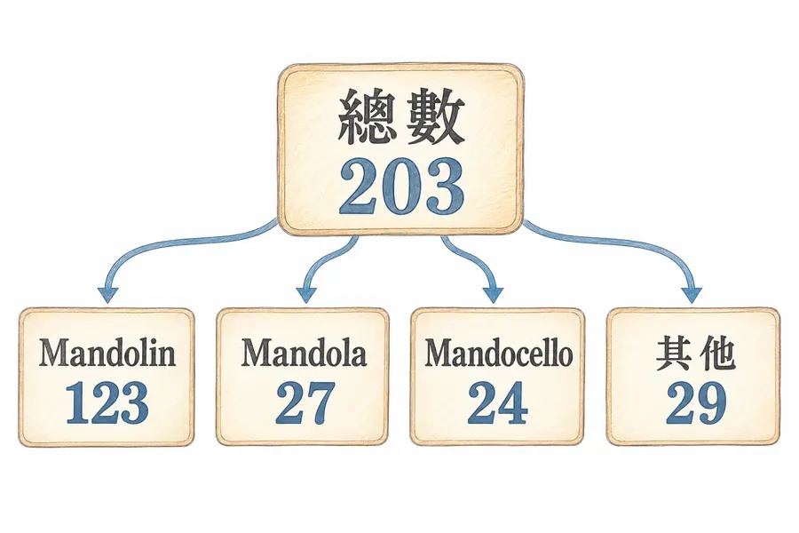

| 家族／分類 | 逐列項目數 |
|--------------------------------|----------------|
| Mandolin（曼陀林） | 123 |
| Mandola（曼陀拉） | 27 |
| Mandola Tenore／G Mandola（G 調曼陀拉） | 6 |
| Octave Mandolin（八度曼陀林） | 11 |
| Mandocello（曼陀切羅） | 24 |
| Mandoloncello | 3 |
| Liuto／10-string（魯特琴／十弦） | 3 |
| Liuto（魯特琴） | 4 |
| 10-string（十弦） | 1 |
| Mandobass（曼陀貝斯） | 1 |
| 合計 | 203 |

圖解 表 20-1｜本版資料庫收錄量與家族分布（示意）

## 20.12　世界型號主資料表

以下表格沿用前期查證版的 203 個逐列項目。欄位中的「未取得可靠資料」與 B／C／D 等級，全部原樣保留。

這一次只用新增的官方資料當「錨點」來校正方法，不用同系列或相似外觀去補滿缺欄。

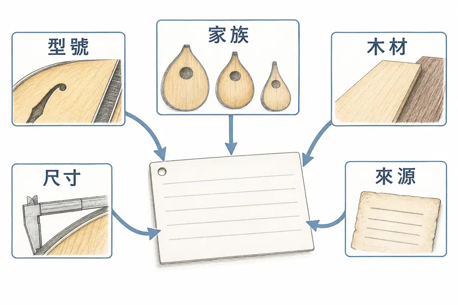

### 20.12.1　怎麼讀這兩張表

原本的總表有 8 欄。對初學者來說，8 欄一起看只會頭暈。所以這裡拆成兩張：

| 表格 | 給誰看 | 回答什麼問題 |
|:---|:---|:---|
| **新手速查表** | 剛開始找琴的人 | 有哪些型號？多長？大概多少錢？ |
| **進階查證表** | 要下單、要比價、要收藏的人 | 用什麼木頭？資料可信到什麼程度？ |

價位欄裡的 H、S、C、B、A，是原稿使用的等級代號。原稿並沒有完整定義每個代號的意思，只看得出來是「由低到高」的排序，其中 H 常與歷史價格一起出現。

A 級以上還有 A-、A+、S-、S 等細分。這些代號一律原樣保留，方便你回頭對照原書。看不懂代號時，直接看後面的文字說明就好。

「未取得可靠資料」不是漏填。它代表作者查過，但沒找到能站得住腳的來源。

### 20.12.2　曼陀林（Mandolin，G–D–A–E，八弦四弦組）

#### 名古屋鈴木（Nagoya Suzuki，日本）｜圓背

**新手速查**

| 型號 | 弦長 | 價格・定位 | 可信度 |
|:---|:---|:---|:---|
| **M-30** | 336 mm | C／H；2016 年 ¥73,000＋稅 | 型號 A／規格 A／價格 A |
| **M-60** | 336 mm | B／H；2016 年 ¥84,000＋稅 | A／A／A |
| **M-80** | 336 mm | A-／H；2016 年 ¥95,000＋稅 | A／A／A |
| **M-100** | 336 mm | A／H；2016 年 ¥110,000＋稅 | A／A／A |

以上四款來自 2016 年官方型錄，是目前資料最硬的一組。

**進階查證**

| 型號 | 面板 | 琴身／琴頸／指板 | 來源 |
|:---|:---|:---|:---|
| **M-30** | Spruce | Maple 15 片（27 片式樣）／Mahogany 琴頸；Rosewood 指板 | S12 |
| **M-60** | Spruce | Rosewood 15 片圓背／Mahogany 琴頸；Rosewood 指板 | S12 |
| **M-80** | Spruce | Maple 27 片圓背／Maple 琴頸；Rosewood 指板；Ebony 琴橋 | S12 |
| **M-100** | Spruce | Master Hand；Maple 27 片圓背／Maple 琴頸；Ebony 系高階指板與琴橋 | S12 |

注意 M-30 的寫法是「15 片，採 27 片式樣」。片數與外觀樣式是兩件事，不能互相換算。

#### 名古屋鈴木（歷史款）｜圓背

這批型號是二手市場的主力，但幾乎每一欄都缺資料。以下只列「有線索」的部分。

**新手速查**

| 型號 | 價格・定位 | 可信度 |
|:---|:---|:---|
| **M-20** | D／H；二手刊登約 ¥7,000–15,000 | C／木材 D |
| **M-40** | C／H；約 ¥6,000–16,000 | C／木材 D |
| **M-50** | B-／H；約 ¥4,500–17,000 | C／木材衝突 |
| **M-150** | A+／S／H；歷史價約 ¥150,000–165,000，二手依品況 | B |
| **No.201** | C／H；樣本差異大 | B／C |
| **No.203** | C／H；樣本少 | C |
| **No.206** | C／H；整備樣本約 ¥6,500 | C |
| **No.208** | C／H；樣本少 | C |
| **No.210** | C／H；樣本少 | C |
| **No.215／M-215** | C+／H；海外刊登約 US$300–380 | B／C |
| **No.218／M-218** | B／H；歷史二手樣本 AUD 420–450 | B |
| **No.223／223-1** | C+／H；樣本差異大 | B／C |
| **No.226** | C+／H；歷史樣本約 US$150–300 | B／C |
| **No.228** | B-／H；現況價與整備後價差很大 | B |
| **No.228S** | B-／H；樣本少 | B／C |
| **No.230** | C+／H；歷史樣本約 ¥8,000–13,000 | B／C |
| **M-210** | B／H；整備樣本約 ¥29,700 | B |
| **M-210-6** | B／H；樣本少 | B／C |
| **M-280** | B-／H；樣本不足 | B／C |

**進階查證**

| 型號 | 面板 | 琴身／琴頸／指板 | 備註 |
|:---|:---|:---|:---|
| **M-20、M-40** | 未取得可靠資料 | 未取得可靠資料 | 只有「圓背」可確認 |
| **M-50** | 市場描述衝突 | 傳統圓背；其餘未取得可靠資料 | 有 MASTERHAND 標籤的樣本 |
| **M-150** | Spruce（多來源） | Maple 圓背（多來源） | 當年的旗艦款 |
| **No.201** | Solid Spruce（多來源） | 22 片 Maple ribs 的線索 | 樣本差異大 |
| **No.203、No.210** | 未取得可靠資料 | 圓背（實物確認） | 樣本少 |
| **No.206** | Spruce（市場說法） | Maple 27 ribs（市場說法） | 僅市場等級 |
| **No.208** | Spruce（拍賣描述） | 多肋圓背；木種待確認 | 僅拍賣等級 |
| **No.215／M-215** | Spruce | Maple 與 Mahogany 兩種描述衝突 | 衝突未解 |
| **No.218／M-218** | Carved／solid Spruce | Rosewood 多肋圓背 | — |
| **No.223／223-1** | Solid Spruce | Maple 圓背 | 樣本差異大 |
| **No.226、No.228、No.228S** | Solid Spruce（No.226 為 Spruce） | Maple 圓背 | — |
| **No.230** | 未取得可靠資料 | 圓背（實物確認） | 樣本少 |
| **M-210、M-210-6** | Spruce | Maple 27 ribs | M-210-6 為 M-210 衍生 |
| **M-280** | 未取得可靠資料 | 未取得可靠資料 | 樣本不足 |

這批型號的共通點是：**型號名稱本身常見，但規格幾乎都靠二手描述**。所以可信度大多停在 C。

#### 木曾鈴木（Kiso Suzuki，日本｜歷史）

全系列都是圓背、G–D–A–E。價格一律「二手市場依品況，不設固定價」。

**新手速查**

| 型號 | 定位 | 可信度 |
|:---|:---|:---|
| **MR-150** | 約 1960s–70s；B／H | B |
| **MR-200** | 歷史款；B／H | B／C |
| **Model No.300** | 歷史款；C／H | C |
| **No.4** | 歷史款；D／C-H | C |
| **No.45** | 歷史款；C／H | C |
| **M-50** | 石川捷二郎監修實物；B-／H | C |
| **Model N** | 待考；D／H？ | D |
| **MR-600** | 待考高階候選 | D |

**進階查證**

| 型號 | 面板 | 琴身 | 備註 |
|:---|:---|:---|:---|
| **MR-150** | Solid Spruce | 28 片 Maple ribs | 資料相對完整 |
| **MR-200** | 未取得可靠資料 | 25 ribs；木種待確認 | 片數可數，木種未知 |
| **Model No.300、No.4** | 未取得可靠資料 | 圓背（實物確認） | — |
| **No.45、Model N、MR-600** | 未取得可靠資料 | 未取得可靠資料 | Model N、MR-600 連存在都待考 |

Model N 與 MR-600 的「？」是原稿就有的。這代表連「這個型號到底存不存在」都還沒確定。

#### Calace（義大利｜現役）

全系列都是那不勒斯式圓背、G–D–A–E、約 33.5 cm 弦長、雲杉面板。價格一律「依型號／訂製」，現價需即時查。

**新手速查**

| 型號 | 圓背片數 | 定位 | 可信度 |
|:---|:---|:---|:---|
| **24** | 25 片平滑 ribs | B | A／A／現價需即時查 |
| **26** | 25 片平滑 ribs | B+ | A／A／現價需即時查 |
| **13** | 25 片平滑 ribs | A- | A／A／現價需即時查 |
| **15** | 25 片平滑 ribs | A | A／A／現價需即時查 |
| **16Bis** | 33 片溝槽 ribs | A | A／A／現價需即時查 |
| **Cl.B** | 31 ribs | A | A／A／現價需即時查 |
| **Cl.C** | 33 ribs | A | A／A／現價需即時查 |
| **Ripa** | 33 ribs | A+ | A／A／現價需即時查 |

**進階查證**

| 型號 | 面板 | 琴身 | 指板 |
|:---|:---|:---|:---|
| **24、26** | Spruce | Rosewood 圓背 | Rosewood |
| **13、15** | Spruce | Rosewood 圓背 | Ebony |
| **16Bis** | Spruce | Rosewood 圓背 | Ebony |
| **Cl.B** | Spruce | Maple 圓背 | Ebony |
| **Cl.C、Ripa** | Spruce | Rosewood 圓背 | Ebony |

「平滑 ribs」（smooth）與「溝槽 ribs」（fluted）是兩種不同的琴身表面做法，不是片數差異。

#### Orville Gibson（美國｜1898）

| 項目 | 內容 |
|:---|:---|
| 館藏編號 | Met 1998.184（1898 instrument，1898 年實物） |
| 結構 | 早期雕刻 A 型（carved A-type） |
| 面板 | 雕刻雲杉 |
| 背板／側板 | 雕刻胡桃木背板；胡桃木側板 |
| 琴頸／琴頭 | 胡桃木 |
| 定位 | S／H；館藏品，非市場定價 |
| 可信度 | A／A（來源 S09） |

這是博物館實物等級的資料，適合確認「那一把琴」，但不代表整個型號的生產期都一樣。

#### Gibson（美國｜歷史）｜美式雕刻拱面

A 系列與 F 系列共 11 個型號。**逐年規格需個別查**，下表是同系列的通則。

**新手速查**

| 型號 | 定位 | 可信度 |
|:---|:---|:---|
| **A** | C+／H | 型號 B |
| **A-1** | B-／H | 型號 B |
| **A-2** | B／H | 型號 B |
| **A-3** | B+／H | 型號 B |
| **A-4** | A-／H | 型號 B |
| **A-5** | A／H | 型號 B |
| **F** | B／H | 型號 B |
| **F-2** | B+／H | 型號 B |
| **F-3** | A-／H | 型號 B |
| **F-4** | A／H | 型號 B |
| **F-5** | S／H | 型號 B |

以上價格都是「歷史原價／收藏價，依年份與品況」。

**進階查證**

| 欄位 | 內容 |
|:---|:---|
| 弦長 | 依年份 |
| 面板 | 雕刻雲杉（系列歷史常見） |
| 背板／側板 | Maple／Birch，依年代與型號 |
| 琴頸 | Mahogany／Maple；指板依型號 |

「系列歷史常見」是保守說法。它代表「通常是這樣」，不代表「每一把都這樣」。

#### Eastman（美國品牌／中國製作）｜A／F 型雕刻

**新手速查**

| 型號 | 定位 | 可信度 |
|:---|:---|:---|
| **MD305** | C | B |
| **MD315** | C+ | B |
| **MD505** | B- | B |
| **MD515** | B | B |
| **MD615** | B+ | B |
| **MD815** | A- | B |
| **MD915** | A | B |

價格為系列整體約 US$700–4,000＋（歷史工作檔）。個別型號的精確規格，需要到官網逐頁查。

**進階查證**

| 欄位 | 內容 |
|:---|:---|
| 結構 | A 型／F 型雕刻家族 |
| 面板 | 全單雲杉（系列主力） |
| 琴身 | 全單楓木（系列主力） |
| 琴頸／指板 | Maple 琴頸；指板依型號 |

#### Ibanez（日本品牌／亞洲製造）M510

| 項目 | 內容 |
|:---|:---|
| 結構 | A 型 |
| 弦長 | 350 mm |
| 面板 | Spruce |
| 背板／側板 | Sapele |
| 琴頸 | Okoume |
| 指板／琴橋 | Purpleheart |
| 定位 | D；現行約 US$200–300 級，依市場 |
| 可信度 | A／A（來源 S34） |

#### Collings（美國｜精品）｜手工雕刻 A／F 家族

12 個型號。除 MF5 系列面板為阿迪朗達克雲杉外，其餘為「Spruce，精確依型號」。

**新手速查**

| 型號 | 定位 | 可信度 |
|:---|:---|:---|
| **MT、MT O** | A-／A | MF5 為 A；其他系列 B／A |
| **MT2、MT2 O** | A | 同上 |
| **MT2 V、MF Deluxe** | A+ | 同上 |
| **MF、MF O** | A | 同上 |
| **MF5、MF5 O** | A+ | 同上 |
| **MF5 V** | S- | 同上 |
| **MF5 Deluxe V** | S | 同上 |

價格為「精品新琴，數千美元以上」。

**進階查證**

| 欄位 | 內容 |
|:---|:---|
| 弦長 | 13 7/8 吋（MF5；其他依型號） |
| 面板 | Spruce（精確依型號）；MF5 系列為 Adirondack spruce |
| 琴身 | Eastern flamed maple（MF5 官方；其他依型號） |
| 指板／琴頸 | Ebony 指板；maple 琴頸系 |

#### Northfield（美國／中國協作）｜雕刻面板

**新手速查**

| 型號 | 定位 | 可信度 |
|:---|:---|:---|
| **Model M** | B+；約 US$3,000 級 | A／B；精確木料逐型號 |
| **A5 Special** | A-；約 US$4,000 級 | A／B |
| **F5S、F5E** | A；約 US$5,000 級 | A／B |
| **Big Mon** | A+；約 US$5,000＋ | A／B |
| **Calhoun** | B+／A-；依版本 | A／B |
| **Artist Series** | A+／S-；約 US$6,000–7,000＋ | A／B |

**進階查證**

| 欄位 | 內容 |
|:---|:---|
| 面板 | Spruce（系列） |
| 琴身 | Maple（系列） |
| 琴頸／指板 | Ebony 指板；以 maple 琴頸為主 |

「A／B」的意思是：型號與部分規格是 A 級，但精確木料要逐型號查，目前只到 B 級。

#### Gold Tone（美國品牌｜現役）｜A／F 型家族

**新手速查**

| 型號 | 定位 | 可信度 |
|:---|:---|:---|
| **GM-10** | D | 型號 A；材料欄系列級 B |
| **GM-35** | D／C | 同上 |
| **GM-50+、GM-55** | C | 同上 |
| **GM-70+** | C+ | 同上 |
| **GM-80** | B- | 同上 |
| **Grandmaster Elite** | A- | 同上 |
| **Victorian** | A | 同上 |
| **Super Cremona** | A | 同上 |

現行價格依官網，購買時需重查。

**進階查證**

| 欄位 | 內容 |
|:---|:---|
| 面板 | 多款 spruce；逐型號確認 |
| 琴身 | Maple／Mahogany 依型號 |
| 指板／琴橋 | Rosewood／Ebony 依型號 |

這一組是「型號確定、材料只到系列級」的典型。要買之前，請向店家確認那一個型號的實際配置。

#### Kentucky／Saga（美國品牌／亞洲製造）｜藍草 A／F 型

**新手速查**

| 型號 | 定位 | 可信度 |
|:---|:---|:---|
| **KM-150** | C | B |
| **KM-250** | C+ | B |
| **KM-270** | C+／B- | B |
| **KM-500** | B- | B |
| **KM-650** | B | B |
| **KM-850** | A- | B |

系列約 US$500–3,000＋（工作檔）；精確規格依版次。

**進階查證**

| 欄位 | 內容 |
|:---|:---|
| 面板 | 全單雕刻雲杉（系列） |
| 琴身 | Maple；高階為花紋楓木 |
| 琴頸／指板 | Maple 琴頸；指板依型號 |

#### The Loar（美國品牌／亞洲製造）｜復古 Gibson 風拱面

**新手速查**

| 型號 | 定位 | 可信度 |
|:---|:---|:---|
| **LM-110** | D／C | A／B 系列級 |
| **LM-310F** | C | A／B 系列級 |
| **LM-520** | C+ | A／B 系列級 |
| **LM-590-MS** | B- | A／B 系列級 |
| **LM-600** | B | A／B 系列級 |
| **LM-700** | B+ | A／B 系列級 |

約 US$400–1,500＋（工作檔）。

**進階查證**

| 欄位 | 內容 |
|:---|:---|
| 面板 | 中高階型號多為手工雕刻全單雲杉 |
| 琴身 | 花紋楓木（中高階型號） |
| 琴頸／指板 | Maple 琴頸；指板依型號 |

#### Weber（美國｜精品）

| 項目 | 內容 |
|:---|:---|
| 結構 | 美式手工家族 |
| 弦長 | 14 吋 |
| 面板 | Spruce（家族規格） |
| 琴身 | 以 Maple 為主，依 trim（裝飾等級） |
| 指板 | 常見 Ebony |
| 定位 | A／S；精品訂製，二手依 trim |
| 可信度 | A 家族規格；trim 需細分 |

#### Trinity College／Saga（美國品牌／亞洲製造）｜Celtic 平背

| 型號 | 弦長 | 面板 | 琴身／琴頸 | 定位 | 可信度 |
|:---|:---|:---|:---|:---|:---|
| **TM-250** | 依型號 | 全單 Sitka 雲杉 | 全單楓木背側／Mahogany 琴頸 | C；中階價位 | A／B |
| **TM-250B** | 依型號 | 全單 Sitka 雲杉 | 全單楓木背側／Mahogany 琴頸 | C；中階價位 | A／B |

#### Ovation／Celebrity（美國品牌｜歷史／停產）｜合成圓背電木

| 型號 | 面板 | 琴身／琴頸 | 定位 | 可信度 |
|:---|:---|:---|:---|:---|
| **MM68** | 全單 Sitka 雲杉（MM68／MC 系工作檔） | Ovation 合成圓背／多片式琴頸；指板依版本 | B／H；歷史牌價，二手依前級保存 | A／B |
| **MM68AX** | 同上 | 同上 | B／H | A／B |
| **MCS148** | 同上 | 同上 | C+／H | A／B |
| **MAE148** | 同上 | 同上 | C／H | A／B |

#### Lyon & Healy（美國｜約 1910 年代）｜拱面美式曼陀林

| 型號 | 面板 | 琴身 | 定位 | 可信度 |
|:---|:---|:---|:---|:---|
| **Style A** | Spruce（工作檔） | Maple／其他依型號；高階古董配置 | A-／H；收藏市場，依保存 | B |
| **Style B** | Spruce（工作檔） | 同上 | A／H | B |
| **Style C** | Spruce（工作檔） | 同上 | A+／S-／H | B |

三款的弦長都是「未取得可靠資料」。

#### Embergher 系（義大利｜歷史／復刻）｜羅馬學派圓背

**新手速查**

| 型號 | 定位 | 可信度 |
|:---|:---|:---|
| **Tipo A、Tipo B** | A／S-H | B；逐型號深化 |
| **Orchestra 1** | A／S-H | B；逐型號深化 |
| **Orchestra 2** | A／S-H | B；逐型號深化 |
| **Orchestra 3** | A／S-H | B；逐型號深化 |
| **Orchestra 4** | A／S-H | B；逐型號深化 |
| **5Bis** | A／S-H | B；逐型號深化 |
| **Model 1、Model 7** | A／S-H | B；逐型號深化 |

價格為「古董／復刻價差大」。

**進階查證**

| 欄位 | 內容 |
|:---|:---|
| 弦長 | 依實物 |
| 面板 | 常見 Spruce；逐件查證 |
| 琴身 | 多 ribs 羅馬式圓背；木種依年份 |
| 指板 | 高階常見 Ebony |

#### Lorenzo Lippi（Embergher model，義大利｜現役手工）

| 型號 | 面板 | 琴身 | 定位 | 可信度 |
|:---|:---|:---|:---|:---|
| **Model 1** | Spruce | Maple／Rosewood 依訂製；高階手工配置 | A／S；手工訂製 | B／A 依個琴 |
| **Model 5bis** | Spruce | 同上 | A／S | B／A 依個琴 |
| **Model 7** | Spruce | 同上 | A／S | B／A 依個琴 |

弦長一律「依訂製」。

#### Flatiron（美國｜1977–1990 年代）｜平頂／雕刻家族

| 型號 | 面板 | 琴身 | 定位 | 可信度 |
|:---|:---|:---|:---|:---|
| **Model 2 Mandolin** | Spruce 依年代 | Maple／Koa／Mahogany 等依版本 | B／H；二手依 Bozeman 期或 Gibson 期 | B |
| **Model 3 Mandolin** | Spruce 依年代 | 同上 | B+／A-／H | B |

弦長與琴頸規格都是「依版本」。「Bozeman 期／Gibson 期」是指工廠變動的兩個階段，價格會不同。

### 20.12.3　曼陀拉（Mandola）

曼陀拉有兩種調弦，買琴時**一定要先問清楚**：

| 調弦 | 說明 | 常見稱呼 |
|:---|:---|:---|
| **C–G–D–A** | 比曼陀林低五度 | 曼陀拉 |
| **G–D–A–E（低八度）** | 和曼陀林同調弦，但整個低八度 | G 曼陀拉／次中音曼陀拉 |

兩者弦長可能一樣，但音域與用法完全不同。這就是 20.1 說「不能只看商品名稱」的實例。

#### 名古屋鈴木（日本）｜圓背曼陀拉（C 調弦）

**新手速查**

| 型號 | 弦長 | 價格・定位 | 可信度 |
|:---|:---|:---|:---|
| **MD-4** | 426 mm | C+／H；2016 年 ¥84,000＋稅 | A／A／A |
| **MD-6** | 未取得可靠資料 | C／H；市場樣本少 | C |
| **MD-8** | 未取得可靠資料 | B+／H；二手樣本約 ¥45,000–50,000 | B |
| **MD-10** | 未取得可靠資料 | A／H；2017 年前後約 ¥115,000＋稅，二手依品況 | A／B |
| **MD-515** | 未取得可靠資料 | C／H；個人二手樣本約 ¥15,000 | C |
| **MD-518／No.518** | 未取得可靠資料 | C／H；日本／台灣樣本差異大 | C |
| **MD-530** | 未取得可靠資料 | C／H；樣本少 | C |

**進階查證**

| 型號 | 面板 | 琴身／琴頸／指板 |
|:---|:---|:---|
| **MD-4** | Spruce | Maple 15 片圓背／Mahogany 琴頸；Rosewood 指板；Ebony 琴橋 |
| **MD-6、MD-8、MD-10、MD-515、MD-518、MD-530** | 未取得可靠資料 | 圓背（實物或市場資料）；其餘未取得可靠資料 |

MD-10 是 Master Hand 系列。除了 MD-4 有官方型錄支撐，其餘都只有二手或實物線索。

#### Calace（義大利｜現役）｜C 調弦曼陀拉

全系列圓背、C–G–D–A、約 43.2 cm 弦長、雲杉面板。現價需即時查。

| 型號 | 琴身 | 指板 | 定位 |
|:---|:---|:---|:---|
| **Mandola 24 in C** | Rosewood 25 ribs | 高階多為 Ebony | B |
| **Mandola 26 in C** | Rosewood 25 ribs | 高階多為 Ebony | B+ |
| **Mandola 13 in C** | Rosewood 25 ribs | 高階多為 Ebony | A- |
| **Mandola 15 in C** | Rosewood 25 ribs | 高階多為 Ebony | A |
| **Mandola Cl.A in C** | Maple 33 ribs | 高階多為 Ebony | S- |
| **Mandola Annamaria in C** | Maple 33 ribs | 高階多為 Ebony | S |

#### Calace（義大利｜現役）｜G 調弦曼陀拉

弦長一律約 43.2 cm，面板一律 Spruce，調弦一律 G–D–A–E（低八度）。現價需即時查。

| 型號 | 琴身 | 定位 | 可信度 |
|:---|:---|:---|:---|
| **Mandola 24 in G** | Rosewood 25 ribs | B | A／A／現價需即時查 |
| **Mandola 26 in G** | Rosewood 25 ribs | B+ | A／A／現價需即時查 |
| **Mandola 13 in G** | Rosewood 25 ribs | A- | A／A／現價需即時查 |
| **Mandola 15 in G** | Rosewood 25 ribs | A | A／A／現價需即時查 |
| **Mandola Cl.A in G** | Maple 33 ribs | S- | A／A／現價需即時查 |
| **Mandola Annamaria in G** | Maple 33 ribs | S | A／A／現價需即時查 |

#### Gibson（美國｜歷史）｜H 系列雕刻曼陀拉

| 型號 | 面板 | 琴身 | 定位 | 可信度 |
|:---|:---|:---|:---|:---|
| **H** | 雕刻雲杉 | Maple／Birch 依年代 | B／H；古董市場 | 型號 B；逐年規格待逐件 |
| **H-1** | 雕刻雲杉 | 同上 | B／H | 同上 |
| **H-2** | 雕刻雲杉 | 同上 | A-／H | 同上 |
| **H-4** | 雕刻雲杉 | 同上 | A／H | 同上 |
| **H-5** | 雕刻雲杉 | 同上 | S／H | 同上 |

弦長一律「依年份」；琴頸與指板「依型號」。

#### Eastman（美國品牌／中國製作）｜16 吋曼陀拉

| 型號 | 弦長 | 面板 | 琴身／琴頸／指板 | 定位 | 可信度 |
|:---|:---|:---|:---|:---|:---|
| **MDA315** | 約 16 吋琴身家族 | 全單雲杉 | 全單花紋楓木／Maple 琴頸；Ebony 指板 | B-；約 US$1,200–3,000 級 | A／B |
| **MDA815** | 約 16 吋琴身家族 | 全單雲杉 | 同上 | A-；約 US$1,200–3,000 級 | A／B |

#### 其他曼陀拉（現役）

| 品牌 | 型號 | 弦長 | 面板 | 琴身／琴頸／指板 | 定位 | 可信度 |
|:---|:---|:---|:---|:---|:---|:---|
| **Northfield** | **Quickstep Mandola** | 依官方 | Spruce | Maple／高階手工配置 | A-；官方約 US$3,995（工作檔時點） | A／B |
| **Gold Tone** | **Mandola** | 17-1/16 吋 | 全單雲杉（工作檔） | Mahogany 背側／Mahogany 琴頸；Rosewood 指板 | C；官網時點約 US$949.99 | A／B |
| **Weber** | **Mandola** | 17 吋 | Spruce（家族規格） | Maple 為主，依 trim；常見 Ebony 指板 | A／S；精品訂製 | A 家族規格；trim 需細分 |

#### Trinity College 與 Flatiron 的曼陀拉

| 品牌 | 型號 | 弦長 | 面板 | 琴身／琴頸 | 定位 | 可信度 |
|:---|:---|:---|:---|:---|:---|:---|
| **Trinity College** | **TM-275** | 16.9 吋平背 | 全單 Sitka 雲杉 | 全單楓木背側／Mahogany 琴頸 | C；中階價位 | A／B |
| **Trinity College** | **TM-275B** | 16.9 吋平背 | 全單 Sitka 雲杉 | 同上 | C；中階價位 | A／B |
| **Flatiron** | **Model 2 Mandola** | 依版本 | Spruce 依年代 | Maple／Koa／Mahogany 等依版本 | B／H；二手依 Bozeman 期或 Gibson 期 | B |
| **Flatiron** | **Model 3 Mandola** | 依版本 | Spruce 依年代 | 同上 | A-／H | B |

### 20.12.4　八度曼陀林（Octave Mandolin，G–D–A–E 低八度）

| 品牌 | 型號 | 弦長 | 面板 | 琴身／琴頸／指板 | 定位 | 可信度 |
|:---|:---|:---|:---|:---|:---|:---|
| **Eastman** | **MDO305** | 約 21 吋家族 | 全單雲杉 | 全單楓木／Maple 琴頸；Ebony 指板 | B-；約 US$900–1,200 | A／B |
| **Northfield** | **WaveLength AT3** | 依型號 | 依型號 | 依型號 | A-；依型號與時點 | A／B |
| **Northfield** | **Archtop AT2** | 依型號 | 依型號 | 依型號 | A；依型號與時點 | A／B |
| **Northfield** | **Flat Top Octave** | 依型號 | 依型號 | 依型號 | B+；依型號與時點 | A／B |
| **Northfield** | **EleOcto EL-1** | 依型號 | 依型號 | 依型號 | B；依型號與時點 | A／B |
| **Northfield** | **EleOcto EL-2** | 依型號 | 依型號 | 依型號 | B+；依型號與時點 | A／B |
| **Gold Tone** | **OM-800+** | 22.5 吋 | 拱形全單雲杉 | Mahogany 背側／Rosewood 指板；附拾音器 | C+／B-；官網時點約 US$1,099.99 | A／B |
| **Weber** | **Octave Mandolin** | 20 吋／22 吋 | Spruce（家族規格） | Maple 為主，依 trim；常見 Ebony 指板 | A／S；精品訂製 | A 家族規格；trim 需細分 |
| **Trinity College** | **TM-325** | 20.2 吋 | 全單 Sitka 雲杉 | 全單楓木／Mahogany 琴頸 | C；中階價位 | A／B |
| **Trinity College** | **TM-325B** | 20.2 吋 | 全單 Sitka 雲杉 | 同上 | C；中階價位 | A／B |
| **Flatiron** | **Model 3 Octave Mandolin** | 依版本 | Spruce 依年代 | Maple／Koa／Mahogany 等依版本 | A-／H；二手依 Bozeman 期或 Gibson 期 | B |

Northfield 這一組型號（AT2、AT3、EL-1、EL-2）在原稿裡連弦長、面板都寫「依型號」。這是原稿的狀態，不是改寫時省略。

### 20.12.5　曼陀切羅（Mandocello，C–G–D–A）

#### 名古屋鈴木（日本）

| 型號 | 弦長 | 面板 | 琴身／琴頸／指板 | 定位 | 可信度 |
|:---|:---|:---|:---|:---|:---|
| **MC-836** | 574 mm | Spruce | Rosewood 平背琴身／Mahogany 琴頸；Rosewood 指板；Ebony 琴橋 | A-／H；2016 年 ¥80,000＋稅 | A／A／A |
| **MC-815** | 未取得可靠資料 | 未取得可靠資料 | 未取得可靠資料 | C／H；未建立可靠價格 | C／D |
| **MC-835** | 未取得可靠資料 | 未取得可靠資料 | 未取得可靠資料 | 待定／H | C／D |
| **MC-811** | 未取得可靠資料 | 未取得可靠資料 | 未取得可靠資料 | 待定 | C／D |
| **MC-812** | 未取得可靠資料 | 未取得可靠資料 | 未取得可靠資料 | 待定 | C／D |
| **MC-600／No.600** | 未取得可靠資料 | 未取得可靠資料 | 未取得可靠資料 | 待定 | C／D |

MC-836 就是 20.9 提到的那把。它是**平背**，不是大型圓背。MC-815／835／811／812／600 則只有「可能是曼陀切羅」的線索。

#### Gibson（美國｜歷史）｜K 系列雕刻曼陀切羅

| 型號 | 面板 | 琴身 | 定位 | 可信度 |
|:---|:---|:---|:---|:---|
| **K** | 雕刻雲杉 | 雕刻 Maple／Birch 依年代 | B／H；高價古董 | 型號 B；規格逐件 |
| **K-1** | 雕刻雲杉 | 同上 | B+／H | 同上 |
| **K-2** | 雕刻雲杉 | 同上 | A-／H | 同上 |
| **K-4** | 雕刻雲杉 | 同上 | A／H | 同上 |
| **K-5** | 雕刻雲杉 | 同上 | S／H | 同上 |

琴頸為 Mahogany；指板常見 Ebony。弦長一律「依年份」。

#### 現代曼陀切羅

| 品牌 | 型號 | 弦長 | 面板 | 琴身／琴頸／指板 | 定位 | 可信度 |
|:---|:---|:---|:---|:---|:---|:---|
| **Eastman** | **MDC804** | 25 吋 | 全單雲杉 | 全單重度花紋楓木／Maple 琴頸；Ebony 指板 | A-；約 US$2,500–4,000＋ | A／B |
| **Eastman** | **MDC805** | 25 吋 | 全單雲杉 | 同上 | A；約 US$2,500–4,000＋ | A／B |
| **Gold Tone** | **Mandocello** | 25 吋 | 全單雲杉 | Maple 背側／Rosewood 指板；附拾音器 | C+／B-；官網時點約 US$1,399.99 | A／B |
| **Weber** | **Mandocello** | 24.75 吋 | Spruce（家族規格） | Maple 為主，依 trim；常見 Ebony 指板 | A／S；精品訂製 | A 家族規格 |
| **Ovation／Celebrity** | **MC68** | 依型號 | 全單 Sitka 雲杉 | Ovation 合成圓背／多片式琴頸 | B／H；歷史牌價，二手依前級保存 | A／B |
| **Ovation／Celebrity** | **MC868** | 依型號 | 全單 Sitka 雲杉 | 同上 | B／H | A／B |
| **Lorenzo Lippi** | **Mandocello Model 1** | 依訂製 | Spruce | Maple／Rosewood 依訂製；高階手工配置 | A／S；手工訂製 | A／B |
| **Lorenzo Lippi** | **Mandocello Model 5bis** | 依訂製 | Spruce | 同上 | A／S | A／B |
| **Musikalia** | **618 MB** | 依型號 | Spruce | 依型號 | B；歐洲市場，需即時查 | B |
| **Musikalia** | **618 MBs** | 依型號 | Spruce | 依型號 | B+ | B |
| **Musikalia** | **618 MN** | 依型號 | Spruce | 依型號 | B+ | B |
| **Musikalia** | **618 MP** | 依型號 | Spruce | 依型號 | A- | B |
| **Musikalia** | **618 MPs** | 依型號 | Spruce | 依型號 | A | B |

Musikalia 系列是 Embergher 樣式。同樣的「依型號」代表原稿沒有取得更細的資料。

### 20.12.6　曼陀隆切羅（Mandoloncello，61 cm 弦長）

Calace 的曼陀隆切羅分成 8 弦四弦組與 10 弦五弦組兩種。面板都是 Spruce／Fir（雲杉／冷杉）。價格都是「訂製價」，現價需即時查。

**8 弦四弦組（C–G–D–A）**

| 型號 | 琴身 | 指板 | 定位 |
|:---|:---|:---|:---|
| **Mandoloncello 26 8-string** | Rosewood 25 ribs | Ebony | A- |
| **Mandoloncello Cl.B 8-string** | 白楓木 41 ribs | Ebony | A |
| **Mandoloncello Cl.A 8-string** | 白楓木 41 ribs | Ebony | S- |

**10 弦五弦組（C–G–D–A–E）**

| 型號 | 琴身 | 指板 | 定位 |
|:---|:---|:---|:---|
| **Mandoloncello 26 10-string** | Rosewood 25 ribs | Ebony | A+ |
| **Mandoloncello Cl.B 10-string** | 白楓木 41 ribs | Ebony | A+ |
| **Mandoloncello Cl.A 10-string** | 白楓木 41 ribs | Ebony | S |

「8 弦／10 弦」不只是多兩條弦。弦組數變成五組，音域往上多一個五度，用途也不一樣。

### 20.12.7　魯特琴與十弦琴（Liuto／10-string）

| 品牌 | 型號 | 結構 | 弦長 | 面板 | 琴身 | 定位 | 可信度 |
|:---|:---|:---|:---|:---|:---|:---|:---|
| **Lorenzo Lippi** | **Liuto Cantabile Model 5bis** | 五弦組圓背；C–G–D–A–E | 依訂製 | Spruce | 羅馬／Embergher 圓背；高階手工配置 | A／S；手工訂製 | A／B |
| **Musikalia** | **619 MB** | Liuto Cantabile；C–G–D–A–E | 依型號 | Spruce | 依型號 | B；歐洲市場，需即時查 | B |
| **Musikalia** | **619 MN** | 同上 | 依型號 | Spruce | 依型號 | B+ | B |
| **Musikalia** | **619 MP** | 同上 | 依型號 | Spruce | 依型號 | A- | B |
| **Gold Tone** | **F-10** | F 型十弦；C–G–D–A–E | 依官方 | 全單雲杉（工作檔） | 依官方版本／Rosewood 指板 | C；官網時點約 US$839.99 | 型號 A／規格 B-A |

### 20.12.8　曼陀貝斯（Mandobass）

| 品牌 | 型號 | 年代 | 結構 | 弦長 | 面板 | 琴身 | 定位 | 可信度 |
|:---|:---|:---|:---|:---|:---|:---|:---|:---|
| **Gibson** | **Style J Mandobass** | 1912–約 1930 | 大型直立曼陀貝斯；E–A–D–G 常見 | 大型直立 | Spruce | Maple／Mahogany 琴頸；Ebony 指板 | S／H；博物館／收藏級 | A（Met／歷史資料） |

曼陀貝斯的調弦寫「E–A–D–G 常見」，是因為歷史上不同來源的記法不一。這裡保留原稿的保守寫法。

### 20.12.9　如果你是第一次查型號，照這五步做

這一節是本章真正的重點。上面的表格會過時，但這個流程不會。

**第 1 步：確認型號真的存在**

先找原廠型錄或官方頁面。找不到，就先記成「待考」，不要因為賣場有寫就當真。

**第 2 步：確認年代**

同一個型號名，可能橫跨幾十年。先問「這是哪一年生產的」，再談規格。

**第 3 步：確認調弦與弦長**

這一步決定它屬於哪個家族。看到「mandola」不要急著下結論，先問 C 調弦還是 G 調弦。

**第 4 步：確認木材，並分清「商業名稱」與「樹種」**

原廠寫「rosewood」就記「rosewood」。不要自己升級成「Indian rosewood」。

**第 5 步：確認價格的性質與日期**

問清楚是牌價、店價、刊登價還是成交價，並記下查閱日期。

| 步驟 | 你要問的問題 | 常見錯誤 |
|:---|:---|:---|
| 1 型號 | 官方資料裡有這個號碼嗎？ | 把賣場標題當官方資料 |
| 2 年代 | 哪一年？哪一批？ | 用現行規格套老琴 |
| 3 調弦・弦長 | C 調還是 G 調？量的是哪裡到哪裡？ | 把「全長」當「弦長」 |
| 4 木材 | 原廠原文寫什麼？ | 把「AAA」當樹種 |
| 5 價格 | 哪一種價？哪一天？ | 把開價當成交價 |

> **常見誤解：「查到了就等於確認了」**
> 查到，只是拿到一條線索。
> 真正的確認，是知道「這條線索屬於哪個等級」，並且寫下來源與日期。

## 20.13　待確認的系列與型號

有些品牌整批都還沒建檔完成。以下不是「這些琴不存在」，而是「目前只確認到系列層級」。

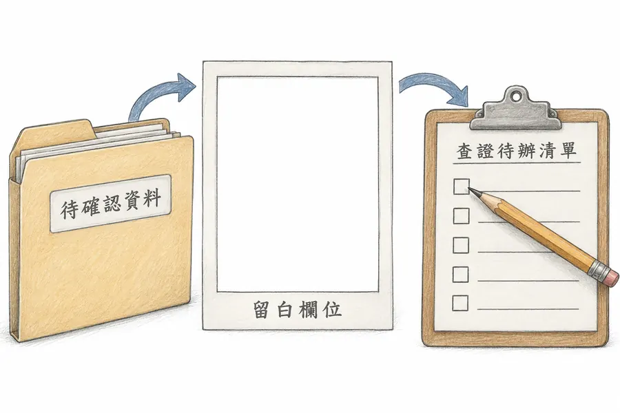

| 品牌 | 國別／時期 | 系列 | 目前狀態 | 查證 |
|:---|:---|:---|:---|:---|
| **Vega** | 美國｜歷史 | 曼陀貝斯系列 | 可確認曾製作低音家族，但需逐年代型錄完成型號編號 | B／C |
| **Vega** | 美國｜歷史 | 圓背／筒背（cylinder-back）／平背曼陀林 | 型號系統複雜，待逐編號建檔 | B／C |
| **Lyon & Healy／Washburn** | 美國｜歷史 | 曼陀貝斯／低音曼陀林 | 可確認有家族低音樂器，具體型號待型錄化 | B／C |
| **Washburn** | 美國｜歷史 | 圓背曼陀林 | 大量 Style／No. 跨年代，待專案整理 | B／C |

圖解 20.13　待確認的系列與型號（示意）

注意這張表的「查證」欄全部是 B／C。意思是：連「這個系列存在」都只到 B 級，「具體型號」則只到 C 級。

## 自我學習題庫

學習檢查：作答、核對、複習

先自己作答，再看答案。答錯時回到本章相關小節重新讀一次。

**1. 型號資料庫為什麼把木材可信度獨立評分？**

- A. 型號存在不代表每項材料都已確認

- B. 為了讓表格更長

- C. 木材永遠最重要

- D. 價格不能記錄

**2. 遇到同系列不同型號時，應？**

- A. 每個型號分開查證

- B. 直接互相推測

- C. 只看最貴的

- D. 只記系列名稱

**3. 二手刊登價和成交價應？**

- A. 分開記錄

- B. 視為相同

- C. 只留較高者

- D. 全部忽略

**答案：1.A　2.A　3.A**

## 本章主要查證來源

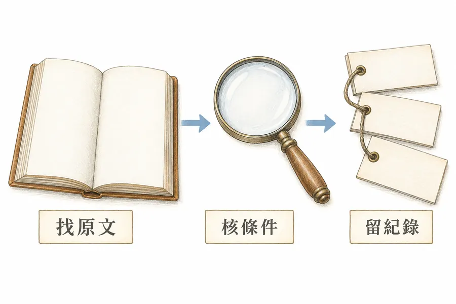

查證來源：找原文、核條件、留紀錄

**【S2001】Classical Mandolin Society of America：Music Notation for Mandolin Family Instruments。** 家族名稱、調弦與記譜的地域差異。

> https://classicalmandolinsociety.org/wp-content/uploads/Music_Notation_for_Mandolin_Family_Instruments_v3.pdf

**【S2002】Gibson：1923 F-5 Master Model Reissue / history。** 現行復刻規格與 1923 F-5 官方歷史敘述。

> https://www.gibson.com/pages/gibson-mandolins

**【S2003】Liuteria Calace：Official mandolin specifications。** 33.5 cm 弦長、ribs、木材、調弦等。

> https://www.calace.it/en/mandolini

**【S2004】Liuteria Calace：Mandoloncelli & Liuti specifications。** 61 cm 弦長、8／10 弦曼陀隆切羅等。

> https://www.calace.it/mandoloncelli-liuti

**【S2005】Collings Guitars：MF5 official specifications。** 現行 F 型規格。

> https://collingsguitars.com/mandolins/mf5/

**【S2006】Eastman Guitars：MD315 official specifications。** 現行 F 型規格與設定數值。

> https://www.eastmanguitars.com/md315

**【S2007】Northfield Mandolins：How Northfield Works。** 跨國材料、加工、組裝與設定流程。

> https://www.northfieldinstruments.com/how-northfield-works

**【S2008】Suzuki Music／鈴木バイオリン製造：Suzuki Music 2016 Catalog。** MC-836 等家族型號官方規格。

> （本書前期查證所使用的 2016 官方型錄）
