*Buying, Evaluating, Preserving and Using the Mandolin（選購、評估、保存與使用曼陀林）*

## 本章重點

- 看琴的順序是：先看結構，再看功能，再看耗材，最後才看美觀。
- 便宜的琴不一定划算，貴的琴也不保證狀態好。真正要比的是「總成本」。
- 弦距很高、琴橋卻已經降到底，這是警訊，不是調整問題。
- 台灣最常見的保存風險是「太濕」，不是太乾。
- 判斷「能不能自己動手」的標準只有一個：做壞了，可不可以復原。

## 21.0　這一章要解決什麼問題

讀完整本書，最後還是會回到一個很實際的場景。

眼前有一把琴。你要決定：它適不適合我？狀態好不好？價格合理嗎？該怎麼保存？哪些問題我能自己處理？哪些一定要交給製琴師？

要回答這些，得把前面章節的結構、木材、設定、聲學和型號資料全部綜合起來。

本章採用「風險導向」：先判斷會不會影響結構與能不能彈，再看可以更換的零件，最後才看裝飾與收藏性。

這個順序很重要。漂亮的紋路、閃亮的貝殼、好聽的故事，都很容易吸引人。

但它們會讓你忽略真正要緊的事：琴頸角度、面板變形、圓背木條開膠。

## 21.1　用途與選琴需求

### 先問：你要拿它做什麼？

| 你想玩的方向 | 優先考慮的特點 |
|:---|:---|
| **藍草即興合奏（bluegrass jam）** | F 型／A 型雕刻面板、f 孔的響應、刷節奏（chop）、投射力（projection） |
| **古典曼陀林或曼陀林樂團** | 圓背傳統、顫音（tremolo）的響應、特定家族的音色 |
| **愛爾蘭／民謠** | 較直接的單音響應（single-note response） |

選琴要從用途開始，不是從品牌開始。

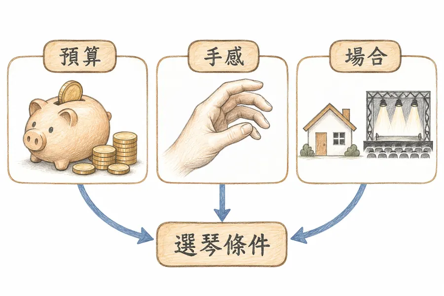

圖解 21.1　用途與選琴需求（示意）

### 第二個問題：手感

這幾項會直接決定你能彈多久：

- 琴枕寬度（nut width）
- 弦長（scale length）
- 指板弧度半徑（fingerboard radius）
- 琴頸形狀（neck profile）
- 弦距（action）

官方資料顯示，Eastman MD315 使用 13 7/8 吋弦長、1 3/32 吋琴枕、12 吋指板半徑。

Collings MF5 則是 13 7/8 吋弦長、1 1/8 吋琴枕，加上複合半徑（compound radius）。

這些毫米級的差異，對你手感的影響，可能比鑲邊華不華麗重要得多。〔S2101〕〔S2102〕

### 第三個問題：預算與品牌

入門琴如果設定良好，往往比高價琴但弦距過高更容易學。

升級的真正理由應該是：響應、音色、琴頸手感、動態範圍，或某種特定風格的需求。不是「這把比較貴」。

| 重點與應用 | 內容 |
|----|----|
| 核心概念 | 藍草合奏重 F／A 型雕刻面板、f 孔響應、chop 與投射力；古典重圓背傳統與顫音響應。 |
| 關係與條件 | 第二個問題是手感。 |
| 應用方向 | 選琴、鑑定與保養。 |

### 帶去店裡之前

第一把琴，先從「你想參加的音樂活動」選起。

要加入社團或樂團，就問老師用什麼琴型、什麼調弦、負責哪個聲部。想參加藍草合奏，就帶著熟悉的旋律和節奏去試琴。

島村樂器的指南，主要服務圓背曼陀林與曼陀拉的讀者。它的配件與售後服務提醒，也很適合放進選琴清單。〔N01〕

把預算分成四項：琴本身、琴盒、基本配件、檢查調整。

店家如果提供套裝，要逐項核對內容物與尺寸。購買前請店家寫清楚：交琴時會做哪些調整、保固條件、換弦與維修的聯絡方式。

網站上的日圓價位，適合用來理解「當時的產品分級」。部分比較價格標示為 2022 年 5 月，頁面也註記 SUZUKI 已生產完畢、Ena 停產及庫存狀態。

這些都是該通路頁面當時的資訊。實際價格、供貨與售後條件，請向購買地店家取得當次報價。〔N01〕

## 21.2　新琴檢查

### 先看琴頸對不對

拿到新琴，先看琴頸排列（neck alignment）。

從琴尾板（tailpiece）往琴頭（headstock）看：弦是不是大致沿著指板中央？琴橋有沒有歪？

接著檢查：琴衍末端（fret ends）、琴枕弦槽（nut slots）、弦鈕順暢度（tuner smoothness）、琴橋腳貼合度（bridge feet）、弦距。

即使原廠有明確規格，運輸、氣候和經銷商的設定，都可能讓實際狀態不一樣。

### 再逐格聽有沒有雜音

每一個琴格都要試音，聽有沒有打弦雜音（buzz），特別是第 1–5 格、第 12 格以上，以及高音 E 弦組。

| 症狀 | 可能原因 |
|:---|:---|
| 只有某一格有雜音 | 局部琴衍過高或過低 |
| 整片低把位都有雜音 | 琴枕或琴頸彎度（relief）的問題 |

**不要立刻去轉桁架桿（truss rod）。** 先判斷問題的分布，再決定怎麼處理。

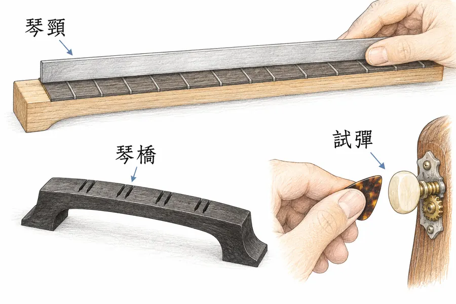

圖解 21.2　琴頸與琴橋檢查的局部示意（示意）

### 最後檢查音準

音準（intonation）要等新弦穩定後再檢查。

第 12 格的泛音（harmonic）和按下的音，可以做快速基準。

浮動琴橋如果位置錯了，整把琴會系統性地偏高或偏低。

這些都是低成本就能調整的問題，要和結構缺陷分開來看。

| 重點與應用 | 內容 |
|----|----|
| 核心概念 | 先看琴頸排列：從琴尾板往琴頭看，弦是否沿指板中央、琴橋是否歪斜。 |
| 關係與條件 | 逐格檢查雜音，特別是第 1–5 格、第 12 格以上與高 E 弦組。 |
| 應用方向 | 選琴、鑑定與保養。 |

### 第一次試琴的固定流程

不知道從哪裡開始？照這個順序做：

1. 坐穩，調音。
2. 依序彈四組空弦。
3. 彈第 1 到第 5 格。
4. 試一段慢旋律。
5. 用「輕」和「強」兩種音量各彈一次。

請老師或店家示範同一段旋律，接著自己重彈。

然後記下三件事：按弦省不省力？音高穩不穩定？聲音清不清楚？

這是本書設計的試琴練習，可以直接帶到現場用。

> **常見誤解：「絃距太高，轉一下桁架桿就好」**
> 桁架桿只處理琴頸彎度。
> 如果問題出在琴頸角度或琴體變形，硬轉只會讓情況更複雜。

## 21.3　中古琴初步檢查

老琴要看三層。順序不能顛倒。

### 第一層：整體結構（第一分鐘）

| 看什麼 | 可能代表什麼 |
|:---|:---|
| 琴頸是否明顯扭轉 | 結構或儲存問題 |
| 面板是否下陷或鼓起 | 張力或濕度問題 |
| 圓背是否有木條分離 | 膠合老化 |
| 琴頸與琴身接合處（neck/body joint） | 接合鬆動 |
| 琴橋高度是否已調到極端 | 琴頸角度不足 |
| 指板延伸段（fingerboard extension）是否異常貼近面板 | 琴體變形 |

### 第二層：裂縫與開膠

木材裂縫（crack）通常會穿過木纖維。漆面龜裂（finish checking）可能只停在漆面。

用斜光觀察、輕敲周邊，可以找出開縫（open seam）。但**不要用力扭琴體去「測試」**。

圓背琴要一條一條看木條和隔片（spacers），特別是琴尾塊（tailblock）和琴頸塊（neck block）附近。

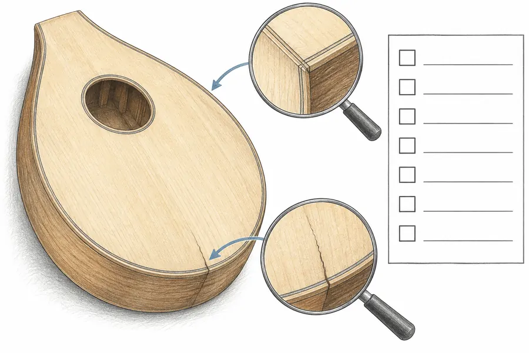

圖解 21.3　中古琴初步檢查（示意）

### 第三層：零件

看琴衍、琴枕、弦鈕、琴橋、琴尾板和弦。

這些多屬於耗材或可維修零件，應該估進成本，但通常不等於「結構報廢」。

**最後**才看刮痕、漆面磨損、裝飾缺失。

> **常見誤解：「表面刮痕多，這把琴就很糟」**
> 刮痕是最後才看的事。
> 一把刮痕很多但結構穩的琴，風險可能遠低於一把外觀漂亮但琴頸角度有問題的琴。

## 21.4　琴頸角度與琴橋高度

浮動琴橋可以提供一定的高度調整，但範圍有限。

**狀況一：弦距很高，琴橋卻已經降到幾乎最低。**

這可能表示琴頸角度不足、面板幾何改變，或指板平面有問題。

**狀況二：弦距很低，琴橋已升到很高，還是打弦。**

這也可能有其他結構因素。

判斷琴頸角度，可以拿直尺沿琴衍延伸，看它大致落在琴橋的哪個高度。

這不是單一的毫米公式，不同琴型不一樣。重點是：**琴橋還有沒有合理的調整餘量**。

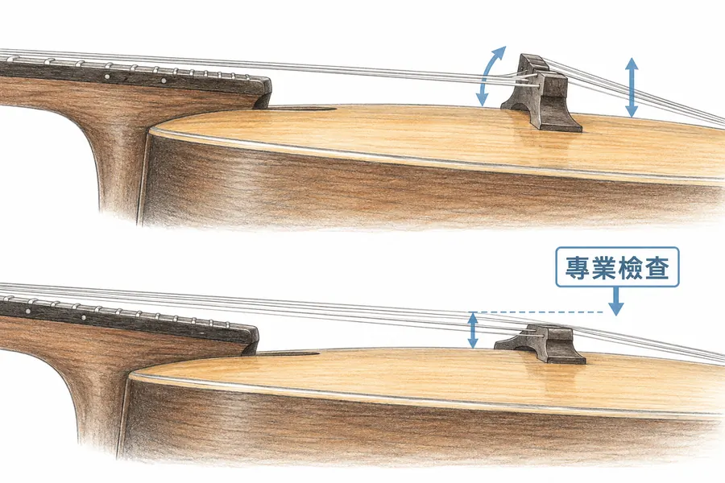

圖解 21.4　琴頸角度與琴橋高度（示意）

琴頸重設（neck reset）屬於高風險工作。不要因為網路影片看起來簡單就自己試。

老琴的膠、接合、漆面和裝飾，都可能因為拆琴頸而受損。應該由熟悉該琴型的製琴師評估。

| 重點與應用 | 內容 |
|----|----|
| 核心概念 | 浮動琴橋有高度調整空間，但範圍有限。 |
| 關係與條件 | 判斷琴頸角度可用直尺沿琴衍延伸，看它落在琴橋哪個高度。 |
| 應用方向 | 選琴、鑑定與保養。 |

## 21.5　裂縫、開膠與結構變形

### 裂縫有大小之分

小型的乾燥裂縫，如果及早修復，可能只是常規維修。

長裂縫穿過琴橋區域、音梁（bracing）脫離，或面板下陷，就複雜得多。

圓背琴的木條分離也有程度差異：一小段開縫，和多條木條大面積移位，工時完全不同。

漆面龜裂本身不一定危險，尤其是老琴上的硝基漆（nitrocellulose lacquer）。真正要問的是：**木材是不是也裂開了**。

用手機手電筒斜照，常能看出裂縫兩側有沒有高度差。但正式購買高價琴，仍應由專業者檢查。

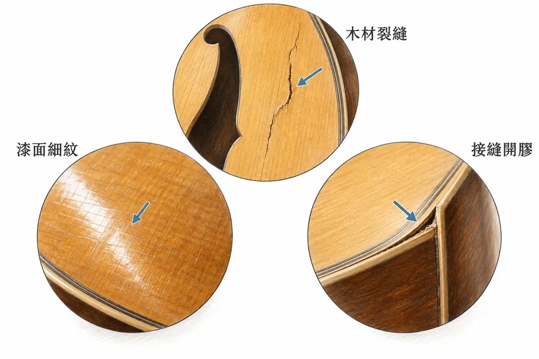

圖解 21.5　裂縫 開膠與結構變形（示意）

### 修復痕跡不等於壞事

一把百年的琴完全沒有修復過，反而罕見。

好的修復可以維持結構與演奏性。真正影響收藏價值的是：修復品質、是否過度改動、原裝零件保留程度，以及來源履歷。

| 重點與應用 | 內容 |
|----|----|
| 核心概念 | 小型乾燥裂縫若及早修復，可能是常規維修。 |
| 關係與條件 | 漆面龜裂本身不一定危險，尤其老硝基漆。 |
| 應用方向 | 選琴、鑑定與保養。 |

> **常見誤解：「有修過＝不值錢」**
> 完全沒修過的老琴反而少見。
> 要看的是「修得好不好」、「有沒有過度改動」、「原裝零件留了多少」。

## 21.6　標籤、序號與真偽

標籤（label）可以被更換、偽造，也可能是真標籤貼在錯的琴上。

鑑定要同時看這些線索：

| 類別 | 具體項目 |
|:---|:---|
| 結構 | 構造方式、內部支撐 |
| 材料 | 木材種類與年代特徵 |
| 尺寸 | 各部分實際測量值 |
| 外型 | 琴頭形狀、鑲邊與鑲嵌（binding／inlay） |
| 五金 | 弦鈕、琴橋、琴尾板 |
| 製作痕跡 | 工具留下的刀痕 |
| 老化 | 漆面老化方式 |
| 履歷 | 來源（provenance） |

對知名製琴師的高價琴，最好比對館藏與型錄。**不要用 Google 圖片看起來很像就下結論。**

序號系統也可能跨年代變動。某些品牌資料完整，某些幾乎沒有。

即使序號落在合理範圍，也只能證明「看起來一致」，不能單獨證明所有零件都是原裝。

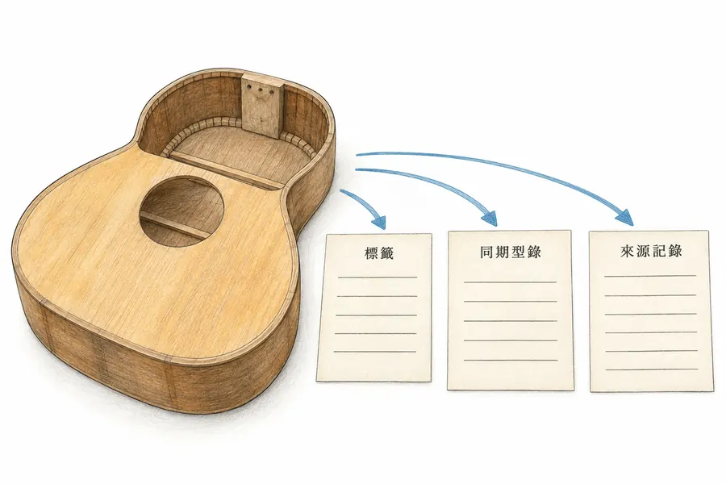

圖解 21.6　標籤 序號與真偽（示意）

購買時應該保存這些照片：標籤、序號、整琴正反面、琴頭、琴橋、琴尾板、內部或圓背、修復處。

還要保留發票與賣家的書面說明。這些未來都可能成為來源履歷的一部分。

| 重點與應用 | 內容 |
|----|----|
| 核心概念 | 標籤可以被更換、偽造，也可能是真標籤貼在錯琴上。 |
| 關係與條件 | 序號系統也可能跨年代變動，某些品牌資料完整，某些幾乎沒有。 |
| 應用方向 | 選琴、鑑定與保養。 |

## 21.7　收藏價值與演奏價值

這兩件事常被混在一起，但它們不是同一回事。

**例子一：** 一把原裝度很高的稀有古琴，可能因為琴頸角度不佳、結構脆弱，不適合頻繁演出。

**例子二：** 一把換過琴橋和琴衍、經專業整備的琴，收藏性稍低，但演奏性極佳。

買家應該先決定：**我在意的是哪一軸？**

| 收藏市場重視 | 演奏者重視 |
|:---|:---|
| 製琴師（maker） | 響應（response） |
| 型號稀有度 | 音準（intonation） |
| 歷史意義 | 琴頸手感 |
| 原漆與原裝五金 | 可靠度 |
| 品況 | 動態範圍 |
| 來源履歷 | 音量與投射力 |

兩者有交集，但不是同義詞。

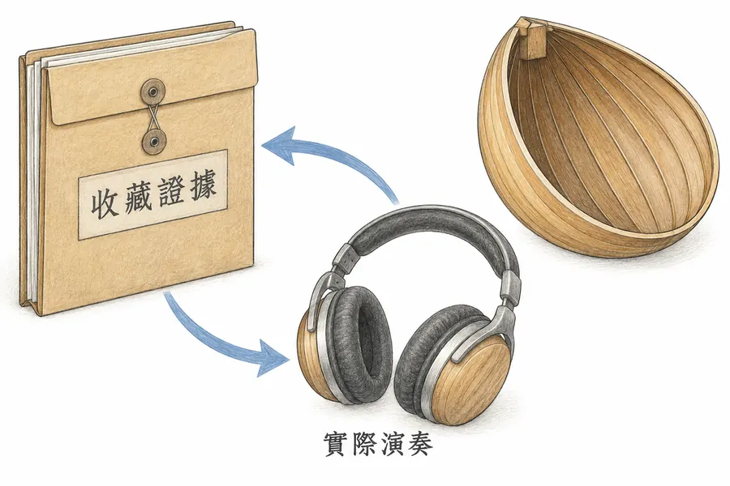

圖解 21.7　收藏價值與演奏價值（示意）

### 不要因為「古」就自動加分

大量生產的學生款（student model），即使上百年，市場上也可能供應很多。

反過來，某些短期生產的職業款（professional model），因為存量少，收藏需求反而更高。

第 20 章的資料庫可以當型號背景，但實際估價仍然需要當期的成交資料。

| 重點與應用 | 內容 |
|----|----|
| 核心概念 | 原裝度很高的稀有古琴，可能因琴頸角度與結構脆弱，不適合頻繁演出。 |
| 關係與條件 | 收藏市場重視製琴師、稀有度、歷史意義、原漆原裝、品況、來源履歷。 |
| 應用方向 | 選琴、鑑定與保養。 |

> **常見誤解：「越老越值錢」**
> 一把 1920 年代的學生琴，可能比一把 1990 年代的職業琴更便宜。
> 稀有度和需求，比年份重要。

## 21.8　浮動琴橋與換弦

### 換弦最常犯的錯

如果你一次把所有弦拆掉，浮動琴橋就會失去弦張力的固定而移位。

對熟悉設定的人來說，這不是災難。但初學者最好**一組一組換**，讓琴橋大致留在原位。

如果真的要全拆弦來清潔指板，應該先用低黏性的定位標記，或量好琴橋位置。這樣重裝後音準才不會跑掉。

### 換弦的幾個要點

- 同一弦組的兩條弦，最好一起換，然後逐條調音。
- 新弦剛裝上會拉伸，需要重新調音好幾次。
- 換成不同粗細（gauge）或材質後，張力會改變，可能需要重新檢查弦距、琴頸彎度與音準。

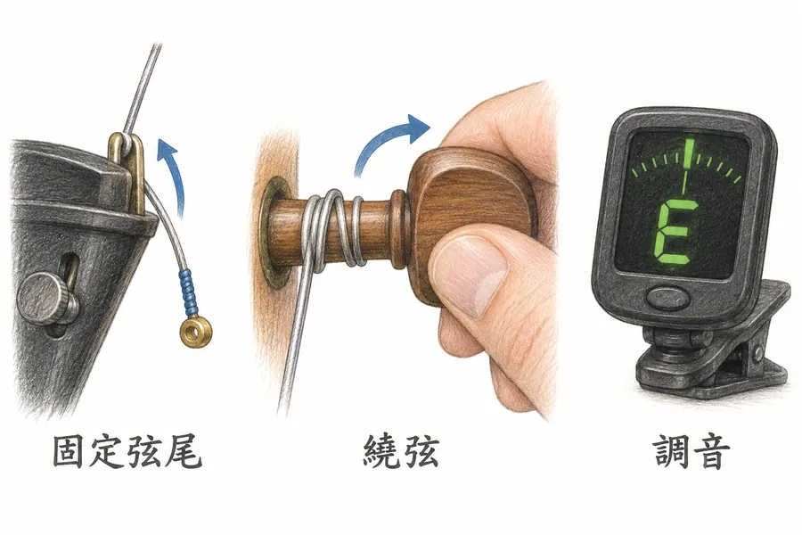

圖解 21.8　浮動琴橋與換弦（示意）

琴尾板有銳邊、弦鈕孔位、弦尾固定方式，各品牌都不同。換弦前先觀察舊弦是怎麼走的。

**不要用暴力把弦環（loop）拉進錯的槽。**

| 重點與應用 | 內容 |
|----|----|
| 核心概念 | 一次拆掉所有弦，浮動琴橋會失去固定而移動。 |
| 關係與條件 | 同一弦組的兩條弦最好一起換，並逐條調音。 |
| 應用方向 | 選琴、鑑定與保養。 |

> **常見誤解：「換弦就是把舊的拆光，再裝新的」**
> 對浮動琴橋的樂器，這個做法會讓琴橋位置跑掉。
> 一組一組換，才是安全做法。

## 21.9　清潔與保養

### 日常清潔

最安全的方法：用柔軟的乾布，先擦掉汗和灰塵。

對老琴或不清楚漆面種類的琴，不要直接用含矽（silicone）、強溶劑或磨料的拋光劑。

蟲膠漆（shellac）、硝基漆（nitrocellulose lacquer）、凡尼斯（varnish）對化學品的反應都不同。某些老漆面可能已經脆化。

### 指板要不要上油？

要看木材、乾燥程度和產品配方。

黑檀（ebony）與玫瑰木（rosewood）這類沒有上漆的指板，偶爾可以用極少量適合樂器的保養油（conditioner）。

但**過量的油不會「餵木頭」**。它反而可能滲進琴衍槽，或吸附灰塵。

上漆的楓木指板，又是另一套處理方式。

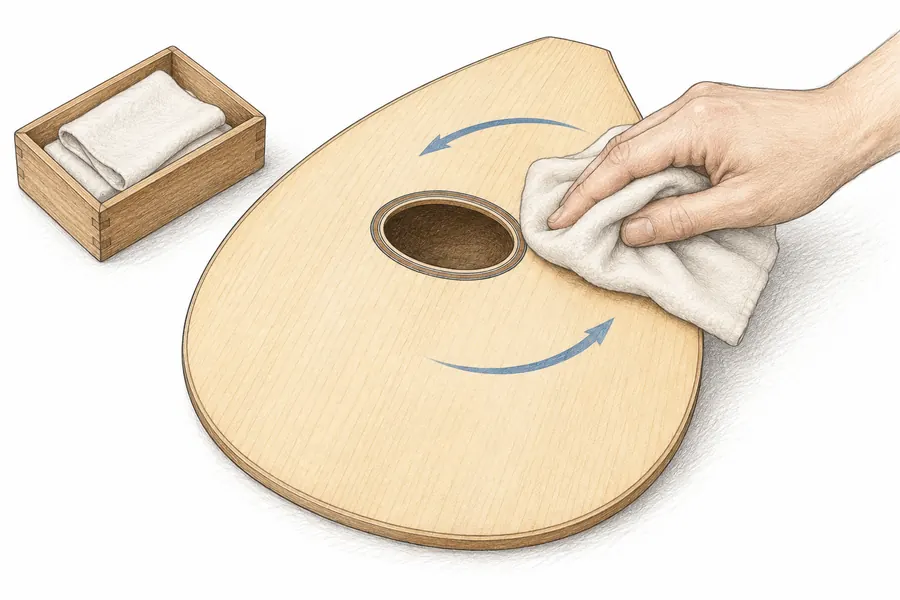

圖解 21.9　清潔與保養（示意）

金屬硬體氧化，可以先用乾布處理。

高價古琴上做強力拋光，可能直接降低原來的自然光澤（patina）和收藏價值。

收藏品的「變亮」，不一定是改善。

| 重點與應用 | 內容 |
|----|----|
| 核心概念 | 日常清潔以柔軟乾布先去汗和灰塵最安全。 |
| 關係與條件 | 指板是否上油，要看木材、乾燥程度與產品配方。 |
| 應用方向 | 選琴、鑑定與保養。 |

### 建立習慣

日常照護從三件事開始：演奏後擦掉汗漬、把琴放回合適的琴盒、觀察環境。

清潔劑、指板油與濕度用品的用量和頻率，要依漆面、指板材質和製琴師的指示安排。

保養紀錄可以註明日期、用品與使用位置，方便下次檢查。

## 21.10　濕度與溫度

### 為什麼濕度這麼重要

木材會隨著環境的相對濕度（RH）改變含水率，造成尺寸變化、裂縫、接縫開膠或面板變形。

常見的樂器保養建議，多把 **40–55% RH** 視為保守範圍。但不同材料、製法和歷史狀態都有差異。

真正重要的不是「某個完美數字」，而是**避免長期極乾、極濕與快速波動**。

美國國會圖書館（Library of Congress）對紙本保存的資料也指出兩個方向。

高於 60% RH 會增加變形與發霉的風險。低於約 30%，也可能因收縮產生問題。

書本不是樂器。但這仍說明有機材料對濕度極端值與波動很敏感。〔S2103〕

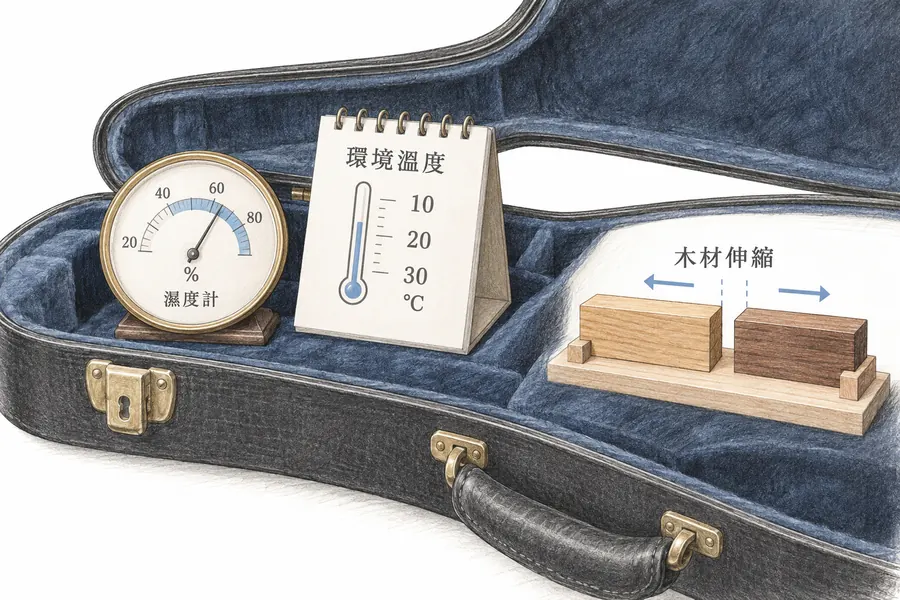

圖解 21.10　濕度與溫度（示意）

### 台灣的實際情況

台灣環境常見高濕。真正的風險，可能反而是琴盒內長期維持 70–80% RH，導致發霉與金屬腐蝕。

比起「在琴盒裡放一包不知道狀態的乾燥劑」，更可靠的做法是：

- 使用可靠的濕度計（hygrometer）
- 控制除濕空間
- 用適當的琴盒收納

| 重點與應用 | 內容 |
|----|----|
| 核心概念 | 木材會隨相對濕度改變含水率，造成尺寸變化、裂縫、開膠或面板變形。 |
| 關係與條件 | 國會圖書館對紙本保存也強調：高於 60% RH 增加變形與發霉風險，低於約 30% 也可能因收縮產生問題。 |
| 應用方向 | 選琴、鑑定與保養。 |

> **常見誤解：「台灣很濕，所以琴一定不會裂」**
> 太濕會發霉、腐蝕金屬、讓木材吸濕變形。
> 而且琴從冷氣房搬到戶外，快速變化本身就是風險。

## 21.11　包裝與運輸

### 琴盒的作用

硬盒（hard case）的作用，是分散衝擊，並且避免琴體在盒內移動。

如果琴盒太大，琴在裡面晃動，外殼再硬也無法阻止二次撞擊。

如果琴頸支撐太高，或壓到琴頭，同樣有風險。

### 溫差

航空與冬季運輸還有溫差問題。

冷琴進入暖室後，不宜立刻打開。讓琴盒緩慢回溫，可以降低結露與漆面受衝擊的風險。

國際運輸則要確認木材、象牙、玳瑁等受管制材料。

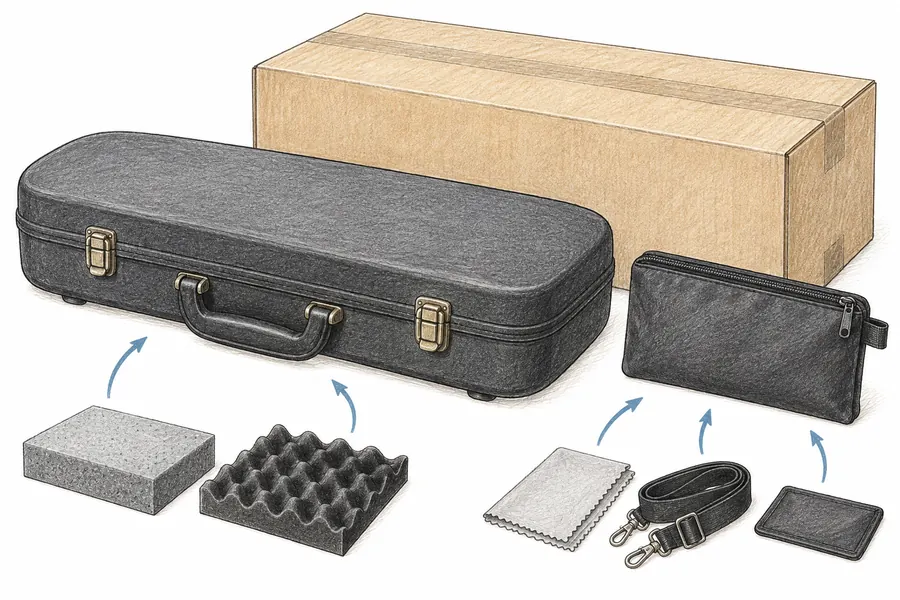

圖解 21.11　包裝與運輸（示意）

CITES（瀕危野生動植物國際貿易公約）的註釋 #15，對許多完成品的達爾伯格屬（Dalbergia，俗稱玫瑰木類）樂器有豁免。

但巴西玫瑰木（Brazilian rosewood，學名 Dalbergia nigra）等重要例外仍然存在。仍應逐項確認物種與適用條件。〔S2104〕

### 寄送高價琴

寄送前應拍照、記錄品況。

要鬆多少弦，得依琴型與承運方式判斷。並確保琴橋、琴頸、琴頭都有適當支撐。

過度鬆弦會讓浮動琴橋與琴尾板失去穩定，未必更安全。

| 重點與應用 | 內容 |
|----|----|
| 核心概念 | 硬盒的作用是分散衝擊，並避免琴體在盒內移動。 |
| 關係與條件 | 航空與冬季運輸還有溫差問題。 |
| 應用方向 | 選琴、鑑定與保養。 |

### 怎麼挑琴盒

把琴實際放進去確認：

- 琴體與琴頸是否受到穩定支撐？
- 盒蓋關閉時能不能自然扣上？
- 提把、背帶與總重量適不適合通勤？

**保護性與尺寸貼合，比套裝件數更值得比較。**

## 21.12　專業維修的時機

| 風險等級 | 項目 |
|:---|:---|
| **高風險，交給專業** | 琴頸重設、嚴重裂縫修復、面板變形、音梁／木條大面積開膠、熱處理（heat treatment）、指板刨平（fretboard planing）、結構性琴橋工程 |
| **低風險，可以自己來** | 正常換弦、清潔、基本調音、在理解方法後做小幅的琴橋位置與音準檢查 |

即使是桁架桿，如果你不知道這把琴有沒有、該往哪轉、結構狀態如何，也不應該硬轉。

尤其古老的圓背琴，內部操作空間有限。拆修可能牽涉多條木條和歷史膠合方式。

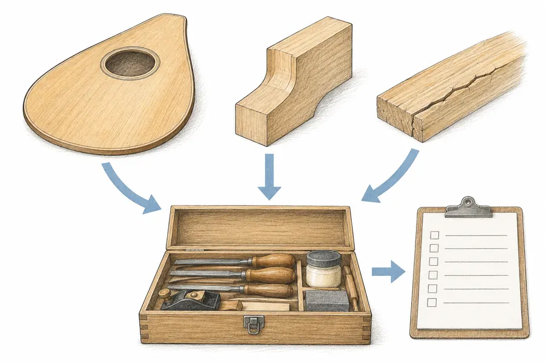

圖解 21.12　專業維修的時機（示意）

「自己修」的判斷標準只有一個：**失敗可不可以復原**。

如果一步做錯，可能破壞木材、漆面或原裝性，那就值得交給專業者。

| 重點與應用 | 內容 |
|----|----|
| 核心概念 | 琴頸重設、嚴重裂縫、面板變形、大面積開膠、熱處理、指板刨平、結構性琴橋工程都屬高風險。 |
| 關係與條件 | 低風險事項包括換弦、清潔、基本調音，以及理解方法後的小幅音準檢查。 |
| 應用方向 | 選琴、鑑定與保養。 |

## 21.13　拾音器與麥克風

三種收音方式，各有取捨。

| 類型 | 優點 | 缺點 |
|:---|:---|:---|
| **壓電／接觸式拾音器（piezo／contact pickup）** | 容易安裝在琴橋或面板上；抗回饋（feedback）較好 | 阻抗不匹配（impedance mismatch）會讓聲音尖薄，常需要高輸入阻抗的前級或 DI |
| **電磁式拾音器（magnetic pickup）** | 聲音較像電樂器，音量穩定 | 需要鐵磁性（ferromagnetic）的弦；對琴身共鳴捕捉少 |
| **內部／外部麥克風（microphone）** | 最自然 | 最容易回饋，也容易收到舞台雜音 |

**混音系統（hybrid system）** 把壓電與麥克風混合，是常見的折衷方案。

現場大音量的藍草樂團，可能偏向壓電或電磁式。安靜的室內舞台或錄音，可以提高麥克風的比例。

**選拾音器前，先定義你的場景**，會比先問「哪一套最好」有效得多。

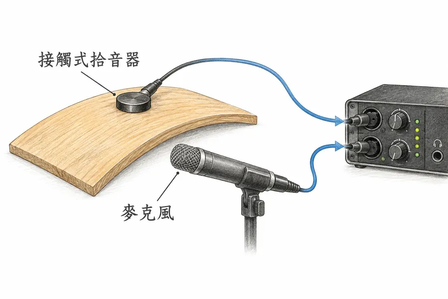

圖解 21.13　接觸拾音與麥克風收音的概念（示意）

安裝拾音器也可能改變琴橋質量或面板負載。

對收藏級古琴，**不可逆的鑽孔要非常慎重**。

| 重點與應用 | 內容 |
|----|----|
| 核心概念 | 壓電拾音器容易安裝、抗回饋較好，但阻抗不匹配會讓聲音尖薄。 |
| 關係與條件 | 電磁式拾音器需要鐵磁性弦，聲音較像電樂器，對琴身共鳴捕捉少。 |
| 應用方向 | 選琴、鑑定與保養。 |

## 21.14　DI 前級與舞台音控

### 為什麼需要前級

壓電拾音器如果接進不適合的低阻抗輸入，可能出現低頻不足、起音過硬的問題。

合適的前級或 DI（direct box，直接盒）可以提供：阻抗匹配、增益、等化（EQ），以及平衡輸出（balanced output）。

舞台上的順序是：**先確定增益結構（gain staging），再處理 EQ**。

不要用極端的 EQ 去補償錯誤的拾音器位置。

### 回饋怎麼處理

回饋（feedback）通常發生在琴體或空氣共振被 PA 系統再次放大的時候。

| 解法 | 說明 |
|:---|:---|
| 改變監聽喇叭位置 | 讓琴不要正對監聽 |
| 降低舞台音量 | 最根本的方法 |
| 陷波等化（notch EQ） | 針對特定頻率削減 |
| 改變拾音器與麥克風的比例 | 少用麥克風 |
| 音孔蓋或回饋抑制器 | 必要時使用 |

一直削低頻，可能讓曼陀林變得過薄。

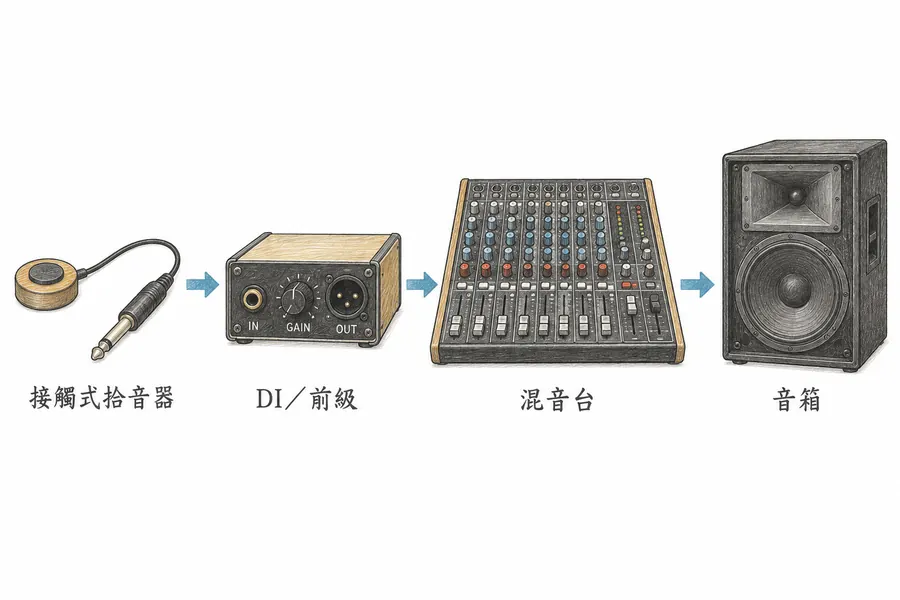

圖解 21.14　DI 前級與舞台音控（示意）

試音（soundcheck）要測三件事：最強的刷節奏（chop）、最密的顫音、最高把位。

這樣才能確認「實際演奏時」的音量與頻譜。真正演出時的峰值與頻譜，才會暴露問題。

| 重點與應用 | 內容 |
|----|----|
| 核心概念 | 壓電拾音器接進不適合的低阻抗輸入，可能低頻不足、起音過硬。 |
| 關係與條件 | 回饋通常發生在琴體或空氣共振被 PA 再放大時。 |
| 應用方向 | 選琴、鑑定與保養。 |

## 21.15　錄音與麥克風位置

### 麥克風的選擇

電容式麥克風（condenser microphone）常能捕捉曼陀林的瞬態（transient）與高頻細節。

動圈式麥克風（dynamic mic）在某些情境下，也能得到比較聚焦的聲音。

**位置比型號更重要。**

| 位置 | 常見結果 |
|:---|:---|
| 直接對音孔 | 容易低頻過重、箱音明顯（boomy／boxy） |
| 第 12 格附近 | 通常較平衡 |
| 琴橋與琴身交界 | 通常較平衡 |

但每把琴都不同，要以實際試聽為準。

### 距離與空間

近距離麥克風能降低房間的影響、增加細節。稍微拉遠，則能整合整個琴身的輻射。

立體錄音（stereo recording）可以用間隔對（spaced pair）、XY／ORTF 等技法，但相位與房間品質會變得更重要。

**如果房間不好，一支位置正確的單聲道麥克風，通常比複雜的立體聲更可靠。**

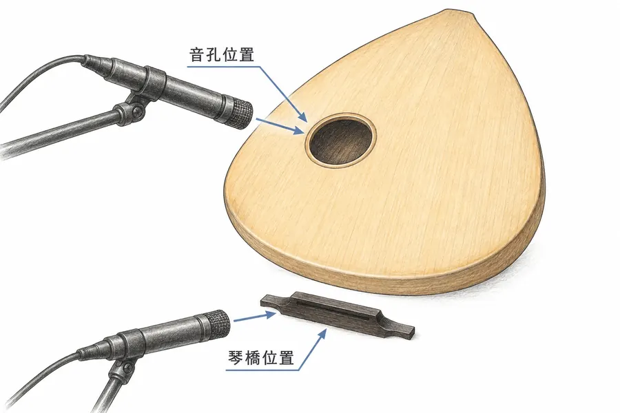

圖解 21.15　音孔與琴橋的部位定位；實際錄音使用完整樂器（示意）

### 錄音前要不要換新弦

要考慮兩件事：新弦的起音太亮，以及調音穩定性。

很多人會提前一兩天換弦，讓弦穩定下來。具體時間依弦的種類、演奏量與聲音偏好決定。

| 重點與應用 | 內容 |
|----|----|
| 核心概念 | 電容式麥克風常能捕捉曼陀林的瞬態與高頻細節。 |
| 關係與條件 | 近距離麥克風能降低房間影響、增加細節。 |
| 應用方向 | 選琴、鑑定與保養。 |

## 21.16　案例：中古琴的總成本

### 案例一：便宜，但很貴

一把老圓背琴，售價很低。但它的狀況是：

- 琴頸角度有問題
- 五條圓背木條開膠
- 琴衍磨平
- 弦鈕鬆動
- 琴橋非原裝

每一項單獨看都可以修。但總工時加起來，可能超過琴價好幾倍。

而且修好後的市場價，又未必等於你的總成本。

### 案例二：看起來糟，其實很好

另一把琴外觀刮痕很多。但它的狀況是：

- 琴頸與結構穩定
- 琴衍還可以用
- 琴橋與音準正常

只需要換新弦和做一次設定。

外觀比較差，實際上反而是風險更低的「可彈琴」（player instrument）。

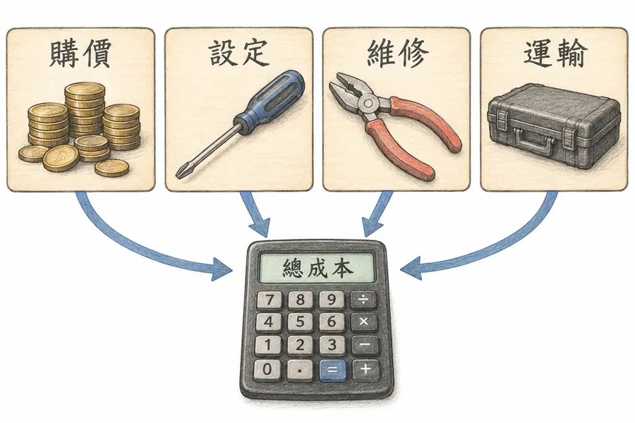

圖解 21.16　案例 中古琴的總成本（示意）

### 這就是中古琴評估的排序

1. **結構**
2. **功能**
3. **耗材**
4. **美觀**

便宜本身不是划算（bargain），昂貴也不是品況的保證。

| 重點與應用 | 內容 |
|----|----|
| 核心概念 | 售價很低的老圓背，若有琴頸角度、五條 ribs 開膠、琴衍磨平、弦鈕鬆、琴橋非原裝，總工時可能超過琴價數倍。 |
| 關係與條件 | 另一把刮痕多但結構穩、琴衍尚可、音準正常，只需換弦與設定，反而是低風險的演奏琴。 |
| 應用方向 | 選琴、鑑定與保養。 |

## 21.17　建立樂器檔案

每把琴建立一份檔案。要記的項目：

| 類別 | 內容 |
|:---|:---|
| 身分 | 品牌、型號、序號／標籤 |
| 交易 | 購買日期、價格、來源 |
| 影像 | 各角度照片 |
| 尺寸 | 弦長、琴枕寬、琴身尺寸 |
| 設定 | 弦組、弦距、琴頸彎度 |
| 維修 | 每次維修紀錄 |
| 環境 | 濕度與存放條件 |

這些資料幾年後會非常有價值。轉售、保險或維修時，都能提供歷史紀錄。

每次重大維修前後都要拍照，並保留發票。

如果換掉原裝的琴橋、琴尾板、弦鈕，**舊零件也要保存並標記**。

收藏價值有時候就取決於這些看起來不起眼的來源履歷。

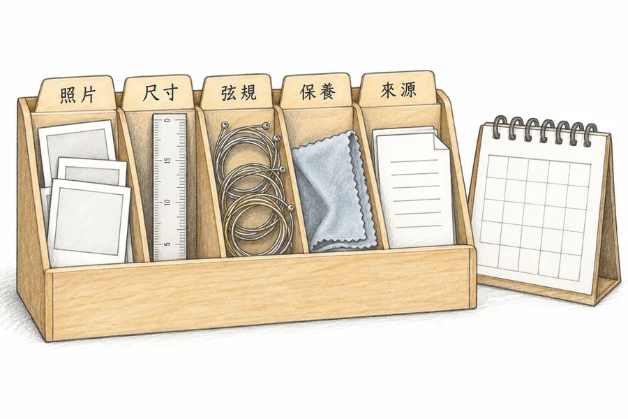

圖解 21.17　建立樂器檔案（示意）

真正的「專業保養」，重點是讓琴安全、穩定、可演奏，同時保存可追溯的歷史。

## 表 21-1｜中古琴症狀、風險與處理順序

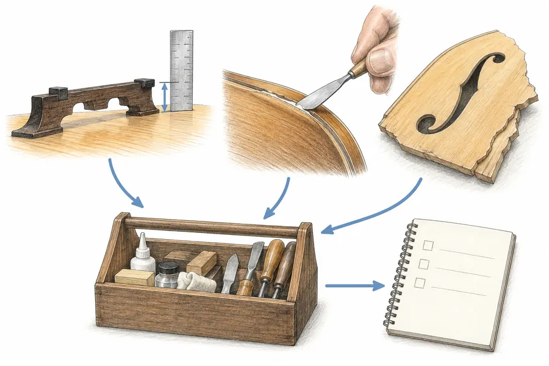

| 觀察 | 可能原因 | 風險層級 | 下一步 |
|:---|:---|:---|:---|
| **琴橋已降到底，弦距仍高** | 琴頸角度／琴體幾何 | 高 | 停止微調，請製琴師評估 |
| **多條圓背木條開膠** | 膠合老化／濕度／撞擊 | 高 | 避免加張力，也不要自行夾合 |
| **單一琴格打弦** | 局部琴衍過高或過低 | 中 | 先定位，再做琴衍處理 |
| **弦鈕澀或回差** | 齒輪磨耗／潤滑／鬆動 | 低–中 | 先確認固定與結構 |
| **弦舊、調音不穩** | 弦拉伸／磨耗 | 低 | 換整組並重新檢查音準 |
| **表面刮痕但結構穩** | 正常使用痕跡 | 低 | 除非收藏需求，通常不需修復 |

圖解 表 21-1｜中古琴症狀 風險與處理順序（示意）

## 自我學習題庫

學習檢查：作答、核對、複習

先自己作答，再看答案。答錯時回到本章相關小節重新讀一次。

**1. 中古琴出現弦距很高但琴橋已很低，可能要注意？**

- A. 琴頸角度或琴體幾何

- B. 琴盒顏色

- C. 撥片材質

- D. Logo 大小

**2. 高價老琴的修復原則較適合？**

- A. 先評估可逆性與原裝性

- B. 能換就全換

- C. 先重噴漆

- D. 只看外觀

**3. 台灣高濕環境常見的保存風險包括？**

- A. 發霉、金屬腐蝕與木材吸濕變形

- B. 只會過乾

- C. 只有弦斷

- D. 沒有影響

**答案：1.A　2.A　3.A**

## 本章主要查證來源

查證來源：找原文、核條件、留紀錄

**【S2101】Eastman Guitars：MD315 official specifications。** 弦長、琴枕寬、指板半徑、弦距等選琴手感參數案例。

> https://www.eastmanguitars.com/md315

**【S2102】Collings Guitars：MF5 official specifications。** 弦長、琴枕寬、複合半徑等選琴案例。

> https://collingsguitars.com/mandolins/mf5/

**【S2103】Library of Congress：Preserving Your Books – relative humidity guidance (2026)。** 有機材料保存對高濕、低濕與快速波動的保守原則；非樂器專屬數值。

> https://guides.loc.gov/preserving-your-books

**【S2104】CITES：Annotation #15 / reports on Dalbergia musical-instrument exemptions。** 完成品樂器豁免與達爾伯格屬管制背景；D. nigra 等例外需個別確認。

> https://cites.org/eng/app/appendices.php

把喜歡的聲音，變成學習的方向。

先聽出旋律與節奏，再觀察音色和演奏方法，最後選一個小目標帶回練習。
