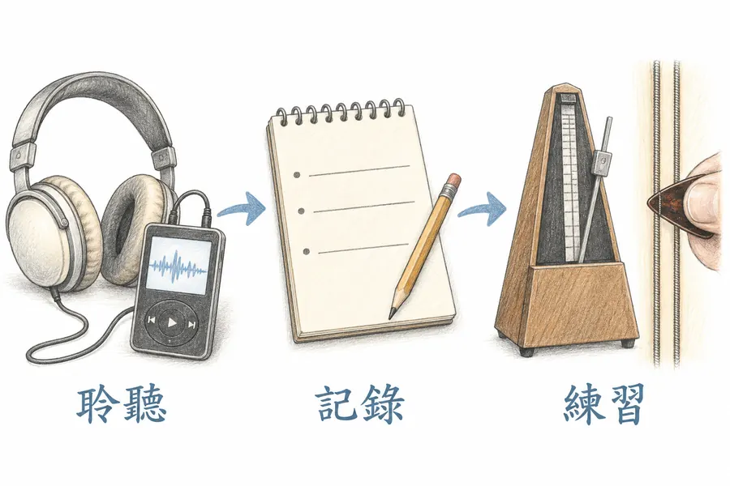
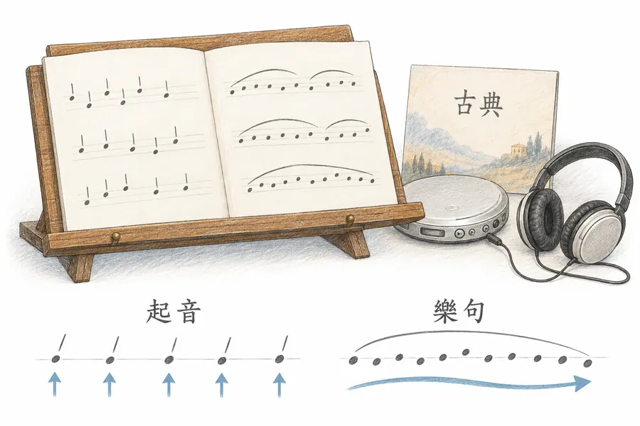
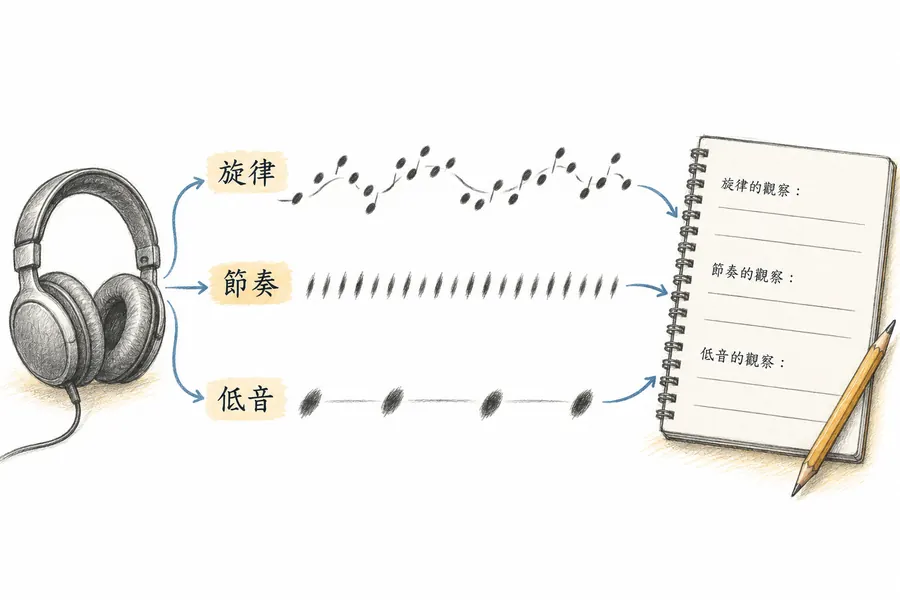

## 本章重點

- 聽音樂也可以有方法：三遍，每遍只專心一件事。
- 八張專輯涵蓋古典、藍草、巴西 choro、二重奏與跨界。
- 每張專輯都有一個「聆聽任務」和一個「練習任務」。
- 錄音是「演奏＋麥克風＋空間＋混音」的總和，不能直接等於你的琴的聲音。
- 把聽到的東西，用你自己的話記下來，比記專有名詞有用。

## 22.0　怎麼用這一章

本章選了八張錄音，帶你認識曼陀林在古典、藍草、巴西 choro、二重奏與跨界音樂裡的樣子。

每張都有三個部分：聆聽入口、觀察問題、短練習。

初學者先挑一首自己喜歡的就好。進階讀者再比較不同編制與演奏處理。

專輯的出版資訊與曲目，依唱片公司與官方資料查證。聆聽問題與練習，則是本書安排的教學活動。

你可以從本章末的來源連結前往官方試聽頁，或在授權平台上用「藝人＋完整專輯名稱」搜尋。

不同版本的曲序、上架地區與可聽範圍，可能不一樣。

## 22.1　三次聆聽的方法

### 三遍，三個任務

| 聆聽次數 | 注意的事情 | 要完成的一項記錄 |
|:---|:---|:---|
| **第一遍** | 旋律與整體感受 | 喜歡的段落，以及為什麼 |
| **第二遍** | 起音或音色 | 一個具體的聲音特徵 |
| **第三遍** | 節拍與樂句 | 一處停頓或重音的位置 |

第一次聽全曲，只記下你喜歡的段落。

第二次選 30 至 60 秒，專心聽一件事。例如「每個音開始時清不清楚」。

第三次跟著音樂輕拍節奏，觀察旋律在哪裡停頓、哪裡接續。

三遍各有一個任務，注意力就容易集中。

圖解22.1　聆聽 記錄與練習

### 怎麼記錄

寫下曲名與播放位置，然後用生活化的詞描述聲音：明亮、柔和、短促、連續。

**一個重要的提醒：** 錄音裡的聲音，是演奏、麥克風、空間與混音加在一起的結果。

想知道自己的琴是什麼聲音，仍然要回到現場試彈。

音色與撥弦位置的關係，可以搭配第 17 章一起練習。

> **常見誤解：「錄音裡的聲音，就是這把琴的聲音」**
> 錄音經過麥克風選擇、擺位、房間、後製與混音。
> 同一把琴，可以錄出完全不同的聲音。

## 22.2　古典作品與獨奏聲部

圖解22.2　聽起音與樂句

### Avi Avital（阿維・阿維塔爾）／Vivaldi（韋瓦第）／2015 年／Deutsche Grammophon（德意志留聲機）

這張專輯由 Avital 與威尼斯巴洛克樂團（Venice Baroque Orchestra）合作，收錄韋瓦第的曼陀林協奏曲，以及其他協奏曲的改編。〔L01〕

先選 C 大調曼陀林協奏曲 RV425 的一個樂章，觀察獨奏加入時的聲音輪廓，再聽樂團怎麼接回主題。

| 任務 | 內容 |
|:---|:---|
| **聆聽** | 找出一處「短音連續出現」的段落，輕拍節奏，記下樂句末尾在哪裡收住 |
| **練習** | 用一組空弦慢慢彈四個均勻短音，讓每個起音清楚，再在句尾留一口氣 |

相關技術見第 13、14 與 17 章。

### Avi Avital／Art of the Mandolin（曼陀林的藝術）／2020 年／Deutsche Grammophon

本專輯選用原本就為曼陀林寫作的作品。合作樂器包含吉他、豎琴、大鍵琴與理論琴（theorbo），也有樂團參與。〔L02〕

先選一首短曲，專注聽曼陀林與伴奏如何交替發聲，再比較另一首的編制。

| 任務 | 內容 |
|:---|:---|
| **聆聽** | 描述一處主旋律和伴奏的分工，並記下力度如何變化 |
| **練習** | 把熟悉旋律彈兩次，一次輕柔、一次稍明亮，兩次都維持穩定節奏 |

作品年代與編制，可以連回第 18 章閱讀。

### Chris Thile（克里斯・希爾）／Bach Sonatas and Partitas Vol. 1（巴赫無伴奏小提琴奏鳴曲與組曲 第一集）／Nonesuch（唱片廠牌名）

Thile 用曼陀林演奏巴赫的無伴奏小提琴作品。收錄 G 小調第一號奏鳴曲、B 小調第一號組曲，以及 A 小調第二號奏鳴曲。〔L03〕

先選一個慢樂章，聽一件撥弦樂器怎麼讓旋律與和聲方向清楚。

| 任務 | 內容 |
|:---|:---|
| **聆聽** | 用手勢標出你聽見的句子起點與終點，觀察低音和高音如何交替 |
| **練習** | 唱一小句熟悉旋律，再用曼陀林彈出同樣的方向；速度依自己的能力安排 |

多聲部觀念可搭配第 12 與 16 章。

## 22.3　藍草與弦樂團的節奏

圖解22.3　跟著旋律 節奏與低音聆聽

### The David Grisman Quintet（大衛・葛里斯曼五重奏）／DGQ 20／Acoustic Disc（唱片廠牌名）

DGQ 20 是 Grisman 五重奏的三片回顧合集。〔L04〕

第一次欣賞，可以先從官方曲目表挑一首短曲，觀察曼陀林在「旋律、節奏、回應同伴」之間的角色變化。

合集提供比較寬的聆聽入口，適合配合第 18 章的曲風內容。

| 任務 | 內容 |
|:---|:---|
| **聆聽** | 在一段音樂中分別追蹤旋律與低音，記下角色交接的位置 |
| **練習** | 用節拍器慢速彈四小節熟悉旋律，停四小節只輕拍節奏，再接回旋律 |

這個練習訓練的是穩定的內在拍感。

### Punch Brothers（潘趣兄弟）／Hell on Church Street（專輯名，字面意為「教堂街的騷動」）／2022 年／Nonesuch

本專輯向 Tony Rice（東尼・萊斯）的《Church Street Blues》致意，曼陀林與歌聲由 Chris Thile 擔任。〔L05〕

從 Church Street Blues 開始，先追蹤歌聲，再觀察曼陀林如何在歌聲旁安排空間。

《Cattle in the Cane》則適合接著比較器樂合奏。

| 任務 | 內容 |
|:---|:---|
| **聆聽** | 找出一處歌聲休息、樂器接話的地方 |
| **練習** | 先唱一句，再用兩三個音回應，保持同一速度 |

把刷節奏、旋律與留白的觀念連回第 14、16 章，練習合奏中的分工。

## 22.4　巴西 choro 的旋律線條

圖解22.4　分開聽旋律與伴奏的節奏

### Jacob do Bandolim（雅各・杜・班多林）／Mandolin Master of Brazil Vol. 1（巴西曼陀林大師 第一集）／Acoustic Disc

這套歷史錄音合集也以《Original Classic Recordings Vol. I》為名流通，Acoustic Disc 編號為 ACD-3。

官方曲目包含 Assanhado、Vibracoes 與 Santa Morena。〔L06〕

可以先聽 Vibracoes 的旋律，再用 Assanhado 比較較活躍的線條。

巴西把曼陀林叫做 bandolim（班多林），這個名稱可以搭配第 5、6 與 18 章理解。

| 任務 | 內容 |
|:---|:---|
| **聆聽** | 跟著旋律哼唱，記下裝飾音出現的位置；第二遍再聽伴奏如何支持旋律 |
| **練習** | 把熟悉旋律的一個長音分成兩個短音，維持原來的拍子，再回到長音版本比較表情 |

歷史錄音可以幫助我們認識演奏語法。

觀察時，把旋律走向、重音與裝飾的安排寫清楚。音質也會受到當年的錄音設備和後來的轉錄處理影響。

## 22.5　二重奏與跨界合作

圖解22.5　聽見主旋律與低音的對話

### Chris Thile 與 Edgar Meyer（艾德加・梅爾）／Bass & Mandolin（低音提琴與曼陀林）／2014 年／Nonesuch

這是曼陀林與低音提琴的二重奏錄音。

從官方曲目表選一首短曲，聽兩個音域如何互相補足：哪一件樂器帶動旋律？哪一件提供節奏或和聲線索？〔L07〕

| 任務 | 內容 |
|:---|:---|
| **聆聽** | 第二遍只追蹤低音提琴，記下它參與旋律的時刻 |
| **練習** | 與同伴各選一個簡單角色，輪流彈旋律與低音或和弦；每次只交換一項任務 |

和聲分工的觀念可搭配第 16 章。

### Avi Avital 與 Omer Avital（歐梅爾・阿維塔爾）／Avital Meets Avital（專輯名，字面意為「阿維塔爾遇見阿維塔爾」）／2017 年／Deutsche Grammophon

這張跨界專輯由曼陀林演奏家 Avi Avital 與貝斯手、作曲家 Omer Avital 合作。

參與者也包括 Yonathan Avishai 與 Itamar Doari。〔L08〕

先選官方頁面的一首作品，聽旋律與低音、打擊聲部如何交談，再比較另一首的速度與情緒。

| 任務 | 內容 |
|:---|:---|
| **聆聽** | 記下讓你想跟著動的節奏型，先用拍手模仿，再彈一組空弦配合 |
| **練習** | 在固定拍子上演奏兩小節短句，再留兩小節空間 |

第 17、18 章可以幫你把音色與曲風的觀察連起來。

## 22.6　四週欣賞與練習計畫

每週安排兩次，每次約 15 分鐘。

順序是：先聽，再記錄，最後做一個短練習。

把練習速度調到自己能穩定完成的程度。連續四週後，回頭聽第一週的作品，看看自己能多聽出哪些細節。

| 週次 | 選擇的方向 | 聆聽與練習目標 |
|:---|:---|:---|
| **第 1 週** | Vivaldi 或 Art of the Mandolin | 聽清楚起音和樂句結尾 |
| **第 2 週** | DGQ 20 或 Hell on Church Street | 跟住節拍並聽角色交接 |
| **第 3 週** | Jacob do Bandolim 合集 | 哼唱旋律並找出裝飾音 |
| **第 4 週** | Bass & Mandolin 或 Avital Meets Avital | 追蹤低音並練習留白 |

圖解22.6　把聆聽觀察帶回練習

### 記錄表怎麼寫

| 欄位 | 填什麼 |
|:---|:---|
| 專輯／曲名 | 完整名稱 |
| 播放位置 | 幾分幾秒 |
| 我聽到的特徵 | 用生活化的詞 |
| 想練的動作 | 一個就好 |
| 下次比較結果 | 有沒有進步 |

這份表也可以在 21.1 試琴時使用，幫你用清楚的詞說出自己喜歡什麼聲音。

## 自我學習題庫

學習檢查　作答 核對與複習

1\. 第二遍聆聽最適合的做法是什麼？ A. 同時分析所有細節 B. 選一個聲音特徵集中觀察 C. 只比較音量大小

2\. Bass & Mandolin 的主要二重奏樂器是什麼？ A. 曼陀林與低音提琴 B. 曼陀林與長笛 C. 吉他與小提琴

3\. Jacob do Bandolim 的錄音適合認識哪一種音樂？ A. choro B. 重金屬 C. 電子舞曲

4\. 用錄音幫助選琴時，哪個做法最合適？ A. 依專輯音量直接決定琴的價格 B. 記下喜歡的聲音，再到現場試彈 C. 只看封面上的樂器

5\. 欣賞後安排練習，適合先做什麼？ A. 一次練完整張專輯 B. 用最快速度模仿 C. 選一個短片段與明確的小目標

答案與說明　1.B，集中一項更容易聽清楚；2.A，兩個音域互相對話；3.A，官方介紹指出這些錄音呈現巴西 choro；4.B，現場試彈能核對實際手感；5.C，小目標方便反覆觀察與比較。

## 本章主要查證來源

查證來源　找原文 核條件與留紀錄

〔N01〕島村樂器 初めてのマンドリン／マンドラの選び方　<https://store.shimamura.co.jp/ec/contents/ols/00mandolin/>　查閱日期2026年10月10日

〔L01〕Deutsche Grammophon Vivaldi　<https://www.deutschegrammophon.com/en/catalogue/products/avi-avital-vivaldi-5124>　查閱日期2026年10月10日

〔L02〕Deutsche Grammophon Art of the Mandolin　<https://www.deutschegrammophon.com/en/catalogue/products/art-of-the-mandolin-avi-avital-12069>　查閱日期2026年10月10日

〔L03〕Warner Music Japan Chris Thile Bach Vol. 1　<https://wmg.jp/chris-thile/discography/13829/>　查閱日期2026年10月10日

〔L04〕Acoustic Disc DGQ 20　<https://acousticdisc.com/product/the-david-grisman-quintet-dgq-20-download/>　查閱日期2026年10月10日

〔L05〕Nonesuch Hell on Church Street　<https://www.nonesuch.com/albums/hell-church-street>　查閱日期2026年10月10日

〔L06〕Acoustic Disc Jacob do Bandolim Vol. 1　<https://acousticdisc.com/product/jacob-do-bandolim-mandolin-master-of-brazil-vol-1-download/>　查閱日期2026年10月10日

〔L07〕Nonesuch Bass & Mandolin official introduction　<https://www.nonesuch.com/journal/edgar-meyer-chris-thile-discuss-new-album-bass-mandolin-2014-08-28>　查閱日期2026年10月10日

〔L08〕Deutsche Grammophon Avital Meets Avital　<https://www.deutschegrammophon.com/en/catalogue/products/avital-meets-avital-10335>　查閱日期2026年10月10日
