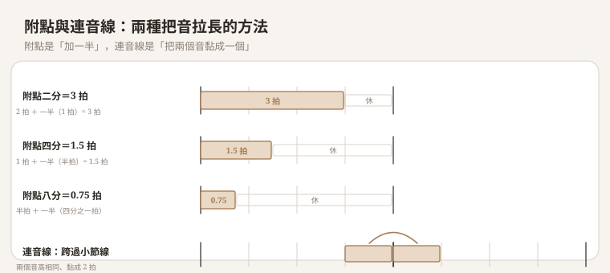
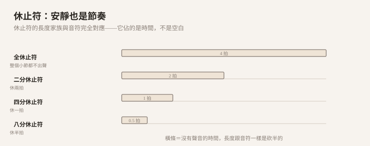
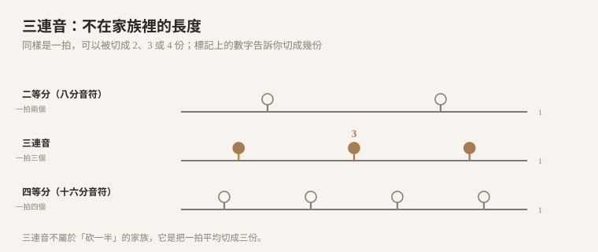
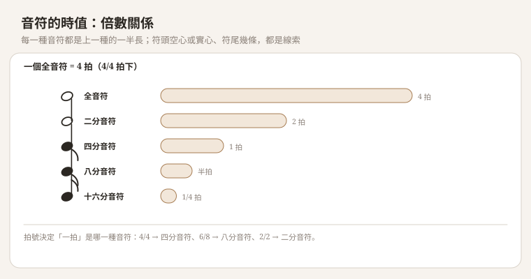
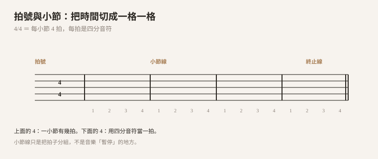
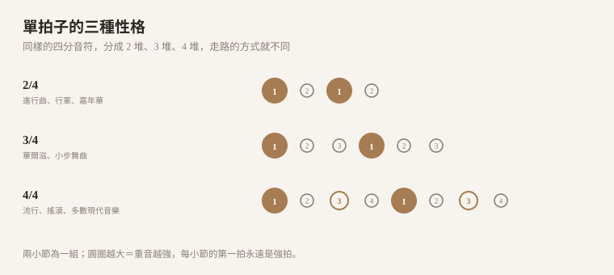
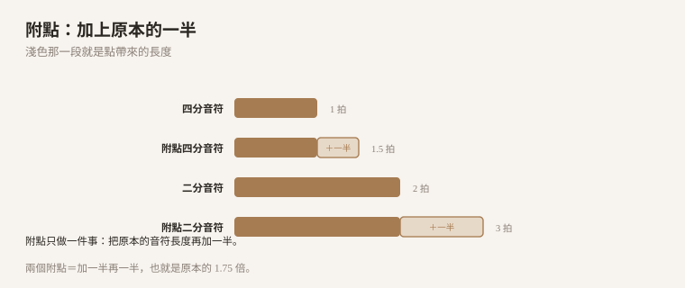
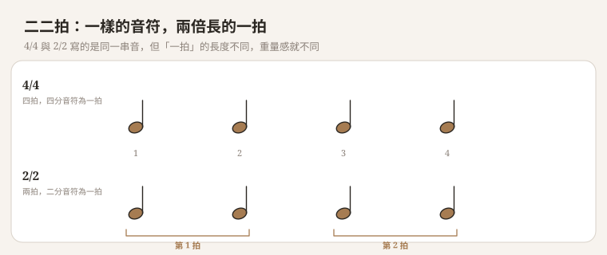
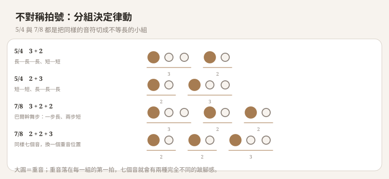

# **第三階段：時間的長短與分組**

認識音符時值與拍號，知道每一個黑色小音符要唱多長、停多久，以及這群拍子該怎麼分組。

在前兩個階段，我們學會了把聲音的高低畫在五線譜上。但音樂之所以被稱為「時間的藝術」，是因為所有的聲音都必須在時間的長河中流動。我們需要一套精確的系統，來告訴演奏者：這個 Do 要唱多長？那個 Re 要停多久？哪裡該重重地踩一腳？哪裡該輕輕地跳過去？

這五章會先從「音符有多長」開始，再進入「拍子怎麼分組」——同樣四個音，分成二加二、三加一或四拍一組，律動就完全不同。接著我們會一路走到華爾滋的旋轉、搖擺的複拍子，以及 5/4、7/8 那種讓人站不穩的跛腳感。

## 第 11 章：音符要唱多長——時值、附點、連音與休止符

同一個音高，唱一拍和唱兩拍，聽起來是兩件完全不同的事。前面我們處理了「多高」，這個階段開始處理「多長」——而「多長」正是節奏的原料。

### **11.1 音符家族：每一次分割都砍一半**

五線譜上的音符長相，其實是一套非常節省的設計：**每往下一級，長度就砍一半**。

- **全音符**：一個空心橢圓，沒有符桿＝ 4 拍
- **二分音符**：空心橢圓加一根符桿＝ 2 拍
- **四分音符**：實心橢圓加符桿＝ 1 拍
- **八分音符**：多一條符尾＝ 半拍
- **十六分音符**：兩條符尾＝ 四分之一拍

二分音符是「把全音符切成兩半」，四分音符再切一半。符尾從八分音符才開始出現：一條符尾＝四分音符的一半、兩條＝再一半。所以只要記得「每多一條尾巴，長度就少一半」，就不必死記名字。

注意一件事：這些拍數是在 4/4 拍的前提下算的。四分音符並不會永遠等於一秒——**它等於「一拍」，而一拍有多長，由速度決定**（上一階段談過的 BPM）。同一個四分音符，慢歌裡可能將近一秒，快歌裡只有零點三秒。

### **11.2 附點：原本的長度再加一半**

二分音符只有 2 拍，但有時候你需要一個 3 拍的音，介於二分和全音符之間。這時候不用發明新音符，只要在右邊加一個小點：**附點把原本的長度再加上一半**。

- 附點二分音符 ＝ 2 + 1 ＝ 3 拍
- 附點四分音符 ＝ 1 + 0.5 ＝ 1.5 拍
- 附點八分音符 ＝ 0.5 + 0.25 ＝ 0.75 拍

偶爾會看到兩個點（雙附點），那是「原本 ＋ 一半 ＋ 四分之一」，例如 1 + 0.5 + 0.25 ＝ 1.75 拍。實務上很罕見，但你在古典樂譜裡確實會遇到。

如果需要的長度用單一個附點音符湊不出來——例如 2.5 拍（附點二分是 3 拍、附點四分是 1.5 拍，都不是 2.5）——附點就幫不上忙。這時用**連音線**（Tie）：把兩個相同音高的音用一條弧線連起來，長度相加，只發聲一次——2.5 拍可以寫成「2 拍 ＋ 半拍，中間連一條線」。連音線跨小節線是常態，尤其在切分節奏裡。

### **11.3 休止符：不算聲音的那一半**

音樂裡「沒有聲音」也是節奏的一部分。休止符的家族跟音符完全對應，只是長相不同：全休止符掛在第四線下、二分休止符坐在第三線上、四分休止符像一個閃電符號。**長度關係一模一樣，也是每往下一級砍一半。**

初學者最常犯的錯，是把休止符當成「不用管」。但在合奏裡，休止符是精確的時間窗——你什麼時候停、什麼時候進，跟什麼時候吹一樣重要。節奏組（鼓、貝斯）之所以能卡得那麼準，正是因為他們數的是休止，不是只有聲音。

### **11.4 三連音：不在家族裡的長度**

有時候你需要的長度，剛好不是「一半的一半」。例如在四拍裡，你想把一拍平均切成三等份——這個長度，音符家族裡沒有。

於是人類發明了**連音符**（Tuplet），最常見的是**三連音**：在同一個時間單位裡塞進三個等長的音（「三份佔兩份的時間」，標記上通常寫一個「3」）。在 4/4 拍裡，一個三連音佔一拍，三個音各佔三分之一拍。

三連音是爵士、藍調與搖滾樂的氣味來源。要注意的是：**平均的三連音還不是 swing**。swing 是把一拍想成三份，但只拿第一份和第三份（長—短，大約 2:1），聽起來才會「搖」。先能把三連音吹平均，才談得上把它搖起來。而在 6/8 這種本來就分三份的拍子裡，反而會出現「二連音」（兩個音佔三份的時間），道理完全對稱。

### **11.5 現在就做**

打開節拍器設 60 BPM（一秒一拍），用單音跟著數：

1. 先吹／唱四分音符，每一拍一個音。
2. 換成八分音符，每一拍兩個音。
3. 換成三連音，每一拍三個音，嘴裡念「一─二─三、一─二─三」。

能穩定地在這三種密度之間切換，比看懂譜面更難，也更有用。

## 第 12 章：節奏的視覺骨架——拍號的結構與意義

當你拿到一份全新的樂譜，你的眼睛會像掃描機一樣，從五線譜的最左邊開始往右掃。這時，你會看到三個非常重要的記號，它們就像是這首樂曲的「遊戲規則設定介面」，這三個記號出現的順序，在全世界所有的樂譜中都是絕對固定的，絕不妥協。

### **12.1 五線譜上的黃金地段：拍號的標示位置**

樂譜開頭的「三神氣」順序是這樣的：

1. **譜號（Clef）**：例如高音譜號或低音譜號。它告訴你「這五條線代表什麼音」。  
2. **調號（Key Signature）**：就是那一堆升記號（♯）或降記號（♭）。它告訴你「這首歌是什麼調性、哪些音要升高或降低半音」。  
3. **拍號（Time Signature）**：最後登場的主角，看起來像是一個沒有中間那條橫線的分數（例如 4/4 或 3/4）。

**拍號永遠站在譜號與調號的後面。** 為什麼是這個順序呢？你可以這樣想像： 譜號定義了「場地」（五線譜的絕對音高）；調號決定了「天氣與環境」（這首歌的和聲氛圍）；最後，拍號規定了你在這個場地裡「前進的步伐與規則」（每一小節有幾拍、什麼音符當作一拍）。場地和環境設定好之後，時間才正式開始流動。

### **12.2 切割時間的柵欄：什麼是「小節」？**

在深入解析拍號之前，我們必須先認識五線譜上用來切割時間的工具：**小節線（Bar line）**。

當你看五線譜時，會發現上面有許多垂直的直線，把原本無限長的五線譜，切成了一個一個等長的小區塊。這些垂直的線就叫「小節線」，而線與線夾住的那個空間，就叫做**小節（Measure 或 Bar）**。

為什麼要畫小節線？ 想像一下，如果你要讀一本沒有標點符號、沒有分段落的小說，你的眼睛一定會迷失在一片字海中。音樂也是一樣的！如果五線譜上只有密密麻麻的音符，演奏者根本不知道現在彈到哪裡，樂團也無法對齊拍子。小節線就像是公路上的里程碑，它把音樂切成好消化、有規律的「時間小包裹」。每一個小節，都裝著固定數量的時間。

### **12.3 拆解密碼：拍號上下數字的真正意義**

拍號的長相非常像數學裡的分數，但請立刻忘掉分數的概念！在拍號裡，上下兩個數字代表著完全不同的意義，它們不是用來相除的。

拍號的公式是這樣的：

* **上方的數字（分子位置）**：代表「每一小節裡面，總共有幾拍」。  
* **下方的數字（分母位置）**：代表「我們要以哪一種音符，來當作一拍的基本單位」。

這個概念非常像我們在計算金錢。 假設你的預算是「每天可以花 4 個 10 元硬幣」。

* 「4」就是上方的數字（數量：4個）。  
* 「10元硬幣」就是下方的數字（單位：10元）。

在音樂中，時間的「貨幣單位」就是各種不同長度的音符。最常見的音符單位有：

* **1**：全音符（Whole note），一個空心的橢圓。  
* **2**：二分音符（Half note），空心橢圓加上一根符桿。  
* **4**：四分音符（Quarter note），實心黑點加上一根符桿。  
* **8**：八分音符（Eighth note），實心黑點加符桿，再加一條小尾巴。  
* **16**：十六分音符（Sixteenth note），實心黑點加符桿，再加兩條小尾巴。

**🔍 數字與音符的歷史對應關係** 為什麼下方的數字是 4，就代表四分音符？這其實是從最大的「全音符」切分下來的。 全音符是音樂裡的「大西瓜」。 把大西瓜切一半（1/2），就是二分音符。 把大西瓜切四等分（1/4），就是四分音符。 把大西瓜切八等分（1/8），就是八分音符。 所以，拍號下方的數字 2、4、8、16，其實就是這個音符佔全音符的幾分之幾！

讓我們用這個邏輯，來解讀幾個最常見的拍號：

* **4/4 拍**：下方是 4（以四分音符為一拍），上方是 4（每小節有四拍）。這就代表，這首歌的每一個小節裡，都裝著四個四分音符的時間長度。  
* **3/4 拍**：下方是 4（以四分音符為一拍），上方是 3（每小節有三拍）。代表每一個小節裡，裝著三個四分音符的長度。  
* **6/8 拍**：下方是 8（以八分音符為基本單位），上方是 6（每小節有六個八分音符）。它屬於複拍子：實際演奏時把每三個八分音符合併成一大拍，所以數起來是 2 大拍，不是 6 拍。代表每一個小節裡，裝著六個八分音符的長度。

這就是拍號運作的絕對鐵律！有了這套規則，無論這首歌的旋律多麼複雜、切分音多麼花俏，只要你把一個小節裡所有音符的時間長度加起來，它的總和絕對會完美等於拍號所規定的長度。這就是音樂世界裡最嚴謹的數學之美。

## 第 13 章：規律與整齊的步伐——單拍子與常見應用

學會了拍號的讀法，我們就要進入第一大類的節拍世界：**單拍子（Simple Time）**。

在人類的音樂歷史中，單拍子是最直覺、最容易被大腦吸收、也是最常被使用的節拍種類。從你小時候唱的兒歌，到現在排行榜上的流行金曲，有高達 90% 以上都是建立在單拍子的框架之上。

### **13.1 什麼是單拍子？「二等分」的絕對特性**

要判斷一個拍號是不是單拍子，最核心的判斷標準在於：**它的一拍，能不能自然地、平均地被切成「兩半」？**

在單拍子中，我們作為單位的那「一拍」，一定是一個沒有附點的普通音符（例如四分音符）。而根據音樂的物理特性，一個四分音符，可以完美地被切成兩個八分音符；一個二分音符，可以完美地被切成兩個四分音符。

這種「一分為二、二分為四」的特性，我們稱之為「二等分（Binary division）」。這非常符合人類的生理直覺，因為我們有兩條腿、兩隻手，我們在走路時左、右交替，這就是最天然的二等分。因此，單拍子的音樂聽起來總是方方正正、步伐明確、有著穩定的前進感。

常見的單拍子主要有三種：二拍子（2/4）、三拍子（3/4）和四拍子（4/4）。讓我們逐一來拆解它們的靈魂。

### **13.2 二四拍（2/4）：軍隊的行軍與民間的狂歡**

**結構解碼**：以四分音符為一拍，每小節有兩拍。 **強弱規律**：**強 —— 弱** | **強 —— 弱**

2/4 拍是人類音樂中最基本、最沒有廢話的拍子。它每兩拍就進入一個新的循環，重音非常密集（每一小節的第一拍就是強拍，所以強拍來得非常快）。

**音樂場景與應用**： 因為它完美的「左右左右」對稱感，2/4 拍天生就是為「走路」**而生的。 **2/4 拍是進行曲最經典的拍號之一**，許多軍隊行軍曲都採用這個拍子。想像一下軍隊行軍的畫面：「左腳（強）— 右腳（弱）、左腳（強）— 右腳（弱）」。強大的第一拍告訴士兵什麼時候該把左腳重重踏在地上，這確保了整個軍隊的步伐整齊劃一。 除了軍隊，許多歡快、活潑的歐洲民間舞蹈，例如波卡舞曲（Polka），或是充滿活力的鄉村音樂，也非常喜歡使用 2/4 拍。它的節奏緊湊，給人一種熱情奔放、想立刻跳起來轉圈的感覺。

### **13.3 三四拍（3/4）：旋轉的舞裙與優雅的失衡**

**結構解碼**：以四分音符為一拍，每小節有三拍。 **強弱規律**：**強 —— 弱 —— 弱** | **強 —— 弱 —— 弱**

3/4 拍是常見的單拍子中唯一以奇數拍循環的成員。這代表如果你試著用雙腳去踩 3/4 拍，你會發現每一次重音落下的腳都不一樣（左-右-左、右-左-右）。這種打破了左右對稱的「失衡感」，正是 3/4 拍最迷人的地方。

**音樂場景與應用**： 提到 3/4 拍，所有人腦海中浮現的第一個詞絕對是：**華爾滋（Waltz，圓舞曲）**。 在 19 世紀的歐洲宮廷裡，小約翰·史特勞斯的華爾滋風靡了整個上流社會。3/4 拍的重音落在第一拍，就像是舞者在地板上用力一蹬（強），接下來的第二拍和第三拍（弱、弱），就像是身體在空中滑行、旋轉的失重狀態。 這種「碰——恰——恰」的律動，給人一種極度優雅、浪漫、無止盡旋轉的感覺。除了古典音樂，流行音樂中如果想要營造一種復古、浪漫或是童話般的氛圍，作曲家也會特地選擇 3/4 拍（例如某些迪士尼公主的主題曲）。

### **13.4 四四拍（4/4）：現代音樂的絕對霸主**

**結構解碼**：以四分音符為一拍，每小節有四拍。 **強弱規律**：**強 —— 弱 —— 次強 —— 弱** | **強 —— 弱 —— 次強 —— 弱**

如果你隨便打開收音機或 Spotify，聽到的前十首歌裡面，大概有九首半是 4/4 拍。它是現代音樂中無可爭議的王者。

為什麼 4/4 拍會這麼受歡迎？因為它是一個「完美的妥協」。 它有二拍子（2/4）的穩定感，但因為它把循環拉長到了四拍，所以不會像進行曲那樣一直被強拍轟炸，給了旋律更多呼吸和發展的空間。同時，它在第三拍安排了一個「次強拍」，讓音樂在小節的中間有一個小小的推進力，不會讓人覺得無聊。

**流行音樂中的隱藏魔法：Backbeat（反拍）** 在古典音樂裡，4/4 拍的重音是 1 和 3。但在現代流行音樂、搖滾樂、R\&B 中，最突出的重音換了位置：從 1、3 拍轉移到 2、4 拍！ 如果你注意聽流行樂裡的爵士鼓，大鼓（低沉的碰）通常打在第 1 和第 3 拍，但小鼓（清脆的啪）卻重重地打在第 2 和第 4 拍。 這個將重音移到弱拍（2和4）的技巧，叫做 **Backbeat（反拍重音）**。它徹底改變了 4/4 拍的歷史！這種反拍的律動，就是讓人忍不住想跟著點頭、拍手的搖滾靈魂。

**📜 歷史冷知識：為什麼 4/4 拍的記號有時候會寫成一個「C」？** 在看樂譜時，你可能會發現有些 4/4 拍的地方，拍號沒有寫數字，而是畫了一個大寫的英文字母「C」。這個 C 的形狀來自中世紀，但它同時也真的被稱作 Common Time（普通拍）——形狀是歷史，名稱是後來的慣用，兩者並不矛盾。

時間回到中世紀，當時的教會認為數字「3」代表著基督教的「三位一體（聖父、聖子、聖靈）」，是世界上最神聖、最完美的數字。因此，當時的三拍子被稱為「完美時間（Tempus perfectum）」，並用一個**完美的圓形（O）來記譜。 相對地，不是三拍子的二拍子或四拍子，被認為是「不完美的」。既然不完美，那個圓形就缺了一角，變成了一個破掉的半圓（C）**。 隨著歷史發展，這個破掉的半圓符號一直被保留下來，成為了現代 4/4 拍的專屬代號。而英文世界的音樂家為了方便解釋，就順理成章地把它解釋為 Common Time 了。

## 第 14 章：搖曳與流動的律動——複拍子解析

當我們習慣了單拍子那種「一分為二」的方正感之後，音樂家們覺得：這樣太死板了！我們能不能在一個大拍子裡面，塞進三個小碎步？讓音樂聽起來不要像機器人走路，而是像在水面上划船一樣流暢？

於是，複拍子（Compound Time）誕生了。 這是許多初學樂理的人最容易卡關的地方，但只要你掌握了它的底層邏輯，你會發現複拍子是音樂中最迷人、最具有流動感的發明。

### **14.1 複拍子的靈魂：什麼是附點音符？**

在進入複拍子之前，我們必須先認識一個小小的、卻能改變時間魔法的符號：**附點（Dot）**。

在五線譜上，你有時會看到音符的右邊跟著一個小黑點。這個點的作用是：**將這個音符原本的時間長度，增加一半（50%）。**

這是一個簡單的數學題：

* 一個普通的四分音符 \= 2 個八分音符的長度。  
* 如果我們給它加上一個附點，變成「附點四分音符」。  
* 它的長度就會變成：原本的 2 個 \+ 增加的一半 (1個) \= **3 個八分音符的長度**。

這就是複拍子的核心秘密！ 在單拍子裡，我們的一拍是「普通音符」，切開來是 2 等分。 在複拍子裡，我們的一拍是「附點音符」，切開來是 **3 等分**！

### **14.2 拆解 6/8 拍的超級迷思**

說到複拍子，最有代表性、也最容易被誤解的，就是 **6/8 拍**。

按照我們在第 12 章學到的公式，6/8 拍的字面意思是：

* 下方是 8：以八分音符為一拍。  
* 上方是 6：每小節有六拍。 聽起來，我們應該要在一個小節裡，均勻地打出六個拍子（1, 2, 3, 4, 5, 6）。

**錯了！這是一個巨大的陷阱！**

如果在演奏 6/8 拍時，你真的在腦海裡數著 6 個平均的拍子，音樂會聽起來極度笨重。 事實上，6/8 拍在音樂的實際聽覺和身體律動上，**它其實是「兩拍」！**

這是怎麼運作的呢？ 在 6/8 拍中，我們把這 6 個八分音符，每 3 個綁成一組。

* 前 3 個八分音符，融合成一個「附點四分音符」。這是一個「大拍」。  
* 後 3 個八分音符，融合成另一個「附點四分音符」。這又是一個「大拍」。

所以，6/8 拍的實際感受是：**每一小節有兩個「大拍」，而每一個大拍裡面，包含了三個「小碎步」。**

**👂 身體律動實驗：感受 6/8 拍的流動** 請你先用腳，在地板上穩穩地踩兩個慢拍：「踩 —— 踩 ——」。 接著，在你的腳踩下去的同時，用嘴巴唸出三連音的節奏： **腳踩下去（重）**：唸「一」 **腳抬起來（輕）**：唸「二、三」

合起來就會變成這樣： **「一**\-二-三、**二**\-二-三 | **一**\-二-三、**二**\-二-三」

你是不是感覺到一種像海浪一樣起伏、或是像人在微醺狀態下搖搖晃晃的感覺？這就是 6/8 拍的魔力！

### **14.3 終極對決：3/4 拍 vs. 6/8 拍，到底差在哪？**

這絕對是音樂考試裡必考的經典題！ 在數學上，3/4 拍等於有 6 個八分音符；6/8 拍也等於有 6 個八分音符。它們的小節總長度是一模一樣的，那到底有什麼不同？

答案就在「重音的分配」與「身體的律動」：

1. **3/4 拍（單拍子）**：  
   * 分組方式：2 \+ 2 \+ 2（三個四分音符）。  
   * 重音位置：**強** \- 弱 \- 弱。  
   * 感覺：三步一個循環，像華爾滋，充滿優雅的旋轉感。  
2. **6/8 拍（複拍子）**：  
   * 分組方式：3 \+ 3（兩個附點四分音符）。  
   * 重音位置：**強** \- 弱 \- 弱 \- **次強** \- 弱 \- 弱。  
   * 感覺：兩步一個循環，每一步裡面帶有三連音的搖擺。這非常適合用來表現船歌（Barcarolle）、愛爾蘭的吉格舞曲（Jig），或是現代流行樂裡那種磅礡、搖擺的抒情搖滾（例如 The Animals 的《House of the Rising Sun》，就是標準的 6/8 拍）。

除了 6/8 拍，常見的複拍子還有：

* **9/8 拍**：每小節有 3 個大拍（3+3+3）。  
* **12/8 拍**：每小節有 4 個大拍（3+3+3+3），這在藍調音樂（Blues）與早期的節奏藍調、福音音樂中極為常見，給予四拍子的框架一種濃厚的慵懶搖擺感。

## 第 15 章：特殊的時間魔法——二二拍與不對稱拍號

我們已經學過了方正的單拍子（4/4、2/4、3/4），也學會了搖曳的複拍子（6/8、12/8）。這兩大類拍號涵蓋了世界上絕大多數的音樂。

但在音樂的魔法書裡，還有一些非常特殊、甚至有些危險的拍號。作曲家們在需要極度緊湊的速度，或是想要創造一種讓人屏息的緊張感時，就會把這些特殊武器拿出來用。這個章節，我們將解鎖二二拍與不對稱拍號的秘密。

### **15.1 視覺的救贖與緊湊的步伐：二二拍（2/2）**

在古典音樂（特別是管弦樂的快板樂章）和百老匯音樂劇中，你經常會遇到一種拍號：**2/2 拍**。 有時候，它不會寫數字，而是畫了一個**中間被一條直線切成兩半的「C」**（就像是一顆被切開的藥丸）。這個符號被稱為 **Alla Breve**，或是俗稱的 **Cut Time（二二拍／切拍）**。

**結構解碼**：以二分音符為一拍，每小節有兩拍。 在數學上，一個小節裡有兩個二分音符，加起來等於四個四分音符。這不就等於 4/4 拍嗎？為什麼還要發明一個 2/2 拍？

這完全是為了解決「速度過快」時的讀譜與演奏危機。

想像一下，有一首 4/4 拍的樂曲，要求你以 BPM \= 240 的速度瘋狂演奏。如果指揮家真的在台上打出四個拍子（1、2、3、4），他的手會揮得像直升機的螺旋槳一樣，演奏者看了眼睛也會花掉。同時，如果每小節要數四個拍子、處理四組強弱，音樂聽起來會太過沉重、拖泥帶水。

為了讓音樂「飛」起來，作曲家使用了 2/2 拍（Cut Time）。 當樂譜標示為 Cut Time 時，它是在告訴所有人：**「把這個 4/4 拍的小節，切成兩半來看待！」** 我們不再把四分音符當作一拍，而是把更長的**二分音符當作一拍**。

這樣一來，原本每一小節要在腦海裡數「1-2-3-4」，現在只需要算兩個大拍子「1 \--- 2 \---」。 指揮家只需要一上一下揮動兩次，演奏者在心裡的節奏感變得更寬廣、更流暢。2/2 拍常用於快速的進行曲或激昂的結尾，它能讓音樂在極高的速度下，依然保持緊湊而不混亂的動力。

### **15.2 打破對稱的危險張力：不對稱拍號（Irregular Time Signatures）**

一直以來，我們接觸的拍號分子都是 2、3、4、6、9、12，它們都能被整齊地分組。但如果，我們把每小節的拍數設定為一個無法被平均分成等長組的數字呢？

這就是不對稱拍號（或稱奇數拍、混合拍子）的領域。最著名的代表就是 **5/4 拍** 和 **7/8 拍**。

這些拍號在西方的古典和流行音樂中相對少見，但它們有一種致命的吸引力。因為人類的大腦天生喜歡對稱與預測，當我們聽到 4/4 拍時，我們知道「1、2、3、4」之後，下一個「1」一定會準時到來。 但是，不對稱拍號就像是一個永遠走不穩、一跛一跛的人，它剝奪了大腦的預測能力，創造出一種**永遠無法安頓下來的緊張感、懸疑感和推動力**。

#### **🎸 5/4 拍：少了一拍的殘缺美**

5/4 拍代表每小節有五個四分音符。因為 5 無法被平均分成兩組或三組等長的拍，所以我們必須把它拆解成不對稱的組合：通常是 **3 \+ 2** 或是 **2 \+ 3**。

**經典案例 1：電影《不可能的任務》（Mission: Impossible）主題曲** 這是全世界最著名的 5/4 拍旋律！阿根廷作曲家拉羅·西夫林（Lalo Schifrin）為了表現特務潛入敵營那種神經緊繃、步步驚心的感覺，刻意使用了 5/4 拍。 它把 5 拍拆成「3 拍 + 2 拍」兩組（也有人聽成 2 + 3，兩種分組在 5 拍裡都很常見）。 你可以試著唸出它的節奏： 「登——登——（這兩個音很長，佔了 3 拍的空間）」 「ㄉㄥ、ㄉㄥ（這兩個音很短，佔了 2 拍的空間）」 加起來剛好 5 拍。這種「長長、短短」的循環，完美營造了特務心跳漏一拍的懸疑感。

**經典案例 2：戴夫·布魯貝克四重奏演奏、保羅·戴斯蒙（Paul Desmond）作曲的《Take Five》** 這首爵士樂史上的神作，其名稱 "Take Five" 就是在致敬它的 5/4 拍結構。它的鋼琴伴奏維持著一種極度洗腦的律動，聽起來像是在平穩的步伐中，突然輕輕地絆了一下，充滿了爵士樂特有的慵懶與實驗性。

#### **💃 7/8 拍：巴爾幹半島的狂野舞蹈**

7/8 拍代表每小節有七個八分音符。它的分組方式更加複雜，常見的有 **3 \+ 2 \+ 2**、**2 \+ 2 \+ 3** 或 **2 \+ 3 \+ 2**。

如果你覺得 7/8 拍聽起來很怪異，那是因為我們習慣了西方的對稱音樂。在東歐、希臘、土耳其以及巴爾幹半島的民間音樂中，7/8 拍甚至是 9/8 拍、11/8 拍簡直就像喝水一樣自然。

在這些文化中，人們跟著 7/8 拍的音樂跳舞時，腳步是三步、兩步、兩步的循環（例如 3+2+2，第一步踩得特別久，後面兩步很快）。這種不規則的律動帶有一種強烈的大地氣息與狂野的生命力。 在前衛搖滾（Progressive Rock）的領域中，許多樂團（如 Tool、King Crimson）也非常喜歡使用 7/8 拍，用來展現他們高超的演奏技巧，並為聽眾帶來一種不斷向前翻滾、無法停歇的聽覺衝擊。

時間的地圖到這裡完成了：你知道每個音符有多長，也知道這一群音符該怎麼分組。

接下來要換一個問題：兩個音之間，到底隔了多遠？那看起來只是「差幾個格子」的小事，卻是後面所有音階與和弦的真正起點。

### 拍號一覽

| 拍號 | 每小節 | 一拍是什麼 | 分類 | 常見場合 |
|---|---|---|---|---|
| 2/4 | 2 拍 | 四分音符 | 單拍子 | 進行曲、波卡舞曲 |
| 3/4 | 3 拍 | 四分音符 | 單拍子 | 華爾滋、小步舞曲 |
| 4/4 | 4 拍 | 四分音符 | 單拍子 | 流行、搖滾、爵士 |
| 6/8 | 6 個八分音符 | 附點四分音符（2 大拍） | 複拍子 | 船歌、愛爾蘭舞曲 |
| 9/8 | 9 個八分音符 | 附點四分音符（3 大拍） | 複拍子 | 複合舞曲 |
| 12/8 | 12 個八分音符 | 附點四分音符（4 大拍） | 複拍子 | 慢速藍調 |
| 2/2 | 2 拍 | 二分音符 | 單拍子（Cut Time） | 快速進行曲 |
| 5/4 | 5 拍 | 四分音符 | 不對稱拍號 | 《Take Five》、電影配樂 |
| 7/8 | 7 個八分音符 | 八分音符 | 不對稱拍號 | 巴爾幹音樂、前衛搖滾 |
