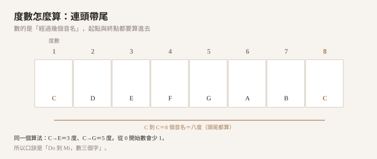
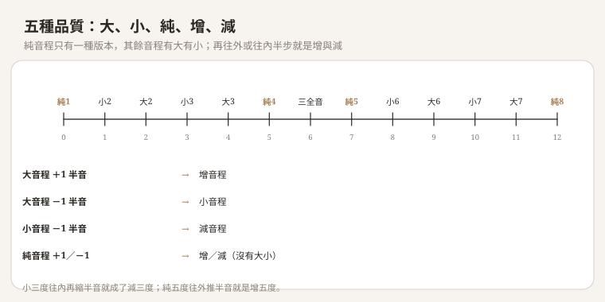
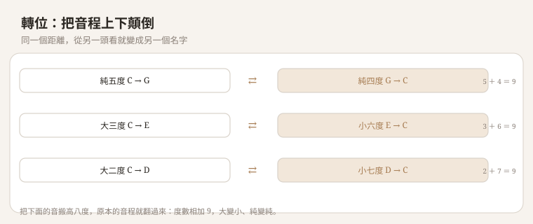

# **第四階段：音與音的距離**

音高有了、時間有了，接下來要問一個更基本的問題：兩個音之間，到底隔了多遠？

「距離」是所有音樂語法的單位。你說一個旋律「跳得很高」、一個和弦「聽起來很緊」，其實講的都是音程。三章的重點分別是：怎麼算距離（度數）、怎麼形容距離的品質（大、小、純、增、減），以及這些距離在耳朵裡為什麼有些舒服、有些刺耳。

把這三章讀通，後面的音階、和弦、和聲進行，都只是把音程一層一層疊起來而已。

## 第 16 章：音與音的距離——度數與半音

你現在會看音高，也會數拍子。接下來要問的問題是：C 到 G，到底隔了多遠？

這個問題看起來很簡單，但它有兩種答案——一種是「數音名」，一種是「數半音」。兩種都要會，因為它們回答的是不同的問題。

### **16.1 度數：連頭帶尾一起數**

最直覺的算法，是數「中間經過了幾個音名」，而且**起點和終點都要算**：

- C 到 C：只有一個音名 → **一度**
- C 到 D：C、D 兩個 → **二度**
- C 到 E：C、D、E 三個 → **三度**
- C 到 G：C、D、E、F、G 五個 → **五度**
- C 到下一個 C：C、D、E、F、G、A、B、C 八個 → **八度**

「連頭帶尾」是初學者最容易漏掉的一步。如果你像量長度一樣「從 0 開始數」，C 到 E 會算成 2，但正確答案是 3。記住口訣：**Do 到 Mi，數三個字**。

度數只看**音名（字母）**，不看升降。C 到 E 是三度，C 到 E♭ 也還是三度，C 到 E♯ 一樣是三度。升降記號改變的是「距離有多遠」，但不會改變「這是幾度」——這條規則等一下會非常重要。

### **16.2 數半音：真正聽到的那段距離**

度數只告訴你「跨越幾個音名」，沒有告訴你實際的距離。因為白鍵和黑鍵的間隔並不平均：E 到 F 之間沒有黑鍵，只隔一個半音；C 到 D 中間夾著 C♯，隔了兩個半音。

所以我們需要第二種計算法：**半音數**。鋼琴上每往右一格（包括黑鍵）就是一個半音。

| 音程 | 半音數 | 例子 |
|---|---|---|
| 一度 | 0 | C → C |
| 二度 | 1 或 2 | C → D♭（1）、C → D（2） |
| 三度 | 3 或 4 | C → E♭（3）、C → E（4） |
| 四度 | 5 或 6 | C → F（5）、C → F♯（6） |
| 五度 | 6 或 7 | C → G♭（6）、C → G（7） |
| 六度 | 8 或 9 | C → A♭（8）、C → A（9） |
| 七度 | 10 或 11 | C → B♭（10）、C → B（11） |
| 八度 | 12 | C → 下一個 C |

你會發現，幾乎每個度數都有「兩種距離」。這不是例外，而是常態——下一章就是要處理這件事。

### **16.3 為什麼要有兩套算法？**

因為它們各自負責不同的工作。

**度數**是「譜面上的寫法」：它決定這個音在五線譜上要畫在哪一線、哪一間。作曲家在寫和聲時，必須遵守度數的邏輯，否則譜面會出現奇怪的同音異名（例如把一個該寫成 E♭ 的音寫成 D♯，明明彈起來一樣，樂理上卻是另一個意思）。

**半音數**是「耳朵聽到的距離」：它決定這個音程聽起來協和還是尖銳、能不能拿來當旋律的跳躍。

一個常見的陷阱是：**聽起來一樣的距離，可能是不一樣的度數。** C 到 F♯ 是增四度（6 個半音），C 到 G♭ 是減五度（也是 6 個半音）——彈的是同一個聲音，但寫法不同：一個寫成四度、一個寫成五度。這種「同音異名」在後面的和聲分析裡會反覆出現。

### **16.4 現在就做**

坐在鋼琴（或任何鍵盤 App）前，從中央 C 出發，把每個白鍵都按一遍，同時說出兩件事：

1. 這是幾度？（數音名，含頭含尾）
2. 隔了幾個半音？（數格子，包括黑鍵）

例如按到 G，你要說「五度，七個半音」。按到 B，你要說「七度，十一個半音」。這個練習做十分鐘，後面所有關於音階與和弦的內容都會輕鬆很多。

## 第 17 章：音程的品質——大、小、純、增、減

上一章我們發現：同一個度數，可能有兩種距離。這一章要把「兩種」講清楚，順便補上另外兩種罕見但重要的版本。

### **17.1 品質是修飾詞，度數是名詞**

樂理形容一個音程，用的是一個「形容詞 ＋ 名詞」的結構：「**大**三度」、「**純**五度」、「**減**七度」。名詞是度數（上一章算的），形容詞就是**品質**，用來指出它到底是這個度數裡的哪一種距離。

品質總共五種：**大、小、純、增、減**。它們不是隨機分配的——哪個度數配得上哪個形容詞，有一套規則。

### **17.2 純音程：一、四、五、八**

**一度、四度、五度、八度**只使用「純」（Perfect），不用大小。理由很實際：這四個音程在泛音列裡對應最簡單的整數比（1:1、4:3、3:2、2:1），在聽覺上只有「一個版本」，沒有「大一點、小一點」的分別。

- 純一度＝同一個音（0 個半音）
- 純四度＝5 個半音（C → F）
- 純五度＝7 個半音（C → G）
- 純八度＝12 個半音（C → 高八度的 C）

純音程只有一個版本聽起來「乾淨、空、穩定」。把純音程再往外推半音，就變成「增」；往內縮半音，就變成「減」。例如 C → F♯ 是增四度（6 個半音），C → G♭ 是減五度（也是 6 個半音）——這兩個剛好是同一個聲音，也就是俗稱的**三全音**（因為它等於三個全音）。

### **17.3 大與小：二、三、六、七**

**二度、三度、六度、七度**則有「大」（Major）與「小」（Minor）兩種版本：大的比較寬，小的比較窄，兩者都差一個半音。

- 大二度＝2 個半音（C → D）／小二度＝1 個半音（C → D♭）
- 大三度＝4 個半音（C → E）／小三度＝3 個半音（C → E♭）
- 大六度＝9 個半音（C → A）／小六度＝8 個半音（C → A♭）
- 大七度＝11 個半音（C → B）／小七度＝10 個半音（C → B♭）

「大」與「小」這兩個字是中譯帶來的麻煩：它們跟「好壞」無關，也不是「大聲小聲」。英文的 Major／Minor 原本就是「較大／較小」的意思——大三度比小三度寬一個半音，就這麼單純。**大調聽起來開朗、小調聽起來憂鬱，是後來的文化聯想，不是音程本身的性格。**

### **17.4 增與減：再往外或再往內一步**

在任何一種音程上動手：

- **增音程**＝把上方音再升高半音（或把下方音降半音），距離變寬
- **減音程**＝把上方音再降低半音（或把下方音升半音），距離變窄

把規則縮成兩行：

- **大／小音程**：小 ＋1 個半音 → 大；大 ＋1 個半音 → 增；大 －1 個半音 → 小；小 －1 個半音 → 減。
- **純音程**：純 ＋1 個半音 → 增；純 －1 個半音 → 減。

注意純音程沒有大／小，所以它往兩邊推就是增／減。以 C 到 E 為例：大三度，往內縮半音變小三度（C → E♭），再往內縮半音就變減三度（C → E♭♭，讀作「重降 E」）——雖然實際彈起來等於 D，但寫法上它仍然是「三度」。這種「聽起來一樣、寫法不同」的現象，你已經在變化記號那一章見過一次了。

### **17.5 一張表看完**

| 半音數 | 音程 | 半音數 | 音程 |
|---|---|---|---|
| 0 | 純一度 | 7 | 純五度 |
| 1 | 小二度 | 8 | 小六度（或增五度） |
| 2 | 大二度 | 9 | 大六度 |
| 3 | 小三度 | 10 | 小七度 |
| 4 | 大三度（或減四度） | 11 | 大七度 |
| 5 | 純四度 | 12 | 純八度 |
| 6 | 增四度／減五度 | | |

表格左邊看半音數，右邊看音程名稱。括號裡的「或」就是同音異名：同一個聲音，兩種寫法，選哪一個取決於它在哪個調、往哪個方向解決。

### **17.6 現在就做**

從 C 出發，把上一章那張「度數與半音」的表補上品質：C 到 D 是大二度、C 到 E♭ 是小三度、C 到 F 是純四度、C 到 G 是純五度、C 到 A 是大六度、C 到 B 是大七度。

然後換一個起點，從 D 出發再做一次。你會發現白鍵上的音程並不對稱——D 到 F 是小三度，D 到 F♯ 才是大三度。這個不對稱，正是下一階段「為什麼需要調號」的起點。

## 第 18 章：音程的轉位、協和度與聽辨

你現在會算度數，也會判斷品質了。這一章要把音程翻過來看、放在耳朵裡聽，順便解釋一個困擾很多人的問題：為什麼有些音程聽起來很舒服，有些卻讓人想逃？

### **18.1 轉位：把底下的音搬到上面**

同一個音程，如果把下面的音升高八度（或把上面的音降低八度），兩個音的角色就對調了，這叫做**轉位**（Inversion）。

- 純五度 C → G，把 C 升八度，變成 G → C：這是純四度。
- 大三度 C → E，轉位後變成 E → C：這是小六度。
- 大二度 C → D，轉位後變成 D → C：這是小七度。

### **18.2 轉位的三條規則**

1. **度數相加等於 9。** 二度↔七度、三度↔六度、四度↔五度、一度↔八度。因為兩個度數都把八度的兩端各算了一次，相加自然會多 1。
2. **大變小、小變大。** 大三度轉位成小六度、小七度轉位成大二度。
3. **純還是純，增變減、減變增。** 純五度轉位成純四度，增四度轉位成減五度。

這三條規則看起來像在考記憶，但其實很好用：當你看到一個奇怪的音程寫法（例如減五度），可以立刻反推它的轉位是增四度；而增四度和減五度都是 6 個半音，也就是俗稱的**三全音**——同一個聲音，兩種寫法。**同一個聲音、不同的說法，往往只是從哪一頭看過去。**

### **18.3 協和與不協和**

音樂常被形容成「聽覺的數學」，這句話在音程上特別準：兩個音的頻率比越簡單，聽起來越融合。

- **完全協和**：純一度、純五度、純八度。頻率比是 1:1、3:2、2:1，週期很短就重新對齊一次，聽起來像同一個聲音的延伸。
- **不完全協和**：大三度、小三度、大六度、小六度。比例稍微複雜（5:4、6:5…），有顏色、有情緒，但仍然穩定。
- **不協和**：大二度、小二度、大七度、小七度，以及三全音。比例複雜，波形互相打架，聽起來緊張、尖銳、需要被「解決」。

其中有一個特別麻煩的傢伙：**純四度**。它被歸類為協和音程（比例 4:3），但在兩聲部的對位裡，它相對於低音聽起來會「懸空」——文藝復興以後的對位理論因此把它當成不協和，需要解決；可是當它夾在兩個上聲部之間、不直接對著低音時，又被當成協和。所以你在不同的教科書裡，會看到純四度被放在不同的分類裡——那不是誰寫錯，而是它真的得看上下文。

還有一件事要說清楚：**協和感有一部分是文化養成的**。受過西方音樂訓練的耳朵會覺得大三度和諧、小二度刺耳；但對習慣甘美朗或印度音樂的聽眾來說，那些「不協和」的音程可能才是熟悉的色彩。物理提供了粗糙度的基礎，文化則決定了你怎麼感受它。

### **18.4 建立你自己的音程資料庫**

純靠計算判斷音程太慢，真正聽音樂時，耳朵需要的是「資料庫」。最有效的建法有兩種：直接在鍵盤上量，或拿你確定唱法的歌當標準答案。先從鍵盤開始：

- **大二度**：鍵盤上 C → D（隔一個黑鍵）。
- **大三度**：C → E（隔三個半音）。
- **純五度**：C → G；想用歌記的話，〈小星星〉第一、第三個音就是 Do → Sol。
- **純八度**：鍵盤上任何一個音，跳到它右邊的下一個同名音。

**用歌當例子要小心版本問題**：同一首歌在不同地區、不同年代的唱法可能不一樣，某個版本的第一個音和第三個音是五度，另一個版本可能不是。所以更可靠的順序是：先用鍵盤建立「距離感」，再用你確定唱法的那一首歌去鞏固。

這份清單你自己可以無限擴充：每找到一首開頭剛好是某個音程的歌，就把它記下來。累積十幾首之後，你會在聽到音程的瞬間就知道那是什麼——這就是所謂的「相對音感」，而它完全可以靠練習建立。

### **18.5 現在就做**

1. 拿一段你喜歡的旋律，把它的音程一一標出來（可以先寫簡譜再換算）。
2. 找出這段旋律裡最寬的跳躍。它通常落在情緒最強的那一句。
3. 把那個音程轉位，唱唱看——你會發現轉位之後距離變了，情緒也跟著換了。
