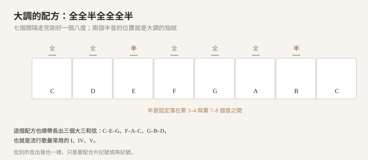
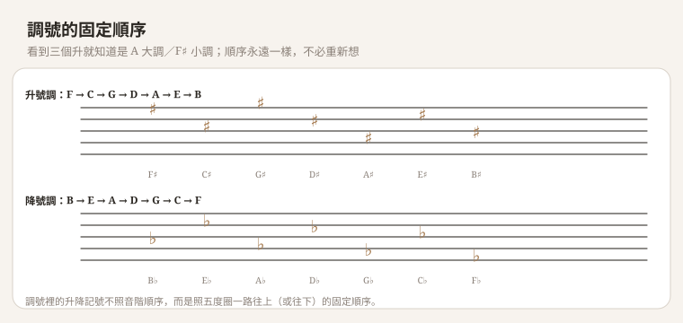
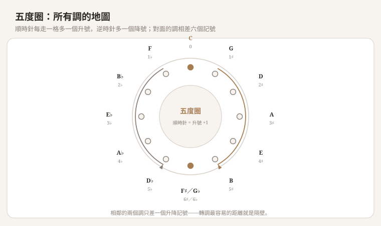
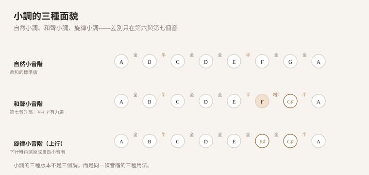
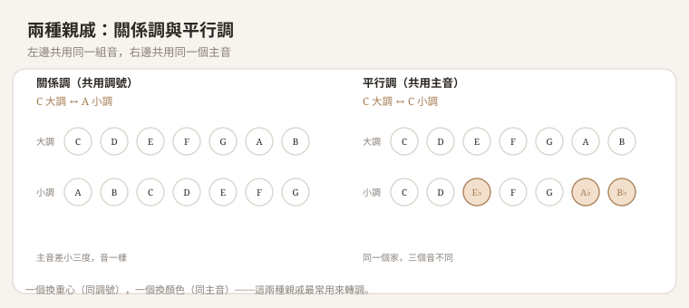
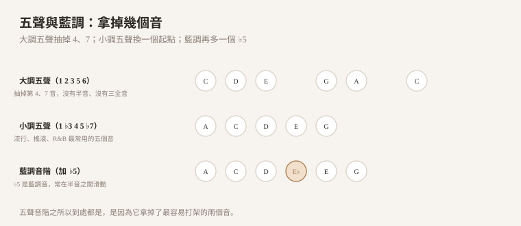

# **第五階段：音階與調**

把音程排成一列，就得到音階；挑其中一個音當家，就得到調。

到這裡，你已經知道每個音之間隔了幾步。但音樂不會把十二個半音全部平等對待——幾乎所有的音樂，都會從中挑出五個、六個或七個音，組成一個有中心、有階梯感的家族。這個家族就是音階，而「以哪個音為家」就是調。

五章依序是：大調的配方、調號與五度圈、小調的三種面貌、關係調與移調，最後走出西方七聲音階，去看調式、五聲音階與藍調。這一段開始有一點「要背」的東西，但每一個背誦點背後都有可以算出來的道理，我們會盡量讓你用理解的，而不是用記的。

## 第 19 章：大調音階的配方——全全半全全全半

如果說音程是字母，音階就是單字。而全世界最常見的那個單字，叫做大調音階。

### **19.1 七個間隔，決定一整首歌的氣質**

從任何一個音出發，照著下面的步伐走，你就會得到一個大調音階：

**全 ─ 全 ─ 半 ─ 全 ─ 全 ─ 全 ─ 半**

以 C 為起點走一次：C（全）D（全）E（半）F（全）G（全）A（全）B（半）C。七個間隔走完剛好回到原來的音，但高了一個八度。這就是 C 大調：C D E F G A B。

注意「半」出現的位置：**第三與第四個音之間（E–F），以及第七與第八個音之間（B–C）**。這兩個半音是大調的指紋——只要位置對，從哪個音開始都可以是大調；位置一錯，聽起來就不再是大調。

如果起點不是 C 呢？把同樣的配方搬到 D 上走一次：D（全）E（全）F♯（半）G（全）A（全）B（全）C♯（半）D。你會發現為了維持「全全半全全全半」，必須把 F 和 C 升高——這就是下一章「調號」要處理的問題。

### **19.2 為什麼半音偏偏放在這兩個位置？**

因為這兩個半音的位置，讓大調音階自動長出三個「穩定的三腳架」：C 大調裡，C–E–G、F–A–C、G–B–D 這三組音剛好都是大三和弦。流行歌最常用的 I、IV、V 三個和弦就是這樣長出來的。

歷史上的順序是先有音階、後有和聲理論；但反過來看也很有意思：**這個間隔順序，剛好讓三個最重要的三腳架同時成立**。這是整個西方和聲學的地基，後面的和弦與和聲階段會不斷回到這裡。

### **19.3 每個音都有名字**

音階裡的七個音，各有職稱。以 C 大調為例：

| 級數 | 音 | 名稱 | 意思 |
|---|---|---|---|
| 1 | C | 主音（Tonic） | 家。旋律停在這裡最安定 |
| 2 | D | 上主音（Supertonic） | 主音上面一格，常當經過音 |
| 3 | E | 中音（Mediant） | 介於主音與屬音之間，決定大小調色彩 |
| 4 | F | 下屬音（Subdominant） | 主音的下方五度（上方四度），提供「離開」的動力 |
| 5 | G | 屬音（Dominant） | 第二重要的音，最強的張力來源 |
| 6 | A | 下中音（Submediant） | 小調的入口，關係小調的主音 |
| 7 | B | 導音（Leading Tone） | 距離主音只有半音，強烈想「回家」 |

其中最重要的是**主音**與**導音**的關係：導音距離主音只有一個半音，它幾乎是「拉著」你回到主音。這個半音的吸引力，是正格終止（V → I）最主要的動力——不是所有終止式都靠它，變格終止（IV → I）就完全不需要導音。

### **19.4 大調不是「快樂」，是「有這個結構」**

課本常說大調聽起來開朗、小調聽起來悲傷。這句話當作第一印象可以，當作定義就錯了。大調只是一組間隔順序，它可以寫出悲傷的歌（很多哀悼音樂是大調），小調也可以寫得很兇猛。

真正決定情緒的，是旋律怎麼走、和弦怎麼配、節奏多快、編曲多厚。調式只是給了你一個起點。

### **19.5 現在就做**

從 C 出發的大調你已經會了。現在試著從 G 出發，自己推出 G 大調的八個音（提示：你會需要一個升記號）。推完之後，再從 F 出發推一次（這次你會需要一個降記號）。

推得出這兩個，你其實就已經在發明調號了。

## 第 20 章：調號與五度圈——不用臨時記號也能換調

上一章我們發現，從 D 出發走大調配方，必須把 F 和 C 升高。如果每一次出現都要臨時畫一個升記號，譜面會變得很髒。於是人類想出一個省事的辦法：**把整首歌要用的升降記號，一次寫在譜號後面。**

那就是調號。

### **20.1 調號：開頭的「這一首的規則」**

調號（Key Signature）寫在譜號與拍號之間，是一串升記號或降記號。它的意思是：**這首歌裡所有被標記的音，都自動升（或降），除非另外用還原記號取消。**

例如 G 大調的調號是一個升記號（F♯）。寫在開頭之後，整首曲子裡所有寫在 F 那一格的音，都自動是 F♯，你不用每次畫。這不只省墨水，也讓調性一目了然——演奏者看到兩個升記號，就知道「這是 D 大調或 B 小調」，不必先讀完整首。

### **20.2 升號與降號的出現順序**

調號裡的升降記號不是隨便排的，而是固定的順序：

- **升號**：F → C → G → D → A → E → B
- **降號**：B → E → A → D → G → C → F（剛好是升號的反向）

每一次新增一個升記號，都是把新調的第七音（導音）升高半音——它剛好也是上一個調第四音的升高半音（C 大調的 F 變成 G 大調的 F♯）。所以升號的順序（從 F 開始：F→C→G→D→A→E→B）其實就是沿著五度圈一路往上的軌跡。你可以用英文句子「Father Charles Goes Down And Ends Battle」記升號，反過來念就是降號順序。

### **20.3 五度圈：所有調的地圖**

把調照「往上五度」的順序排成一個圈，就得到**五度圈**（Circle of Fifths）：

C → G → D → A → E → B → F♯（＝G♭）→ D♭ → A♭ → E♭ → B♭ → F → 回到 C。

從 C 順時針走到 F♯（＝G♭）為止，每走一步多一個升號；從 C 逆時針走到 G♭ 為止，每走一步多一個降號。兩邊在「六個記號」處會合——F♯ 與 G♭ 是同一個聲音的兩種寫法，再往後記號數就開始遞減。這張圖之所以重要，是因為它同時呈現了三件事：

1. **調號的數量**：離 C 越遠，記號越多。
2. **調與調的親疏**：相鄰的調只差一個升降，轉調最平滑（下一階段講轉調時會用到）。
3. **和弦的關係**：同一個調的 I、IV、V，在圈上就是「相鄰的三格」。

### **20.4 兩招快速認調**

拿到一份譜，怎麼知道它是什麼調？兩個口訣：

- **升號調**：看最後一個升記號，把它往上一個半音，就是大調主音。例如三個升（F♯、C♯、G♯），最後一個是 G♯，往上半音是 A → A 大調。
- **降號調**：看倒數第二個降記號，那就是大調主音。例如三個降（B♭、E♭、A♭），倒數第二個是 E♭ → E♭ 大調。

只有一個降記號時沒有「倒數第二個」可用——看到單一個 B♭，直接記成 F 大調。掌握了這兩招，你讀譜的速度會快上不少。

| 調號 | 大調 | 關係小調 |
|---|---|---|
| 無 | C | A 小調 |
| 1♯ | G | E 小調 |
| 2♯ | D | B 小調 |
| 3♯ | A | F♯ 小調 |
| 4♯ | E | C♯ 小調 |
| 5♯ | B | G♯ 小調 |
| 6♯ | F♯ | D♯ 小調 |
| 7♯ | C♯ | A♯ 小調 |
| 1♭ | F | D 小調 |
| 2♭ | B♭ | G 小調 |
| 3♭ | E♭ | C 小調 |
| 4♭ | A♭ | F 小調 |
| 5♭ | D♭ | B♭ 小調 |
| 6♭ | G♭ | E♭ 小調 |
| 7♭ | C♭ | A♭ 小調 |

### **20.5 同一組音，兩個名字**

再往上走：6 個升是 F♯ 大調，6 個降是 G♭ 大調。它們用同一組琴鍵、聽起來完全一樣，只是一個全寫升、一個全寫降。這種「同一個調、兩種寫法」叫**等音調**（Enharmonic Key）。傳統調號系統最多用到 7 個升（C♯ 大調）或 7 個降（C♭ 大調）。這兩個調確實存在（巴哈《平均律》裡就有 C♯ 大調），但實務上為了讓譜面好讀，常改用等音調來寫——C♯ 大調常寫成 D♭ 大調（5 個降），C♭ 大調常寫成 B 大調（5 個升）。

### **20.6 現在就做**

1. 在五度圈上找出「A 大調」與「E♭ 大調」，寫出它們的調號（各有幾個升或降、分別是哪些音）。
2. 找一首你熟悉的簡譜歌，看它的調號，推回去驗證：這首歌的 Do 到底是哪一個音？
3. 把同一段旋律分別用 G 大調與 D 大調寫出來，數一數調號差多少——這就是下一章「移調」的開端。

## 第 21 章：小調的三種面貌——自然、和聲、旋律

大調只有一種配方，小調卻有三種。這不是樂理學家愛找麻煩，而是三種配方各自解決不同的問題——而且你會在不同類型的音樂裡，聽到它們輪流出現。

### **21.1 自然小音階：大調的「降三個音」版本**

最基本的小調，配方是：**全 ─ 半 ─ 全 ─ 全 ─ 半 ─ 全 ─ 全**。

以 A 為起點走一次：A（全）B（半）C（全）D（全）E（半）F（全）G（全）A。這就是 A 自然小音階，剛好全部是白鍵——它和 C 大調共用同一組音，只是把 A 當成家。

用「相對於大調」的方式看會更清楚：自然小音階就是把大調的**第三、第六、第七個音都降半音**。這三個降記號，正是小調聽起來「暗」的來源，其中第三音尤其關鍵——大三度變小三度，整個顏色的基調就變了。

### **21.2 和聲小音階：為了讓 V 和弦回家**

自然小音階有一個尷尬的問題：它的第七音（A 小調的 G）距離主音是**全音**，不像大調的導音只有半音。少了這半音的吸引力，「屬和弦回到主和弦」的力道就弱了一大截。

於是人類直接把它升半音：A 小調的 G 變成 G♯。這樣一來，第五級和弦從 Em 變成 E 大調和弦（E–G♯–B），回到 Am 的張力就出來了。這個版本叫**和聲小音階**，配方是：**全 ─ 半 ─ 全 ─ 全 ─ 半 ─ 增二 ─ 半**。

注意第六到第七音之間變成了一個**增二度**（F 到 G♯），這是和聲小調特有的音程（自然大調音階裡不會出現），也是中東、東歐、吉普賽音樂裡那種「異國感」的來源之一。

代價是：這條音階在旋律上很難唱——增二度的跳躍聽起來突兀。所以作曲家只會在「和弦需要導音」的時候借用它。

### **21.3 旋律小音階：上行升、下行還原**

如果旋律要往上走，第六音和第七音一起升高（A 小調：F♯、G♯），跳躍就變得平滑，也能同時擁有導音；往下走的時候，這兩音又還原回自然小音階。

這就是**旋律小音階**：

- 上行：A B C D E F♯ G♯ A
- 下行：A G F E D C B A（回到自然小音階）

這條「上行升、下行還原」的規則，是十九世紀的教科書把它系統化的；在此之前，巴洛克與古典時期的作曲家其實是依和聲需要自由使用升六、七級，往上往下都可能。到了爵士樂，旋律小音階又被拿去當即興材料，通常只用上行版本。

### **21.4 三種版本怎麼選？**

- **自然小調**：旋律與和聲都柔和，最常見於民謠、流行歌主歌、以及不需要強烈終止的段落。
- **和聲小調**：需要 V–i 強力收束時（例如樂曲結尾、重要終止），或想要異國色彩時。
- **旋律小調**：需要一條「唱得出來」的上升線條時。

實務上，一首歌常常三種混用：主歌用自然小調，副歌前借用和聲小調的導音，旋律衝上去時用旋律小調。**它們不是三個不同的調，而是同一個小調的三種使用方式。**

### **21.5 現在就做**

用 A 小調彈（或唱）三次同樣的旋律，第一次全用自然小調、第二次把 G 換成 G♯、第三次下降時改回 G。注意最後一個音落在 A 的時候，「回家」的感覺差多少——那個差別，就是導音在做的事。

## 第 22 章：關係調、平行調與移調——同一個家，不同的門牌

現在你手上有一張五度圈，也知道每個調長什麼樣子。接下來要處理的是「調與調之間的親戚關係」，以及一件在流行音樂裡天天發生的事：把整首歌搬到另一個調。

### **22.1 關係調：共用一副調號的大小調**

每一個大調，都有一個「住在同一層樓」的小調——它們用同一組音、同一個調號，只是把不同的音當家。

這個小調叫**關係小調**（Relative Minor），找法是：**從大調主音往下數一個小三度**。

- C 大調的關係小調是 A 小調（C 往下小三度＝A）
- G 大調的關係小調是 E 小調
- F 大調的關係小調是 D 小調

它們的關係緊密到什麼程度？同一首歌，你可以只改幾個和弦，就從大調的明亮切換到關係小調的陰暗——因為兩邊的音完全一樣，只是重心搬家了。

### **22.2 平行調：同一個主音，不同顏色的外殼**

另一種親戚叫**平行調**（Parallel Key）：主音相同，但一個是大調、一個是小調。

- C 大調 ↔ C 小調
- G 大調 ↔ G 小調

它們不共用調號——C 大調沒有升降記號，C 小調有三個降記號（B♭、E♭、A♭），差別剛好是三個音。所以平行調的關係是「同一個家、不同的門牌」：主音一樣，但整棟樓的顏色被換掉了。

流行歌裡常故意借用平行調的和弦（例如在大調歌曲裡用 iv 或 ♭VI），製造一種突然轉暗的效果——這叫**調式互換**，第六階段講和弦時會再遇到。

### **22.3 移調：把整首歌搬去另一個調**

**移調**（Transposition）就是把一段音樂裡所有的音，同時往上或往下移動同樣的距離。旋律的音程關係完全不變，聽起來還是同一首歌，只是整體高了一點或低了一點。

為什麼要移調？三個最常見的理由：

1. **配合歌手的音域**。同一首歌，男聲通常比女聲低八度；必要時再依個人音域微調幾個半音。
2. **配合樂器**。吉他上用 Capo 夾第二格彈 C 和弦的形狀，實際響出來是 D。
3. **配合段落情緒**。副歌最後一次升半音或全音，是流行歌最老派的「加壓」手法。

移調的算法很簡單：把每個音都移動同樣的音程距離。C 大調的 I–IV–V 是 C–F–G；搬到 D 大調就變成 D–G–A。**級數不變，音名全變**——這也是為什麼很多樂手習慣用級數溝通，而不是直接講和弦名字。

### **22.4 移調樂器：譜上的 Do 不是耳朵聽到的 Do**

有一類樂器，天生就是「移調樂器」：譜上寫 C，實際響出來卻是別的音。

| 樂器 | 譜上寫 C 時聽到的 | 差距 |
|---|---|---|
| B♭ 小號、B♭ 單簧管 | B♭ | 低一個大二度 |
| F 法國號 | F | 低一個純五度 |
| E♭ 中音薩克斯風 | E♭ | 低一個大六度 |
| B♭ 次中音薩克斯風 | B♭ | 低一個大九度 |

這樣設計的理由很實際：讓**同一族**樂器的指法可以共用。例如所有薩克斯風的按鍵邏輯相同，中音換次中音不必重新學一套，只是響出來的音高不同；小號、單簧管、薩克斯風之間則各有一套系統，不能直接互換。

所以當你看到總譜上法國號聲部寫著 C，千萬不要以為它吹的是鋼琴的中央 C——它吹的是低五度的 F。讀總譜時，這一層換算是必備的。

### **22.5 現在就做**

1. 找出你歌單裡最喜歡的三首歌，查它們的調。如果都是同一個調，想想為什麼。
2. 把其中一首的副歌移調 +2（升一個全音），唱唱看。你會發現同一段旋律，換了音域之後身體的感受完全不同。
3. 用級數（I–V–vi–IV）而不是和弦名稱，寫下那首歌的進行。

## 第 23 章：調式、五聲音階與藍調——走出大小調的兩條路

到目前為止，我們的世界只有兩種顏色：大調與小調。但音樂當然不只這兩種。這一章要打開兩扇門：一扇通往**調式**（同一組音、不同的家），一扇通往**五聲音階與藍調**（直接刪掉幾個音）。

### **23.1 調式：把大調的配方從別的音開始**

C 大調的音是 C D E F G A B。如果我不從 C 開始，改從 D 開始，把同一組音排成一圈會怎樣？

D E F G A B C D ——間隔變成「全半全全全半全」。這一組音不是大調，也不是自然小調，它叫**多利安調式**（Dorian）。

同樣的方法可以從白鍵上每一個音出發，得到七種調式。中世紀的教會音樂發展出一套調式系統（實際上是八個：四正四副），後世的理論家才把它整理成下面這七種，統稱**教會調式**——其中 Locrian 其實從來沒在中世紀的教會音樂裡用過：

| 調式 | 從哪開始（白鍵） | 相當於 | 個性音 |
|---|---|---|---|
| 伊奧尼安 Ionian | C | 大調 | — |
| 多利安 Dorian | D | 小調但第六音不降 | ♮6 |
| 弗里吉安 Phrygian | E | 小調但第二音降 | ♭2 |
| 利地安 Lydian | F | 大調但第四音升 | ♯4 |
| 米克索利地安 Mixolydian | G | 大調但第七音降 | ♭7 |
| 艾奧利安 Aeolian | A | 自然小調 | — |
| 洛克里安 Locrian | B | 最不穩定 | ♭2、♭5 |

七個調式裡，有兩個你已經很熟——Ionian 就是大調、Aeolian 就是自然小調。剩下的五個，各自靠一個「個性音」活著：Dorian 的大六度、Phrygian 的小二度、Lydian 的增四度、Mixolydian 的小七度、Locrian 的減五度。把那個音改掉，調式就消失了。

這些調式不是古蹟。爵士樂大量使用 Dorian 與 Mixolydian，電影配樂愛用 Phrygian 做異國感，Lydian 則常出現在「漂浮、夢幻」的段落。

### **23.2 五聲音階：拿掉會打架的兩個音**

如果我們把大調音階裡的第四音與第七音抽掉，會得到：**1 2 3 5 6**（C D E G A）。這叫**大調五聲音階**。

抽掉這兩個音的效果非常明顯：原本四度與七度之間隔著三全音，而且 3–4、7–1 都是半音——刪掉 4 和 7 之後，整條音階裡**沒有任何半音、也沒有三全音**。於是隨便怎麼組合都不會打架，聽起來乾淨、空曠、沒有壓迫感。

這就是為什麼許多古老音樂傳統都獨立發展出五聲音階：蘇格蘭民謠、美國鄉村、西非音樂，以及中國的**宮、商、角、徵、羽**（對應 1 2 3 5 6）。它不是西方的專利，但也不是每個文化都走這條路——印度與阿拉伯的古典傳統就以七聲為主。

小調也有自己的五聲音階：**1 ♭3 4 5 ♭7**（A C D E G）。它在流行、搖滾、R&B 裡出現的頻率，可能比大調五聲還高。

### **23.3 藍調音階：多一個「不准」的音**

把小調五聲音階再加上一個**♭5**（A 小調裡的 E♭），就得到**藍調音階**：A C D E♭ E G。

這個 ♭5 是**藍調音**（Blue Note）裡最有辨識度的一個——藍調音泛指 ♭3、♭5、♭7 這幾個「卡在大調與小調之間」的音。它不穩定、不屬於大調也不屬於小調，聽起來像「卡在中間」。而在實際演奏裡，它常常不是固定的一個音，而是在 ♭5 與 ♮5 之間滑來滑去——這也是為什麼藍調聽起來那麼「有人味」，因為它拒絕被十二平均律釘死。

藍調音階也被爵士樂拿去當即興的起點，但爵士手通常不會只停在五聲加一個音，而是把整個調式的音都用上。**藍調音階是入口，不是全部。**

### **23.4 調式不是「錯的大調」**

很多人第一次聽到調式，會覺得「這不就只是把大調從別的音開始彈嗎？」技術上沒錯，但音樂上差很多。

當你在 Dorian 裡即興，你的耳朵會把 D 當成家，和弦也會配 Dorian 的顏色（例如 Dm7–G7 的循環）；當你在 C 大調裡彈同一組音，D 只是調裡的一個音級，耳朵不會把它當成「家」。**同一組音，重心不同，就是兩種音樂。**

### **23.5 現在就做**

1. 在鍵盤上只彈白鍵，但每次都從不同的音開始，把七個調式各彈一次。注意哪一個讓你最不舒服（通常是 Locrian）。
2. 用 D Dorian 彈一段 8 小節的即興，配上 Dm7–G7 兩個和弦循環。
3. 用 A 小調五聲音階彈一段，再加進 E♭，聽那個音怎麼「卡」在裡面。
