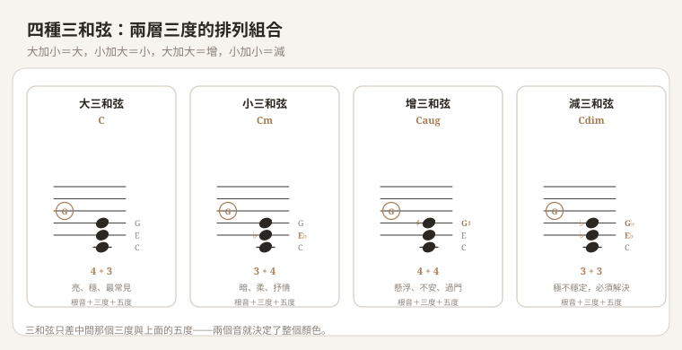
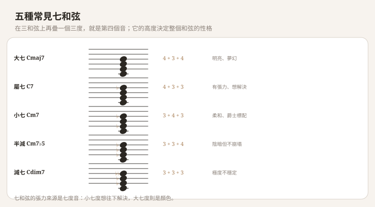
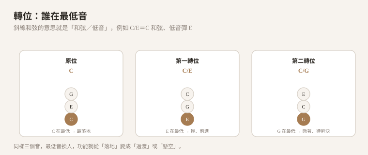
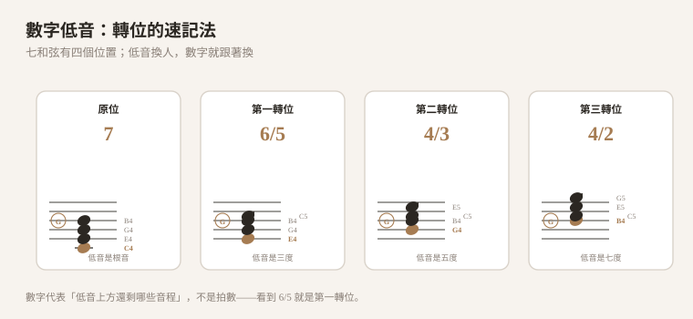
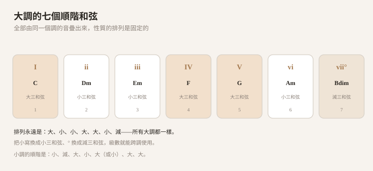
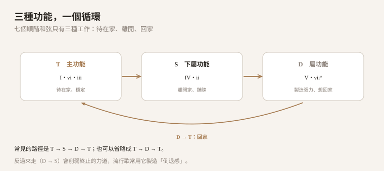
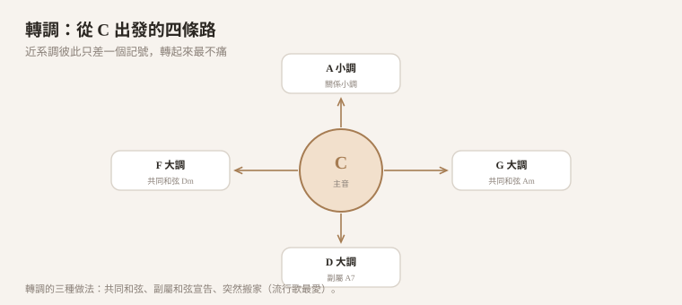

# **第六階段：和弦與和聲**

三個音同時響，就成了和弦；和弦排隊出現，就成了和聲。

這一階段是很多人學樂理卡住的地方，但也是收穫最大的一段。我們會先拆開和弦的構造：三和弦怎麼疊、七和弦多出來的那個音在做什麼、轉位又改變了什麼。接著才進入「和弦的語法」——同一個調裡的七個和弦各自扮演什麼角色、為什麼 V 一定要回到 I、為什麼有些進行聽起來就是很順。

六章讀完，你拿到的不只是一堆和弦名稱，而是一套能解釋「這首歌為什麼這樣走」的工具。之後你在任何一首流行歌裡看到的 C–G–Am–F，都不再是四個孤立的符號。

## 第 24 章：三和弦的構造——大三、小三、增、減

單音是點，音程是線，和弦就是面。而所有和弦裡最基礎的一種，只用了三個音。

### **24.1 三個音，兩層三度**

**三和弦**（Triad）的定義非常樸素：從一個**根音**出發，往上疊一個三度，再疊一個三度，總共三個音。

以 C 為根音：C（根音）→ E（三度）→ G（五度）。這三個音疊起來就是 C 大三和弦，寫作 C。

為什麼是三度而不是別的間隔？因為三度疊起來會形成「根音－五度」的骨架，中間夾一個三度來決定顏色。根音與五度提供穩定性，中間那個三度提供性格——這就是三和弦的設計邏輯。

### **24.2 四種三和弦**

兩層三度各有「大」與「小」兩種可能，排列組合出四種三和弦：

| 和弦 | 下層三度 | 上層三度 | 半音結構 | 例子（C 根音） |
|---|---|---|---|---|
| 大三和弦 | 大三度（4） | 小三度（3） | 4 + 3 | C–E–G |
| 小三和弦 | 小三度（3） | 大三度（4） | 3 + 4 | C–E♭–G |
| 增三和弦 | 大三度（4） | 大三度（4） | 4 + 4 | C–E–G♯ |
| 減三和弦 | 小三度（3） | 小三度（3） | 3 + 3 | C–E♭–G♭ |

四個和弦共用同一個根音 C，差別只在中間的三度（E 或 E♭）與上面的五度（G、G♯ 或 G♭）：大三與小三隻差中間那個音，增三與減三則是把五度往外或往內推半音。記法可以簡化成一句：**「大加小是大三，小加大是小三，大加大是增，小加小是減。」**

和弦記號的寫法：

- 大三和弦：直接寫根音，**C**
- 小三和弦：加小寫 m，**Cm**
- 增三和弦：加 aug 或 ＋，**Caug**、**C＋**
- 減三和弦：加 dim 或 °，**Cdim**、**C°**

### **24.3 為什麼三和弦這麼穩？**

因為它的三個音，剛好對上泛音列的第 4、5、6 個分音。以 C2（約 65 Hz）為基音時，第 4、5、6 分音正好是 C4、E4、G4——也就是說，當你按下 C 大三和弦，你其實是在「放大」一個單音本來就藏著的東西。

這解釋了為什麼大三和弦聽起來最穩定：它不是外加的和聲，而是聲音自己長出來的結構。小三和弦（C–E♭–G）就沒有這麼直接對應，所以聽起來比較「內斂」；增三和弦（C–E–G♯）兩個大三度疊起來，沒有穩定的五度骨架，聽起來懸浮、不安，常用在過門或懸疑段落；減三和弦（C–E♭–G♭）更不穩定，幾乎一定要解決到下一個和弦。

### **24.4 三個音，已經足夠寫一首歌**

流行樂裡最常見的和弦，絕大多數都是這四種三和弦的組合（再加上七和弦）。它們之所以夠用，是因為三和弦的資訊量剛好：夠清楚，聽眾能記住；又夠模糊，可以讓旋律在上面自由活動。

如果你只記得住一件事，記這個：**決定和弦明亮或陰暗的是中間那個三度，決定穩定或不穩定的是五度。** 之後看到任何複雜的和弦，先找出這兩個音，你就不會迷路。

### **24.5 現在就做**

在鍵盤上找到 C，一次只動一個音：

1. C–E–G（大三）→ 把 E 降半音 → C–E♭–G（小三）
2. 再把 G 降半音 → C–E♭–G♭（減三）
3. 換一條路：回到 C–E–G，這次把 G 升半音 → C–E–G♯（增三）

四個和弦都按一次，注意「顏色」怎麼一格格變化。這個練習比背表格有用得多。

## 第 25 章：七和弦與延伸和弦——從三個音到四個音，再到更多

三和弦乾淨、好用，但它只有四種顏色。想要多一點層次，就得往上再加一個音。

### **25.1 再加一層三度：七和弦**

在三和弦上面再疊一個三度，第四個音距離根音是七度，所以叫做**七和弦**（Seventh Chord）。

以 C 為例：C–E–G–B。多出來的 B，讓整個和弦的「味道」瞬間複雜起來——它不再只是一個靜止的顏色，而是帶著一點「還沒結束」的張力。

### **25.2 五種常見的七和弦**

| 和弦 | 半音結構 | C 上的例子 | 記號 | 聽起來 |
|---|---|---|---|---|
| 大七和弦 | 4 + 3 + 4 | C–E–G–B | Cmaj7 | 明亮、夢幻、有點飄 |
| 屬七和弦 | 4 + 3 + 3 | C–E–G–B♭ | C7 | 有張力、想解決 |
| 小七和弦 | 3 + 4 + 3 | C–E♭–G–B♭ | Cm7 | 柔和、爵士標配 |
| 半減七和弦 | 3 + 3 + 4 | C–E♭–G♭–B♭ | Cm7♭5、Cø7 | 陰暗但不至於崩塌 |
| 減七和弦 | 3 + 3 + 3 | C–E♭–G♭–B♭♭ | Cdim7、C°7 | 極度不穩定，像懸空 |

還有一個比較少見但很美的**小大七和弦**（Cm(maj7)，也寫成 CmΔ7：C–E♭–G–B，也就是小三和弦加一個大七度），結構是 3 + 4 + 4，聽起來像小調裡透出一道光。

最需要注意的是**屬七和弦（C7）**。它是整個西方和聲的引擎：因為它同時包含大三度（E）與小七度（B♭），解決方向最明確——幾乎只想回到 F 和弦。你聽到的大多數「這首歌快結束了」的感覺，都是屬七和弦造成的。（減七和弦的張力其實更大，但它的解決方向有好幾個，所以比較像「懸空」而不是「回家」。）

### **25.3 sus 與 add：不疊三度也能加音**

七和弦不是唯一的加音方式。還有兩種常見的變化：

- **sus**（掛留）：把三度換成二度或四度。Csus4 = C–F–G、Csus2 = C–D–G。因為沒有三度，和弦既不大也不小，聽起來「開放、懸而未決」，常常在解決回 C 之前出現。
- **add**（附加）：保留三度，另外再加一個音。Cadd9 = C–E–G–D（把 D 放在高八度）。它比 C 更飽滿，但不像 Cmaj7 那樣「爵士」。

**sus 和 add 的差別，一句話：sus 是換掉三度，add 是保留三度再加音。** 最容易被搞混的是 Csus2 與 Cadd9：前者是 C–D–G（沒有三度），後者是 C–E–G–D（三度還在）。同樣看得到 D，聽起來完全是兩回事。

### **25.4 九、十一、十三：一路往上疊**

繼續往上疊三度，就會得到九和弦（C9 = C–E–G–B♭–D）、十一和弦（再加 F）、十三和弦（再加 A）。理論上可以一路疊到十三，但實務上很少全部按出來——音太多會糊成一片。

爵士樂手的做法是「挑重點」：省略五度、保留三度與七度（這兩個決定和弦性質），再把九、十一、十三當作色彩音放在高音聲部。所以你看到的 C13，實際彈出來可能只有 C–E–B♭–A 四個音。

### **25.5 現在就做**

在同一台鋼琴上，從 C 大三和弦出發，把第四個音一次往上移半音：

C–E–G–B♭（C7）→ C–E–G–B（Cmaj7）→ C–E–G–C（七度音不見了，退回單純的 C 大三和弦，張力整個鬆掉）

再試 C–E♭–G–B♭（Cm7）→ C–E♭–G–B（Cm(maj7)）。

每一次只動一個音，你就會清楚聽到「哪一個音在決定什麼」。

## 第 26 章：轉位、斜線和弦與數字低音——誰在最低音

C 和弦是 C–E–G。但如果我把 E 放到最低音，聽起來還是 C 和弦嗎？答案：是和弦一樣，但**功能與重量完全不同**。這一章講的就是「最低音」為什麼重要。

### **26.1 決定和弦重量的，是最低音**

一個和弦裡有三個（或更多）音，它們的排列順序會改變整個聲響的重心。最低的那個音叫**低音**（Bass），它是最靠近聽眾感知底層的音，也是貝斯手實際演奏的音。

當低音就是根音時，和弦聽起來最穩、最「落地」。低音換成別的音，穩定度與方向感就會改變——第一轉位通常比較輕、有前進感，第二轉位則更不穩定、更「懸」。這就是**轉位**（Inversion）的效果。

### **26.2 三和弦的兩個轉位**

以 C 大三和弦為例：

- **原位**：C–E–G（低音是根音 C）→ 記號 C
- **第一轉位**：E–G–C（低音是三度 E）→ 記號 C/E
- **第二轉位**：G–C–E（低音是五度 G）→ 記號 C/G

寫法上，C/E 讀作「C on E」，也就是「C 和弦，低音彈 E」。這種用斜線表示低音的寫法，就是**斜線和弦**（Slash Chord）。

三種排列（原位與兩個轉位）的功能差別很大：第一轉位最輕、最適合當過渡；第二轉位聽起來懸著、有「還沒結束」的感覺，傳統上會接在屬和弦之前，或用來製造「站起來」的張力。

### **26.3 七和弦有四個位置**

七和弦有四個音，所以除了原位之外還有三個轉位。古典理論用**數字低音**（Figured Bass）標記它們：

| 位置 | 低音 | 數字 | Cmaj7 的例子 |
|---|---|---|---|
| 原位 | 根音 | 7 | C–E–G–B |
| 第一轉位 | 三度 | 6/5 | E–G–B–C |
| 第二轉位 | 五度 | 4/3 | G–B–C–E |
| 第三轉位 | 七度 | 4/2（或 2） | B–C–E–G |

這些數字不是拍子，而是「從低音往上，還剩哪些音程」。以第一轉位 6/5 為例：低音上方有五度與六度（三度被當成預設值省略不寫）。初學者看到會頭痛，但它其實是一套很有效率的速記法——數字直接告訴你聲部的相對位置。

### **26.4 為什麼實務上要用轉位？**

三個理由：

1. **低音線條要平順**。如果每個和弦都用原位，低音會跳來跳去（C→F→G）；改用轉位之後，低音可以走得更近（C→C/E→F，其中 E→F 只差半音），整首歌會穩很多。
2. **避免「同一個音重複太多次」**。鋼琴左手如果一直按根音，聽起來會很笨重。
3. **製造張力與方向感**。第二轉位（C/G）特別適合放在屬和弦前面：它的低音雖然是 G，上方的四度（C）與六度（E）卻是不協和音程，必須分別解決到 B 與 D，所以聽起來「懸著、需要落地」。注意 C/G 本身仍然是主和弦的第二轉位，不是屬和弦。

流行樂裡，斜線和弦還有另一個常見用途：**固定低音**（Pedal Point）。整段和弦變化，但低音一直踩著同一個音，會製造一種「卡住、累積壓力」的效果，副歌前最常用。

### **26.5 現在就做**

找一首你喜歡的歌，把它的和弦全部改寫成斜線和弦：每一次都問「如果低音改成三度會怎樣？」先只彈低音，聽聽那條線是往上還是往下。**好的和聲進行，低音幾乎都可以單獨唱成一首歌。**

## 第 27 章：順階和弦——一個調裡的七個和弦

現在你會蓋和弦了。接下來要問：如果我只用 C 大調的七個音，能蓋出哪些和弦？答案是七個，不多不少，而且它們的排列有固定規律。

### **27.1 在音階的每一級上蓋一個三和弦**

方法很簡單：從 C 大調的每一個音出發，隔一個取一個、再隔一個取一個，全部使用調內的音。

- 從 C 出發：C–E–G → **C 大三和弦**
- 從 D 出發：D–F–A → **Dm 小三和弦**
- 從 E 出發：E–G–B → **Em 小三和弦**
- 從 F 出發：F–A–C → **F 大三和弦**
- 從 G 出發：G–B–D → **G 大三和弦**
- 從 A 出發：A–C–E → **Am 小三和弦**
- 從 B 出發：B–D–F → **Bdim 減三和弦**

這七個和弦叫做 C 大調的**順階和弦**（Diatonic Chords），意思就是「全部由這個調的音組成、不必借用外來音」的和弦。

### **27.2 排列是有規律的：大、小、小、大、大、小、減**

注意這串性質的順序：**大、小、小、大、大、小、減**。這不是巧合，而是大調音階「全全半全全全半」的必然結果——因為半音固定出現在第 3–4 與 7–8 之間，每個三和弦的兩層三度就會自動變成大或小。

所以這條規律適用於**所有大調**。G 大調的順階和弦一樣是「大、小、小、大、大、小、減」，只是音名換成 G、Am、Bm、C、D、Em、F♯dim。

### **27.3 級數：用羅馬數字溝通**

與其背十二個調的和弦名字，不如記**級數**。用羅馬數字標記音階的第幾級，並用大小寫表示性質：

| 級數 | 和弦（C 大調） | 性質 | 功能角色 |
|---|---|---|---|
| I | C | 大 | 主和弦（家） |
| ii | Dm | 小 | 下屬，準備離開 |
| iii | Em | 小 | 主和弦的替代 |
| IV | F | 大 | 下屬，最強的「離開」 |
| V | G | 大 | 屬，最強的「回家」動力 |
| vi | Am | 小 | 主和弦的替代（關係小調） |
| vii° | Bdim | 減 | 屬的替代，極不穩定 |

大寫＝大三和弦，小寫＝小三和弦，小寫加 °＝減三和弦。這套寫法的好處是：講「I–V–vi–IV」在任何調都成立，不用說「C–G–Am–F」或「D–A–Bm–G」。

### **27.4 小調的順階和弦**

自然小調的排列是：**小、減、大、小、小、大、大**。以 A 小調為例：Am、Bdim、C、Dm、Em、F、G。

但實際使用時，第五級常常不是 Em 而是 **E（大三和弦）**——這正是上一階段「和聲小音階」升第七音的目的。所以小調的順階和弦要分兩套看：

| 級數 | i | ii° | III（和聲為 III+） | iv | v（或 V） | VI | VII（自然）／vii°（和聲） |
|---|---|---|---|---|---|---|---|
| 自然小調 | Am | Bdim | C | Dm | Em | F | G |
| 和聲小調 | Am | Bdim | C+（C–E–G♯） | Dm | E | F | G♯dim |

自然小調的第三級是 C 大三和弦；一旦把 G 升成 G♯，第三級就變成增三和弦 C+。流行歌通常兩邊混用：**III 用自然小調的 C，V 用和聲小調的 E**——實務上很常見，理論上則是「借用」。所以看到小調的和弦表，先確認它寫的是哪一套，不然會對不起來。

### **27.5 為什麼這張表這麼好用？**

因為流行歌最常用的就是順階和弦（雖然副屬和弦、借用和弦也很常見）。當你拿到一首歌，把它的和弦換成級數之後，你會發現幾百首歌其實長得差不多：

- 卡農進行：I–V–vi–iii–IV–I–IV–V
- 常見流行：I–V–vi–IV
- 悲傷系：vi–IV–I–V
- 老派抒情：I–vi–IV–V

**調會變，級數不會。** 學會用級數聽歌，你就開始能「聽出結構」了。

### **27.6 現在就做**

拿一首歌，查出它的調，把每個和弦換成級數。然後把整首歌搬到另一個調，用級數重新推算和弦。做過一次之後，你就再也不會害怕「這首歌是什麼調」了。

## 第 28 章：功能和聲與終止式——和弦在做什麼事

上一章列出七個順階和弦，但沒說它們的關係。這一章要回答一個更根本的問題：**為什麼和弦要照某個順序出現？**

### **28.1 七個和弦，三種工作**

把七個順階和弦按「功能」分類，只有三組：

| 功能 | 名稱 | 包含的和弦 | 做什麼 |
|---|---|---|---|
| T | 主功能（Tonic） | I、vi、iii | 待在家、穩定、結束 |
| S | 下屬功能（Subdominant） | IV、ii | 離開家、鋪陳、準備 |
| D | 屬功能（Dominant） | V、vii° | 製造張力、強烈想回家 |

音樂進行的基本邏輯，就是 **T → S → D → T** 這個循環：從家出發、離開、累積張力、回家。你可以把這三個功能想成一句話的三段：「我在家」→「我出門」→「我要回家了」。

當然，實際的音樂不會每次都走完整個循環。最常見的省略是「T → D → T」（跳過下屬），最常見的逆行為「D → S」則要特別處理——它是流行樂常用的「倒退感」手法，古典理論會說它弱化了終止的力道，但流行歌不管這個。

### **28.2 屬和弦為什麼這麼想回家？**

屬和弦（V）裡藏著一個關鍵的音：**導音**。以 C 大調的 G 和弦（G–B–D）為例，B 就是導音，距離主音 C 只有半音。當 B 響起，耳朵會自動期待它往上解決到 C。

同時，屬七和弦（G7：G–B–D–F）還多了一個 F。B 與 F 之間是三全音，是調內最不穩定的音程，而它解決的方式也幾乎是唯一的：B 往上到 C，F 往下到 E。兩個音同時解決，剛好落在 C 大三和弦的根音與三度上（再加上原本的 G，就是完整的 C–E–G）。

所以「V → I」之所以這麼有力，不只是因為習慣，而是因為**兩個音各自只走半步就到了**。這是西方調性和聲最核心的慣例之一——注意它是「慣例」不是「物理定律」，其他文化的音樂並不一定要這樣解決。

### **28.3 四種終止式**

樂句結束的方式叫**終止式**（Cadence）。四種最常見：

| 終止式 | 進行 | 感覺 |
|---|---|---|
| 正格終止（Authentic） | V → I | 最完整、最「結束」 |
| 變格終止（Plagal） | IV → I | 溫和、像「阿們」的收尾 |
| 半終止（Half） | 停在 V | 懸而未決，像逗號 |
| 阻斷終止（Deceptive） | V → vi | 期待回家卻被帶到別處，像「咦？」 |

還有一個很有個性、但名字常被用錯的：**♭VII → i**（例如 C 小調的 B♭ → Cm），流行樂與搖滾很愛用，聽起來有西班牙、安達魯西亞的味道——它常被稱為「調式終止」，也有人叫它安達魯西亞終止（完整進行是 i–♭VII–♭VI–V）。至於古典理論說的「弗里吉安終止」其實是另一件事：低音從 ♭6 級半音下行到 5 級（C 小調的 A♭ → G），通常寫成 iv6 → V。兩者都被說成「有西班牙味」，但和弦與低音走向不一樣。

### **28.4 和聲節奏：和弦換得多快，也是表現力**

同樣的進行，換和弦的速度不同，效果就完全不同。

- **一小節一個和弦**：寬闊、從容，適合主歌或抒情段落。
- **一小節兩個和弦**：有推進感，流行歌最常用。
- **一小節四個和弦**：急促、緊張，常用在副歌前的堆疊。

這個「和弦多久換一次」就叫**和聲節奏**（Harmonic Rhythm）。它是編曲裡最容易被忽略、卻最能改變情緒的參數之一。同一段旋律，和聲節奏放慢一倍，馬上從「衝」變成「飄」。

### **28.5 常見進行與它們的功能解讀**

- **I–V–vi–IV**（C–G–Am–F）：T–D–T–S。最流行的四和弦進行。
- **vi–IV–I–V**（Am–F–C–G）：從 T 的替代開始，情緒更低。
- **ii–V–I**（Dm–G–C）：S–D–T 的完整循環，爵士樂的骨幹。
- **I–vi–IV–V**（C–Am–F–G）：老派抒情歌的萬用進行，又叫「50 年代進行」。
- **I–vi–ii–V**（C–Am–Dm–G）：把上一個的 IV 換成 ii，就是爵士樂最常用的 turnaround。

看出來了嗎？這些進行大多繞著 T、S、D 三個功能轉，但順序與省略各不相同——不是每一條都照 T→S→D→T 走，I–V–vi–IV 實際上是 T–D–T–S。

### **28.6 現在就做**

1. 用 C 大調彈一次 I–IV–V–I，然後把最後的 V–I 改成 V–vi，聽「阻斷」的感覺。
2. 把同一段進行的小節數減半（和聲節奏加快），再彈一次。
3. 找一首你喜歡的歌，標出它的終止式在哪裡——通常就是段落結束的那一兩小節。

## 第 29 章：副屬和弦、借用和弦與轉調——把別的調借來用

順階和弦是「合法的」材料，但真正讓音樂有味道的，往往是那些「不合法」的音。這一章講三種最常見的破壞規則方式。

### **29.1 副屬和弦：在別人的地盤上當老大**

C 大調的屬和弦是 G7，它想回到 C。但如果我今天想讓 Dm 和弦聽起來更重要呢？

我可以在 Dm 前面放一個 **A7**（A–C♯–E–G）。A7 是 D 的屬七和弦，它會強烈地想解決到 Dm——就像 G7 想回到 C 一樣。這個 A7 就叫做**副屬和弦**（Secondary Dominant），寫作 **V/ii**（讀作「二的五」）。

- V/V（C 大調的 D7）→ 解決到 G
- V/vi（E7）→ 解決到 Am
- V/IV（C7）→ 解決到 F

注意一個細節：這些和弦裡出現了**調外的音**（A7 的 C♯、E7 的 G♯、D7 的 F♯）。正是這些音讓它們「不屬於這個調」，也因此產生額外的張力。這就是為什麼加了副屬和弦之後，音樂聽起來會突然「亮」一下。

副屬和弦也可以用 ii–V 的形式出現，例如 Am7–D7–G（ii–V of V），這是爵士樂最常用的裝飾法。

### **29.2 借用和弦與調式互換**

另一種「借」的方式，是從**平行調**借和弦過來。C 大調可以借用 C 小調的和弦：

- **iv**（Fm）代替 IV（F）：最常見的借用，聽起來突然變柔、變暗。
- **♭VI**（A♭）：戲劇性強，常用在電影配樂。
- **♭VII**（B♭）：有搖滾、民謠的味道。
- **♭III**（E♭）：介於兩者之間。

這種做法叫**調式互換**（Modal Mixture）：在同一個主音上，把大調與小調的材料混在一起用。它之所以有效，是因為聽眾的主音感沒有被打破——你只是換了顏色，不是換了家。

### **29.3 拿坡里和弦：降二級的大和弦**

還有一個很有個性的借用：**拿坡里和弦**（Neapolitan），也就是把第二級降半音，做成一個大三和弦。在 C 大調裡就是 **D♭ 大三和弦**（D♭–F–A♭），通常用第一轉位（低音 F）出現，然後接 V。

它的效果非常戲劇化——像是突然被拉進一個陰暗的房間，再從那裡回到主和弦。古典時期很常見，流行樂與電影配樂也愛用。

### **29.4 轉調：真的搬家**

前面講的都是「借」，主音沒變。**轉調**（Modulation）則是主音真的換了：音樂從此以另一個音為家。

三種常見做法：

1. **共同和弦轉調**（Pivot Chord）：兩邊的調都承認同一個和弦，用它當橋樑。例如 C 大調要到 G 大調，可以用 Am（C 大調的 vi，也是 G 大調的 ii）當樞紐。
2. **副屬和弦轉調**：直接用新調的 V 和弦「宣告」新家，例如在 C 大調裡突然出現 D7，接下來就順勢進入 G 大調。
3. **突然轉調**（Direct Modulation）：不鋪路，直接跳。流行歌最常見——副歌最後一次直接升全音，沒有橋樑，聽眾也不會迷路，因為旋律還在那裡。

實務上，轉調最常發生的位置是：**主歌進副歌**（情緒升級）、**最後一次副歌**（升高半音或全音）、以及**橋段**（暫時離開再回來）。

### **29.5 現在就做**

1. 在 C 大調的 I–vi–ii–V 進行裡，把每個和弦前面都加一個副屬和弦，聽起來會變得非常「爵士」。
2. 把 I–IV–V–I 的 IV 換成 iv（Fm），感受那個突然轉暗的瞬間。
3. 寫一段 8 小節，前 4 小節在 C、後 4 小節在 G，試著用 Am 當樞紐，讓轉調聽起來不突兀。
