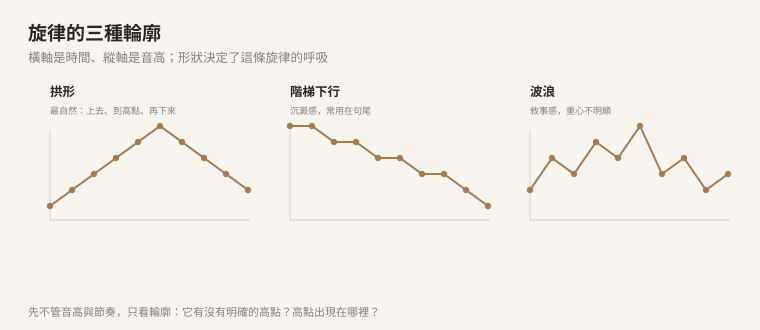
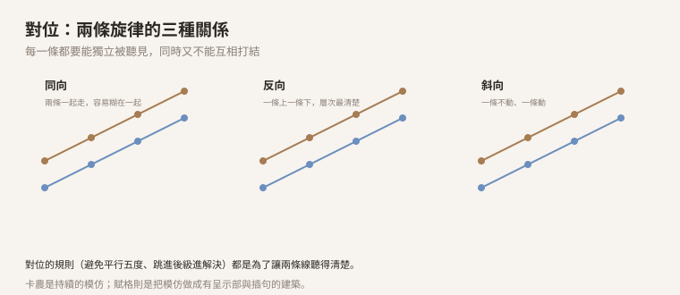
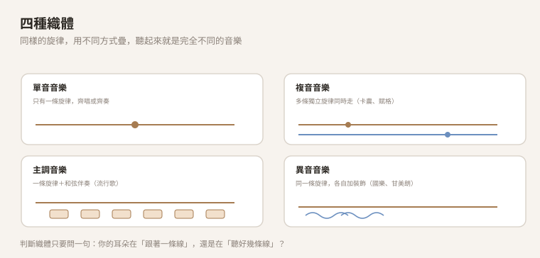

# **第七階段：旋律、曲式與對位**

把音符水平地排成一條線，是旋律；把旋律切成一段一段，是曲式；讓兩條旋律同時走，是對位。

前面六個階段，我們幾乎都在處理「點」與「堆疊」：一個音、一組拍子、一個音程、一個和弦。這一階段要把視角拉遠，看整首曲子是怎麼被組織起來的——一個兩小節的動機，如何長成八小節的樂句，再長成一首歌的段落。

四章分別處理：動機與樂句、旋律的形狀、常見曲式、以及對位與織體。這是樂理課裡最「像作文」的一段，也是最能直接回頭改善你寫歌與聽歌方式的一段。

## 第 30 章：動機與樂句——音樂的最小單位

一首歌不是一堆音符的總和，而是一層一層長出來的。這一章要看的是最底下那兩層：**動機**與**樂句**。

### **30.1 動機：兩三個音就夠了**

**動機**（Motive）是一段音樂裡最短、最有辨識度的單位——通常只有兩到五個音，但一聽就認得出來。

想想貝多芬第五號交響曲的開頭：三個短音、一個長音。就這四個音，整首交響曲幾乎都從它長出來。或者華語流行歌裡最常見的副歌開頭，往往也只是四個音的反覆。

動機不需要「好聽」，它需要的是**清楚**：清楚到聽眾能記住，清楚到作曲家能拿它去變化。

### **30.2 樂句：四小節一個呼吸**

動機組合起來，成為**樂句**（Phrase）。在西方音樂裡，樂句最常見的長度是**四小節**，因為它大約等於人講一句話的長度，也剛好是一次自然的呼吸。

兩個樂句（4 + 4 小節）組成一個**樂段**（Period）——樂句本身已經是一個完整的樂思，樂段則是「一問一答」湊成一組更大的單位。八小節，剛好是流行歌主歌或副歌一個段落的長度。


四小節不是鐵律，但它是直覺的基準。樂句長度不是 4 的倍數（五小節、七小節）在民謠與流行歌裡也可能是刻意的設計；真正讓人覺得「卡」的，通常是和聲、重音或旋律走向沒有處理好，而不是小節數本身。

### **30.3 前句與後句：一句問、一句答**

一個完整的樂段，通常由兩個樂句組成：

- **前句**（Antecedent）：提出問題。通常結束在半終止（停在 V），聽起來「還沒完」。
- **後句**（Consequent）：給出回答。通常結束在正格終止（V → I），把話說完。

最典型的例子是：前四小節停在屬和弦（半終止，聽起來「還沒完」），後四小節回到主和弦（正格終止，把話說完）。以 C 大調為例，就是前句收在 G、後句收在 C——這就是「問與答」。許多民謠、兒歌與流行歌的段落都建立在這個結構上（當然不是全部：八小節一句、不對稱樂句、貫穿式寫法的歌也很多）。

### **30.4 動機的五種變化**

一個動機要撐起一整首歌，靠的是變化。最常用的五種手法：

| 手法 | 做法 | 效果 |
|---|---|---|
| 反覆 | 原封不動再來一次 | 強化記憶 |
| 模進 | 把整個動機往上或往下搬幾度 | 產生推進感，最常見 |
| 擴張 | 把音值拉長 | 情緒變慢、變重 |
| 縮減 | 把音值縮短 | 情緒變急、變輕 |
| 倒影 | 把音程上下顛倒 | 熟悉又陌生 |

這五種手法不是作曲家的專利。你在即興時「同一個句子換個高度再彈一次」，其實就是在做模進。

### **30.5 現在就做**

找一首你很熟的歌，把它的前四小節寫下來（簡譜就好）。然後試著回答：

1. 它的動機是哪些音？
2. 這個動機在整首歌裡出現了幾次？有哪幾次被改變了？
3. 前四小節結束時，聽起來是「問」還是「答」？

做完這個練習，你會發現自己聽歌的方式變了——開始聽得到「結構」，而不只是旋律。

## 第 31 章：旋律的形狀——輪廓、級進與跳進

有了動機和樂句，接下來要問：一條好的旋律，在「形狀」上有什麼特徵？這一章沒有公式，但有幾個可以觀察的角度。

### **31.1 輪廓：一條線的走勢**

把旋律的音高連成一條線，你會看到一個形狀——這就是**輪廓**（Contour）。最常見的三種：

- **拱形**：慢慢往上爬，到高點，再慢慢下來。這是最自然、最常見的形狀，像是講話時情緒的起伏。
- **階梯下行**：從高處開始，一段一段往下。常用在樂句結尾，有「沉澱」的效果。
- **波浪**：上上下下，重心不明顯。適合比較長、比較敘事的段落。



好的旋律通常有一個明確的**高潮**（Climax）——情緒或結構上的最高點，通常只出現一次。要注意：高潮不一定等於最高音，它也可能是節奏最密、和聲最滿、或歌詞最重的那一句。如果每一句都在飆高音，聽眾會疲乏；如果從頭到尾都在同一個高度，聽眾會分心。

### **31.2 級進與跳進：走樓梯還是搭電梯**

旋律的移動方式有三種：

- **級進**（Stepwise）：走到隔壁的音。平順、好唱、有「說話」的感覺。
- **跳進**（Leap）：移動超過一個音級（三度以上），例如 Do → Mi。有張力、有戲劇性，但連續大跳會讓人唱不上去。
- **同音反覆**：音高不變，節奏可以相同也可以變化。常用來強調、累積，或製造「唸」的感覺。

經驗法則是：**大跳之後通常會反向級進平衡**（往上跳，就慢慢走下來），但這是風格慣例，不是硬性規定。如果旋律一直跳，聽起來會很「忙」，卻沒有方向。

### **31.3 音域：這首歌適合誰唱**

旋律最高音與最低音之間的距離，就是**音域**。它決定這首歌適合誰唱、也決定唱起來累不累。

- 音域窄（六度以內）：好唱、好記，兒歌與民謠常見。
- 音域寬（十二度以上）：有張力，但需要技巧，流行歌副歌常常靠這個製造高潮。

寫旋律時，一個很實用的自問是：**這首歌的高點，出現在哪裡？** 如果它出現在副歌的第一句，那後面的情緒就沒地方去了；如果它出現在最後一次副歌，整首歌就會有一個漂亮的累積。

### **31.4 節奏動機與留白**

旋律不只是音高，還有節奏。一段旋律的「個性」，往往來自它的**節奏動機**——例如「長—短—短」或「短—短—短—長」。

而節奏裡最容易被忽略的東西是**留白**。休止符不是「沒有音樂」，而是讓聽眾有時間消化前一句。很多經典旋律之所以好記，是因為它敢停——停下來的那一拍，反而讓人記住了前面的音。

### **31.5 現在就做**

拿一段你寫的（或喜歡的）旋律，做三件事：

1. 畫出它的輪廓線（只畫高低，不管節奏）。它是拱形、階梯還是波浪？
2. 標出最高音在第幾小節。它是不是出現在你希望的情緒高點？
3. 把其中一個跳進改成級進，聽聽看哪個版本更順。

旋律沒有絕對的對錯，但「形狀」是可以被看見、被調整的。

## 第 32 章：曲式——一段旋律如何長成一首歌

動機、樂句、樂段都講完了，最後一層是**曲式**（Form）：整首曲子是由哪些段落、用什麼順序組成的。

### **32.1 曲式就是用字母標記的段落順序**

分析曲式最常用的方法，是把每個段落標上字母：A 是第一段、B 是第二段、A' 是 A 的變化版。於是「A B A」就代表「第一段、第二段、回到第一段」。

這套標記不是為了考試，而是為了讓你一眼看出：這首歌有沒有重複、重複幾次、變化在哪裡。

### **32.2 四種基本曲式**

| 曲式 | 結構 | 特色 | 例子（概念） |
|---|---|---|---|
| 一段體 | A | 同一段反覆，最簡單 | 短歌、童謠 |
| 二段體 | A B | 兩段對比（第二段常帶回一點第一段的素材） | 部分民謠、早期歌曲 |
| 三段體 | A B A | 出去、對比、再完整回到 A | 古典小步舞曲、詠嘆調 da capo |
| 輪旋曲 | A B A C A | 一直回到 A | 古典終樂章常見 |
| 主副歌形式 | A B A B…（A 主歌、B 副歌） | 副歌反覆出現，當作錨點 | 絕大多數流行歌 |

三段體（ABA）之所以最普遍，是因為它符合人的心理：先聽一個東西、聽點新鮮的、再回到熟悉的。**「回家」這個概念，不只出現在和弦裡，也出現在曲式裡。**


### **32.3 兩個更長的形式**

- **主題與變奏**（Theme and Variations）：先完整演奏一段主題，接下來每一次都改變它——加花、換調、換節奏、換樂器。聽眾一邊認出原形，一邊享受變化。
- **奏鳴曲式**（Sonata Form）：古典時期最複雜的結構，分成三大部分：**呈示部**（先後在兩個調上呈示主題）、**發展部**（把材料拆開重組，最自由）、**再現部**（主題回來，但都在同一個調上）。交響曲、奏鳴曲的第一樂章幾乎都用這個結構。

奏鳴曲式的精髓是**調的戲劇**：呈示部有兩個調（製造衝突），再現部統一成一個調（解決衝突）。所以它不只是段落安排，更核心的是**用調性關係來說一個故事**。

### **32.4 流行歌的曲式**

流行歌有自己的邏輯，而且跟三段體不完全一樣：

**前奏 → 主歌（Verse）→ 副歌（Chorus）→ 主歌 → 副歌 → 橋段（Bridge）→ 副歌 → 尾奏**

- 主歌：敘事、音域較低、和弦較細碎。
- 副歌：記憶點、音域較高、和弦較寬、重複歌詞。
- 橋段：離開熟悉的和聲或調，製造「再不解決不行」的張力。

這叫**主副歌形式**（verse–chorus form）：主歌是敘事段（A），副歌是反覆出現的錨點（B），橋段是對比段（C），整體常排成 ABABCB。它不是 ABA 三段體——三段體要求對比段之後完整回到 A，而流行歌是「A 一直回來」，靠反覆而不是靠回歸。而「最後一次副歌升半音」則是調性層面的轉調（升調），把情緒推到最高。

### **32.5 12 小節藍調：最短的完整曲式**

藍調有一個非常固定的 12 小節骨架，用級數寫出來是：

```
I  I  I  I
IV IV I  I
V  IV I  V
```

（最後一小節的 V 是 turnaround，用來把音樂接回下一輪的 I；如果這一段要結束，最後一小節改成 I 就好。）

十二小節裡只用了三個和弦，但全世界幾萬首歌都靠它。它之所以能撐這麼久，是因為第 9–10 小節的 V → IV 下行，製造了一種「卡住、不甘心」的張力，然後才回到 I。

### **32.6 現在就做**

1. 拿一首你喜歡的流行歌，試著標出 A、B、C 段落。你會發現大部分都在 3 到 5 個段落之間。
2. 找一首 12 小節藍調，跟著數小節，看和弦是不是照上表走。
3. 用「A B A」的結構，寫一段 24 小節的旋律（A 8 小節、B 8 小節、A 8 小節）。

## 第 33 章：對位與織體——兩條旋律怎麼一起走

到目前為止，我們談的音樂大多是「一條旋律 ＋ 一組和弦伴奏」。但西方音樂有一半的傳統，是把**兩條以上獨立的旋律**同時放在一起。這就是對位。

### **33.1 對位：每個聲部都是主角**

**對位**（Counterpoint）的字面意思是「點對點」——一個音對一個音。它的目標不是讓一條旋律突出，而是讓每一條旋律都能獨立成立，同時聽起來又和諧。

這跟我們熟悉的主調音樂（一條主旋律、其他聲部伴奏）是兩種完全不同的美學。對位的音樂要你「聽進去」，一次聽到好幾條線；主調的音樂要你「跟著唱」，注意力在單一旋律上。

對位的黃金時期是文藝復興與巴洛克：帕勒斯提那的合唱、巴赫的賦格，都是把它推到極致的作品。

### **33.2 三種基本動作**

兩條旋律同時走，只有三種相對關係：

- **同向**：兩條一起往上或往下。音程保持不變才叫**平行**——平行的純五度、純八度會「糊在一起」，古典對位會避免。
- **反向**：一條往上、一條往下。這是最有對位感的動作，兩條線會互相讓路。
- **斜向**：一條不動、一條動。靜與動的對比，常用來製造層次。

古典對位（尤其 16 世紀的對位法教學）對這三種動作有一套很細的規則：避免平行五度與八度、跳進之後通常反向進行、不協和音必須用經過音、鄰音或延留音等方式合法引入，再解決到協和音程。這些規則不是美感偏好，而是為了讓兩條旋律**聽得清楚**。

### **33.3 模仿與卡農**

最簡單、也最有效的對位手法是**模仿**（Imitation）：第二條旋律把第一條剛剛吹過的句子，原封不動（或移高幾度）再吹一次。

如果模仿一直持續下去，就成了**卡農**（Canon）。你小時候唱的〈兩隻老虎〉、〈Row, Row, Row Your Boat〉就是卡農——同一條旋律，不同時間進場，疊起來卻很和諧。



卡農之所以好聽，是因為它同時滿足兩個條件：每一條旋律都一樣（所以熟悉），但進場時間不同（所以有層次）。

### **33.4 賦格：把模仿做成一座建築**

**賦格**（Fugue）是巴洛克對位的最高形式。它跟卡農一樣以模仿為核心，但自由得多——卡農要求同一條旋律嚴格貫穿全曲，賦格則允許主題變形、插入新材料、轉調。

結構大致是：

1. **主題**（Subject）在某一個聲部單獨出現。
2. **答題**（Answer）在另一個聲部，通常高五度或低四度進來。
3. 其他聲部陸續加入，形成**呈示部**。
4. 中間段用**插句**（Episode）把主題拆開、轉調、變化。
5. 最後主題再現；有些賦格會用 **stretto**（主題還沒說完，另一個聲部就搶進來）製造高潮。

巴赫的《賦格的藝術》把這個形式推到極限。你不必會寫賦格，但知道它的存在，會讓你聽巴洛克音樂時多一層理解——那些「跑來跑去的線條」不是裝飾，而是有嚴格結構的。

### **33.5 織體：不只是對位或主調**

**織體**（Texture）是「音樂的布料怎麼織」。四種基本類型：

| 織體 | 長相 | 例子 |
|---|---|---|
| 單音音樂（Monophony） | 只有一條旋律，沒有伴奏 | 獨唱、齊奏 |
| 複音音樂（Polyphony） | 多條獨立旋律同時走 | 卡農、賦格、文藝復興合唱 |
| 主調音樂（Homophony） | 一條旋律＋和弦伴奏 | 絕大多數流行歌 |
| 異音音樂（Heterophony） | 同一條旋律，各聲部加不同的裝飾 | 國樂合奏、甘美朗、中東音樂 |



第四種「異音」很值得注意：它是西洋音樂學建立的分類術語，西洋藝術音樂裡少見，卻是很多亞洲與中東傳統的常態。同一條旋律，每個人照自己的方式加花、滑音、裝飾，疊起來會有一種「毛邊」的質感——那不是不整齊，而是風格。

### **33.6 現在就做**

1. 找一群人（或自己錄兩軌）唱〈兩隻老虎〉的卡農，注意兩條旋律疊起來時哪一句最和諧。
2. 聽一首巴赫的賦格，數一數主題總共出現了幾次。
3. 拿一段簡單的旋律，試著寫一條「反向進行」的對位：主旋律往上，你就往下。
