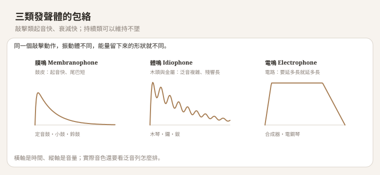
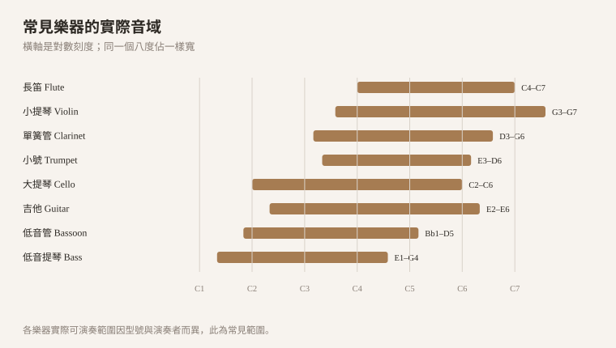
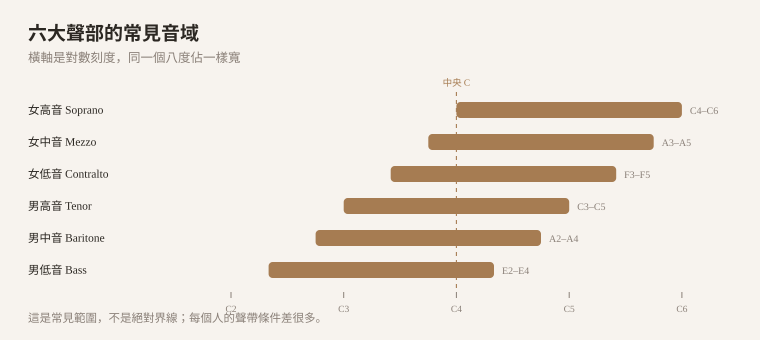
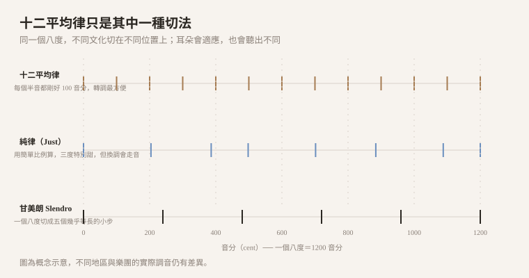

# **第八階段：樂器、人聲與合奏**

紙上的記號要變成空氣的振動，得靠樂器。

前面七個階段處理的都是「抽象的音樂」：音高、時間、距離、調、和弦、曲式。但聲音終究是由某個具體的東西發出來的——一條被拉緊的弦、一根被吹響的管子、一張被敲擊的皮，或是一副肉做的聲帶。

七章會先從樂器的科學分類（S-H 系統）開始，看人類怎麼把全世界的樂器分成五大類；再拆開弦鳴與氣鳴、膜鳴與體鳴的發聲原理；接著談音域、人聲的六個聲部，以及管弦樂團如何把這些音色疊成一棟建築。最後一章離開西方框架，去看世界上其他地方把同一個八度切成了什麼樣子。

## 第 34 章：樂器的科學分類——薩克斯—霍恩博斯特爾系統

如果你在路上隨便問一個學過一點音樂的人：「樂器分成哪幾類？」他通常會不假思索地回答你：「弦樂、木管、銅管、打擊樂，還有鍵盤樂器！」

這個答案錯了嗎？其實沒有錯，這是西方交響樂團（Orchestra）幾百年來最常用的分類法，它非常直覺，也符合我們看交響樂團演出時的座位編排。

**但是，當音樂學家把眼光放到全世界，試圖將人類歷史上出現過的所有樂器進行分類時，這套傳統的西方分類法立刻就崩潰了。**

### **34.1 傳統分類法的崩潰與「鋼琴的身份危機」**

傳統分類法最大的問題在於，它的分類標準「極度不統一」。它有時看材質（木管、銅管），有時看演奏動作（打擊、鍵盤），有時又看發聲體（弦樂）。這種混亂會產生許多無法解釋的矛盾。

我們來舉幾個經典的「找碴」例子：

1. **鋼琴（Piano）到底算什麼樂器？**  
   * 你用手指按下「鍵盤」，所以它是鍵盤樂器？  
   * 但是鍵盤在內部連接著小木槌，木槌去「敲擊」琴弦，所以它算打擊樂器？  
   * 可是真正發出聲音的明明是裡面那兩百多根「琴弦」，所以它應該是弦樂器？  
2. **長笛（Flute）明明是金屬做的，為什麼叫「木管」樂器？**  
   * 現代長笛大多是銀、K金或鎳銀合金製成的，根本沒有木頭成分。但因為它在歷史早期是木頭做的，就一直被歸類在木管組，這讓很多初學者感到困惑。  
3. **薩克斯風（Saxophone）是黃銅做的，為什麼它也是「木管」樂器？**  
   * 它全身金光閃閃，卻因為它的吹嘴上有一片「蘆葦製的簧片」，所以被歸類在木管，這在邏輯上顯得很牽強。  
4. **澳洲原住民的迪吉里杜管（Didgeridoo）該放哪裡？**  
   * 它是一根被白蟻蛀空的巨大桉樹木頭。它沒有按鍵、沒有簧片，吹奏方式像銅管樂器（靠嘴唇震動），但材質卻是純木頭。傳統分類法根本找不到它的位置。

### **34.2 終極解方：薩克斯—霍恩博斯特爾系統（S-H 系統）**

為了解決這個學術界的大混亂，1914 年，兩位民族音樂學家（一位德國、一位奧地利）——**古特·薩克斯（Curt Sachs）和埃里希·霍恩博斯特爾（Erich Moritz von Hornbostel）**，提出了一套震驚世界、至今仍被全球博物館與民族音樂學界奉為圭臬的分類法，簡稱 **S-H 系統**。

這兩位學者認為，外觀、材質、或是演奏方式（吹、拉、彈、唱、敲）都是表象。決定一個樂器本質的，只有一個核心的物理問題： **「產生聲音的最初源頭，到底是『什麼物質』在震動？」**

根據這個絕對理性的單一標準，他們將全世界成千上萬種樂器，完美地歸納成了四大類（後來因為科技發展，又加入了第五類）。這五大類分別是：

1. **弦鳴樂器（Chordophones）**：聲音的源頭來自「一根或多根緊繃的弦」的震動。  
2. **氣鳴樂器（Aerophones）**：聲音的源頭來自「空氣柱」本身的震動。  
3. **膜鳴樂器（Membranophones）**：聲音的源頭來自「一張緊繃的皮膜」的震動。  
4. **體鳴樂器（Idiophones）**：聲音的源頭來自「樂器本身的堅硬材質（如木塊、金屬）」的震動，不需要弦或膜。  
5. **電鳴樂器（Electrophones）**：聲音由電子電路產生，或由傳統的振動體產生後再經電子方式拾取與放大（電吉他屬於後者——真正發聲的仍是琴弦，電路負責拾音與放大）。

這套系統就像是一把鋒利的手術刀，完美解決了所有爭議。 鋼琴是什麼？因為真正震動發聲的是琴弦，所以它是「弦鳴樂器」。長笛和薩克斯風是什麼？因為是管子裡的空氣在震動，所以它們都是「氣鳴樂器」。迪吉里杜管呢？也是「氣鳴樂器」。一切都變得清晰無比！

### **34.3 發聲原理如何決定「音色（Timbre）」？**

為什麼我們學樂理，必須要懂這個科學分類法？因為「發聲體（什麼東西在震動）」直接決定了這個樂器的音色 DNA。

在聲學中，音色（Timbre）是由聲音的泛音列（Overtones）**以及聲音的**包絡線（Envelope，包含聲音的起音、延音、衰減）所決定的。

* **弦的震動（弦鳴）**：弓弦樂器帶有一種連續、延綿不絕、泛音極為豐富且溫暖的特質。因為弦的震動可以透過弓的摩擦（小提琴）持續給予能量，所以弦樂器的聲音可以像線條一樣不斷延展。  
* **空氣的震動（氣鳴）**：帶有一種純淨、穿透力強、且帶有「呼吸感」的特質。氣鳴樂器的音色很大程度上取決於管子的形狀（圓柱體或圓錐體），以及激發空氣的方式。  
* **皮膜與固體的震動（膜鳴與體鳴）**：通常帶有爆炸性的「起音（Attack）」。因為敲擊的瞬間能量極大，但隨後會迅速衰減。體鳴樂器（如木琴、銅鑼）的泛音通常非常複雜，甚至是不和諧的，這賦予了它們強烈的節奏衝擊感與特殊的金屬/木質光澤。

當偉大的作曲家（如貝多芬、馬勒、約翰·威廉斯）在譜寫交響樂時，他們其實就像是畫家在巨大的調色盤上擠顏料。他們是在精準地混合「弦鳴的溫暖、氣鳴的穿透、膜鳴的震撼」，來創造出千變萬化、直達聽眾靈魂深處的聽覺饗宴。

### 薩克斯－霍恩博斯特爾五大分類

| 大類 | 靠什麼振動 | 例子 |
|---|---|---|
| 體鳴（Idiophone） | 樂器本體 | 木琴、鑼、三角鐵、鈸 |
| 膜鳴（Membranophone） | 繃緊的膜 | 定音鼓、小鼓、鈴鼓 |
| 弦鳴（Chordophone） | 弦 | 小提琴、吉他、鋼琴、豎琴 |
| 氣鳴（Aerophone） | 空氣柱 | 長笛、單簧管、小號、管風琴 |
| 電鳴（Electrophone） | 電路（或電子拾音） | 合成器、電鋼琴、電吉他（電聲） |

第五大類「電鳴」不是 1914 年原版就有的，是後來由 Curt Sachs 補上的——不在 1914 年的原始版本裡（各來源給的年份不一，1940 與 1950 年代都有人主張）。

## 第 35 章：弦與管的對話——弦鳴與氣鳴樂器

弦鳴與氣鳴，是世界上能夠演奏出最複雜、最細膩旋律的兩大樂器家族。無論是泣訴般的小提琴，還是嘹亮的長號，它們是如何精準控制音高的？這背後藏著極度嚴謹，甚至可以寫成數學公式的物理定律。

讓我們分別深入這兩大樂器家族的物理核心。

### **35.1 弦鳴樂器（Chordophones）：長度、張力與質量的魔術**

弦鳴樂器包含了小提琴、大提琴、吉他、豎琴、琵琶、古箏，甚至鋼琴。

想像你拿著一條橡皮筋，兩手拉緊，然後用手指撥一下。橡皮筋會快速震動，發出「嗡」的聲音。這就是弦鳴樂器最原始的狀態。當一根弦被撥動或摩擦時，它會以特定的頻率（Hz）瘋狂震動。

決定這根弦發出什麼音高（頻率多少）的，有三個絕對的物理變數，這在物理學上被稱為**梅森定律（Mersenne's laws）**：

#### **變數一：弦的長度（Length）**

* **物理定律**：在張力與質量不變的情況下，**弦越長，震動頻率越低（音越低）；弦越短，震動頻率越高（音越高）**。弦長與頻率成反比。  
* **物理實踐（吉他與提琴的指板）**： 當吉他手或小提琴手在演奏時，你會看到他們的左手手指不斷地在琴頸（指板）上按壓。按下去的這個動作，在物理上的意義是什麼？ 當你沒按弦時（稱為空弦），整根弦從琴頭到琴橋都在震動，這時候長度最長，發出的是這個弦的最低音。當你的手指按在弦的中間時，你等於把弦「截斷」了，只有手指到琴橋之間的那段弦在震動。有效震動的「長度變短了」，所以彈出來的音就變高了。手指越往琴身（琴橋）靠近，有效弦長就越短，音就一路飆高。這就是弦樂器改變音高的最主要方式。

#### **變數二：弦的張力（Tension）**

* **物理定律**：在長度與質量不變的情況下，**弦拉得越緊（張力越大），震動頻率越高；弦放得越鬆（張力越小），震動頻率越低**。頻率與張力的平方根成正比。  
* **物理實踐（調音鈕的拉鋸戰）**： 在任何弦樂器的頂端（琴頭），都有控制琴弦鬆緊的機械裝置，稱為「弦鈕（Tuning pegs 或 Machine heads）」。 在交響樂團開演前，你會聽到所有人都在發出嗡嗡的聲音調音。如果今天小提琴手發現他的 A 弦稍微低了四分之一音（走音了），他不能改變弦的粗細，也不能改變空弦的長度，他唯一的辦法就是把弦鈕「轉緊」，增加琴弦的張力。張力一變大，音高就會慢慢爬升，直到精準地對上 440 Hz。這就是為什麼吉他換新弦時，一開始很容易走音，因為新弦的張力還不穩定，會一直慢慢鬆掉。

#### **變數三：弦的質量與粗細（Mass/Thickness）**

* **物理定律**：在長度與張力不變的情況下，**弦的單位長度質量越重（越粗），震動頻率越低；弦越輕（越細），震動頻率越高**。  
* **物理實踐（粗壯的低音弦與極細的高音弦）**： 請觀察一把吉他或大提琴。你會發現，負責發出最低音的那根弦（吉他的第六弦），粗得像是一條鋼纜；而負責發出最高音的那根弦（吉他的第一弦），細得像是一條釣魚線。 為什麼不把六根弦做成一樣粗，全靠調整張力來改變音高就好？ 因為物理極限！如果要把一根很細的弦，放鬆到能發出極低的音，它會鬆垮垮地貼在指板上，根本無法震動發聲；反過來，如果要把一根很粗的弦，拉緊到能發出極高的音，在達到那個音高之前，琴弦早就因為張力過大而繃斷了，甚至把琴頸都拉斷。 為了解決這個問題，樂器工匠在製造低音弦時，會在中心的鋼絲外面，一圈又一圈地緊密纏繞上銅絲或銀絲（稱為纏弦 Wound string）。這樣可以在不增加太多張力的情況下，大幅增加弦的「質量」，讓它能夠沉穩、緩慢地發出渾厚的低音。

**🪵 共鳴箱的放大魔法與斯特拉迪瓦里的秘密** 一根弦自己在空氣中震動，聲音是非常微弱的（你可以拿一根沒插電的電吉他彈彈看，聲音小得像蚊子叫）。 弦鳴樂器之所以能發出宏亮的聲音，關鍵在於**琴橋（Bridge）與共鳴箱（Resonator Body）**。 琴弦的微小震動，會透過一塊直立的小木片（琴橋），傳導到巨大的木頭琴面上。這個木頭琴面（面板通常是雲杉木）就像是一個超級揚聲器，它被迫跟著琴弦一起震動，推動琴箱內部的空氣，最後從音孔（如小提琴的 f 孔或吉他的圓孔）噴發出來。 三百年前義大利的製琴大師史特拉底瓦里（Antonio Stradivari）製造的小提琴之所以至今仍是天價，就是因為他對共鳴箱的木材選擇、弧度雕刻與漆料配方，達到了一種人類至今無法完全用科學複製的完美震動傳導境界。

### **35.2 氣鳴樂器（Aerophones）：空氣柱的魔法**

氣鳴樂器包含了長笛、單簧管、薩克斯風、雙簧管、小號、長號，甚至教堂裡那龐大無比的管風琴。它們不靠弦發聲，而是靠管子裡的「空氣柱（Air column）」在震動。

#### **氣鳴樂器的三種激發機制**

空氣自己是不會震動的，必須要有某種「啟動器」去擾亂空氣。氣鳴樂器主要分為三種激發方式：

1. **邊棱音（Edge-blown）**：如長笛、排笛。演奏者將氣流吹向一個鋒利的邊緣。氣流被這個邊緣劈開，在管口內外交替偏轉（稱為邊棱音，edge tone）；這股交替的壓力擾動了管內的空氣柱，讓它震動起來。這就像你對著一根吸管吹氣會發出聲音一樣，管越長、音越低。  
2. **簧片震動（Reed-vibrated）**：  
   * **單簧管與薩克斯風（單簧）**：吹嘴上綁著一片薄薄的蘆葦片（蘆竹製成，不是竹子）。吹氣時，氣流讓這片簧片產生劇烈的高頻震動，進而帶動管內空氣。  
   * **雙簧管與低音管（雙簧）**：使用兩片綁在一起的簧片。吹奏時兩片簧片互相拍打震動。雙簧樂器的音色通常帶有濃厚的鼻音特質，極具穿透力。  
3. **唇振（Lip-vibrated）**：也就是所有的「銅管樂器」（小號、法國號、長號等）。這裡沒有簧片，啟動器就是**演奏者自己的嘴唇**。演奏者必須緊閉雙唇，用力將氣流擠出，讓嘴唇在金屬吹嘴裡發出「噗噗噗」的震動聲（Buzzing）。

#### **空氣柱的長度變化：為什麼長笛要按這麼多按鍵？**

跟弦鳴樂器一樣，空氣柱也遵守長度的物理定律：**管子（空氣柱）越長，音越低；管子越短，音越高。**

長號（Trombone）是這個物理定律最完美的視覺呈現。長號沒有按鍵，它有一個巨大的 U 型滑管。

* 當演奏者把滑管往外推，整根銅管的總長度變長了，裡面的空氣柱也變長了，聲音就會發出低沉的滑音。  
* 當他把滑管往內拉，管子變短了，聲音就往上飆高。

那長笛和薩克斯風沒有滑管，它們怎麼改變空氣柱長度？ 答案是：**在管子上鑽洞（音孔）**。 管樂器內部的空氣柱，長度只計算到「第一個打開的孔洞」為止。

* 當演奏者按下所有按鍵，把長笛上所有的孔洞都蓋死時，吹進去的空氣無處可逃，只能一路跑到管子的最尾端才出來。這時空氣柱最長，發出長笛的最低音。  
* 當演奏者放開靠近吹口處的某個按鍵，打開了一個孔，空氣就會從這個最近的孔跑出來。這時有效空氣柱瞬間變短了，發出的音就變高了。 這就是為什麼木管樂器上總是佈滿了複雜的機械按鍵系統，它們全部都是為了精準控制「哪個洞要打開、哪個洞要關閉」，藉此改變空氣柱長度來吹出音階。

**💡 物理學的終極浪漫：開管與閉管的秘密** 這裡有一個會讓所有物理迷興奮的聲學秘密。 把長笛和單簧管（黑管）放在一起比一比，它們的長度差不多，大約都是 60 幾公分。 理論上，長度一樣，最低音應該差不多高，對吧？ **錯！單簧管的最低音，比長笛低了將近一個八度（小七度）！**

為什麼會這樣？這牽涉到聲學中的「邊界條件」。

* **長笛是「開管樂器（Open Pipe）」**：它的吹口處是有一個大洞（讓你吹氣），管尾也是開的，兩端都與大氣壓力相通。在開管中，空氣震動的聲波波長，大約是管長的 2 倍。  
* **單簧管是「閉管樂器（Closed Pipe）」**：它的管尾是開的，但是它的吹口處，在吹奏時是被厚厚的蘆葦簧片和演奏者的嘴唇**完全封死**的。在聲學物理中，一端封閉、一端開放的管子，它震動產生聲波的波長，會被強制拉長到管長的 4 倍！

波長變成兩倍，頻率就直接砍半，音高就整整降了一個八度。這就是為什麼單簧管家族（特別是低音單簧管 bass clarinet）雖然看起來沒有特別長，但它們卻能發出深沉到令人畏懼的極低音的原因。這也是造物主與物理學賦予樂器的神奇魔力！

## 第 36 章：敲擊與電聲——膜鳴、體鳴與電鳴樂器

離開了負責旋律的弦和管，我們來到了一個充滿原始節奏、金屬光澤，以及充滿未來科技感的領域。這三大類樂器改變音高的方式，跟弦與管完全不一樣：鼓靠膜的張力，木琴靠木條的長短，電子樂器靠電路。

### **36.1 膜鳴樂器（Membranophones）：張力與共鳴的爆發**

膜鳴樂器，簡單來說就是我們俗稱的「鼓」。 它的發聲體是一張緊緊繃在圓形框架上的薄膜（古代使用牛皮、羊皮等動物皮，現代為了不受溫濕度影響，多使用 Mylar 等高分子合成塑膠皮）。當鼓棒或手掌擊打膜面時，這層膜會產生極其複雜的二維波動。

#### **鼓的音高控制：張力的藝術**

絕大多數的鼓（如爵士鼓的小鼓、大鼓、中東的達布卡鼓）被稱為「無固定音高樂器」。因為鼓膜震動產生的泛音非常混亂，泛音之間的頻率比不是簡單的整數倍，人耳無法把它聽成一個明確的音高，聽起來就是一個「碰」的打擊聲，無法明確唱出它是 Do 還是 Re。

但鼓皮依然有高低之分。演奏者能即時控制鼓皮音高的主要物理變數就是張力。

* 鼓皮拉得越緊（張力大）：聲音越清脆、高昂、緊實。  
* 鼓皮放得越鬆（張力小）：聲音越低沉、悶響、具有厚實的延音。

如果你仔細看爵士鼓的邊緣，會有一圈金屬的「鼓耳（Lugs）」和螺絲。鼓手在演出前，會拿著鼓鑰匙去轉動這些螺絲，藉由鎖緊或放鬆鼓框，來調整鼓皮的張力。

**👑 定音鼓（Timpani）：能演奏旋律的膜鳴之王** 在交響樂團中，有一個膜鳴樂器是絕對的特例，它就是定音鼓。 定音鼓有巨大的半球形銅製共鳴盆，最厲害的是，它是少數能「精準調出固定音高（Do-Re-Mi）」的鼓類樂器。 定音鼓的底部有一個機械踏板系統。演奏者在演奏時，可以用腳踩下踏板。踏板內部連接著傘狀的連桿，會瞬間、均勻地拉緊整個鼓面的皮。這讓定音鼓可以在一秒鐘內，把原本發出 C 的鼓皮拉緊，變成發出 G 的聲音。在貝多芬或馬勒的交響曲中，定音鼓不僅是打節奏，它根本就是在演奏低音的旋律線！

### **36.2 體鳴樂器（Idiophones）：最古老的堅硬聲響**

體鳴樂器可能是人類歷史上最古老的樂器。當原始人拿起兩塊石頭互相敲擊，或是用木棒敲打一塊空心圓木時，體鳴樂器就誕生了。 體鳴樂器的特點是：**它不需要外加的弦，也不需要繃緊的皮膜，發聲體就是「樂器本身的固體材質」。**

決定體鳴樂器音高的，是材質的**密度、大小、厚度與形狀**。

#### **木琴與馬林巴琴（Xylophone & Marimba）**

這是有固定音高的木製體鳴樂器。它們由一排長短不一的玫瑰木（或合成材料）條組成，排列得像鋼琴鍵盤一樣。

* **物理規則**：木條越長、質量越大，敲起來震動越慢，聲音越低；木條越短、質量越小，敲起來聲音越高。 為了讓聲音更大、更飽滿，現代馬林巴琴的每一個木條下方，都懸掛著一根金屬共鳴管。這根管子的長度是被精準計算過的，專門用來放大該木條的特定頻率，讓原本乾癟的木頭敲擊聲，變成極度溫暖、圓潤的音色。

#### **銅鑼與鈸（Gongs & Cymbals）**

這些是金屬製的無固定音高體鳴樂器。金屬的內阻尼極低，敲擊後能量流失得慢，所以震動的時間可以維持非常久（延音極長）。 當你用力敲擊一面巨大的中國鑼或交響樂團的銅鈸時，金屬表面會產生極度混亂且複雜的震波。這些成千上萬個不協和的泛音交織在一起，會產生一種震耳欲聾、白噪音般（White noise）的音響爆炸。這也是為什麼在樂曲達到最高潮時，指揮家一定會讓打擊樂手狠狠地敲下一記銅鈸，那是無可取代的情緒釋放。

### **36.3 電鳴樂器（Electrophones）：顛覆物理定律的現代魔法**

時間來到 20 世紀，人類掌握了電磁學與電子技術。到了 1940 年代，S-H 分類法才補上第五大類：電鳴樂器。 電鳴樂器的出現，徹底顛覆了人類幾千年來製造樂器的物理限制。木頭會爛、琴弦會斷、肺活量有限，但在電力的世界裡，這些都不是問題。

電鳴樂器可以分為兩大革命性的分支：**電聲樂器**與**純電子樂器**。

#### **分支一：電聲樂器（Electro-acoustic instruments）**

最典型的代表就是**電吉他（Electric Guitar）與電貝斯（Electric Bass）**。 如果你拿一把實心木頭的電吉他，不插電直接彈，你會發現聲音小得像蚊子叫。它沒有木吉他那種大大的共鳴箱來放大聲音。 它的魔法，來自於藏在琴弦下方那些一塊一塊、上面有金屬圓點的方塊——這叫做**拾音器（Pickup）**。

* **電磁學的奇蹟**：拾音器裡面藏著一塊磁鐵，磁鐵外面纏繞著幾千圈比頭髮還細的銅線圈。這在琴弦周圍形成了一個磁場。  
* **法拉第電磁感應定律**：電吉他的弦必須是含鐵的金屬弦。當你撥動琴弦時，金屬弦在磁場中來回震動，切割了磁力線。這會在銅線圈中產生一股微弱的「交流電（電流）」。  
* 這股電流包含了你彈奏的音高（頻率）與力度資訊。電流順著導線傳送到音箱（Amplifier），被放大幾萬倍後推動喇叭單體，爆發出震耳欲聾的聲音。

因為聲音在中間變成了「電訊號」，我們就可以對它為所欲為！吉他手會踩下地上的「效果器（Effects pedals）」，讓電流波形產生失真（Distortion，產生搖滾樂的破音）、產生延遲（Delay，產生回音），創造出大自然中根本不可能存在的狂野音色。

#### **分支二：純電子樂器（Electronic instruments）**

代表作是**合成器（Synthesizer）**。 合成器是真正的「造物主樂器」。它內部沒有琴弦、沒有簧片、沒有鼓皮，什麼實體的震動機構都沒有。 它的聲音完全是憑空「算」出來的。

* **振盪器（Oscillator, VCO）**：這是合成器的心臟。它是一組電子電路，可以憑空產生出純粹的電子波形。你可以選擇圓潤的「正弦波（Sine wave）」、像長笛般空靈的「三角波（Triangle wave）」、像遊戲機 8-bit 聲音的「方波（Square wave）」，或是尖銳如弦樂的「鋸齒波（Sawtooth wave）」。  
* **濾波器（Filter, VCF）**：合成器產生原始波形後，會通過濾波器，把太刺耳的高頻削掉（Low-pass filter），讓聲音變得溫暖、悶厚，就像是給聲音戴上口罩一樣。  
* **包絡線（Envelope, ADSR）**：最後，透過控制 Attack（起音）、Decay（衰減）、Sustain（延音）、Release（釋音）四個參數，你可以決定這個聲音是像打擊樂一樣瞬間爆發又消失，還是像小提琴一樣緩慢出現、持續不斷。

透過這套邏輯，合成器不僅可以模擬出世界上所有的傳統樂器，更可以創造出聽起來像雷射槍發射、星際飛船降落、或是深海怪物咆哮的全新科幻聲響。電鳴樂器打破了物質的限制，讓人類的「想像力」成為音色唯一的邊界。

## 第 37 章：探索聲音的邊界——音域的定義與分類

我們學了這麼多樂器，最後必須面對一個殘酷的物理現實：**沒有任何一種樂器或人聲是無所不能的。**

小提琴拉不出低音提琴那種震動地板的震撼，長號也吹不出長笛那種鳥鳴般的輕靈；男低音無法唱出女高音的雲端音符，女高音也無法發出男低音的胸腔共鳴。

每種樂器和每個人，都有屬於自己的領土範圍，這條不可逾越的聲學國界，就叫做**音域（Range）**。

### **37.1 音域的科學定義與座標**

音域，指的是一個樂器或人聲，從它能發出的「最低音」到「最高音」之間的總距離範圍。

在音樂界，為了精準溝通，我們通常會用我們在第二階段學過的「科學音高標記法（Scientific Pitch Notation）」來標示音域。例如：

* **小提琴的音域**：大約是 G3（中央 C 下方的 G）到 E7（極高的 E，甚至更高）。這橫跨了將近四個八度。  
* **鋼琴的音域**：從 A0 到 C8，橫跨超過七個八度。這是所有常見樂器中音域最廣泛的樂器，它幾乎涵蓋了所有樂器的生存空間。

### **37.2 音域的三個層次：理論、實用與舒適**

音域不僅僅是一個物理極限。在專業的音樂創作、配器法（Orchestration）與聲樂教學中，我們不會只看一個絕對的範圍。我們會把音域像同心圓一樣，細分為三個層次，這對於作曲家和表演者來說至關重要：

#### **1\. 理論音域（Theoretical Range）—— 實驗室裡的極限**

這是樂器在「最完美、最極端的條件下」，或者歌手在「極度發聲」的狀態下，理論上能達到的極限範圍。

* **樂器例子**：一把小提琴的指板到底有多長，如果樂手的手指按到指板的最底端，弓摩擦在琴橋邊緣，它能發出的極限尖叫聲。  
* **人聲例子**：美國流行天后瑪麗亞·凱莉（Mariah Carey）展示的「海豚音（Whistle register）」。  
* **應用價值**：這個範圍通常只存在於實驗室、極度前衛的現代音樂、或是為了展示極端技巧的炫技曲目中。在常規的音樂中，我們極少使用到理論音域的邊緣，因為那裡的音質通常很難控制，且失誤率極高。

#### **2\. 實用音域（Practical Range）—— 戰場上的安全區**

這是樂器或歌手在實際的樂團演出中，能夠「穩定控制、音準良好，且音色不會變得太過怪異或失真」的範圍。

* **實務意義**：對於一位稱職的作曲家或編曲家來說，寫譜時有 95% 的時間都必須乖乖待在這個範圍內。如果你為了追求特殊效果，寫了一個長號的極高音，雖然理論上吹得出來，但在現場演出時，長號手可能會因為嘴唇疲勞而吹破音（俗稱的「放炮」），這會毀了整場音樂會。了解實用音域，是確保音樂能夠被完美執行的安全底線。

#### **3\. 舒適音域（Tessitura）—— 樂器與人聲的靈魂核心**

這個詞源自義大利文的 "Tessitura"，原意是紡織品的「織體」或「紋理」。它指的是在實用音域中，一個更為狹窄、但卻最精華的區段。 在這個範圍內，樂器或歌手可以發出**最豐滿、最優美、共鳴最完美、且最不費力**的聲音。

* **人聲的舒適音域（保護你的聲帶）**： 對於歌手而言，Tessitura 是決定一首歌能不能唱的關鍵。一首歌的最高音可能很高，歌手偶爾出現一次可以咬牙唱上去（這接近理論音域的邊緣）；但如果這首歌的副歌，旋律一直盤旋、糾纏在那個極高音區（這代表歌曲的 Tessitura 很高，超過了歌手的舒適音域），歌手的聲帶很快就會疲勞、充血、甚至長繭受傷。 流行音樂的歌手在錄音或演唱會前，經常會要求樂隊「降 Key（移調）」。降 Key 的目的，就是為了把整首歌的旋律重心，往下移動到歌手的「舒適音域」內，讓歌手能用最放鬆的狀態，唱出最飽滿的情感，而不是在台上聲嘶力竭地搏命。  
* **樂器的舒適音域（展現性格）**： 每種樂器的舒適音域都不同。法國號的舒適音域在中音區，能發出如天鵝絨般溫暖、包覆感極強的聲音；如果逼迫法國號吹到極高音，聲音會變得極度緊繃、具有攻擊性（這有時也是作曲家刻意為之的戲劇效果）。 把合適的旋律，交給處於舒適音域內的樂器來演奏，是讓管弦樂團聽起來和諧、動人、不刺耳的不二法門。

到這裡，你已經具備了看透樂器本質的聲學之眼。下次聽到一段音樂時，你腦中浮現的將不只是旋律，而是琴弦的拉扯、簧片的震顫與電子的狂舞。

接下來，我們要把這雙眼睛轉向最特別的一件樂器——它不用買、不能換，而且每一副都不一樣：人的聲音。

## 第 38 章：人聲的奧秘——六大聲部與自然音域

在人類發明弓弦、簧片、或是電子合成器之前，我們就已經擁有了一件世界上最精密、最充滿情感、且獨一無二的樂器，那就是我們自己的喉嚨——**人聲（The Human Voice）**。

人聲在薩克斯—霍恩博斯特爾分類法中，本質上屬於「氣鳴樂器」的一種。當肺部呼出的氣流，通過喉部兩片極為精巧的肌肉組織（聲帶）時，會引發聲帶的快速閉合與震動，產生基礎的聲波；接著，這些聲波會在我們的咽喉、口腔、鼻腔等腔體中產生共鳴，最終形成我們聽到的歌聲。歌者感覺到的那份「胸腔共鳴」，其實是振動經由組織傳導到胸壁造成的體感，聽眾聽到的聲音裡幾乎沒有它的成分。

與工廠裡統一規格批量生產的鋼琴或小提琴不同，地球上沒有任何兩個人的聲帶長度、厚度、喉部空間與顱骨形狀是完全一樣的。這造就了每個人無可取代的獨特音色，也讓「音域」這件事，成為聲樂領域中最嚴謹的科學。

### **38.1 古典聲樂的六大聲部劃分與音色特質**

在西方古典音樂（特別是合唱團與大型歌劇）數百年的發展過程中，為了讓多個人同時演唱時能達到最和諧、最豐富的頻譜平衡，音樂學家將成年人的人聲，依據「自然音域的高低」**以及**「音色的重量（暗沉或明亮）」，極度精細地劃分為六大聲部（男女各三種）。

這不僅僅是音高範圍的分類，更是在戲劇與角色設定上的靈魂賦予。在許多音樂劇或角色設定中，聲部直接暗示了角色的性格。例如，若要刻畫一位名叫「隔壁織音人」的靈魂人物，給予他溫潤、充滿包容力與敘事感的男中音（Baritone）聲線，便能立刻在聽眾腦海中建立起他善於編織聲音、親切且沉穩的立體形象。

以下是六大聲部的詳細解析：

#### **👑 女聲家族 (Female Voices)**

**1\. 女高音（Soprano）**

* **理論與實用音域**：大約從中央 C（C4）一路延伸到高音 C（C6），甚至極端的情況下可以達到 E6 或 F6。  
* **音色特質與分類**：女高音是所有人類聲部中音高最高、音域最高的聲部，在管弦樂中因「歌手共振峰」落在樂團頻譜的空隙裡而容易被辨識。在管弦樂團的轟炸下，女高音依然能像利劍一樣刺穿厚重的伴奏，直達音樂廳的最後一排。因此，在絕大多數的古典歌劇與現代流行樂中，女高音與男高音是歌劇中最常擔任主角、演唱主旋律的兩個聲部。女高音又可細分為多種特質：  
  * **花腔女高音（Coloratura Soprano）**：聲音極度輕巧、靈活，能夠在極高音區進行機關槍般的快速跳躍與裝飾音演唱（如莫札特《魔笛》中的夜后）。  
  * **抒情女高音（Lyric Soprano）**：音色甜美、柔和、充滿詩意，常扮演純情少女或悲劇女主角。  
  * **戲劇女高音（Dramatic Soprano）**：聲音極具爆發力、厚實且充滿金屬光澤，能夠與龐大的瓦格納管弦樂團抗衡，常扮演女武神或充滿仇恨的女王。

**2\. 女中音（Mezzo-soprano）**

* **理論與實用音域**：大約從 A3 到 A5。  
* **音色特質**：女中音的聲帶通常比女高音稍微厚重一些。她們的音色比女高音更溫暖、豐滿、帶有天鵝絨般的厚度。在歌劇中，女中音很少扮演純真的少女，她們經常被分配到極具個性與深度的角色，例如成熟的女性、母親、邪惡的巫婆，或是充滿致命吸引力的吉普賽女郎（最著名的例子就是比才歌劇《卡門》的女主角）。有趣的是，因為女中音的音域涵蓋了變聲前男童的範圍，她們也常在歌劇中「反串」扮演年輕的俊美少男（稱為 Trouser roles / 褲裝角色）。

**3\. 女低音（Alto / Contralto）**

* **理論與實用音域**：大約從 F3 到 F5，甚至可以下潛到 D3。  
* **音色特質**：這是女聲中最為罕見、也最珍貴的自然聲部。真正的女低音擁有極度深沉、寬廣、且胸腔共鳴極為強烈的聲音，帶有一種莊嚴、大地般的母性力量，甚至雌雄莫辨的神秘感。

#### **🎩 男聲家族 (Male Voices)**

**4\. 男高音（Tenor）**

* **理論與實用音域**：大約從 C3 到 C5。  
* **音色特質**：男高音是自然男聲（不包含純假聲）中音域最高的聲部。優秀的男高音就像是音樂界的超級英雄，他們在演唱高音時（特別是著名的「High C」），聲音充滿了陽剛的爆發力與輝煌的金屬光澤。在傳統歌劇中，男高音永遠是那位拯救世界的英雄、熱血的王子或是深情的愛人。世界三大男高音（帕華洛帝、多明哥、卡列拉斯）就是這個聲部在近代最偉大的傳奇代表。

**5\. 男中音（Baritone）**

* **理論與實用音域**：大約從 A2 到 A4。  
* **音色特質**：這是男性中最為普遍、最常見的自然聲部。男中音的音色厚實、溫潤、充滿磁性與敘事感。在流行音樂中，絕大多數以「深情、說故事」見長的男歌手，其最佳共鳴區都落在男中音的範疇。在古典歌劇裡，男中音經常扮演國王、父親、大反派、或是男主角身邊那位最忠誠的摯友。他們是穩定整個男性聲部中低頻的關鍵力量。

**6\. 男低音（Bass）**

* **理論與實用音域**：大約從 E2 到 E4，甚至有「深沉男低音（Basso profondo）」可以唱到 C2 這樣令人毛骨悚然的低頻。  
* **音色特質**：男低音是人類聲音的深淵。他們的聲音雄渾、深不可測，像是一座沉穩的大山或是一口古老的銅鐘。在合唱團中，男低音負責提供最穩固的「和聲根音（Root）」，如果沒有男低音的支撐，整個合唱團聽起來就會像失去地心引力一樣輕飄飄的、沒有重心。

### **38.2 舒適音域（Tessitura）在演唱與聲帶保護中的絕對重要性**

在現代流行音樂選秀節目的推波助瀾下，社會大眾對唱歌產生了一種極度危險的錯誤迷思：許多人以為「高音飆得越高，唱歌的技巧就越厲害」。這完全違反了人體工學與聲樂科學！

我們在第 37 章提過舒適音域（Tessitura）的概念，這個概念對於保護人聲這個「肉體樂器」有著生死攸關的影響力。

Tessitura 指的是在歌手的整個可用音域中，那一段能夠發出**最豐滿、最優美、共鳴最完美、且喉部肌肉最不費力**的核心範圍。

**強迫飆高音的物理代價**

當一位歌手在演唱時，如果歌曲的旋律只是偶爾、瞬間觸碰到他實用音域的極限最高音，那是可以接受的戲劇張力；但如果一首歌的副歌，其旋律線一直死死糾纏在歌手舒適音域之外的極高音區（這代表歌曲的 Tessitura 極高），這就是一場災難。

為了維持那個極端的高頻，歌手的喉部肌肉必須處於極度的緊繃狀態，聲帶會以極高的頻率快速開合、互相碰撞。長時間處於這種狀態，會導致聲帶微血管破裂、充血、長出聲帶結節（長繭），最終徹底毀掉這個無可取代的樂器。許多曾經紅極一時的搖滾歌手，到了晚年聲音完全沙啞、失去高音，就是因為年輕時無視舒適音域，過度透支聲帶的結果。

**將知識應用於音樂科技與開發**

了解舒適音域的重要性，不僅是歌手的必修課，更是音樂科技開發者的核心底層邏輯。

舉例來說，在規劃音樂互動系統，例如一款名為「Pitch Game」的音高判定互動遊戲時，開發者必須在演算法中寫入對應不同年齡層（成人與兒童）與性別的舒適音域動態範圍。如果在遊戲設計時，盲目要求所有未受過專業訓練的玩家去衝擊超過他們 Tessitura 極限的音符才能得分，不僅會造成極差的遊戲體驗，更極易導致玩家在闖關時造成聲帶疲勞與實質損傷。科技與遊戲的設計，必須建立在對人體聲學極限的深刻理解之上。

### 六大聲部的常見音域

| 聲部 | 大致音域 | 備註 |
|---|---|---|
| 女高音（Soprano） | C4–C6 | 歌劇中最常見的主角聲部之一 |
| 女中音（Mezzo-soprano） | A3–A5 | 常擔任次主角或反派 |
| 女低音（Contralto） | F3–F5 | 人數最少，音色厚實 |
| 男高音（Tenor） | C3–C5 | 歌劇中最常見的男主角 |
| 男中音（Baritone） | A2–A4 | 常見於敘事、對話性的角色 |
| 男低音（Bass） | E2–E4 | 合唱的基礎低音 |

這些是「常見」而不是「絕對」範圍，每個人的聲帶條件差異很大。

## 第 39 章：管弦樂團的音色光譜——樂器音域的實務配置

現在，讓我們把視野從單一的人聲，擴大到容納八十到一百名音樂家的交響樂團，或是包含各種合成器與爵士鼓的現代流行樂隊。

當一百件樂器在舞台上同時發出聲音時，為什麼聽起來不會像是一場震耳欲聾的交通車禍？為什麼長笛的聲音不會被幾十把小提琴徹底淹沒？這背後的最高機密，就是作曲家、編曲家與混音工程師對「頻譜空間（Frequency Spectrum）」**與**「樂器音域特質」的精準調控。

### **39.1 高、中、低音交織的聲學建築**

一個編制完美的管弦樂團，或是經過精心混音的現代音樂，就像是一座結構嚴謹的摩天大樓。不同音域的樂器，負責建造不同的樓層，每一層樓都有其不可取代的聲學功能。

我們可以用現代混音工程的頻段概念，將這座聲學建築拆解為四個主要樓層：

先講清楚一件事：這裡說的「誰在哪一層」，指的是**能量與泛音集中**的位置，不是基頻。同一個樂器往往同時橫跨好幾層——長笛的基頻在二、三樓，泛音卻能一路延伸到四樓。

**1\. 一樓地基：超低頻與低頻區（Sub & Low，約 20 Hz \- 250 Hz）**

* **負責樂器**：低音提琴（Double Bass）、大提琴的低音弦、低音管（Bassoon）、低音號（Tuba）、定音鼓、單簧管的低音區（Chalumeau）；在流行樂中則是電貝斯（Bass）與大鼓（Kick Drum）、808 合成低音。  
* **實務功能**：它們提供音樂的「重心」、「推進的律動」與和聲的「根音（Root）」。這個頻段的震動往往不只是被耳朵聽見，更是被聽眾的胸腔與皮膚「感覺」到的。如果地基不穩、低頻缺失，整首音樂聽起來會非常單薄、尖銳、令人不安；但如果低頻過多，音樂就會變得渾濁、轟鳴（Muddy），掩蓋掉所有細節。

**2\. 二樓牆壁：中低頻與中頻區（Low-Mid & Mid，約 250 Hz \- 2000 Hz）**

* **負責樂器**：中提琴、法國號、單簧管的中音區（Clarion）、大提琴與長號的中高音區；流行樂中的木吉他、電吉他節奏刷弦、合成器 Pad。  
* **實務功能**：這是整首音樂最「肉」、最飽滿的地方。中提琴與法國號經常被用來當作各聲部之間的「聲音黏著劑」——中提琴橋接弦樂與木管，法國號橋接木管與銅管；它們填補了極高音與極低音之間的巨大空隙，讓音樂聽起來具有溫暖的包覆感與厚度。大部分的和弦內音都在這裡交織。

**3\. 三樓裝潢與主角：中高頻區（High-Mid，約 2000 Hz \- 5000 Hz）**

* **負責樂器**：小提琴的高把位；雙簧管、小號、長笛在上面這個頻段的泛音與明亮度；流行樂中的主唱人聲（Vocal）、電吉他 Solo。  
* **實務功能**：我們在第一階段學過，根據「等響曲線」，這是人類耳朵最敏感、最容易聚焦的頻率範圍。因此，作曲家幾乎都會把最重要的「主旋律」放置在這個樓層。在這個頻段的樂器，負責吸引聽眾所有的注意力。

**4\. 四樓屋頂：高頻與超高頻區（High & Brilliance，約 5000 Hz \- 20000 Hz）**

* **負責樂器**：這一層沒有樂器把基頻放在這裡——它收的是**泛音與殘響**：鈸、三角鐵、鐘琴、短笛與長笛高音區的上方泛音，以及爵士鼓的 Hi-hat 與各種空氣感殘響。  
* **實務功能**：這些樂器通常不負責主要的旋律，它們的功能是為音樂加上「金屬的光澤」、「呼吸的空氣感」與「極致的穿透力」。短笛雖然體積極小，但因為它的聲音頻率極高，位於管弦樂團音域的頂端，因此即使樂團一百人火力全開、銅管齊鳴，聽眾依然能清晰地聽見短笛在雲端上發出清亮的穿透聲。

### **39.2 編曲的藝術：樂器在不同音域的「性格分裂」**

一位偉大的作曲家或編曲家，絕對不會只看樂器的「理論音域」，他們深知每一種樂器在跨越不同音區時，會展現出完全不同的音色性格。

舉例來說，單簧管（黑管）就是一個極具多重人格的樂器。

* 當它吹奏極低音區（稱為 Chalumeau register 沙盧莫音區）時，聲音極度深沉、厚實，甚至帶有一種陰暗、空洞、充滿威脅感的戲劇性。  
* 但是，當它跨越換音區，來到中高音區（Clarion register）時，它的聲音卻瞬間變得明亮、清澈、如歌唱般甜美。

如果在編曲時，作曲家不了解這種特性，將單簧管的低音區安排去與明亮的小號演奏同樣的高潮旋律，單簧管的聲音不僅會被徹底淹沒，還會讓整個和聲聽起來異常混濁。這就像是專案管理時，原本排在 I 欄的進度因為邏輯修正而整體向後遞延至 J 欄並重算時間差一樣，編曲時若把原本該在低音域的樂器強行移到高音域，整個頻譜的聲學邏輯都會隨之大亂，必須重新計算所有樂器頻率的分配與碰撞。

### **39.3 音域概念在現代混音與曲風配置上的終極應用**

在現代數位音樂製作中，這種對頻譜與音域的控制被發展到了極致的科學境界，這就是混音（Mixing）與 EQ（等化器）的藝術。

以現代音樂的不同曲風為例，它們對頻譜空間的配置有著截然不同的哲學：

* **華語流行音樂（Mandopop）的頻譜哲學**：  
  在製作 Mandopop 時，「人聲（Vocal）」永遠是頻譜中至高無上的絕對主角。混音師會使用 EQ 仔細清理中高頻（2kHz \- 5kHz）的空間，如果吉他或鋼琴的頻率在這個區段與歌手的聲音「撞車（頻率遮蔽效應）」，混音師會毫不猶豫地將樂器的中高頻砍掉（Cut），讓出一條康莊大道給歌手的咬字與情感。整個頻譜的設計是為了襯托人聲的清晰度與親密感。  
* **氛圍音樂（Ambient）與後搖滾（Post-rock）的頻譜哲學**：  
  然而，如果今天製作的是氛圍音樂或後搖滾，策略就完全逆轉了。在這些曲風中，人聲可能退居二線，甚至完全消失，取而代之的是主角變成了「空間感」與「音牆（Wall of Sound）」。電吉他透過大量的破音與延遲（Delay）、殘響（Reverb）效果器，刻意填滿了從中低頻到高頻的所有頻譜空間。混音師不會去追求單一樂器的極度清晰，而是利用 EQ 讓各種合成器與吉他的頻率互相交織、重疊，創造出一種無邊無際、令人沉浸其中的巨大轟鳴感與漂浮感。

音樂製作，本質上就是在一個有限的三維畫布（頻率、時間、音量）上，精準地放置每一種音域的顏料。

## 第 40 章：世界的音調——同一個八度，不同的切法

課程走到最後一章了。

前面三十九章，我們談的規則幾乎都來自同一套系統：把八度切成十二等分的十二平均律、大調與小調、I–V–I 的和聲語法、4/4 拍的骨架。這些是歐洲在過去幾百年建立起來的標準，也因為西方音樂的強勢輸出，成了今日全球流行音樂的通用語法。

但物理定律是共通的，詮釋方式卻不是。同一個八度，不同文化切在不同的位置；而切在哪裡，決定了那個文化聽起來「對」的是什麼。

### **40.1 十二平均律是一個妥協**

十二平均律的數學，中國明代朱載堉在 1584 年就算出來了；歐洲差不多同時期也獨立發展出同樣的算法。它的做法很暴力：把一個八度的頻率比，用對數平均切成 12 等分。

好處是轉調從此自由——任何一個調聽起來都一樣「準」（或一樣「不準」）。代價是：除了八度之外，鋼琴上所有音程都不是完美的整數比。純五度差 2 音分、大三度差 14 音分，人耳大多聽不出來，但物理上它們確實偏了。

在平均律之前，人們用的是純律（用簡單整數比調音）或五度相生律（一路疊五度）。它們在某些調上甜得多，但一轉調就會走音。所以平均律不是「更正確」，而是**更方便**——它是為了鍵盤樂器與大型合奏而做的取捨。

### **40.2 印度：一個八度切成 22 份**

如果告訴印度古典音樂的大師，西方人把八度只切成 12 份，他大概會覺得太粗糙。

印度的理論把一個八度細分成 **22 個什魯蒂（Shruti）**，而且不是等分的。實際演出時，一個拉格（Raga）只會用到其中幾個音，但演奏者可以透過揉弦、滑音，把音高「拉」到那些鋼琴上根本不存在的刻度上。

對印度音樂來說，音高不是格子，而是可以滑動的連續體。精準地落在某個什魯蒂上，是技巧，也是修養。

### **40.3 印尼甘美朗：每一套樂器都不一樣**

印尼的甘美朗（Gamelan）打擊樂團，用的是兩套與西方完全脫鉤的音階：**斯連德羅**（Slendro，約五等分）與**培羅格**（Pelog，七個不等距的音）。

更特別的是：**每一套甘美朗的調音都是獨一無二的。** 這個村莊的樂器，跟隔壁村莊的樂器，無法放在一起合奏，因為基準不同。而樂器是成對製造的，工匠會刻意讓其中一片高幾赫茲——同時敲擊時會產生規律的干涉，發出「嗡—嗚—嗡—嗚」的閃爍。印尼人叫它 Ombak（波浪），認為那是金屬被賦予生命的聲音。

這提醒我們一件事：**「音準」不是絕對的**。在甘美朗裡，微微偏離的成對樂器才是對的；在西方管弦樂團裡，同樣的偏離叫做走音。

### **40.4 五度相生：另一條路**

中國的「三分損益法」、古希臘的畢達哥拉斯調律，走的是同一條路：把弦長去掉三分之一（得五度）、再加上三分之一，一路疊上去，就得到一組音。

這條路和泛音列直接相關——我們在第二章就看過，泛音列裡第一個非八度的新音級就是五度（第 3 分音）。所以五度相生不是發明，而是「把物理現象抄下來」。

由此得到的五聲音階（宮、商、角、徵、羽，對應 1 2 3 5 6），避開了半音與三全音，聽起來乾淨、空曠。它在東亞、蘇格蘭、非洲都獨立出現過——不同的文化，同一組音。

### **40.5 終極結語**

這是一趟很長的旅程。

我們從一根弦的振動開始，學會了怎麼量音高、怎麼算距離；接著把距離排成音階、把音階疊成和弦、把和弦串成進行；最後把這些抽象的東西，還原成真實的樂器、人聲與合奏。

回頭看，那些規則其實都不難：音階是間隔的排列，和弦是三度的堆疊，和聲是張力與解決的循環，曲式是重複與對比的安排。真正難的是**聽出來**——而這件事只能靠耳朵，不能靠課本。

所以，如果這四十章只能帶走一句話，就帶這句：**樂理不是規定，是描述。** 它描述的是人類幾百年來發現「怎樣的聲音會讓人有什麼感覺」，而這張地圖永遠還有空白的地方。

現在，換你去填了。
