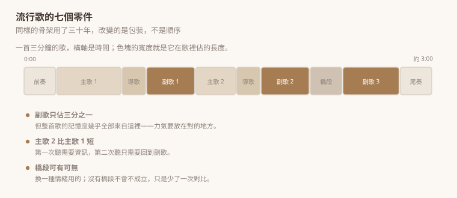
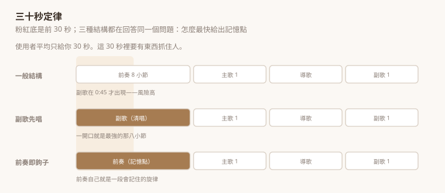
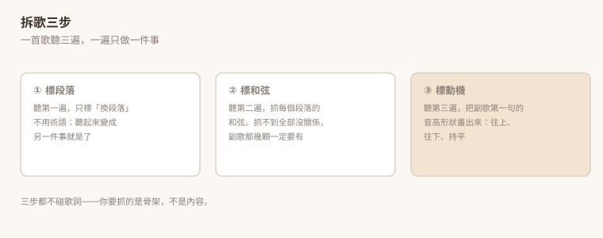

# 第 1 堂：拆歌——一首歌是怎麼蓋起來的

## 先講結論

寫不出歌的人，多半不是沒有靈感，而是**不知道自己正在寫的是哪一個零件**。

他們坐在琴前面，心裡想的是「我要寫一首歌」——一首歌是很大的東西，大到你不知道下一步要做什麼。職業作者想的不是「一首歌」，是「一段八小節的導歌」或「四句副歌的第二句」。**先會拆，才會蓋。**

這堂課不寫任何一個字。要做的事只有一件：把你最喜歡的那首歌拆開，看清楚裡面的七個零件各自負責什麼、佔多少時間、放在哪裡。看完之後你會發現，你腦中那些「聽起來很順」的歌，其實有一半是同樣的骨架。

## 常見誤解

**誤解一：「創作是一次靈感爆發，從第一個字寫到最後一個字。」**

正好相反。絕大多數商業歌曲是**分開做的**：先有一段副歌的旋律、或一句歌詞、或一個和弦進行，然後往外長。主歌常常是最後才寫的——因為要先知道副歌要講什麼，才知道主歌該鋪什麼哏。

把「寫歌」想成一條直線，你會卡在第一句；把它想成七個可以分開做的零件，你隨時都有事可做。

**誤解二：「副歌就是比較大聲、比較high的那一段。」**

音量是結果，不是定義。副歌的定義是：**整首歌裡重複最多次、資訊最集中、最容易被記住的那一段**。有些歌的副歌反而更安靜（所謂的「小聲副歌」），一樣成立——因為它重複。

判斷副歌的方法不是聽音量，是聽「哪一段你聽第二次就會跟著唱」。

**誤解三：「結構是一種公式，會限制創意。」**

結構是容器。你不會說「杯子限制了水的形狀」——沒有容器，水就灑掉了。真正限制創意的不是結構，是**沒有結構時那種「不知道寫到哪裡了」的焦慮**。

而且流行歌的結構不是一條法律，是一組預設值。你知道預設值長什麼樣，才有能力刻意打破它；不知道的人以為自己在創新，其實只是隨機。

## 原理

### 一、七個零件

一首流行歌由這些零件組成，每一個都有明確的工作：

| 零件 | 工作 | 常見長度 | 誰在聽的時候會注意到 |
|---|---|---|---|
| 前奏 Intro | 建立調性、速度與情緒，讓人知道「開始了」 | 4–8 小節 | 幾乎沒人注意，但拿掉會很怪 |
| 主歌 Verse | 敘事。交代人、事、時、地，鋪陳情緒 | 8–16 小節 | 會聽，但不會記住 |
| 導歌 Pre-chorus | 把主歌的情緒往上推，準備迎接副歌 | 4–8 小節 | 說不出來，但拿掉就「上不去」 |
| 副歌 Chorus | 整首歌的重點。重複最多次、最容易被記住 | 8–16 小節 | 只記得這裡 |
| 橋段 Bridge | 提供對比。換一個角度、換一組和弦、換一種情緒 | 4–8 小節 | 會覺得「這裡不一樣」 |
| 間奏 Solo | 讓耳朵休息、讓歌聲休息 | 4–8 小節 | 有些人會跳過 |
| 尾奏 Outro | 收尾。可以漸弱、可以停在一個和弦 | 4–8 小節 | 通常沒聽到 |

一個很重要的觀察：**聽眾只記得住副歌**。這不是聽眾不用心，這是流行歌的設計目的。所以副歌值得你花最多的時間，主歌只要「不擋路」就及格了。



*圖：三分鐘的歌，副歌通常佔不到三分之一，卻決定了這首歌是誰。*

### 二、三分鐘的比例

一首標準的華語流行歌大約 3 分 30 秒到 4 分 30 秒。扣掉前奏與尾奏，真正在「唱」的時間大約 2 分半。這 2 分半要放進 4 到 6 次副歌，其餘分給主歌與導歌。

常見的比例是：

- **前奏** 8 小節（約 20 秒）
- **主歌 1** 8–16 小節
- **導歌** 4–8 小節
- **副歌 1** 8–16 小節
- **主歌 2** 8–16 小節（通常比主歌 1 短，因為聽眾已經懂了）
- **導歌** 4–8 小節
- **副歌 2** 8–16 小節
- **橋段** 4–8 小節（不是每首都有）
- **副歌 3**（通常會加高、加厚，或轉調）
- **尾奏**

看出來了嗎？**主歌 2 通常比主歌 1 短**。這不是偷懶，是因為第一次聽的人需要資訊，第二次聽的人只需要回到副歌。如果你想砍掉什麼讓歌變短，第一個該砍的就是主歌 2 的一半。

### 三、三十秒定律

串流時代改變了結構。以前買 CD 的人會從第一首聽到最後一首，現在的使用者平均**三十秒**決定要不要跳過。

所以現代流行歌的前三十秒必須發生兩件事之一：**副歌提前出現**，或是**前奏本身就有記憶點**。

這也是為什麼愈來愈多歌採用「副歌先唱」的結構：一開場就是副歌（有時是清唱或半編制），唱完才進主歌。你在車上、在短影音裡聽到的版本，常常就是被剪成這樣。

寫歌的時候值得問自己一句：**這首歌最強的那八小節，在第幾秒出現？** 如果答案超過三十秒，你就得靠前面那三十秒撐住人。



*圖：同樣一首歌，兩種三十秒策略：副歌提前，或前奏自己就是鉤子。*

### 四、怎麼拆一首歌（三步，都不碰歌詞）

拆歌不是抄歌。你要抓的是骨架，不是內容。找一首你聽過五十遍的歌，按這三步做：

**第一步：標段落。** 邊聽邊在紙上寫下時間碼，標出「這裡換段落了」。不用專業術語，寫「聽起來變成另一件事」也可以。聽第二遍的時候，把段落的時間長度記下來。

**第二步：標和弦。** 用你會的樂器跟著彈，找出每個段落用了哪幾個和弦。**不用管調性，先寫級數或相對關係**（例如「一個循環裡是 1→5→6→4」）。抓不到全部沒關係，副歌那幾個一定要抓到。

**第三步：標動機。** 副歌的第一句，把它唱的**音高形狀**畫出來——往上、往下、持平，這樣就好，不用寫成五線譜。你會發現同樣的形狀在整首歌裡出現很多次，那就是這首歌的「動機」。



*圖：聽三遍，每一遍只做一件事。三步都不碰歌詞——你要抓的是骨架，不是內容。*

三步做完，你手上會有一張表：哪個零件、多長、用什麼和弦、旋律長什麼形狀。**那張表就是你這首歌的說明書。** 之後你要寫自己的歌，就是把這張表換成你自己的內容。

## 打個比方

寫歌像**辦一場婚禮**。

你不會說「我要辦一場婚禮」然後就開始動作。你會拆：場地、賓客、流程、菜色、音樂、攝影。每一項都可以分開準備，每一項都有它存在的理由，而且**順序是有意義的**——你不會在確認場地之前先挑菜色。

拆歌也是一樣。副歌是新人進場，主歌是前面的致詞（不能太長，但沒它很奇怪），導歌是燈光漸暗的那三十秒（說不出來為什麼，但沒有它就進不去），橋段是中間播放成長影片（換一種情緒），尾奏是送客。

而且婚禮有一個鐵則跟流行歌一模一樣：**賓客只記得「進場」和「吃飯」，中間發生什麼事，再精彩也會忘。** 所以把最好的力氣放在進場，其他地方不出錯就好。

## 現在就做

**練習：拆一首歌，畫一張結構表。**

1. 選一首你「聽過五十遍以上」的歌。不要選最喜歡的，選最熟的——熟到你不用專心聽也知道下一秒會發生什麼，這樣你才聽得出結構。
2. 準備一張紙（或手機備忘錄），畫成這樣：

```
| 段落 | 起始時間 | 長度（小節） | 和弦 | 旋律形狀 |
|------|---------|------------|------|---------|
| 前奏 |  0:00   |            |      |         |
| 主歌1|         |            |      |         |
| 導歌 |         |            |      |         |
| 副歌1|         |            |      |         |
```

3. 聽三遍：第一遍標段落、第二遍標和弦、第三遍標旋律形狀（副歌就好）。
4. 填完之後，回答三個問題：
   - 副歌在第幾秒出現？有沒有超過三十秒？
   - 主歌 2 比主歌 1 短嗎？
   - 這首歌有幾次副歌？最後一次跟第一次有什麼不同？

**不要跳過這一步。** 很多人讀完就覺得「懂了」然後直接去寫，寫兩行就卡住。這張表不是作業，是你之後每一堂課都要回頭看的底稿。

## 練完之後

你現在有一張結構表，還有三個問題的答案。把它收好——第二堂課寫歌詞的時候，你會需要知道「這首歌的副歌要講幾句話、一句幾個字」，那就是你這首歌的**容納量**。

下一堂：從一句話開始寫歌詞。先寫副歌，再回頭寫主歌——跟大部分人相反的順序，但這是比較容易寫完的順序。
