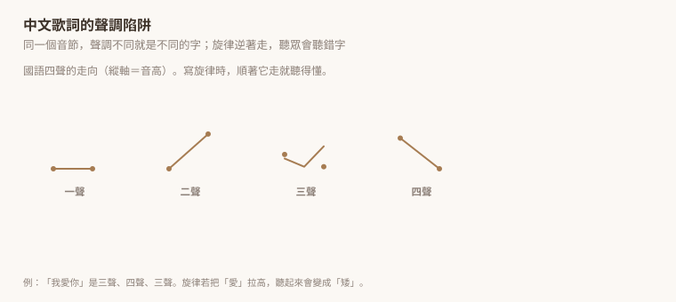
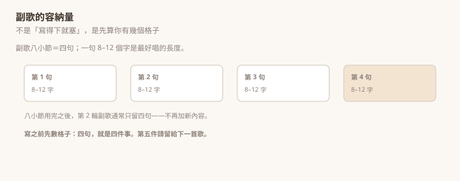

# 第 2 堂：歌詞——從一句話長出整首

## 先講結論

歌詞不是作文，是**可以唱的中文**。

作文的目標是「講清楚」，歌詞的目標是「唱得順、記得住、有畫面」。這三個目標經常互相打架：最精準的字常常最難唱，最文雅的字常常最沒有畫面。

所以歌詞有它自己的規矩。這堂課要處理的只有兩件事：**怎麼開始**（很多人卡在這一關），以及**怎麼寫才不會一唱就出戲**。

答案是：**先寫一句話，然後把那句話拆成可以唱的四句或八句。** 不是從第一句寫到最後一句——那是作文，不是歌。

## 常見誤解

**誤解一：「押韻是歌詞最重要的事。」**

押韻是加分，**重複是及格線**。

一首歌裡，聽眾記得住的通常是重複最多次的那幾個字，不是押得最整齊的韻。你想想〈小星星〉或〈生日快樂〉——它們幾乎沒有在押韻，但全世界都會唱。反過來，有些歌押得非常整齊，你一句都記不住。

押韻真正的作用是「讓句子聽起來收得住」，它是標點，不是內容。

**誤解二：「歌詞要寫得文雅、要有深度。」**

歌詞要寫得**具體**。文雅和具體經常是相反的。

「我獨自佇立於月色之下，思鄉之情油然而生」——文雅，但沒有畫面。
「床前明月光，疑是地上霜」——一千年了，還是每個人腦中都有畫面。

**誤解三：「副歌要講道理。」**

副歌要講**感覺**，不講道理。道理留給主歌（或留給你自己）。

副歌是所有人一起唱的那一段，它必須是**一句話就能懂、而且願意重複三次**的東西。「我愛你」比「我認為我們之間的關係需要重新定義」更適合放在副歌——不是因為它比較淺，是因為它比較**堅固**。

## 原理

### 一、先寫主題句

一首歌只需要一句話。不是詩，不是段落，就是一句話。

寫歌詞最有效率的起手式，是先在紙上寫下這個句子，而且**不押韻、不修飾、不管好不好聽**：

> 這首歌在講：＿＿＿＿＿＿＿＿。

例如：

- 「我想回到一個已經不存在的家。」
- 「我終於承認我沒有那麼重要。」
- 「我們都很好，只是不適合。」

這句話不會出現在歌裡（也可能會），它的工作是**讓你之後每一句都有地方可以回去**。當你寫到第五句開始想「我到底在寫什麼」的時候，看這句話。

**沒有主題句，就會寫出一堆各自很好、合起來不知道在幹嘛的句子。** 這是業餘作品最常見的死因。

### 二、具體勝過抽象

中文流行歌最常見的寫法是**用具體的東西講抽象的情緒**，而不是直接寫情緒。

| 抽象（不要） | 具體（要） |
|---|---|
| 我很難過 | 我把車停在路邊，雨刷還開著 |
| 我很想他 | 我還是買了兩杯咖啡 |
| 我們回不去了 | 你留下的傘，我今天才收進櫃子 |
| 我很孤單 | 我在便利商店等到店員換班 |

看出規則了嗎？**抽象的句子是結論，具體的句子是證據。** 聽眾不需要你告訴他結論，他自己會從證據裡得到結論——而且他得到的那個結論，會變成他自己的。

李白沒有寫「我很想家」，他寫「床前明月光，疑是地上霜。舉頭望明月，低頭思故鄉」。前三句全是具體的畫面：光、霜、抬頭、低頭。**最後一句才給你情緒，而且只給兩個字。**

*圖：左邊是把情緒講出來，右邊是把情緒藏進畫面裡。右邊永遠比較好唱，也比較好記。*

### 三、聲調：中文歌詞獨有的陷阱

英文歌詞只有重音，中文歌詞有**聲調**。同一個音節，聲調不同就是不同的字；旋律走向如果跟聲調相反，聽起來就會「怪」——這叫**倒音**。

國語的四聲大致是：

- **一聲**：高而平（媽）
- **二聲**：往上（麻）
- **三聲**：先降後升（馬）
- **四聲**：往下（罵）

寫詞的時候要做的檢查是：**這句話的聲調走向，跟你的旋律走向有沒有打架？**

例如「我愛你」是 三聲、四聲、三聲。如果旋律把它唱成「低—高—低」（先往上再往下），「愛」被拉高、被拉長，聽起來就變成「矮」——這就是倒音。

反過來，「月亮」是四聲接四聲，兩個字都往下；旋律如果也往下，就會非常順。

**實用的檢查法**：詞寫完之後，用你最自然的方式把句子「唸」出來，注意哪個字你唸得比較高、哪個字往下掉；然後寫旋律時**順著那個高低走**。你不是在配合規矩，你是在配合你說話的直覺——那也是聽眾的直覺。

*圖：黑線是字本身的聲調走向，橘線是旋律。順著走＝聽得懂；逆著走＝聽起來像別的字。*

### 四、重複比押韻重要

副歌的設計目標只有一個：**讓人第二次就會唱。**

要達成這件事，靠的是重複，而且要**刻意地、大量地**重複。最常見的三種手法：

1. **句尾重複**：四句裡的最後兩句幾乎一樣，只換一個字。
2. **開頭重複**：每一句都用同樣的幾個字起頭（例如每一句都是「我還是…」）。
3. **整段重複**：副歌的第二輪直接照抄第一輪——這不是偷懶，這是設計。

押韻當然可以用。原則是：**先確定句子重複得夠，再用韻去收尾。** 順序顛倒就會寫出「押得很整齊但你記不住」的作品。

### 五、主歌敘事、副歌抒情

分工要清楚：

- **主歌**：告訴我「發生了什麼」。時間、地點、人物、一個具體的動作。
- **副歌**：告訴我「所以呢」。那個動作讓我感覺如何——而且要用可以被重複的方式講。

最常被寫反的是：主歌開始抒情（變成模糊的感慨），副歌開始敘事（變成一句講不完的故事）。

檢查方法：把主歌遮起來，只讀副歌——**副歌應該自己站得住**，不需要主歌的上下文也能懂。再把副歌遮起來，只讀主歌——主歌應該像一個場景，而不是一篇感想。

### 六、容納量：先算你要寫幾個字

回到第一堂那張結構表。副歌是 8 小節，對應到歌詞大概是 **4 句、每句 8–12 個字**（慢歌可以更少，快歌更多）。

*圖：先算格子，再決定放什麼。四句就是四件事。*

先算清楚你有多少格子，再決定要放什麼。**很多人寫不完，不是因為詞窮，是因為他們想塞進去的東西太多。** 四個格子，就只能講一件事。

## 打個比方

歌詞像**投影片**，不像**文章**。

一場好的演講，每一頁投影片只有一句話。那句話很大、很清楚，你在最後一排也看得到。剩下的內容靠講者說——就像歌詞剩下的內容靠旋律、編曲、歌手的語氣去承擔。

如果你把段落文字塞進投影片，觀眾會開始讀，然後就不再聽你說話了。歌詞也一樣：**一句話塞太多字，聽眾會忙著解讀，就不會感受到情緒。**

所以寫詞的時候問自己：**這一句，我可以在三秒內聽懂嗎？** 不能，就砍。

## 現在就做

**練習：四句副歌 ＋ 四句主歌。**

順序跟直覺相反：**先寫副歌**。理由很簡單——副歌是聽眾唯一會記住的部分，先把最難的寫掉；而且先有副歌，你才知道主歌要鋪什麼哏。

1. 寫下你的主題句：「這首歌在講＿＿＿。」（不限字數，不管好不好聽）
2. **先寫四句副歌**：只做一件事——講那件事讓你怎麼了。第一句和第四句可以是同一個句子（重複）。
3. **再寫四句主歌**：從主題句裡挑一個**具體的東西**當作場景（一個地點、一個動作、一個物件），只做兩件事：講場景、給證據。**不要下結論。**
4. 唸一遍，把唸起來會打結的字換掉。**唸不順的，唱一定不順。**

不需要押韻，不需要文雅，不需要寫完。這四加四句就是你的第一份歌詞草稿。

## 練完之後

你現在有一份可以唱的草稿。它可能還很粗，但它的結構是對的：主歌有畫面、副歌有情緒、句子唸得順。

下一堂我們要把它**唱出來**——用四個音，寫一段副歌旋律。你會發現，一旦有了旋律，你原本覺得「還不錯」的句子會突然有一半不能用，那是好事，那叫真實的篩選。
