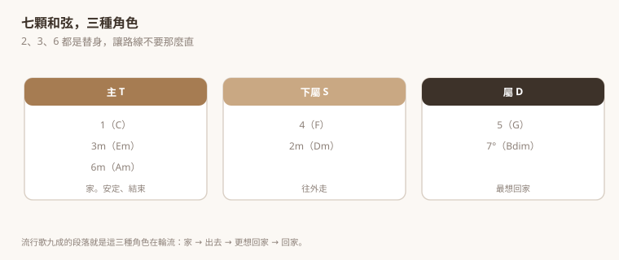
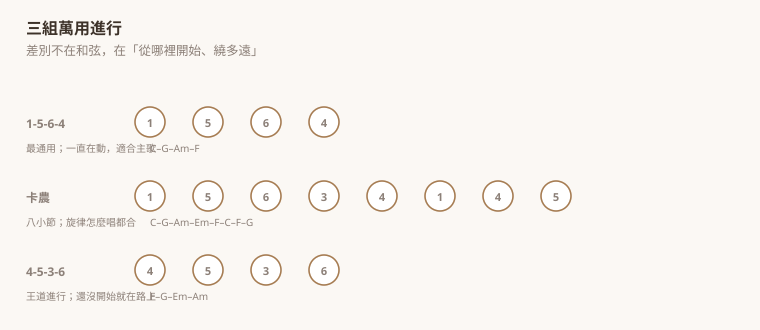

# 第 4 堂：和弦——四顆和弦打天下

## 先講結論

和弦不是「挑好聽的」，是**挑這個位置需要什麼功能**。

同一個和弦，放在副歌第一小節很好聽，放在最後一小節就變成「還沒結束」。決定它的不是和弦本身，是它**站在哪裡**。

好消息是：流行歌九成的段落只用了三到四組進行，而且來來去去就那幾組。你不需要認識幾百個和弦，你需要認識**這幾個和弦在做什麼工作**。

## 常見誤解

**誤解一：「和弦越多越豐富。」**

和弦的數量跟豐富程度沒有關係。**同樣四顆和弦，換位置的順序就會變成另一首歌。**

反過來，一首歌從頭到尾只有兩顆和弦也可以很好聽——只要你讓它們有變化（節奏、力度、編曲）。新手最常見的問題不是和弦太少，是**每兩拍換一顆，結果沒有一顆站得住**。

**誤解二：「和弦越複雜越高級。」**

七和弦、九和弦、掛留和弦是**調味料**，不是主菜。一鍋湯放三種香料是風味，放十種就是災難。

流行歌的骨架幾乎都是三和弦（大三、小三）。複雜和弦出現的時機通常是：**一句話的結尾**、**要轉彎的地方**、**副歌最後一次**。它們是重點，所以稀少。

**誤解三：「大調就是開心，小調就是難過。」**

調式決定的是「基準情緒」，但同一個大調可以寫得很痛（很多華語抒情歌就是這樣），同一個小調也可以很輕快。

決定情緒的其實是**速度、編曲、唱法**，以及你在哪裡放不穩定和弦。與其記「大調＝快樂」，不如記「**這一顆和弦讓我想不想往下走**」。

## 原理

### 一、七顆基本和弦的功能

以 C 大調為例，七顆順階和弦（用級數寫，換調時只要換根音）：

| 級數 | 和弦 | 功能 | 聽起來 |
|---|---|---|---|
| 1 | C | 主和弦（T） | 家。結束、安定 |
| 2 | Dm | 下屬（S） | 出發、鋪路 |
| 3 | Em | 主和弦的替身 | 柔軟的 C，適合接在 1 後面 |
| 4 | F | 下屬（S） | 往外走最強的一顆 |
| 5 | G | 屬和弦（D） | 最想回到 1 的一顆 |
| 6 | Am | 主和弦的替身 | 最常用來「假裝回家」 |
| 7 | Bdim | 屬和弦（D） | 很少用，張力太強 |

只要記住三件事：**1 是家、5 是想回家、4 是往外走**。2、3、6 都是這三顆的替身，用來讓路線不要那麼直。

流行歌 90% 的段落，就是這三種功能在輪流：**家 → 出去 → 更想回家 → 回家。**

*圖：不是七顆各自獨立，是三種角色各有替身。記角色，比記和弦有用。*

### 二、三組萬用進行

**① 1-5-6-4（C–G–Am–F）**

最通用的一組，華語流行歌裡出現頻率極高。它的特點是：每一顆都換了一個方向，聽起來「一直在動」，適合抒情歌的主歌。

**② 卡農進行 1-5-6-3-4-1-4-5（C–G–Am–Em–F–C–F–G）**

八小節一循環，比 1-5-6-4 多了一層「往下沉再爬上來」的過程。它之所以經典，是因為**旋律在上面幾乎怎麼唱都合**——這也是它被用爛的原因。

**③ 4-5-3-6（F–G–Em–Am）**

「王道進行」。同樣四顆和弦，但從 4 開始，所以永遠有一種「還沒開始就已經在路上了」的感覺。副歌很常用。

三組擺在一起看，你會發現它們都是同一件事的不同路線：**離開家，繞一圈，回來。**

*圖：三組進行的差別不在和弦，在「從哪裡開始、繞多遠」。*

### 三、換和弦的密度

密度是很多人忽略的參數。同樣一組和弦，換的頻率不同，歌的氣質完全不同：

- **一小節一顆**：最穩，適合抒情、慢歌，讓旋律有空間
- **兩拍一顆**：有推動感，適合副歌
- **一小節兩顆（前後各半）**：常用在導歌，製造「快到了」的感覺

密度還有一個實用功能：**你要延長情绪的時候，就降低密度。** 副歌最後一次，把和弦拉長成一顆兩小節，情緒會自己撐起來——這比加樂器有效。

*圖：密度是第二個旋鈕。和弦沒變，換的時機一變，歌的氣質就變了。*

### 四、旋律與和弦的關係

一句話：**正拍落在和弦音上，聽起來就順。**

C 和弦（C-E-G）的第一拍，旋律唱 C、E、G 任何一個都很穩；唱 D 或 F 就會「浮」——不是錯，是刻意製造的懸浮感。

這給了你一個很實用的檢查法：**旋律寫完之後，把每一小節的第一個音抓出來，看它有沒有落在和弦音上。** 沒有，你有兩個選擇：換那個音，或換那顆和弦。

後者常常更好——因為旋律通常比和弦難改，而和弦只是背景。

### 五、用級數思考

把 C–G–Am–F 想成「1-5-6-4」，你就能立刻把它搬到任何一個調：

| 調 | 1-5-6-4 |
|---|---|
| C | C–G–Am–F |
| G | G–D–Em–C |
| D | D–A–Bm–G |
| A | A–E–F#m–D |

**級數是「相對位置」，和弦名是「絕對地址」。** 寫歌的時候用級數想，溝通的時候用和弦名講。

這也是為什麼別人問你「這首歌什麼調」，你說得出調，就等於說得出全部和弦。

## 打個比方

和弦像**地板的材質**。

你不會走在一塊地上還一直注意地板——你注意的是「現在走在哪裡」。木地板、水泥地、草地，決定的是氛圍，不是路線。

真正決定你走到哪的是**和弦的順序**（路線），而「換和弦的密度」是你**走多快**。新手常犯的錯是一直在換地板材質（一直找特別的和弦），卻沒有決定路線。

還有一個更重要的觀察：**好的地板是讓你忘記它的存在。** 如果聽眾一直在注意和弦，通常是因為和弦太擠或太怪——那時候該做的不是再加，是拿掉。

## 現在就做

**練習：三段進行，配你自己的旋律。**

1. 拿第二、三堂寫的副歌（歌詞＋四個音的旋律）。
2. 依序配上三組進行，各彈／播一次：
   - 1-5-6-4
   - 卡農（1-5-6-3-4-1-4-5）
   - 4-5-3-6
3. 每一組都用**一小節一顆**的密度，先把旋律唱順。
4. 挑一組你最喜歡的，然後做兩件事：
   - 把副歌**最後兩小節**改成一小節一顆（拉長），聽聽看情緒有沒有撐起來
   - 把某一個小節的**第一拍旋律音**改成和弦音，聽聽看「順」是什麼感覺

**不用全部做完。** 三段進行各聽一次，你就會對「同一個旋律、不同地板」有身體感——這比讀十篇文章有用。

## 練完之後

你現在有一組「和弦＋旋律＋歌詞」都對得上的副歌。它已經是一首歌的核心了。

下一堂要把主歌接上去，處理最後也最難的一步：**詞和曲打架的時候，該改哪一個。**
