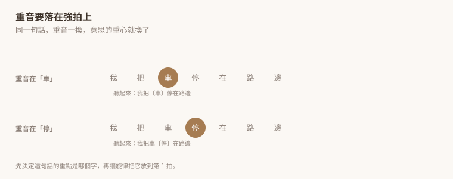
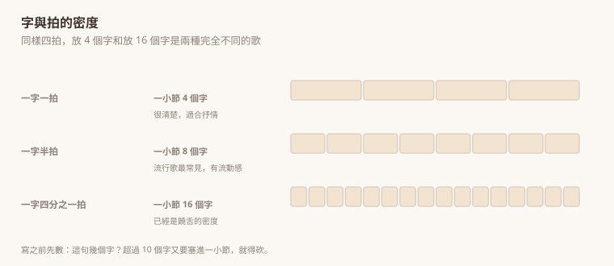
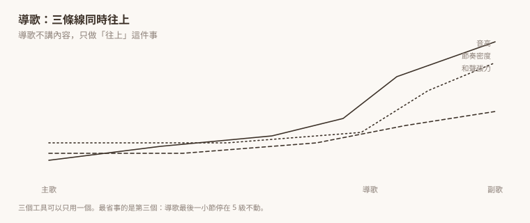
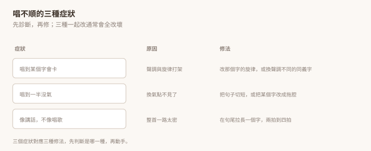

# 第 5 堂：詞曲合一——對拍、修字、接起來

## 先講結論

詞和曲會打架，**九成是因為字太多**。

寫詞的時候你在紙上（或螢幕上）工作，字是排排站的；寫旋律的時候你在時間裡工作，字是一個一個被拉開的。同一句話在紙上兩秒讀完，唱出來可能是六秒——那多出來的時間，就是打架的地方。

這一堂要做的只有三件事：**把重音放到重拍上、把塞不進去的字砍掉、把主歌和副歌接起來。**

## 常見誤解

**誤解一：「一個字配一個音最清楚。」**

清楚，但很平。中文歌好聽的地方，常常在**一字多音**（拖腔）：一個字拉住兩三個音，情緒就出來了。

規則不是「一字一音」，是**重要的字可以多給音，不重要的字一個音都不多給**。副歌的最後一個字拖長四拍，跟主歌中間一個字拖長四拍，效果完全相反。

**誤解二：「副歌一定要飆高音。」**

副歌要比主歌**更亮**，但不一定要更高。亮度可以來自：音域稍微提高、節奏變密、和聲變厚、編曲加樂器、你自己的力度。

把副歌全部寫在最高音，結果是：**第一次很爽，第三次就累。**（唱的人也累。）

**誤解三：「導歌可有可無。」**

導歌（pre-chorus）是**專業與業餘最明顯的分水嶺**。它不承載內容，只做一件事：**把主歌的情緒推到副歌的高度**。

拿掉導歌，主歌會直接跳到副歌，聽起來像「電梯跳樓層」——不是不能聽，是少了那口氣。

## 原理

### 一、對拍：重音字要落在重拍

每一小節有四拍，這四拍的份量不一樣：**第 1 拍最重、第 3 拍次重、第 2 和第 4 拍最輕。**

所以你要做的事很簡單：**把一句話裡最重要的那個字，放在第 1 拍。**

例如「我把車停在路邊」——

- 如果「車」落在第 1 拍，聽起來就是「我把**車**停在路邊」
- 如果「停」落在第 1 拍，聽起來就變成「我把車**停**在路邊」

同一句話，重音不同，意思的重心就不同。這不是音樂問題，是**你要先決定這句話的重點是哪個字**。

實用做法：詞寫完之後，用螢光筆把每句最重要的**一個字**標出來，然後檢查你的旋律有沒有把它放在強拍上。沒有，就往前或往後挪一個字——通常挪完就順了。

*圖：不是「字塞得進去就好」，是「重點的字要落在對的拍子上」。*

### 二、塞不進去的字，砍掉

最常見的症狀是：一個小節塞了十二個字，唱起來像在唸 rap——不是你寫錯，是**容納量超載**。

一個實用的換算（以中慢速歌、一小節四拍為例）：

- **一字一拍**：一小節 4 個字，很清楚，適合抒情
- **一字半拍**：一小節 8 個字，有流動感，流行歌最常見
- **一字四分之一拍**：一小節 16 個字，已經是饒舌的密度

寫詞的時候先在紙上數一下：**這一句有幾個字？** 超過 10 個字又要放在一小節裡，你就得砍。

砍的方法是**砍形容詞，留動詞和名詞**。「我獨自一個人靜靜地坐在窗邊」→「我坐在窗邊」。前者 14 個字，後者 5 個字，後者的畫面反而更清楚。

*圖：先數字，再寫旋律。密度決定這一句是抒情還是饒舌。*

### 三、導歌：把情緒推上去的三個工具

導歌通常只有四到八小節，它的工作不是講故事，是**製造期待**。三個工具，可以只用一個，也可以疊：

1. **音高往上爬**：導歌的音高比主歌高一截，一路往上，到副歌第一句才停。
2. **節奏變密**：主歌是一個字半拍，導歌變成一個字四分之一拍——心跳加快的感覺。
3. **和聲離開家**：導歌通常停在第 5 級（屬和弦）不回家，逼你進入副歌。

最容易做的版本是第 3 個：**導歌四小節，最後一小節就停在 5 級不動**。光是這樣，副歌就會自己變大聲。

*圖：導歌不講內容，只做「往上」。三條線可以只用一條，疊起來效果最強。*

### 四、唱不順的三種症狀與修法

**症狀一：唱到某個字會「卡」一下。**
原因幾乎都是**聲調與旋律打架**（第 2 堂講過）。修法：改那個字的旋律走向，或換一個同義但聲調不同的字。

**症狀二：唱到一半沒氣了。**
原因是**換氣點不見了**。中文句子有自然的停頓，寫詞時把逗號拿掉、硬塞成一句，就會沒氣。修法：把句子切短，或把某個字改成拖腔，用拖的時間換氣。

**症狀三：歌詞聽起來像在「講話」，不像在唱歌。**
原因是**一路都太密**。整首歌都是一字半拍，聽起來就是唸稿。修法：在每句的尾巴拉長一個字（兩拍或四拍），立刻就有「唱」的感覺。

*圖：卡、沒氣、像講話——三種症狀其實對應三種不同的修法。*

### 五、把段落接起來：三分鐘的骨架

現在你手上有一份主歌、一份副歌。接起來的順序是：

> 主歌 1（8 小節）→ 導歌（4 小節）→ 副歌 1（8 小節）→ 主歌 2（4–8 小節）→ 導歌（4 小節）→ 副歌 2（8 小節）→ 副歌 3（8 小節，加厚或轉調）

注意兩個地方：

- **主歌 2 比主歌 1 短。** 第一次聽需要資訊，第二次聽只需要回到副歌。
- **副歌 3 一定要跟前兩次不一樣。** 加高音、加和聲、換編曲、轉調都可以，但不能一模一樣——否則聽眾會覺得「已經聽完了」。

## 打個比方

詞曲合一像**兩個人跳舞**。

歌詞是領舞的人，決定往哪走；旋律是跟著的人，決定怎麼走。兩個人踩到腳，通常不是旋律不會跳，是**領舞的人走太快**。

所以修的時候先改詞，不是先改曲。把字砍掉、把重音調對，旋律通常自己就順了——因為旋律本來就是跟著語感寫的。

反過來（先改旋律去遷就塞不下的詞）幾乎一定會失敗：你會寫出一段誰都唱不順、但每個音都對的旋律。

## 現在就做

**練習：把你的歌接起來，然後唱三遍。**

1. 把第三堂的四句副歌，配上第四堂選定的進行，完整唱一次。**先不要管主歌。**
2. 寫四句主歌（第二堂的方法：具體的畫面），配同一組進行的前四小節。
3. 中間插四小節導歌：**最後一小節停在 5 級不動。**
4. 照上面的順序接起來：主歌 → 導歌 → 副歌。
5. 唱三遍，每一遍只注意一件事：
   - 第一遍：有沒有哪個字卡住？（症狀一）
   - 第二遍：在哪裡沒氣？（症狀二）
   - 第三遍：哪一句聽起來像講話？（症狀三）
6. 記錄這三個問題的位置。**不要當場改**，先記下來，下一堂一起修。

## 練完之後

你現在有了一首**結構完整**的歌：主歌、導歌、副歌、和弦、歌詞、旋律都有。它可能還有三四個地方會卡，但那是修的問題，不是寫的問題。

下一堂是最後一堂：把它錄成 demo，修掉那幾個卡住的地方，然後決定**什麼時候可以拿給別人聽**。
