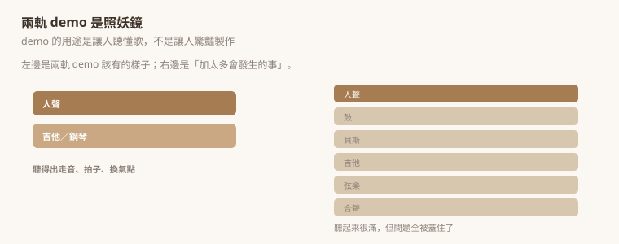
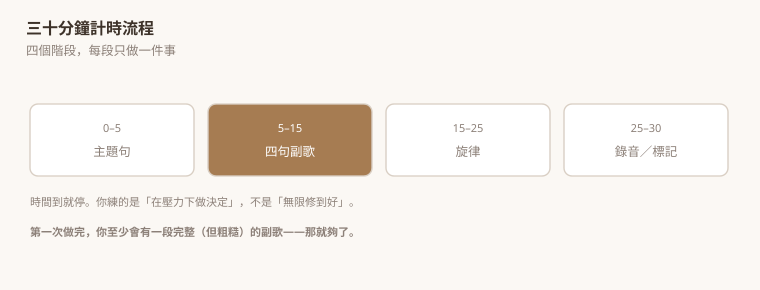
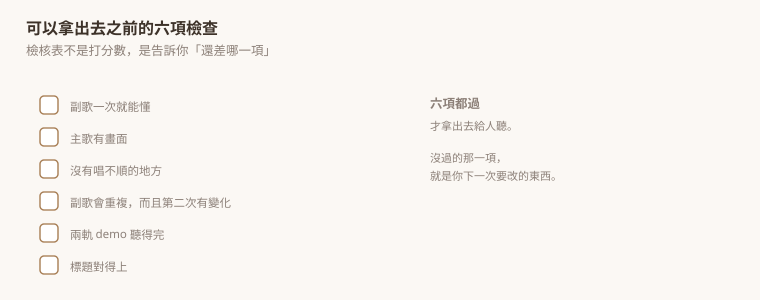

# 第 6 堂：寫完與拿出去

## 先講結論

從「寫了一半」到「有一首歌」，差的通常不是才華，是**流程**。

大部分人的歌停在 70% 的地方，不是因為寫不下去，是因為**沒有定義「寫完」是什麼樣子**。沒有終點線的比賽，沒有人會跑完。

這堂課要給你三樣東西：一個**兩軌就能做的 demo 方法**、一個**三十分鐘的計時流程**、一份**可以拿給別人聽的檢核表**。

## 常見誤解

**誤解一：「demo 要做得很好才能給人聽。」**

正好相反。**demo 的用途是讓人聽懂歌，不是讓人驚豔製作。**

編曲做得很滿的 demo，反而會害你：聽的人會開始評價音色、混音、鼓的力度，而不是「這首歌好不好」。兩軌（一個樂器＋人聲）是最誠實的形式，它讓旋律和歌詞沒有地方躲。

**誤解二：「要等靈感來了才寫得完。」**

靈感負責**開始**，不負責**完成**。完成靠的是排時間。

職業作者的日常是「今天下午三點到五點寫歌」，不是「今天有感覺所以寫歌」。这不是浪漫與否的問題，是**創作需要一個容器**。

**誤解三：「完成等於完美。」**

完成等於**可以拿出去**。完美是不存在的，而且追求完美的人通常一首歌都寫不完。

你要練的是「在有限的時間裡做出最好的版本」，不是「做出最好的版本」——後者沒有終點，前者有。

## 原理

### 一、兩軌 demo

你需要：**一個能彈和弦的樂器（吉他或鋼琴）＋ 一支麥克風（手機也可以）。**

做法：

1. 樂器先錄一次，從頭到尾，跟著節拍器。（不要邊彈邊唱，會兩邊都不準。）
2. 人聲再錄一次，戴耳機聽剛才那一軌。
3. 有兩個軌了。**不要加第三軌。**

這個版本會暴露所有問題：走音、拍子不穩、字塞不進去、換氣點不對。**這正是它的價值**——有問題的地方，一聽就知道在哪。

如果兩軌版本聽起來就成立，加上編曲只會更好；如果兩軌版本不成立，加再多編曲都救不回來。

*圖：兩軌是照妖鏡。它能聽出問題，所以它是最好的檢查工具。*

### 二、三十分鐘計時流程

給自己三十分鐘，計時，照這個順序做：

| 時間 | 做什麼 | 不要做什麼 |
|---|---|---|
| 0–5 分 | 決定主題句，寫下「這首歌在講＿＿」 | 不要想和弦 |
| 5–15 分 | 寫四句副歌（先寫副歌，不要寫主歌） | 不要修字 |
| 15–25 分 | 用四個音配副歌旋律，唱三次 | 不要重寫 |
| 25–30 分 | 唱一次錄下來，標記卡住的地方 | 不要重錄 |

**三十分鐘到了就停。** 不是因為時間到就完成了，是因為**你要練的是「在壓力下做決定」**，而不是「無限修到好」。

大部分人第一次做的時候，前三十分鐘會產出一段很粗糙但**完整**的副歌。這件事本身就有價值：你知道了「原來我做得到」，之後就沒有藉口了。

*圖：計時不是為了逼你，是為了讓決定發生。*

### 三、檢核表：什麼時候可以拿給別人聽

寫完之後，用這六項檢查。**六項都過才拿出去**，否則你會得到一堆「還不錯啊」這種沒有用的回饋。

- [ ] **副歌一次就能懂**：第一次聽的人，聽完副歌知道這首歌在講什麼
- [ ] **主歌有畫面**：至少有一句是具體的場景，不是感想
- [ ] **沒有唱不順的地方**：自己唱三遍，沒有卡、沒有沒氣
- [ ] **副歌會重複**：至少兩次，而且第二次有變化（加高、加厚或轉調）
- [ ] **兩軌 demo 聽得完**：不會想跳過，也不會覺得尷尬
- [ ] **標題對得上**：歌名是這首歌最強的那句話，不是最後寫的那個

第 6 項很多人忽略。**歌名不是命名，是定位**——它是聽眾在播放清單裡唯一會看到的字。如果歌名不是副歌裡最有記憶點的那幾個字，改一個。

*圖：檢核表的用途不是打分數，是讓你知道「還差哪一項」。*

### 四、怎麼問回饋（這比檢核表重要）

拿給別人聽的時候，**不要問「好不好聽」**。那個問題只會換來「還不錯」。

問這三個：

1. **「你記得住哪一句？」** → 測鉤子。如果他講得出，你就有一個真正的鉤子。
2. **「你覺得這首歌在講什麼？」** → 測主題。答案跟你的主題句差太遠，表示詞沒有傳達到。
3. **「你會想聽第二次嗎？為什麼？」** → 測整體。不想聽，問「哪裡讓你不想聽」；想聽，問「哪一段讓你想要」。

三個問題問三個人，你會得到比「十個人說還不錯」有用十倍的回饋。

### 五、下一步

寫完一首之後，接下來通常是這幾種：

- **繼續寫**：這是唯一保證進步的方法。第二首會比第一首快，因為你知道流程了。
- **找人編曲**：把兩軌 demo 給編曲的人，他能聽懂就夠了。
- **自己編曲**：站上的[線上編曲製作](/tools/daw/learn/)課程就是為這個寫的，從 MIDI 編曲到母帶輸出都在那裡。
- **發表**：放上平台之前，先確認你擁有這首歌的所有權利（旋律、歌詞、編曲、錄音）。翻唱別人的歌、取樣別人的錄音，都要另外處理。

## 打個比方

寫歌像**做菜**。

靈感是「今天想吃什麼」，它只發生在買菜之前。真正把菜做出來的是：備料、火候、調味、擺盤——每一步都不浪漫，但每一步都可以練。

而且有一個跟寫歌完全一樣的觀察：**餐廳裡最受歡迎的菜，通常不是最複雜的那道。** 一碗麵做得好，比一道做壞的功夫菜受歡迎。所以不要一開始就想寫很複雜的歌，先把一碗麵做好。

## 現在就做

**練習：三十分鐘，寫完一段副歌。**

1. 計時三十分鐘，照上面的流程表走。
2. 時間到就停，不管寫到哪裡。
3. 把結果錄下來（手機就好），然後用檢核表打分。
4. 寫下一個句子：**「下一次我要改的三件事是＿＿、＿＿、＿＿。」**

這三件事就是你下一首歌的方向。**不要重寫這一首**——它已經完成它該做的事：告訴你現在在哪裡。

## 練完之後

六堂課走完了。你現在有：一個拆歌的方法、一份歌詞、一段旋律、一組和弦、一份完整的結構，還有一個兩軌 demo。

這些都是可以重複使用的流程，不是一次性的作品。下一次寫歌，你不需要從零開始——你只需要再跑一次這個流程。

如果你寫出了東西想分享，站的「聯絡我們」一直都在。
