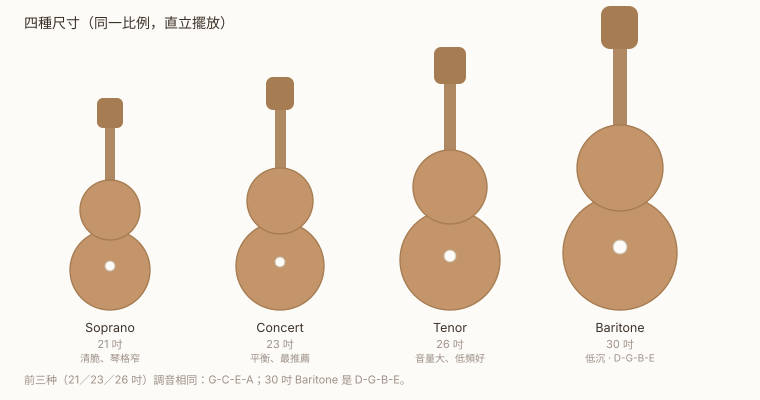
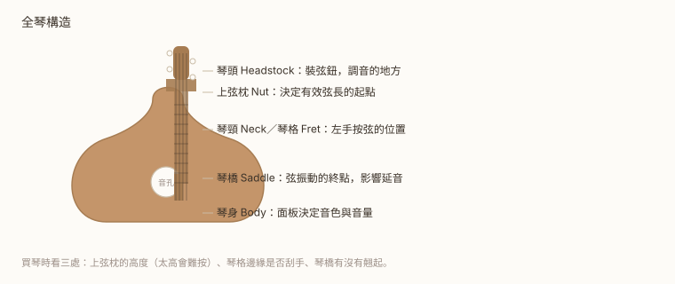

# 第 1 章：挑一把適合流行彈唱的烏克麗麗

在正式撥響第一根琴弦之前，我們必須先認識手中的這把樂器。許多人在剛接觸烏克麗麗時，常會被網路上琳瑯滿目的規格搞得一頭霧水：「21 吋跟 23 吋差在哪裡？」、「合板、面單板、全單板一定要買最貴的嗎？」、「為什麼有的烏克麗麗聽起來像玩具，有的卻像迷你木吉他般溫暖？」

本章將站在**成人流行彈唱**的實用角度，幫你快速看懂烏克麗麗的尺寸分類、木材音色個性與全琴構造，讓你無論是正準備購買人生第一把琴，或是想確認手邊現有的琴是否合用，都能做出最精準的判斷。

---

## 1.1 四大標準尺寸全解析：成人彈唱該選哪一種？

烏克麗麗雖然統稱為「四弦小吉他」，但依照琴身總長度與**有效弦長（Scale Length，指上弦枕到下弦枕之間琴弦實際振動的長度）**的不同，主要分為四種標準尺寸：**Soprano（高音）**、**Concert（中音）**、**Tenor（次中音）**與 **Baritone（上低音）**。

對年輕與成人學習者來說，尺寸選擇直接決定了「左手會不會覺得琴格太擠」以及「抱在懷裡舒不舒服」。

| 尺寸名稱 | 中文別稱 | 琴身總長 | 有效弦長 | 常見琴格數 | 標準調音 | 音色個性與手感定位 | 推薦族群 |
| :--- | :--- | :--- | :--- | :--- | :--- | :--- | :--- |
| **Soprano** | 高音型（標準型） | 約 21 吋（53 cm） | 約 330 mm（13 吋） | 12 ～ 15 格 | G - C - E - A | 音色最清脆明亮、充滿傳統夏威夷海島風味；琴格間距窄 | 手掌較小的女性、兒童、追求最輕便的旅行者 |
| **Concert** | 中音型 | 約 23 吋（58 cm） | 約 380 mm（15 吋） | 15 ～ 20 格 | G - C - E - A | **手感與音色的黃金平衡點**；琴格寬敞不擁擠，共鳴溫暖飽滿 | **大多數成人入門、流行彈唱首選** |
| **Tenor** | 次中音型 | 約 26 吋（66 cm） | 約 430 mm（17 吋） | 17 ～ 22 格 | G - C - E - A | 桶身大、音量宏亮、低音共鳴佳，高把位好按，延音更持久 | 手掌較大的男性、進階演奏者、指彈（Fingerstyle）玩家 |
| **Baritone** | 上低音型 | 約 30 吋（76 cm） | 約 480 mm（19 吋） | 18 ～ 22 格 | D - G - B - E | 音色深沉醇厚，幾乎等同於小型木吉他；和弦指法與前三者不同 | 原本就會彈木吉他、想無痛轉換的樂手 |

*圖：四種尺寸依實際長度比例繪製：21／23／26 吋的調音相同，30 吋 Baritone 是 D-G-B-E。*

### 編輯室選購真心話
* **首推 23 吋（Concert）與 26 吋（Tenor）**：前三种尺寸（21、23、26 吋）的調音完全相同，本書所有和弦圖與四線譜皆完全通用。但考慮到成年人的手指粗度與手臂比例，21 吋在按壓如 `G` 或 `E` 等多指和弦時容易手指打架；**23 吋 Concert** 既保留了烏克麗麗甜美清新的特質，又給了左手充足的活動空間，是流行彈唱最不會出錯的選擇。若你身高較高（175 公分以上）或未來有志挑戰華麗的指彈獨奏，則可直接攻頂 **26 吋 Tenor**。
* **避開 30 吋 Baritone 作為第一把琴**：它的調音是 `D-G-B-E`（與木吉他最細的四條弦相同），雖然好聽，但市面上絕大多數的烏克麗麗教材與網路和弦圖都是為 `G-C-E-A` 設計的，新手買這把會面臨「看譜全部對不上」的困擾。

---

## 1.2 木材與面板工藝：為什麼價格從一千元到上萬元都有？

走進樂器行，你會發現同樣是 23 吋的烏克麗麗，價格落差卻非常大。這背後的關鍵差異在於**「板材結構」**與**「木頭種類」**。

### 一、板材結構的三個等級
1. **合板（Laminate）**：由三層薄木片交錯壓合而成。優點是價格親民（約新台幣 1,500 ～ 3,500 元）、結構堅固，對台灣潮濕或冷氣房的溫濕度變化耐受度高，不容易開裂變形；缺點是共鳴較單薄，音色不會隨時間越彈越開。
2. **面單板（Solid Top）**：只有最關鍵的發聲「面板」採用整塊實木原木，側板與背板則為合板。這是**性價比最高（CP 值最強）的結構**（約新台幣 3,500 ～ 8,000 元），既有實木的溫暖共鳴與動態層次，又兼顧了側背板的耐用度，非常推薦給打算認真學習流行彈唱的成人讀者。
3. **全單板（All Solid）**：面板、側板、背板全數使用整塊原木製作（約新台幣 8,000 元以上至數萬元）。音色最為通透立體，且具有「開聲（Wood Opening）」特性——隨著你彈奏年資增加，木頭纖維會越震越鬆、音色越發醇厚；但對環境濕度要求嚴格，需要細心保養。

### 二、常見木材的音色個性

| 木材名稱 | 英文標示 | 外觀色澤特徵 | 音色個性描述 | 適合的流行曲風 |
| :--- | :--- | :--- | :--- | :--- |
| **桃花心木** | Mahogany | 溫暖的紅褐色，木紋細膩均勻 | 中低頻溫暖厚實、甜美不刺耳，人聲融合度極高 | 抒情慢歌、民謠彈唱、溫柔小品 |
| **相思木** | Acacia / Koa | 金黃至深褐色，常帶有虎斑火焰紋 | 夏威夷最經典木材；中高頻清脆明亮、顆粒感十足 | 輕快節奏、雷鬼海島風、指彈獨奏 |
| **雲杉木** | Spruce | 淺乳白色，紋理筆直細密 | 音量大、動態範圍廣、聲音穿透力強、反應靈敏 | 強烈刷弦搖滾、需要大音量的戶外彈唱 |
| **沙比利木** | Sapele | 類似桃花心木的紅棕色，有條紋光澤 | 音色接近桃花心木，清晰明亮、性價比高 | 入門全能型練習琴 |

---

## 1.3 全琴構造解剖圖：看懂每一個零件的功能

為了讓你在接下來的章節能無障礙閱讀教學指令（例如「左手按在第三格琴衍內側」、「右手在響孔上方刷弦」），請花兩分鐘對照下方的構造圖，記住這 8 個核心部位名稱：

1. **琴頭（Headstock）與弦鈕（Tuning Pegs）**：位於最頂端，用來固定琴弦並透過旋轉齒輪調整音高。現代優質烏克麗麗多採用「封閉式齒輪弦鈕（sealed gear tuners）」，轉動順暢且不容易走音。弦鈕哪一顆對應哪條弦依品牌配置而異，調音時轉動旋鈕、看音高往哪走即可。
2. **上弦枕（Nut）**：位於琴頭與指板交界處的白色（或牛骨製）橫條，上面有四道凹槽，決定了四條弦的間距與高度。
3. **指板（Fretboard / Fingerboard）**：琴頸正面深色的木板（多為玫瑰木或黑檀木），左手手指按弦的舞台。
4. **琴衍（Fret）與琴格（Fret Space）**：鑲嵌在指板上的細長金屬條稱為「琴衍」，而兩條金屬條之間的木頭格子稱為「琴格」。從上弦枕往下數，依序為第 1 格、第 2 格、第 3 格……以此類推。
5. **音點記號（Position Markers）**：鑲嵌在指板正面（以及琴頸側邊）的白色圓點，通常標記在**第 5、7、10、12 格**（第 12 格通常會有兩個圓點，代表高八度位置），讓你低頭看琴時能一秒定位。
6. **響孔（Soundhole）**：面板中央的圓孔，琴弦振動的聲波會進入琴身共鳴箱放大後，再從這裡傳出來。**右手刷弦的最佳位置，通常在響孔上方與指板末端交界處**，這裡音色最平衡甜美。
7. **琴橋（Bridge）與下弦枕（Saddle）**：黏貼在面板下半部，負責將琴弦末端固定，並透過白色的「下弦枕」將琴弦振動傳導至整個面板。

---

*圖：全琴構造：上弦枕決定有效弦長的起點，琴橋與琴身負責把弦的振動變成聲音。*

## 1.4 買琴必備的四大實用配件清單

購琴時，除了琴袋之外，建議你一次備齊以下四樣小工具，它們能幫你省去無數練習時的挫折感：

* **夾式電子調音器（Clip-on Tuner）**：夾在琴頭上，透過感應木頭震動來調音。即使身處吵雜的咖啡廳或客廳，也能精準調音（比手機 App 收音準確得多）。
* **烏克麗麗專用移調夾（Ukulele Capo）**：第 17 章我們會學到如何使用它一鍵轉調，讓你輕鬆唱出任何歌手的歌曲。注意不要買成木吉他專用移調夾，因為木吉他移調夾彈簧太緊、尺寸太寬，容易把烏克麗麗的指板夾傷或導致音準偏高。
* **備用琴弦一組**：建議準備一組氟碳弦（fluorocarbon）（如 Worth）或 Nylgut 合成弦（如 Aquila）。新琴剛買來前幾天琴弦會持續延展，萬一調音轉過頭不小心斷弦，手邊有備用弦才不會中斷練習興致。
* **背帶（Strap，選配）**：如果你希望站著彈唱，或覺得抱琴時右手容易滑動，可以加裝一條背帶（需確認琴身底部與琴頸跟部是否已安裝背帶釘，若無則可使用免打孔的「響孔鉤式背帶」）。

---

### 本章重點檢查表
* [ ] 我已確認自己手上這把烏克麗麗的尺寸（21 / 23 / 26 吋），知道它適用標準 `G-C-E-A` 調音。
* [ ] 我能準確指出琴頭、弦鈕、上弦枕、第 3 格、第 5 格音點與響孔的位置。
* [ ] 我已經準備好一個夾式調音器（或暫時先下載好手機調音 App）。