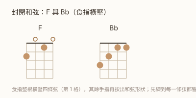
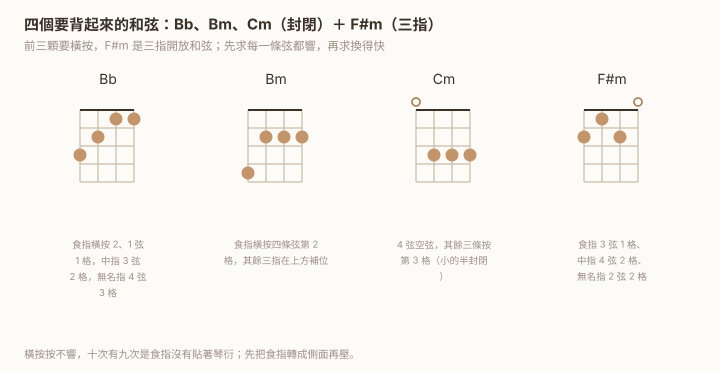

# 第 12 章：攻克新手大魔王：封閉和弦（Barre Chords）

每一種弦樂器都有一個讓新手聞風喪膽的「分水嶺關卡」——在烏克麗麗上，這個關卡叫做**封閉和弦（Barre Chords，又稱大橫按）**。

當你興高采烈地彈完前十一章的歌，正準備挑戰蘇打綠〈小情歌〉、周杰倫〈告白氣球〉或五月天〈突然好想你〉時，樂譜上突然跳出一個 **`Bb`** 或 **`Bm`**！你照著和弦圖把食指橫壓在所有琴弦上，結果用力捏到虎口發麻，撥下去卻傳來一陣「噗、噗、噗」的悶音……別灰心，這不是因為你手指沒力氣，而是因為你用錯了「施力角度」！本章將用物理力學幫你徹底馴服這隻大魔王。

---

## 12.1 封閉和弦手部力學：省力槓桿與食指側面按壓術

封閉和弦的原理，是用**左手食指（1指）像「人體移調夾（Capo）」一樣，同時橫跨壓住第 1 格或第 2 格的多條琴弦**，再搭配中指、無名指按出其他音。

為什麼新手按封閉和弦會按不響、手又超痛？因為大家直覺會用「食指正中央軟軟的指腹肉墊」去壓弦，而且試圖用「大拇指與食指死命對捏」來硬碰硬。請立刻改用以下**四大省力物理法則**：

1. **用「食指骨頭側面」按弦，拒絕軟肉墊！**
   伸出你的左手食指，摸一摸食指**靠近大拇指那一側（外側邊緣）**，你會發現那裡的皮肉最薄、底下就是硬挺的指骨！按封閉和弦時，食指不要平平地正對指板，而要**稍微向琴頭方向側轉約 15～20 度**，用這條硬挺的「骨頭側面」去壓弦，只需一半的力氣就能把四條弦壓得密不透風。

2. **緊貼「琴衍金屬條內側」**：
   這個法則在封閉和弦上更是生死關鍵！食指必須緊緊貼在目標琴格下方的金屬條內側（距離約 1～2 毫米），千萬不要壓在格子正中央。

3. **善用「右手前臂向內扣」的槓桿借力！**
   這是最神奇的省力秘訣：當左手食指按住琴頸時，用**夾住琴身的右手前臂微微向自己胸口方向輕壓**。根據槓桿原理，琴身往胸口靠，琴頸就會自然往前推向你的左手食指，替你的左手提供額外的向後反作用力！這能明顯減輕虎口負擔。

4. **食指只需壓「需要發聲的弦」**：
   例如按 `Bm` 時，無名指已經按住了第 4 弦第 4 格，因此你的食指在橫按第 2 格時，其實**只需要專注把第 1、2、3 弦壓緊**，第 4 弦就算食指沒壓死也完全不影響音準！

---

*圖：封閉和弦：食指整根橫壓四條弦，其餘手指再按出和弦形狀。*

## 12.2 必學四大封閉和弦指型：Bb、Bm、F#m、Cm

以下四個和弦是華語流行歌出現頻率最高的封閉（與半封閉）和弦。圖中橫跨多條弦的粗黑線（`●═══●`）代表**食指（1指）同時橫按住該格的所有標示琴弦**。

### 四大和弦按法細節與音色驗收表

| 和弦代號 | 封閉類型 | 左手精準指法配置 | 常見出現調性 | 逐弦爬音驗收檢查點 |
| :--- | :--- | :--- | :--- | :--- |
| **Bb** | 小橫按（半封閉） | 食指（1）橫按**第 1、2 弦第 1 格**；中指（2）第 3 弦第 2 格；無名指（3）第 4 弦第 3 格 | F 大調（4級和弦）、C 大調借用和弦 | 檢查第 2 弦（E 弦）是否被食指肉墊壓實，或被中指指腹碰到悶住 |
| **Bm** | 全封閉（大橫按） | 食指（1）全橫按**第 2 格（1～4 弦）**；無名指（3）按**第 4 弦第 4 格**（中指可疊在食指上方幫忙加壓！） | G 大調（3級和弦）、D 大調（6級和弦） | **偷吃步神技**：中指（2）現在完全空閒，可以**直接疊壓在食指背上**幫食指加壓，立刻解決按不緊的問題！ |
| **Cm** | 小橫按（半封閉） | 食指（1）橫按**第 1、2、3 弦第 3 格**；第 4 弦保持空弦 `O` | C 大調的「借用 iv 級小和弦」（borrowed iv）（`F` → `Fm` 的 C 調對應：C 調中常寫為 `Fm`，而 G 調中常出現 `Cm`） | 食指指尖不要頂到第 4 弦空弦，讓第 4 弦空弦（High-G 調音下是 G）清亮響起 |
| **F#m** | 非封閉（進階三指） | 食指（1）第 2 弦第 1 格、中指（2）第 4 弦第 2 格、無名指（3）第 3 弦第 2 格、第 1 弦空弦 `O` | A 大調、D 大調常用小和弦 | 注意它長得跟 `Dm` 很像，只是無名指往右移到了第 3 弦第 2 格，第 1 弦必須保持空弦清脆發聲 |

---

## 12.3 封閉和弦指型平移與「3 分鐘每日強化訓練」

封閉和弦一旦練成，最大的紅利就是**「可移動性（Movable Shapes）」**！
例如你學會了按第 2 格的 **`Bm`**，只要維持一模一樣的手型，整隻手往琴身方向平移一格（食指按第 3 格、無名指按第 5 格），它就自動變成了 **`Cm`**！再往右平移兩格（食指按第 5 格、無名指按第 7 格），它就變成了 **`Dm`**！

### 每日 3 分鐘封閉和弦突破菜單
請勿一次死命按壓超過 5 分鐘，以免肌腱發炎。建議每天練琴前花 3 分鐘做「按壓 → 放鬆」間歇訓練：

1. **單指橫按測音（1 分鐘）**：只用食指側面橫按第 2 格全部四條弦，大拇指由上往下撥四條弦，確認四條弦都響亮後，左手完全放開休息 3 秒，重複 10 次。
2. **熱門和弦轉換循環（2 分鐘）**：跟著 BPM = 55 的節拍器，練習流行歌最常出現的封閉轉換組合：
   * 組合 A（F 大調經典進行）：`| F | Bb | C7 | F |`（練習食指從單按第 2 弦第 1 格，瞬間倒下變成橫按第 1、2 弦的 `Bb`！）
   * 組合 B（G 大調經典進行）：`| G | Bm | C | D |`（第 15 章我們立刻就會在周杰倫〈晴天〉用到這組超帥進行！）

---

### 本章重點檢查表
* [ ] 我按封閉和弦時懂得使用「食指骨頭側面」緊貼琴衍金屬條內側，並用右手前臂微向內扣借力。
* [ ] 我能按出清脆無雜音的 `Bb` 與 `Bm`（懂得用中指疊壓在食指背上輔助加壓）。
* [ ] 我已經能流暢完成 `F` → `Bb` 與 `G` → `Bm` 的和弦切換。