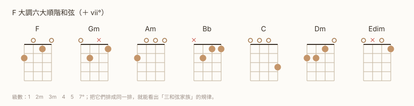
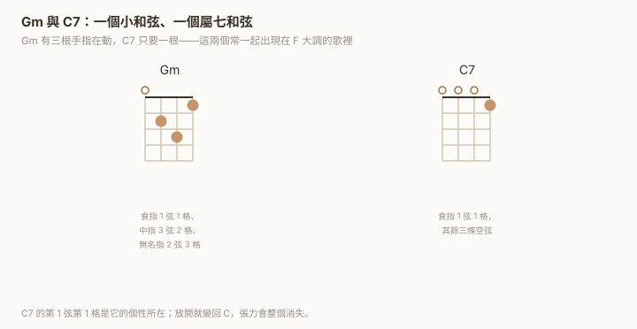
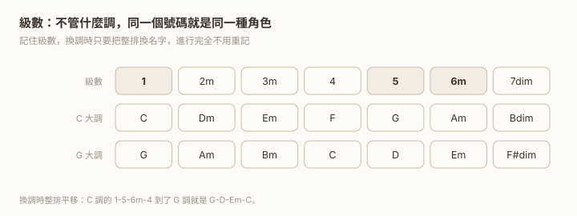
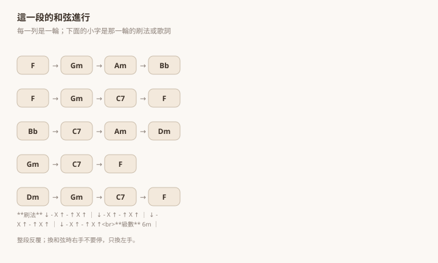

# 第 16 章：F 大調家族和弦與「3 分鐘推算順階和弦」

在吉他與烏克麗麗的世界裡，有三大「平民黃金調性」——**C 大調**、**G 大調** 與 **F 大調**。這三個調性在烏克麗麗的開放把位上擁有最多空弦共鳴，音色最甜美，也是絕大多數流行歌譜改編時的首選調性。

上一章我們征服了 G 大調，本章我們將補齊最後一塊拼圖——**F 大調家族和弦**！更重要的是，我們要教你一套只需 3 分鐘就能學會的「數字級數推算心法」，讓你從此不再死背和弦進行，只要看一眼簡譜數字（`1 2 3 4 5 6`），就能在任何調性中秒速推出對應和弦！

---

## 16.1 F 大調順階和弦總覽（F、Gm、Am、Bb、C7、Dm）

同樣地，我們用「對照學習法」來檢視 F 大調的六個核心順階和弦。你會發現，其中 4 個和弦（`F`、`Am`、`C` / `C7`、`Dm`）你早在前幾章就已經滾瓜爛熟了，加上第 12 章學過的 `Bb`，你唯一需要認識的新面孔只有 **`Gm`（2 級和弦）**！

| 級數代號 | 1 級 (I) | 2 級 (ii) | 3 級 (iii) | 4 級 (IV) | 5 級 (V) | 6 級 (vi) |
| :--- | :--- | :--- | :--- | :--- | :--- | :--- |
| **C 大調成員** | **C** | **Dm** | **Em** | **F** | **G** (或 G7) | **Am** |
| **G 大調成員** | **G** | **Am** | **Bm** | **C** | **D** (或 D7) | **Em** |
| **F 大調成員** | **F** | **Gm**（**新學！**） | **Am** | **Bb** | **C** (或 C7) | **Dm** |

*圖：F 大調順階：F、Gm、Am、Bb、C、Dm、Edim——同一排看，就看得出三和弦家族的規律。*

### 新和弦攻略：`Gm` 與 `C7` 指法圖

* **`Gm` 按法秘訣**：食指（1）按第 1 弦第 1 格、中指（2）按第 3 弦第 2 格、無名指（3）按第 2 弦第 3 格，第 4 弦空弦 `O`。**觀察它的形狀：它跟 G 大調和弦長得一模一樣，只是把原本按第 1 弦第 2 格的手指往左退一格到了第 1 格！**（樂理上，大三和弦的三音降半音就變成小三和弦，這就是為什麼 `G` 退一格就變 `Gm`！）
* **`C7` 按法秘訣**：烏克麗麗史上最簡單的七和弦！只需用**食指（1）按住第 1 弦第 1 格**，其餘三條弦全部空弦，能為 F 大調帶來極強的「回歸主和弦 `F`」的解決張力。

---

## 16.2 白話樂理：用數字級數（1～7）秒懂全調性轉換

為什麼職業樂手在 KTV 或街頭表演時，主唱喊一聲「這首我們降半音唱 F 調！」，樂手連譜都不用重寫，就能直接彈出來？因為職業樂手腦袋裡記的不是英文字母，而是**「數字級數（Number System）」**！

你只需要記住這三條白話公式，就能自己推算出任何大調的順階和弦：

1. **大調音階的「全全半、全全全半」音程口訣**：
   * 在音樂中，相鄰兩個字母之間，除了 **`E-F`（Mi-Fa）** 與 **`B-C`（Si-Do）** 相差半音（1 格）之外，其他相鄰字母都相差全音（2 格）。
   * 任何大調的 `1 - 2 - 3 - 4 - 5 - 6 - 7 - 1` 音階，都必須嚴格遵守**「全音、全音、半音、全音、全音、全音、半音」**的距離公式。
   * 舉例推算 **F 大調**：從 `F(1)` 開始，往後推全音是 `G(2)`，再推全音是 `A(3)`，接下來 `3` 到 `4` 必須是**半音**——`A` 往上走半音不是 `B`（`A` 到 `B` 是全音），而是 **`Bb(4)`**！這就是為什麼 F 大調的 4 級和弦一定是 `Bb`，而不是 `B`！

2. **大小和弦屬性固定公式（`1, 4, 5` 是大調；`2, 3, 6` 是小調）**：
   * 無論哪一個大調，它的 **1 級、4 級、5 級永遠是大三和弦（開心陽光）**；它的 **2 級、3 級、6 級永遠是小三和弦（憂鬱感傷，後面要加上 `m`）**！
   * 檢驗一下 F 大調音階 `F(1) - G(2) - A(3) - Bb(4) - C(5) - D(6)`：
     * `1, 4, 5` 保持大寫 → **`F`、`Bb`、`C`**
     * `2, 3, 6` 加上 `m` → **`Gm`、`Am`、`Dm`**
     * 順利推導出 F 大調六大順階和弦！

---

## 16.3 流行金曲實戰演練：F 大調原調金曲

F 大調的音域位置非常適中，許多華語女歌手與男高音歌手的經典作品原曲就是 F 大調，用烏克麗麗彈奏 F 大調原調，不需要做任何移調就能直接跟著原唱 CD 一起合奏！

### 實戰曲目一：蘇打綠〈小情歌〉（F 大調原調版）

* **歌曲節奏**：4/4 拍，速度約 70–80 BPM。
* **核心秘密**：這首華語樂壇經典作品原曲就是 **F 大調**！主歌充滿細膩詩意的鋼琴質感，最適合用烏克麗麗的抒情指法分解詮釋；副歌「你知道 就算大雨讓這座城市顛倒」則切換為飽滿的民謠搖滾或慢靈魂刷法。

| 和弦進行 | 節奏／指法 |
| :--- | :--- |
| `F` → `Gm` → `Am` → `Bb` | — |
| `F` → `Gm` → `C7` → `F` | — |
| `Bb` → `C7` → `Am` → `Dm` | — |
| `Gm` → `C7` → `F` | — |

### 實戰曲目二：蔡健雅〈紅色高跟鞋〉（F 大調都市輕快版）

* **歌曲節奏**：4/4 拍，中速偏快。
* **核心秘密**：原曲為 F 大調，主歌與副歌幾乎由超俐落的四小節循環 **`Dm` → `Gm` → `C7` → `F`**（樂理級數 **`6m - 2m - 5 - 1` 循環進行**，是流行爵士與都會輕快曲風的最愛！）貫穿全曲，搭配第 9 章學過的切音刷法（`下、切、上下、切`），立刻就能彈出都市女性的自信與俏皮！

| 和弦進行 | 節奏／指法 |
| :--- | :--- |
| `Dm` → `Gm` → `C7` → `F` | **刷法** ↓ - X ↑ - ↑ X ↑ ｜ ↓ - X ↑ - ↑ X ↑ ｜ ↓ - X ↑ - ↑ X ↑ ｜ ↓ - X ↑ - ↑ X ↑ **級數** 6m ｜ 2m ｜ 5(7) ｜ 1 |

---

### 本章重點檢查表
* [ ] 我已經能按出 `Gm` 與 `C7` 和弦，並記住 F 大調的六個常用順階和弦：`F`、`Gm`、`Am`、`Bb`、`C7`、`Dm`。
* [ ] 我理解「`1, 4, 5` 是大和弦、`2, 3, 6` 是小和弦」的級數推算規則，能自己推算 D 大調或 A 大調的順階和弦。
* [ ] 我已經能用 F 大調原調自彈自唱〈小情歌〉或〈紅色高跟鞋〉。
