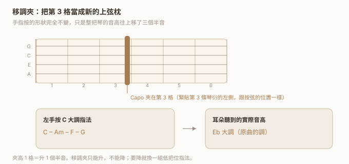
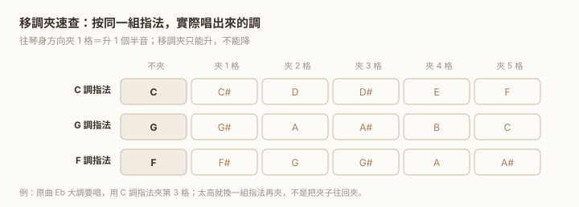
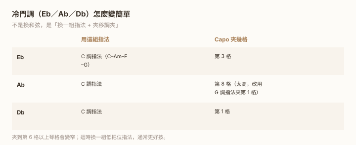

# 第 17 章：移調夾（Capo）轉調實戰：唱不上去／太低怎麼辦？

在實際流行彈唱中，你一定會遇到以下兩個令人崩潰的真實場景：

1. **場景 A（音域不合）**：網路上查到的〈小幸運〉常見版本是「C 大調指法＋Capo 5」（原曲 F 大調），但你是低沉嗓音的男生，唱到副歌高音時破音破到外太空；或是女生想唱陳奕迅、周興哲的歌，用原調唱起來低音像在喉嚨裡含滷蛋，完全發不出聲音！
2. **場景 B（冷門地獄調性）**：你超想彈一首新歌，打開網路和弦譜一看，上面寫著 **`Eb`、`Cm`、`Ab`、`Bb`**（降 E 大調）！整首歌滿滿都是封閉和弦，按到手指抽筋還是一片悶音！

別擔心，這兩個痛點在流行樂手眼中，只需要一個小小的神器就能在 3 秒內徹底解決——那就是**移調夾（Capo）**！本章將教會你 KTV 級的實戰轉調秘技，讓你從此想唱幾調就唱幾調，而且永遠只按自己最熟悉的簡單和弦！

---

## 17.1 烏克麗麗專用移調夾正確夾法與音準維護

移調夾（Capo）的作用原理很簡單：**它就像一根超級穩固的「機械食指」，替你橫按在某一個琴格上，把整把烏克麗麗的有效弦長縮短，從而讓所有空弦音高整體往上提升**。

### 夾移調夾的三個黃金細節（避免走音與傷琴）
1. **務必選用「烏克麗麗專用移調夾」**：木吉他移調夾的彈簧張力是為粗鋼弦設計的，如果硬夾在烏克麗麗纖細的琴頸與軟尼龍弦上，不僅會把琴頸壓出凹痕，還會把琴弦過度拉緊，導致夾上去之後音準全部偏高半音！
2. **夾在「琴衍金屬條內側」**：跟左手按弦一樣，移調夾的橡膠墊必須緊貼目標琴格靠琴頭那一側的品絲（例如要夾第 2 格，就貼在第 2 條品絲的琴頭側），這樣才不會產生打品雜音，這樣才不會產生打品雜音，也能防止琴弦被往側邊拉歪走音。
3. **夾好後快速確認音準**：每次移動移調夾位置後，習慣性地從第 4 弦到第 1 弦快速爬音聽一遍，確認四條弦都清脆響亮且沒有被拉歪。

---

## 17.2 KTV 級轉調速查表（男女對唱升降 Key 實戰）

在音樂的世界裡，**每往琴身方向移動 1 個琴格（Capo 夾高 1 格），實際唱出來的音高就會上升一個半音（semitone）**；移動 2 格就是上升兩個半音（一個全音）。

### 一、男生唱女生的歌 / 女生唱男生的歌，Capo 該夾第幾格？
一般而言，成年男女的舒適音域大約相差**一個八度（12 個半音）**。翻唱異性歌手的歌時，常見做法有兩種：①**降 4～5 個半音**，把整首歌移到自己音域的中段；②**直接用低八度唱**，再用移調夾把伴奏墊回原本的調。

* 第二種做法的算術：你以低八度唱，等於人聲降了 12 個半音，而**伴奏照原譜彈、不夾 Capo**——人聲在伴奏下方一個八度，聽起來本來就正常。只有在「連原調的伴奏都覺得太高」時，才用第 ① 種做法（改按低 4～5 個半音的調），不要兩件事混在一起。

### 二、萬用轉調速查對照表
假設你最熟練的是 **C 大調指法（`C, Dm, Em, F, G, Am`）** 或 **G 大調指法（`G, Am, Bm, C, D, Em`）**，只要把移調夾夾在對應格數，你按出來的指法完全不變，實際發出來的卻是全新的調性！

| 移調夾位置 | 升高半音數 | 使用「C 大調指法」實際發出的調性 | 使用「G 大調指法」實際發出的調性 | 使用「F 大調指法」實際發出的調性 |
| :--- | :--- | :--- | :--- | :--- |
| **不夾 (0 格)** | 原音高 | **C 大調** | **G 大調** | **F 大調** |
| **Capo 第 1 格** | +1 半音 | **Db (C#) 大調** | **Ab (G#) 大調** | **Gb (F#) 大調** |
| **Capo 第 2 格** | +2 半音（1全音） | **D 大調**（以常見版本為準） | **A 大調**（以常見版本為準） | **G 大調** |
| **Capo 第 3 格** | +3 半音 | **Eb (D#) 大調**（超多情歌原調！） | **Bb (A#) 大調** | **Ab (G#) 大調** |
| **Capo 第 4 格** | +4 半音（2全音） | **E 大調** | **B 大調**（以常見版本為準） | **A 大調** |
| **Capo 第 5 格** | +5 半音 | **F 大調** | **C 大調** | **Bb (A#) 大調** |

---

## 17.3 將冷門難按調性（Eb / Ab / Db）一秒變簡單

現在我們來實戰演練如何把網路上「地獄級封閉和弦譜」一秒轉換成天堂級簡單譜！

### 實戰轉調步驟（三步秒殺公式）
假設你在網路上找到一首超好聽的歌，原曲是 **Eb 大調（降 E 大調）**，譜面上寫著滿滿的：
`| Eb | Cm | Ab | Bb |`

1. **第一步：判斷原曲的級數進行**
   * `Eb` 是主和弦（1 級）、`Cm` 是關係小調（6 級小和弦）、`Ab` 是下屬和弦（4 級）、`Bb` 是屬和弦（5 級）。
   * 原來它骨子裡就是我們最熟的 **`1 - 6m - 4 - 5` 萬能四和弦**！

2. **第二步：查表決定移調夾格數**
   * 我們希望用最簡單的 **C 大調指法（`C - Am - F - G`）** 來彈出 **Eb 大調** 的音高。
   * 對照上方表格「使用 C 大調指法」那一欄，找到目標調性 **Eb 大調**——對應的移調夾位置正是 **Capo 第 3 格**！

3. **第三步：夾上 Capo 3，直接看簡化版彈唱原調！**
   * 把移調夾穩穩夾在**第 3 格**，現在把第 3 格當作你的「新上弦枕」，照常按出 **`C` → `Am` → `F` → `G`**，神奇的事情發生了——你耳朵聽到的音高跟原曲 CD 百分之百一模一樣，但左手卻輕鬆無比！

> **特別提醒**：如果你發現連同一個和弦，用 C 大調指法夾到第 6、7 格太高（琴格變太窄不好按），這時就可以切換成**「G 大調指法」**來找低把位替代方案！例如同樣要彈 **Bb 大調**，用 C 指法要夾到第 10 格（太高了！），但改用 **G 大調指法（`G - Em - C - D`）**，只需夾 **Capo 第 3 格**就能順利彈出 Bb 大調！這就是為什麼同時學會 C 調與 G 調指法如此重要的原因。

---

### 本章重點檢查表
* [ ] 我知道如何正確夾放烏克麗麗專用移調夾（緊貼琴衍金屬條內側），不會把琴弦拉偏走音。
* [ ] 我理解每往琴身方向夾高 1 格，實際音高就會上升半音的計算邏輯。
* [ ] 我已經能透過「級數轉換＋移調夾速查表」，將原本充滿封閉和弦的 Eb 大調或 A 大調歌曲，轉換為 C 調或 G 調開放指法輕鬆彈唱。

