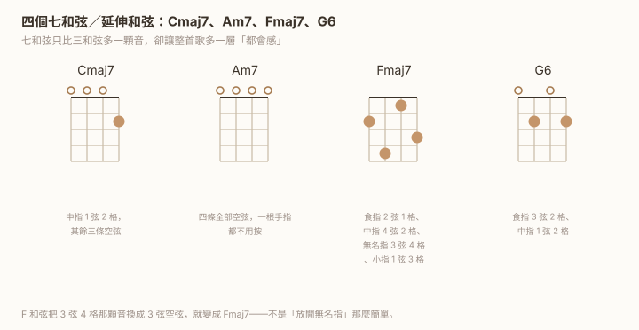
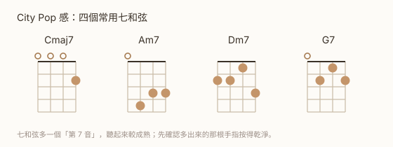

# 第 18 章：City Pop 與文青感秘訣：七和弦與延伸和弦

你有沒有發現，現在當紅的獨立樂團與都會創作歌手——例如落日飛車、9m88、韋禮安、告五人、Deca Joins——他們的歌聽起來總是有一種「微醺的都會夜色感」、「日系透明清新感」，或是「咖啡廳午後的慵懶文青味」？

秘密並不在於他們刷弦有多用力，而在於他們把傳統的「三和弦（Triads，如 `C`、`Am`、`F`、`G`）」升級成了帶有夢幻色彩的**七和弦（Seventh Chords）與延伸和弦（Extended Chords）**！最棒的是：在烏克麗麗上，這些聽起來超級高級的和弦，往往比原本的和弦**還要少按一根手指**！本章將帶你解鎖這套和弦美學魔法。

---

## 18.1 少按一根手指更高級：Maj7、m7、6、sus4、add9 解析

在樂理中，傳統三和弦是由「根音（1）、三度音（3）、五度音（5）」三個音堆疊而成，聽起來穩定、直接；當我們在上面多加一個「七度音（7）」、「六度音（6）」或「九度音（9，即高八度的 2）」時，和弦就會產生微妙的色彩張力，瞬間變得豐富立體。

請看下方烏克麗麗史上最驚喜的「減法魔法」和弦圖：

*(註：上圖第 3 個標準實用 **`Fmaj7`** 指法為：中指按第 4 弦第 2 格、食指按第 2 弦第 1 格、無名指按第 3 弦第 4 格、小指按第 1 弦第 3 格；若想體驗極簡文青版，還可使用 **`Fadd9`**（只按第 2 弦第 1 格，其餘三弦全空弦！），音色超級透明夢幻！)*

*圖：Cmaj7、Am7、Dm7、G7 只比三和弦多按一根手指，卻多出「成熟感」。*

### 六大文青色彩和弦聽覺個性與按法速查表

| 和弦代號 | 中文全名 | 左手精準按法 | 聽覺情緒色彩 | 取代傳統和弦的升級時機 |
| :--- | :--- | :--- | :--- | :--- |
| **Cmaj7** | C 大七和弦 | 中指（2）按第 1 弦第 2 格，其餘全空弦（比 `C` 往左退一格！） | 夢幻、透明、日系清新、微甜的浪漫感 | 取代 `C` 和弦（特別適合用在歌曲開頭與結尾） |
| **Am7** | A 小七和弦 | **四條弦全部空弦 `O`！**（比 `Am` 連中指都放開！） | 慵懶、都會夜色、R&B 與 City Pop 靈魂感 | 取代 `Am` 和弦，讓換和弦速度瞬間變零秒 |
| **Fadd9** | F 加九和弦 | **只用食指（1）按第 2 弦第 1 格**，其餘三弦全空弦（比 `F` 放開中指！） | 空靈、清澈如泉水、極具文青民謠感 | 取代 `F` 和弦，指法分解時特別好聽 |
| **G6** | G 大六和弦 | 食指（1）第 3 弦第 2 格、中指（2）第 1 弦第 2 格（比 `G` 放開無名指！） | 復古、爵士咖啡廳、輕鬆不沉重的解決感 | 取代 `G` 或 `G7` 和弦 |
| **Gsus4** | G 掛留四和弦 | 在 `G` 的基礎上，小指（4）加按**第 1 弦第 3 格** | 懸浮、期待、充滿呼吸感（常接回 `G` 製造旋律流動） | 放在 `G` 和弦的前兩拍：`Gsus4` → `G` |
| **Cadd9** | C 加九和弦 | 食指按第 3 弦第 2 格、無名指按第 1 弦第 3 格，其餘兩弦空弦（G–D–E–C） | 開闊、陽光微風、現代流行樂團最愛聲響 | 取代 `C` 和弦，刷弦時共鳴特別豐富立體 |

---

## 18.2 傳統三和弦升級為都會浪漫和弦進行對照

現在，我們來做一個令人驚豔的音樂實驗！請拿起你的烏克麗麗，先刷一遍傳統的 `C - Am - F - G`，再立刻刷一遍升級後的文青色彩版 **`Cmaj7 - Am7 - Fadd9 - G6`**，感受一下空氣中氛圍的瞬間轉變：

| 和弦進行 | 節奏／指法 |
| :--- | :--- |
| `C` → `Am` → `F` → `G` → `Cmaj7` → `Am7` → `Fadd9` → `G6` | — |

### 進階編曲小技巧：`sus4` 的呼吸魔法
在抒情歌的段落結尾（例如 `G` 和弦停留一整小節時），不要呆呆地刷滿 4 拍 `G`，試著把前兩拍換成 **`Gsus4`**（小指按住第 1 弦第 3 格），後兩拍再放開小指回到 **`G`**！你會立刻聽到一條優美的內聲部旋律線（`Do` → `Si`）在和弦裡面自動唱出來，這正是專業編曲師最愛用的秘密武器。

---

## 18.3 流行金曲實戰演練：都會文青風格曲目

### 實戰曲目一：韋禮安〈慢慢等〉（C 大調文青色彩版）

* **歌曲節奏**：4/4 拍，中慢板。
* **核心秘密**：韋禮安的早期民謠作品充滿大量透明清新的延伸和弦色彩。把主歌的傳統和弦替換成 `Cmaj7`、`Am7`、`Dm7`（在 `Dm` 基礎上小指加按第 1 弦第 3 格）、`G6`，整首歌的細膩度立刻提升一個檔次！

| 和弦進行 | 節奏／指法 |
| :--- | :--- |
| `Cmaj7` → `Am7` → `Dm7` → `G6` | — |
| `Cmaj7` → `Am7` → `Fadd9` → `Gsus4   G` | — |

### 實戰曲目二：告五人〈帶我去找夜生活〉（C 大調都會微醺改編版）

* **歌曲節奏**：4/4 拍，中速偏快（練習時先放慢）。
* **核心秘密**：這首充滿復古 Disco 與 City Pop 色彩的派對情歌，在烏克麗麗上移調為 **C 大調**並套用 **`Fmaj7`（或 `Fadd9`）→ `G6` → `Em7`（只按第 3 弦第 2 格與第 1 弦第 2 格，就是 `G6`！）→ `Am7`**，再搭配第 14 章學過的輕快 16 Beat 刷法或倫巴律動，一個人就能在客廳營造出整座城市的霓虹夜色！

| 和弦進行 | 節奏／指法 |
| :--- | :--- |
| `Fadd9` → `G6` → `Am7` | — |

---

### 本章重點檢查表
* [ ] 我已經學會按出 `Cmaj7`、`Am7`、`Fadd9`、`G6`、`Gsus4` 與 `Cadd9` 等色彩和弦。
* [ ] 我能聽出傳統三和弦與「七和弦／加九和弦」在聲音情緒上的差異，並懂得在抒情或文青曲風中替換使用。
* [ ] 我學會了在段落結尾運用 `Gsus4` → `G` 製造內聲部旋律流動感。