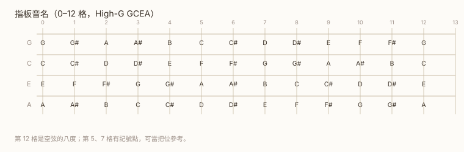
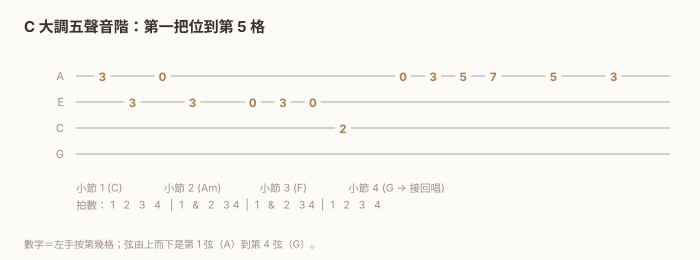
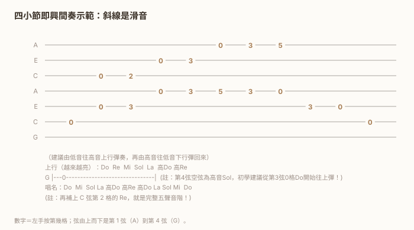

# 第 19 章：指板音階全解析與簡易間奏 Solo 設計

在前面十八章中，我們幾乎都在烏克麗麗指板的「第 0 格（空弦）到第 4 格（開放把位）」活動。但你看著指板上延伸到第 12 格、第 15 格的那些格子，是不是也很好奇：「上面那些格子究竟是什麼音？要怎麼像專業樂手一樣，在主歌與副歌之間自己編出一段好聽的單音旋律 Solo 過門？」

本章將為你揭開整張烏克麗麗指板的音名地圖，並教你一套就算完全不懂複雜樂理也能立刻上手的即興神器——**C 大調五聲音階（Pentatonic Scale）**！

---

## 19.1 烏克麗麗 1～12 格全指板音名地圖

要記住指板上所有格子的音名，千萬不要一格一格死背！我們只要運用第 2 章學過的「半音階規律（除了 `E-F` 與 `B-C` 差 1 格之外，其餘相鄰字母皆差 2 格）」，再搭配指板側邊的**白色音點記號（第 5、7、10、12 格）**作為路標，就能秒速推算出任何一格的音名！

| 弦 ＼ 格 | 0 | 1 | 2 | 3 | 4 | 5 | 6 | 7 | 8 | 9 | 10 | 11 | 12 |
| :--- | :-- | :-- | :-- | :-- | :-- | :-- | :-- | :-- | :-- | :-- | :-- | :-- | :-- |
| 1弦 A | A | · | B | C | · | D | · | E | F | · | G | · | A |
| 2弦 E | E | F | · | G | · | A | · | B | C | · | D | · | E |
| 3弦 C | C | · | D | · | E | F | · | G | · | A | · | B | C |
| 4弦 G | G | · | A | · | B | C | · | D | · | E | F | · | G |

*（「·」＝該格是升降半音，例如第 1 弦第 1 格是 A♯／B♭；第 12 格與空弦同名，高八度。）*

*圖：0–12 格的音名對照：第 12 格是空弦的八度，第 5、7 格可當把位參考。*

### 指板定位三大黃金路標（必背捷徑）
你不需要背下全部 48 個格子，只要先記住這三個超級路標：

1. **第 12 格（雙音點記號）**：是整條弦長度剛好一半的位置，音高比空弦**高整整一個八度**，音名與空弦一模一樣（由上往下依序還是 `G - C - E - A`）。
2. **第 5 格（第一個音點）**：由上往下依序是 **`C - F - A - D`**（注意看，這剛好就是你最熟悉的「F 大調核心三和弦＋D 音」）。
3. **第 1 弦的 La-Si-Do-Re-Mi-Fa-Sol-La**：因為第 1 弦最常用來彈主旋律，請務必熟記第 1 弦的音名位置：
   * `0格 = La(A)` → `2格 = Si(B)` → `3格 = Do(C)` → `5格 = Re(D)` → `7格 = Mi(E)` → `8格 = Fa(F)` → `10格 = Sol(G)` → `12格 = 高音La(A)`！

---

## 19.2 C 大調五聲音階把位與即興過門編寫技巧

當你想在歌曲間奏（Interlude）自己編一段 4 小節的單音 Solo 時，新手最怕「不小心按到不和諧的怪音」。這時，音樂史上最神奇的音階就派上用場了——**大調五聲音階（Major Pentatonic Scale）**！

### 為什麼五聲音階「怎麼彈都不會難聽」？
在傳統七聲音階（`Do Re Mi Fa Sol La Si`）中，最容易跟伴奏和弦打架、產生刺耳不和諧感的兩個音，就是**第 4 音 `Fa(F)`** 與**第 7 音 `Si(B)`**。五聲音階非常聰明地把這兩個「地雷音」全部拿掉，只留下最和諧、最順耳的五個黃金音符：**`Do (C)`、`Re (D)`、`Mi (E)`、`Sol (G)`、`La (A)`**！

### 3 步編出你的第一段流行歌間奏 Solo
下次在朋友聚會彈唱 C 大調的歌（例如〈小薇〉，或把〈稻香〉〈寶貝〉轉成 C 調彈），唱完第一段副歌進入間奏（`| C | Am | F | G |` 共 4 小節）時，試著照以下三個心法即興彈出單音旋律：

1. **長短音交錯（有呼吸感）**：不要每拍都塞滿音符！多使用「2 拍長音」搭配「兩個半拍短音」，模仿人聲唱歌換氣的語氣。
2. **句尾落在「和弦內音」上**：每個小節結束或第 4 小節結尾時，讓旋律穩穩停在 **`Do`（C 弦 0 格 或 A 弦 3 格）** 或 **`Sol`（E 弦 3 格）** 上，聽起來就會非常穩重、有完成感！
3. **加入第 11 章的滑音與錘音**：在 E 弦第 3 格滑向第 5 格，或在 C 弦做 `0H2`，立刻就會有專業吉他手 Solo 的味道！

---

### 本章重點檢查表
* [ ] 我能利用第 5、7、10、12 格音點記號，快速找出第 1 弦與第 2 弦上任何一格的音名。
* [ ] 我已經能流暢彈奏 C 大調五聲音階（`Do Re Mi Sol La`）的開放把位上行與下行。
* [ ] 我已經嘗試在 4 小節的 `C - Am - F - G` 伴奏循環中，自己編出一段簡單好聽的單音間奏旋律。