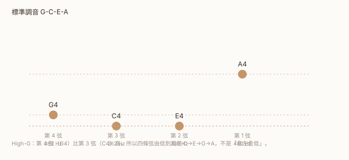
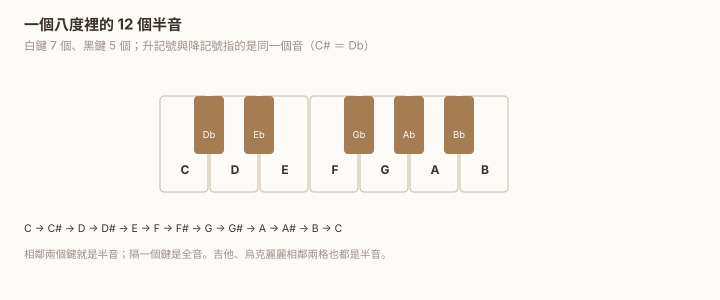

# 第 2 章：4 條弦的秘密與 30 秒精準調音

許多自學者剛買回烏克麗麗時，興沖沖地照著網路上的和弦圖按下去，結果刷出來的聲音卻怪腔怪調、完全不像流行歌。大多數情況下，問題並不出在你的手指，而是——**你的琴根本還沒調音！**

全新琴弦具有高度延展性，再加上環境溫度與濕度變化，烏克麗麗在每次拿起來練習前「走音」是完全正常的物理現象。專業樂手每次練琴的第一件事，永遠是花 30 秒調音。本章將帶你揭開烏克麗麗四條弦的獨特音高排列秘密，並教會你如何快速、安全地把音調準。

---

## 2.1 四條弦的編號與標準定弦（G-C-E-A）

請先把烏克麗麗抱在胸前（琴頭朝左、琴身朝右，指板面向前方）。從你低頭往下看的視角，這四條弦的編號與標準音名定義如下：

* **第 4 弦（最靠近你下巴、最上方那一條）**：音名為 **G**（唱名 Sol）
* **第 3 弦（由上往下數第二條）**：音名為 **C**（唱名 Do）
* **第 2 弦（由上往下數第三條）**：音名為 **E**（唱名 Mi）
* **第 1 弦（最靠近地板、最下方那一條）**：音名為 **A**（唱名 La）

口訣很好記：**「由上往下（第 4 弦到第 1 弦）是 G - C - E - A」**。

*圖：標準調音 G-C-E-A。High-G 的第 4 弦比第 3 弦高八度，所以四條弦由低到高不是「愈左愈低」。*

### 為什麼第 4 弦這麼細？揭開「高音 G（High G）」的秘密

如果你曾經看過木吉他，你會發現木吉他的六條弦是「由上往下越來越細、音高越來越低到高」整齊排列的。但當你仔細觀察烏克麗麗時，你會驚訝地發現：**最上面的第 4 弦（G），竟然比它下面的第 3 弦（C）還要細！**

這正是烏克麗麗靈魂音色的來源——**Re-entrant Tuning（回溯式定弦，俗稱 High G 調音）**。

| 弦號（由上至下） | 音名（科學音高記號） | 簡譜唱名（C大調） | 標準頻率（A4=440Hz） | 音高相對位置說明 |
| :--- | :--- | :--- | :--- | :--- |
| **第 4 弦（最上弦）** | **G4** | `5`（Sol） | **392.0 Hz** | **高音 G！比第 3 弦還高五度，賦予清脆跳躍感** |
| **第 3 弦** | **C4** | `1`（Do） | **261.6 Hz** | **全琴音高最低的弦（鋼琴中央 C）** |
| **第 2 弦** | **E4** | `3`（Mi） | **329.6 Hz** | 比中央 C 高大三度 |
| **第 1 弦（最下弦）** | **A4** | `6`（La） | **440.0 Hz** | **全琴音高最高的弦（國際標準音高基準）** |

正因為第 4 弦的音高（G4）高於第 3 弦（C4），當我們用右手從上往下刷過四條弦時，第一個聽到的音不是沉重的低音，而是一顆清亮晶瑩的高音 Sol，接著才落入穩定的 Do - Mi - La。這種「先亮後暖」的聲學排列，讓烏克麗麗自帶一股陽光、療癒、仿佛海風吹拂的獨特空氣感。（註：進階指彈玩家有時會將第 4 弦改裝為低八度的 `G3` 纏弦，稱為 Low G，這部分我們將在第 24 章詳細介紹。）

---

## 2.2 看懂音名與升降記號：調音器螢幕上的密碼

在打開調音器之前，我們只需要花一分鐘認識音樂世界裡的「7 個基本音名」與「半音階」。

西方音樂用七個英文字母代表音高，由低到高循環排列：
C (Do) → D (Re) → E (Mi) → F (Fa) → G (Sol) → A (La) → B (Si) → C（高八度 Do）

在這七個基本音之間，還夾著五個「半音」，就像鋼琴上的黑鍵一樣。我們用兩個符號來表示它們：

* **升記號 `#`（Sharp）**：代表比原本的音高半音。例如 `C#` 就是比 C 高半音。
* **降記號 `b`（Flat）**：代表比原本的音低半音。例如 `Bb` 就是比 B 低半音。

> **關鍵記憶點**：在七個基本音之中，**`E` 與 `F` 之間**、**`B` 與 `C` 之間**天生就只差半音，沒有黑鍵（所以沒有 `E#` 或 `B#`）。其他相鄰字母之間都隔著一個半音。

為什麼調音時一定要懂這個順序？因為當你撥響第 3 弦（目標音是 **C**），如果調音器螢幕顯示 **`B`**，對照上面的音階表，`B` 在 `C` 的左邊，代表你現在的音**偏低了**，你需要把弦轉緊；反之，如果螢幕顯示 **`C#`** 或 **`D`**，代表音**偏高了**，你需要把弦轉鬆！

---

## 2.3 調音器實戰四步驟與防斷弦安全守則

請將夾式調音器夾在烏克麗麗琴頭頂端（螢幕朝向自己），長按電源鍵開機。

### 步驟一：確認調音器模式
許多綜合型調音器內建多種樂器模式，請短按電源／功能鍵，將螢幕左下角或右下角的模式切換為 **`C`（Chromatic，十二平均律半音階模式（Chromatic））** 或 **`U`（Ukulele，烏克麗麗專用模式）**。

* 建議初學者直接使用 **`C`（十二平均律模式）**：它能顯示所有 12 個音名，幫助你清楚判斷目前的音到底是偏高還是偏低，而不受限於特定弦號。

### 步驟二：從第 4 弦（G）開始逐條撥響
用右手大拇指輕輕撥響第 4 弦（每次只撥一條弦，並用左手輕觸其他三條弦避免共振干擾），觀察調音器螢幕變化：

| 螢幕顯示狀態 | 代表意義 | 你的調整動作（面對琴頭視角） |
| :--- | :--- | :--- |
| **字母未到目標音**（例如目標 G，顯示 F#） | 音高嚴重偏低（琴弦太鬆） | 慢慢**轉緊**對應弦鈕，直到字母跳到 G |
| **字母正確（G），指針偏左（橘／紅色）** | 音高稍微偏低 | 微微**轉緊**弦鈕，讓指針往中央移動 |
| **字母正確（G），指針正中央（亮綠色）** | **音準正確！** | 停止轉動，進行下一條弦 |
| **字母正確（G），指針偏右（橘／紅色）** | 音高稍微偏高 | 先轉鬆一點讓指針降到中央左側，再**由低往高微調**回正中央 |
| **字母超過目標音**（例如目標 G，顯示 G# 或 A） | **危險！音高過高（琴弦過緊）** | **立刻轉鬆**弦鈕，降回目標音下方再重新往上調 |

### 步驟三：依序完成 C - E - A，並進行「第二輪複查」
照上述方式依序調好第 3 弦（C）、第 2 弦（E）、第 1 弦（A）。
**特別提醒**：當你把原本鬆弛的四條弦一一拉緊後，琴頸會受到新的拉力產生極微小的向前彎曲，這會導致最先調好的第 4 弦與第 3 弦音高又稍微下降了一點點。因此，**四條弦全部調完後，請務必再從第 4 弦到第 1 弦快速檢查第二輪**，確保四條弦都亮起綠燈。

### 新手防斷弦三大安全鐵則
1. **邊撥邊轉，絕不盲轉**：一定要撥響琴弦、看到螢幕有數字／指針跳動時，才慢慢轉動弦鈕。如果撥弦後螢幕沒反應（可能環境太吵或電池沒電），千萬不要一直轉緊，否則琴弦會在瞬間超過張力極限而崩斷。
2. **確認手指握對弦鈕**：調第 4 弦時，請順著琴弦延伸的方向確認它纏繞在哪一顆弦鈕上。新手最常犯的錯誤就是「撥響第 4 弦，手卻去轉第 3 弦的弦鈕」，結果螢幕上的音高完全沒變，越轉越緊就把第 3 弦轉斷了！
3. **「由低往高」鎖定音準**：如果音偏高了，先轉鬆到比綠燈稍微低一點點，再轉緊拉回綠燈位置。這樣能讓弦鈕齒輪緊密咬合，彈奏時比較不容易走音。

---

### 本章重點檢查表
* [ ] 我能不看書說出烏克麗麗由上往下（第 4 弦到第 1 弦）的標準音名：`G - C - E - A`。
* [ ] 我了解第 4 弦是「高音 G（G4）」，比第 3 弦（C4）音高還高。
* [ ] 我已經能不靠他人協助，在 1 分鐘內獨自用調音器將四條弦調出綠燈。