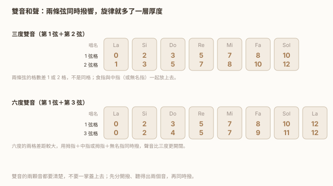
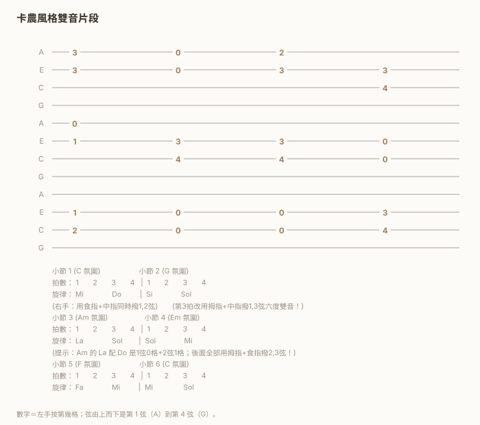

# 第 20 章：雙音和聲與旋律美化

這一篇我們進入第五篇——指彈演奏（Fingerstyle）的世界！

在上一章，我們學會了彈奏單音旋律。但你可能發現：單音旋律雖然清脆，在烏克麗麗上聽起來卻略顯單薄，就像一個人獨自清唱；如果我們能讓右手兩根手指**同時撥響兩條琴弦**，讓一條弦唱主旋律、另一條弦唱和聲合音，整段旋律就會瞬間變得厚實飽滿，就像雙人二重唱一樣動聽！

本章將帶你學習流行編曲中最常用、最悅耳的兩種和聲距離——**三度音程（3rds）**與**六度音程（6ths）**雙音演奏技巧。

---

## 20.1 三度音程與六度音程雙音指法配置

在音樂中，兩個音同時發聲的音高距離稱為「音程（Interval）」。在所有音程之中，聽起來最甜美、和諧、充滿流行情歌和聲感的，正是**三度音程**（例如 `Do` 配 `Mi`）與**六度音程**（例如 `Mi` 配高音 `Do`）。

### 一、雙音右手撥弦手勢
彈奏雙音時，右手大拇指（`T`）與食指（`1`）或中指（`2`）同時向掌心方向輕輕捏合撥弦（像用兩根手指輕輕捏起一顆珍珠），**務必確保兩條弦在「同一毫秒」發聲**，音量均衡，不要彈成一前一後的琶音。

### 二、C 大調雙音音階指型表（最實用的 1 弦＋2 弦三度雙音）
請看下方這組雙音音階，它全數集中在最明亮的 **第 1 弦（高音旋律）** 與 **第 2 弦（低音合音）** 上，只要記住「第 2 弦比第 1 弦多 1～2 格」的規律，就能在指板上移動。

*(規律：大三度時第 2 弦比第 1 弦多 1 格、小三度多 2 格；換調時整組一起平移。)*

### 三、六度雙音指法（第 1 弦＋第 3 弦同時撥響）
六度雙音的音域跨度更寬廣，聽起來充滿古典浪漫與電影配樂的史詩感，右手用**大拇指撥第 3 弦、中指（或無名指）撥第 1 弦**：

---

## 20.2 實戰練習：卡農風格的雙音片段

現在，我們把剛學會的三度與六度雙音，放進一段卡農風格的進行裡，體驗一個人彈出二重奏的立體效果！

---

### 本章重點檢查表
* [ ] 我在撥奏雙音時，兩根手指能精準同時觸弦，使兩個音同時響起且音量平衡。
* [ ] 我記住了第 1 弦與第 2 弦三度的平移規律：第 2 弦比第 1 弦多 1～2 格。
* [ ] 我已經能流暢演奏卡農風格的雙音片段。