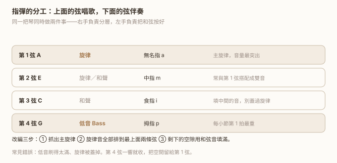
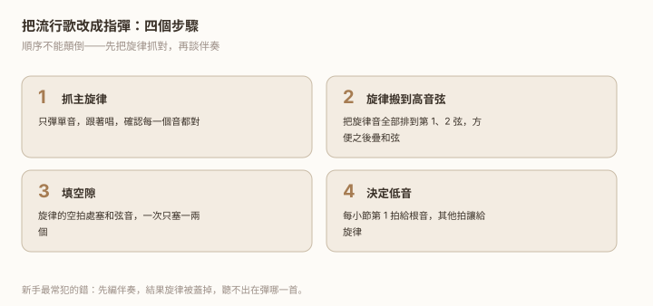
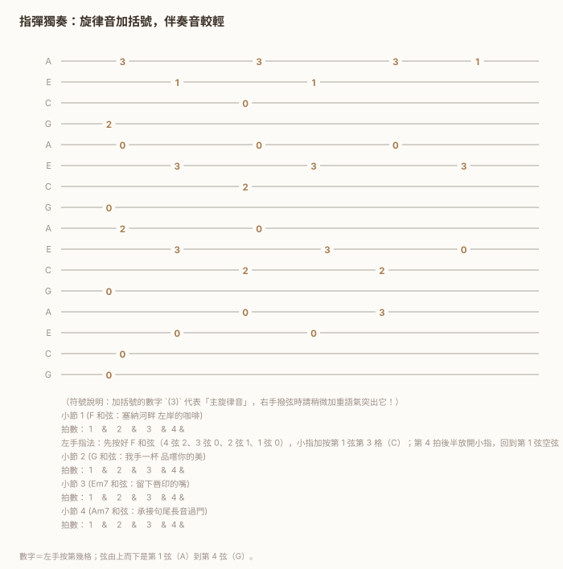

# 第 21 章：指彈演奏（Fingerstyle）入門：一邊彈旋律、一邊伴奏

如果你有時候不想開口唱歌，只想在安靜的夜晚泡一杯茶，用烏克麗麗獨自演奏出一首讓人一聽就認出來的流行金曲，那麼你一定要愛上**指彈演奏（Fingerstyle）**！

什麼是指彈演奏？簡單來說，就是**「一個人就是一支小型樂團」**——你用右手的高音手指（食指、中指、無名指）在較細的琴弦上彈出「主唱的歌聲旋律」，同時用右手大拇指（`T`）負責第 4 弦的低音、其餘手指在空拍處補上內聲部的伴奏音。本章將帶你拆解指彈編曲的底層邏輯，並完成你的第一首流行歌指彈獨奏！

---

## 21.1 Fingerstyle 核心思維：高音旋律線＋低音和聲伴奏

許多初學者看到指彈四線譜上密密麻麻的數字就頭皮發麻，其實任何一首指彈曲都可以拆解成兩層簡單的結構：

1. **主角層（Melody 主旋律線）**：永遠位在**「同時撥響的那幾個音裡面，音高最高的那一顆音」**（通常分佈在 **第 1 弦** 與 **第 2 弦**）。就像合唱團裡的女高音，你的右手無名指（`3`）或中指（`2`）在撥響主旋律音時，力道比其他伴奏音稍微飽滿，讓旋律音浮出伴奏，讓旋律線清晰地浮現在最上層！
2. **配角層（Accompaniment 和弦伴奏音）**：位在主旋律下方的音符（通常分佈在 **第 4 弦、第 3 弦、第 2 弦**）。它們負責在主旋律的空拍處填補和聲，力道要輕柔如微風，千萬不能喧賓奪主蓋過主旋律。

---

## 21.2 流行歌改編指彈四步驟

只要掌握以下四個邏輯步驟，未來你甚至可以自己把任何喜歡的流行歌改編成烏克麗麗獨奏曲：

| 編曲步驟 | 具體執行動作 | 核心原則與注意事項 |
| :--- | :--- | :--- |
| **第一步：抓出單音主旋律** | 在第 1 弦與第 2 弦（高音區）找出歌曲的單音主旋律，並標註節拍 | 確保每個音都落在正確的拍點上，先把旋律單獨彈熟 |
| **第二步：套入對應和弦指型** | 對照該小節原本的伴奏和弦（如 `C`、`Am`、`F`、`G`），讓按旋律的手指順便構成和弦指型 | 盡量使用與主旋律音位置重疊的和弦指法，減少左手跨度 |
| **第三步：在每小節第 1 拍「合奏」** | 在每小節第 1 拍主旋律音落下的同時，大拇指順勢撥響和弦根音（或用大拇指由上往下爬音同時刷過） | 這一瞬間的「和弦＋旋律齊鳴」是指彈曲最飽滿動聽的時刻 |
| **第四步：用分解音填補長音空隙** | 當主旋律遇到 2 拍或 4 拍的長音停頓時，利用右手空閒手指撥出 `3-2-3` 等分解音填補節奏空檔 | 填補音的音量務必保持輕柔（明顯輕於主旋律，當作背景填充） |

---

## 21.3 完整指彈實戰曲：周杰倫〈告白氣球〉（入門獨奏 Fingerstyle 版）

這首甜度爆表的現代經典情歌，副歌旋律線條優美且重複性高，非常適合作為人生第一首 Fingerstyle 獨奏曲！我們將它改編為最友善的 **C 大調**，並用括號 **`( )`** 標示出需要特別彈響亮的「主旋律音」。

### 練習這首指彈曲的黃金秘訣
1. **先單練最上面兩條弦的括號音**：把括號裡的數字（`3 - 3 - 3 - 1 | 0 - 0 - 0 - 3 | 2 - 0 - 3 - 0`）單獨用右手撥一遍，確認你耳朵已經聽出「塞納河畔、左岸的咖啡」這句旋律了。
2. **再把伴奏音輕輕放進去**：加上中間的伴奏音後，想像你的無名指是拿著麥克風的主唱，大拇指與食指是站在舞台後方的伴奏樂手，永遠讓「主唱」的聲音最清晰立體！

---

### 本章重點檢查表
* [ ] 我理解指彈演奏中「突出最高音主旋律、輕柔處理中間伴奏音」的音量層次分配。
* [ ] 我在同時撥響第 1 弦與第 4 弦（如小節 1 第 1 拍）時，兩根手指能準確同步發聲。
* [ ] 我已經能流暢演奏〈告白氣球〉副歌這 4 小節的指彈獨奏片段。