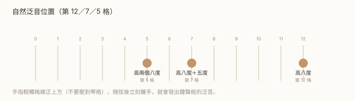
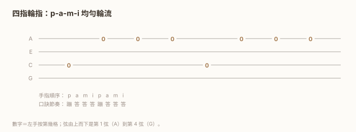
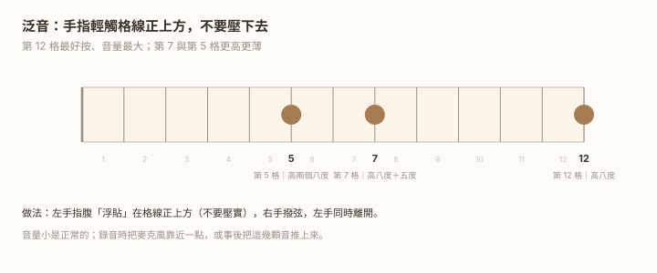

# 第 22 章：進階華麗技巧：輪指（Tremolo）與自然泛音（Harmonics）

當你開始演奏指彈獨奏曲（Fingerstyle）時，你很快會發現烏克麗麗因為琴身小、尼龍弦張力低，單音的「延音時間（Sustain）」比鋼琴或電吉他短得多——撥下去大約兩三秒後聲音就慢慢消失了。

那麼，指彈大師們是怎麼在烏克麗麗上營造出「如小提琴般綿延不絕的浪漫長音」，以及「如八音盒水晶鐘聲般清脆夢幻的結尾音效」呢？答案就是本章的兩大炫技神招——**輪指（Tremolo）**與**自然泛音（Harmonics）**！

---

## 22.1 右手四指輪撥（a-m-i-p）綿延長音訓練

輪指（Tremolo，又稱震音奏法）源自古典吉他（曼陀林則是用撥片震音達到類似效果），它的原理是利用右手手指**極快速、均勻地輪流撥動同一條琴弦**，讓人耳產生「這顆音符正在持續不斷發聲」的聽覺錯覺，特別適合用來演奏浪漫抒情慢歌的高潮長音！

*圖：第 12 格是高八度、第 7 格高八度＋五度、第 5 格高兩個八度；手指輕觸格線正上方就別壓。*

### 烏克麗麗經典四指輪指順序：`p - a - m - i`（大拇指 → 無名指 → 中指 → 食指）
* **`p`（大拇指 Thumb）**：先撥響低音伴奏弦（標準 High-G 下最低音是第 3 弦 C；Low-G 調音時第 4 弦 G3 才是最低）。
* **`a`（無名指 Ring）** → **`m`（中指 Middle）** → **`i`（食指 Index）**：緊接著由無名指、中指、食指**依序在同一條高音旋律弦（例如第 1 弦）上快速往上勾撥三下**！

### 輪指練成「顆粒均勻」的三大秘訣
1. **慢速建立肌肉獨立性（切忌一開始就求快！）**：無名指（`a`）天生最不靈活，新手最容易彈成「蹦—答答—答（跛腳馬蹄聲）」。請把節拍器開到 **BPM = 50**，一拍一顆音，嚴格要求 `p`、`a`、`m`、`i` 四下音量與間隔時間百分之百相等，像機關槍一樣整齊。
2. **手指動作幅度極小化**：勾弦時手指只需在琴弦上方 3～5 毫米的微小空間內輕巧勾過，勾完立刻放鬆歸位，千萬不要把手指高高抬起。
3. **左手按住和弦做輪指和聲練習**：按住 `C` → `Am` → `F` → `G7`，用 `p` 撥第 3 弦（或第 4 弦），`a-m-i` 輪撥第 1 弦，你會立刻聽到宛如夏威夷海風吹拂的浪漫曼陀林交響曲！

---

## 22.2 第 12、7、5 格清脆自然泛音觸弦要領

**自然泛音（Natural Harmonics，譜面常標示為 `Harm.` 或在數字旁加上菱形符號 `<12>`、`◇12`）**是烏克麗麗最迷人的聲學魔術。它能發出比原本音高更高的純淨泛音（第 12 格高八度、第 7 格高八度＋五度、第 5 格高兩個八度）、純淨透明、宛如音樂盒或水晶風鈴般的夢幻音色，最常被拿來當作歌曲結尾（Ending）的最後一個和弦！

### 泛音發聲的物理秘密與四步操作法
琴弦在震動時，除了整條弦一起擺動之外，在弦長的 **1/2 處（第 12 格）**、**1/3 處（第 7 格）** 與 **1/4 處（第 5 格）** 存在著「駐波節點」。只要我們在這些節點正上方輕觸琴弦，就能過濾掉厚重的基頻，只留下清脆純淨的高次泛音！

1. **找準「金屬條正上方」（注意：與一般按弦完全不同！）**：
   * 一般按弦是按在「金屬條內側的木頭格子裡」；但彈奏自然泛音時，左手手指必須**精準放在「第 12 條金屬條（或第 7 條、第 5 條金屬條）的正上方正中央」**！

2. **「蜻蜓點水」般輕觸，絕對不要把弦壓到指板上！**：
   * 左手食指（或無名指）指腹只需要**輕輕碰觸在琴弦表面**（剛好感覺到琴弦貼著皮膚即可，琴弦完全不能往下陷碰到木頭指板）。

3. **右手靠近琴橋撥弦（音色更清亮）**：
   * 右手大拇指（或食指）在比平常更靠近琴橋的位置果斷撥響琴弦（力道比平常稍微明確一點）。

4. **關鍵毫秒——「撥響後立刻放開左手！」**：
   * 就在右手撥響琴弦的 **0.05 秒後，左手輕觸的手指立刻垂直離開琴弦**！如果你一直按著不放，泛音的震動很快就會被手指吸收掉；只有立刻放開，那顆如水晶般的鐘聲才會持續在空氣中迴盪好幾秒！

| 自然泛音位置 | 琴弦長度比例 | 實際發出音高（以第 1 弦 A 為例） | 難度與實用建議 |
| :--- | :--- | :--- | :--- |
| **第 12 格金屬條正上方** | 1/2 弦長 | 比空弦**高 1 個八度**（高音 A5） | **最容易成功、音量最大！** 強烈建議從第 12 格開始練習，四條弦依序爬音泛音超級夢幻 |
| **第 7 格金屬條正上方** | 1/3 弦長 | 比空弦**高 1 個八度＋五度**（高音 E6） | 音色極度清脆空靈，撥弦位置稍微靠近琴橋會更容易響 |
| **第 5 格金屬條正上方** | 1/4 弦長 | 比空弦**高 2 個八度**（超高音 A6） | 音高極高，需要最精準的金屬條正上方定位與更果斷的撥弦力道 |

### 歌曲結尾（Ending）神技：C 大調泛音收尾
下次當你彈完任何一首 C 大調的歌（例如〈寶貝〉，或轉成 C 調彈的〈小幸運〉），在最後一小節結尾時，不要只彈普通的 `C` 和弦，試著這樣收尾：

1. 先按住 `C` 和弦 slow 慢速爬音刷一下（2 拍）。
2. 第 3、4 拍左手迅速移到**第 12 格金屬條正上方**輕觸四條弦，右手大拇指由上往下輕輕刷過第 4 → 3 → 2 → 1 弦並**左手同步放開**！
3. 四顆宛如八音盒般晶瑩剔透的泛音（高音 `G - C - E - A`）在空氣中緩緩散開，保證讓現場所有聽眾瞬間驚呼！

---

### 本章重點檢查表
* [ ] 我能用慢速（BPM = 50）均勻彈出 `p - a - m - i` 四指輪指，無名指與中指的音量與間隔一致。
* [ ] 我知道自然泛音必須輕觸在「第 12 / 7 / 5 格金屬條正上方」，且撥響後左手要立刻離開琴弦。
* [ ] 我已經能成功彈出第 12 格四條弦的清脆自然泛音，並運用在歌曲結尾。

