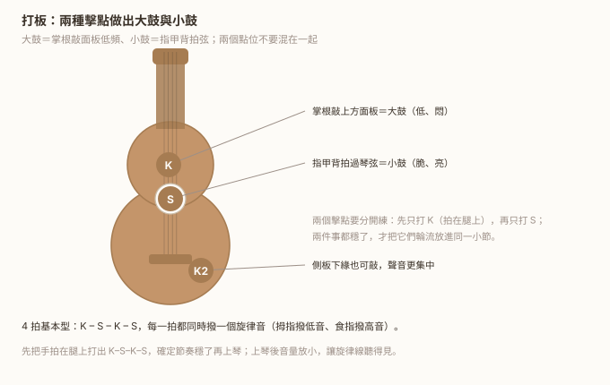
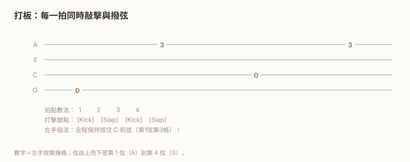

# 第 23 章：現代打板指彈（Percussive Fingerstyle）入門

你在社群媒體上看過現代指彈吉他或烏克麗麗大神（如 Sungha Jung、Jake Shimabukuro 或現代街頭演奏家）的影片嗎？他們明明只有一個人抱著一把琴，卻能一邊彈出悠揚的主旋律、一邊用右手在琴身上敲出「咚！滋！咚！滋！」的爵士鼓節奏，整把樂器彷彿瞬間化身為一支三人編制的迷你樂團！

這就是現代木吉他與烏克麗麗界最酷炫的表演風格——**打板指彈（Percussive Fingerstyle）**。本章將為你揭開琴身打擊點的聲學秘密，並帶你學會基礎的「大鼓（Kick）＋小鼓（Snare）」邊彈邊敲協調術！

---

## 23.1 大鼓（Kick）與小鼓（Snare）面板敲擊點位解析

要在小小的烏克麗麗上模擬出爵士鼓的層次，我們需要利用右手的不同部位，敲擊琴身上共鳴特性截然不同的兩個區域：

### 一、模擬「大鼓重低音（Kick Drum）」——手腕掌根敲擊面板
* **敲擊部位**：右手手腕下方最厚實的**掌根肉墊（小魚際肌底部）**。
* **最佳面板點位**：位於**響孔與琴橋之間的面板中央**（低頻最飽滿的位置）。
* **發聲原理**：用掌根肉墊輕快而有彈性地點擊面板，會激發琴身內部空氣柱的低頻共鳴，發出沉穩厚實的「咚（Boom）！」聲。**切記：敲擊後手腕要像拍籃球一樣立刻彈起，絕對不能壓死在面板上**，否則會把木頭的共鳴悶死！

### 二、模擬「小鼓清脆聲（Snare Drum）」——指甲背／指關節敲擊琴弦或側板
在烏克麗麗打板中，小鼓重拍（第 2 拍與第 4 拍）有兩種常見且超帥的打法：

1. **Slap 拍弦打板（譜面記號：`X` 或 `⊗`）**：右手大拇指側面（或食指中指指背）像甩鞭子一樣往下拍擊指板末端的琴弦，讓琴弦瞬間撞擊第 12～14 格的琴衍金屬條，發出清脆響亮的「啪滋（Slap）！」金屬打擊聲。
2. **面板邊緣敲擊（Nail Tap）**：用右手中指或無名指的指甲背，輕敲響孔下方的面板邊緣，發出清脆的「喀！」聲。

| 模擬鼓件 | 常用譜面記號 | 右手敲擊部位 | 烏克麗麗最佳敲擊位置 | 發聲要領與注意事項 |
| :--- | :--- | :--- | :--- | :--- |
| **大鼓 (Kick)** | `K` 或 `●`（低音區） | 右手掌根肉墊 | 響孔與琴橋之間的面板中央 | 手腕放鬆點敲、**觸板即彈起**，利用共鳴箱發出低沉「咚！」聲 |
| **小鼓 (Snare / Slap)** | `S` 或 `⊗` | 右手大拇指側邊 / 中指指甲背 | 指板末端第 12～14 格琴弦上方 | 果斷拍擊琴弦撞擊琴衍，發出清脆「啪滋！」聲，同時切斷上一拍餘音 |

---

## 23.2 邊彈旋律邊打板的協調練習

打板指彈最令人著迷、也最具挑戰性的地方，在於**「你的右手要在同一瞬間完成兩件事：一邊用掌根敲大鼓（或拍小鼓），一邊用手指把主旋律音撥出來！」**

### 兩大核心協調動作訓練（無需樂譜，直接上手！）

#### 動作一：大鼓（Kick）＋ 大拇指撥弦同步（`K + T`）
1. 左手按住最簡單的 `C` 和弦（第 1 弦第 3 格）。
2. 右手準備在響孔上方：當你的**右手掌根往下敲擊響孔上方面板（「咚！」）的同一瞬間，右手大拇指順勢往下撥響第 4 弦（或第 3 弦）**！
3. 你會同時聽到低沉的「咚！」大鼓聲與清亮的和弦音一起響起！

#### 動作二：小鼓拍弦（Slap）＋ 食指彈出旋律同步（`S + 1`）
這招是現代打板指彈的靈魂神技（稱為 **Slap & Flick**）：

1. 當你用大拇指側邊往下拍擊第 4、3 弦製造「啪滋！」小鼓聲的同一瞬間，彎曲的**右手食指（或中指）指甲背順勢向上勾出（Flick）第 1 弦或第 2 弦的旋律音**！
2. 練習節奏循環：跟著 BPM = 65 的節拍器，反覆練習這 4 拍基本律動：
   * **第 1 拍**：掌根敲大鼓 ＋ 拇指撥第 4 弦（`咚 + 弦`）
   * **第 2 拍**：拇指拍小鼓 ＋ 食指彈第 1 弦（`啪 + 旋律`）
   * **第 3 拍**：掌根敲大鼓 ＋ 拇指撥第 3 弦（`咚 + 弦`）
   * **第 4 拍**：拇指拍小鼓 ＋ 食指彈第 1 弦（`啪 + 旋律`）

*(一旦你練會這個 4 拍動作，把左手的 `C` 換成 `Am` → `F` → `G7`，你一個人就可以直接用打板指彈伴奏演唱〈寶貝〉或〈稻香〉了，現場效果很有臨場感！)*

---

### 本章重點檢查表
* [ ] 我用掌根敲擊面板模擬大鼓（Kick）時，手腕能做到「觸板即彈起」，發出厚實不沉悶的低頻共鳴。
* [ ] 我能做出清脆的琴弦拍擊小鼓（Slap）音效，不會用力過猛拍傷琴身面板。
* [ ] 我已經能完成「1 拍大鼓＋撥弦、2 拍小鼓＋彈旋律」的 4 拍基礎打板循環。