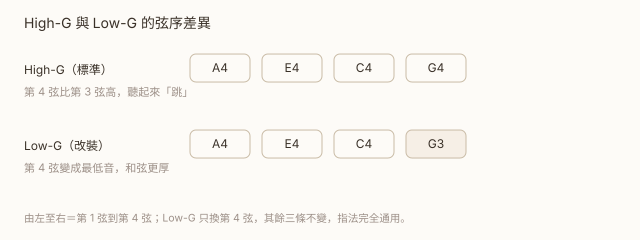

# 第 24 章：Low G 弦改裝與雙人合奏（重奏）玩法

當你彈烏克麗麗一段時間後，你一定會在網路上聽到一些音色特別深沉、醇厚、甚至有點像古典吉他的烏克麗麗獨奏影片，影片標題常常寫著「**Low G Ver.**」。許多成人玩家在接觸一段時間後，都會考慮為自己準備第二把烏克麗麗，改裝成 **Low G 定弦**，或者在與朋友聚會時來一場「一把 High G ＋ 一把 Low G」的雙人重奏！

本章將帶你徹底搞懂 High G 與 Low G 的聲學差異與改裝要領，並傳授朋友聚會時讓兩人合奏不打架、層次感翻倍的聲部編排心法！

---

## 24.1 High G 與 Low G 音色、音域及曲風適用全面比較

在第 2 章我們提過，標準烏克麗麗的第 4 弦是「高音 G（`G4`，392.0 Hz）」，比第 3 弦（`C4`）還要高。而所謂的 **Low G 改裝**，就是把原本細細的第 4 弦拆掉，換上一條專用的**「低音第 4 弦（`G3`，196.0 Hz，比原本整整低了一個八度！）」**，通常這條弦的外層會纏繞一層細金屬絲（纏弦 Wound String）來增加質量與低頻共鳴。

換上 Low G 之後，烏克麗麗的四條弦就變成了從上往下（第 4 弦到第 1 弦）**音高由低到高整齊排列（`G3 - C4 - E4 - A4`，稱為 Linear Tuning 線性定弦）**，有效音域往下整整拓展了五度（多了低音 `G3, A3, B3` 三個寶貴的音符）！

| 比較維度 | 標準 High G 定弦（G4 - C4 - E4 - A4） | 改裝 Low G 定弦（G3 - C4 - E4 - A4） |
| :--- | :--- | :--- |
| **第 4 弦音高與外觀** | 高音 G（`G4`），透明碳纖維／尼龍單絲弦 | **低八度 G（`G3`）**，較粗、外層常有銀色／金色金屬纏絲 |
| **整體音色個性** | 明亮、跳躍、陽光、充滿夏威夷海島空氣感 | **溫暖、深沉、醇厚**，接近迷你古典吉他的細膩質感 |
| **最佳適用曲風** | 輕快民謠刷弦、雷鬼、切音、日式清新小品 | **深情男聲流行歌、現代 Fingerstyle 獨奏、古典改編** |
| **和弦指法相容性** | **100% 通用！**（Low G 只是把原本的高音 G 變成低音 G，本書所有和弦圖與刷法完全不需修改） | **100% 通用！**（但部分專為 High G 設計的特殊指彈曲旋律線可能會變成低音） |
| **改裝注意事項** | 原廠出廠標準配置，不需調整 | 部分平價琴的上弦枕第 4 弦凹槽較窄，換裝較粗的 Low G 弦時可能需用細砂紙稍微拓寬凹槽 |

> **成人玩家選購建議**：如果你未來打算擁有兩把烏克麗麗，最夢幻的配置就是**「一把 23 吋 Concert 維持標準 High G（專門用來刷弦彈唱輕快歌），另一把 26 吋 Tenor 改裝 Low G（專門用來彈深情抒情歌與 Fingerstyle 獨奏）」**！

---

*圖：Low-G 只換第 4 弦：High-G 的第 4 弦比第 3 弦高，Low-G 則變成最低音，指法不變。*

## 24.2 雙人合奏聲部編排心法（低把位節奏＋高把位 Triads）

當你跟朋友都有烏克麗麗，聚會時想一起合奏同一首流行歌，新手最常犯的錯就是：**兩個人坐在旁邊，按一模一樣的低把位和弦、刷一模一樣的民謠搖滾刷法**。這樣彈起來不僅音量吵雜、頻率全部擠在一起，而且只要一個人稍微搶拍，聽起來就會像車禍現場！

要讓兩把烏克麗麗彈出宛如交響樂團般的立體層次，請嚴格執行**「高低音域分工法則（一把負責地板、一把負責天空）」**：

### 角色 A：節奏伴奏手（負責地板——低把位飽滿和聲與律動）
* **武器配置**：使用我們全書學過的**第 1～3 格開放把位和弦**（`C, Am, F, G`），負責打出穩定的民謠搖滾刷法、切音或慢靈魂節奏，穩穩撐住整首歌的節拍骨架。

### 角色 B：高把位和聲／旋律手（負責天空——高把位三和弦 Triads 與過門）
* **武器配置**：避開第 1～3 格！改用**第 5～10 格的三和弦**，用清脆的撥弦、雙音或切音反拍點綴，與角色 A 形成「高低音域對話」。

高把位三和弦不是新和弦，就是**同一組音換一個八度再按一次**。只有一條原則：指型整組往琴身方向移 N 格，聲音就升 N 個半音。下面四組的每一個音都逐一核對過音名：

| 和弦 | 低把位（撥 4、3、2 弦） | 實際音 | 高把位（撥 3、2、1 弦） | 實際音 |
| :--- | :--- | :--- | :--- | :--- |
| `C` | 第 4 弦 0 格、第 3 弦 0 格、第 2 弦 0 格 | G–C–E | 第 3 弦 7 格、第 2 弦 8 格、第 1 弦 7 格 | G–C–E |
| `Am` | 第 4 弦 2 格、第 3 弦 0 格、第 2 弦 0 格 | A–C–E | 第 3 弦 9 格、第 2 弦 8 格、第 1 弦 7 格 | A–C–E |
| `F` | 第 4 弦 2 格、第 3 弦 0 格、第 2 弦 1 格 | A–C–F | 第 3 弦 5 格、第 2 弦 5 格、第 1 弦 3 格 | F–A–C |
| `G` | 第 3 弦 2 格、第 2 弦 3 格、第 1 弦 2 格 | D–G–B | 第 3 弦 7 格、第 2 弦 7 格、第 1 弦 5 格 | G–B–D |

三件事要記住：

1. **只撥你按的那三條弦。** 高把位這幾組都落在第 3、2、1 弦，第 4 弦不撥，或用右手掌根輕輕蓋住止音。
2. **同一組音，只是換八度。** 低把位 C 是 G–C–E，高把位 C 也是 G–C–E。所以角色 A 刷 `C` 的時候，角色 B 按上表的高把位 `C` 一定和得起來。
3. **自己驗算一次。** 把 `G` 的第 3·2·1 弦指型（2·3·2 格）整組往琴身移 5 格，就變成 7·8·7 格——正是上表的高把位 `C`。移 N 格升 N 個半音，這條在整條指板上都成立，換調時照樣能用。

> **為什麼要搬去高把位？** 兩把琴都待在第 1～3 格，頻率會全部擠在一起，愈刷愈吵。把其中一把搬到第 5～10 格，音域就錯開了：一把當地板，一把當天空。

### 雙人合奏三種超好聽互動模式
1. **主歌對話模式**：角色 A 用指法分解彈伴奏，角色 B 完全不刷弦，改用第 19 章學過的**五聲音階**在句尾空隙彈出 2 個音符的單音回應（Call & Response）。
2. **副歌高低立體模式**：角色 A 在低把位刷民謠搖滾，角色 B 在高把位（第 5～10 格）用雷鬼反拍短促上刷（`&` 拍點綴），兩把琴的音域完全錯開，聽起來就像有木吉他＋電吉他合奏！
3. **終曲泛音合鳴**：歌曲最後一小節，角色 A 在低把位慢速爬音刷出 `C` 和弦，角色 B 同時在第 12 格彈出清脆自然泛音，畫下完整的句點！

---

### 本章重點檢查表
* [ ] 我了解 High G（清脆明亮）與 Low G（溫暖深沉、低八度第 4 弦）的音色與曲風定位差異。
* [ ] 我知道高把位三和弦是同一組音換八度，而且能用「移 N 格升 N 個半音」自己算出按法（例如 `G` 的 3·2·1 弦指型上移 5 格就是 `C`）。
* [ ] 我已經能與另一位琴友進行「一低一高、聲部錯開」的雙人流行曲合奏。