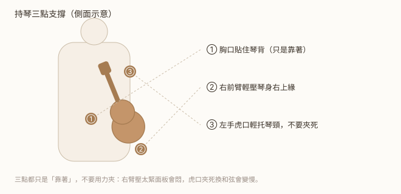

# 第 3 章：不酸痛的持琴姿勢與左右手發力

調好音之後，許多人迫不及待就想直接按和弦刷下去。但在這之前，請先給自己 10 分鐘建立正確的「人體工學姿勢」。

為什麼這 10 分鐘如此重要？因為成年人學琴最常放棄的兩個原因——**「左手虎口與手腕酸痛」**以及**「琴身一直往下滑、感覺要掉下去」**——多半與第一天的抱琴姿勢有關與發力方式錯了。一旦錯誤的肌肉記憶形成，日後要花更多時間刻意練習才能矯正。本章將教你最省力、最自然的持琴與左右手基本功。

---

## 3.1 成人居家抱琴法：不用背帶也能穩如泰山的「三點定位」

烏克麗麗體積小、重量輕，沒有木吉他那麼大的琴身可以穩穩架在大腿上，因此新手常會不自覺地用「左手死命托住琴頸」來防止琴滑落。這麼做的後果就是：你的左手一被綁架去托琴，手指就再也無法靈活移動換和弦了！

正確的抱琴方式，是利用**胸口、右手前臂、左手虎口**建立「三點支撐定位」，讓左手完全解放：

1. **貼近胸口（第一支撐點）**：坐在椅子或沙發前緣，背脊自然挺直，將烏克麗麗的琴身背板平貼在你的右胸口（或肚臍上方）位置。琴頭自然朝向左前方，與地面呈約 **15 至 30 度微向上傾斜**（切忌琴頭垂向地面，那會讓左手腕極度扭曲）。
2. **前臂夾持（第二支撐點）**：將你的右手手臂自然垂下，用**右手前臂內側（靠近手肘下方約 5～10 公分處）**輕輕夾住琴身右下緣的弧度，將琴身穩定地壓向胸口。
3. **虎口輕托（第三輔助點）**：這時你會發現，即使你的左手完全放開，烏克麗麗依然穩穩地夾在你的右手臂與胸口之間！此時再將左手輕輕抬起，讓琴頸自然落在左手拇指指腹與食指根部之間即可。

---

*圖：三點都只是「靠著」：胸口、右前臂、左手虎口；任何一點用力夾緊都會讓音色變悶、換和弦變慢。*

## 3.2 左手按弦黃金法則：如何按出飽滿不打品的聲音？

當你用左手手指按住某一格琴弦並撥響時，如果發出的不是清脆的樂音，而是「噗噗」的悶音，或是伴隨「滋滋」的金屬雜音（俗稱**打品 / 打弦**），請立刻檢查以下四個關鍵細節：

### 1. 指尖垂直指板，留出「半圓形通道」
左手手指的**第一關節（最靠近指甲的關節）必須保持彎曲**，用指尖肉墊最頂端垂直壓在琴弦上，切忌手指關節塌陷、用指腹「躺平」按弦。如果手指躺平，指腹底下的肉就會不小心碰到下方相鄰的琴弦，導致其他弦發不出聲音。

### 2. 黃金位置：緊貼「琴衍金屬條內側」
這是最重要的省力秘訣！假設我們要按「第 3 格」，第 3 格是由「第 2 條金屬條」與「第 3 條金屬條」圍成的木頭格子。

* **錯誤按法**：按在格子正中央，或靠近上方（第 2 條金屬條）。這會導致琴弦與第 3 條金屬條接觸不夠緊密，不僅需要花雙倍力氣，還極易產生「滋滋」打品雜音。
* **正確按法**：按在**靠近下方（第 3 條金屬條）內側約 2～3 毫米處**（但不要直接壓在金屬條正上方，否則聲音會變悶）。這個位置只需花一半的力氣，就能讓琴弦緊密貼合琴衍，發出最清亮飽滿的聲音。

### 3. 大拇指位置與「虎口留空」
左手大拇指應該自然貼在琴頸背面的中線位置（約在食指與中指正後方），作為施力的支點。掌心與琴頸下緣之間要保留一個能塞進一顆小雞蛋的空隙（**虎口留空**），千萬不要把整個手掌像握棒球棍一樣緊緊包住琴頸，那會限制你手指伸展的幅度。

### 4. 左手指甲必須修剪乾淨
如果你留著長指甲，指尖就無法垂直壓在指板上，只能被迫用指腹平躺按弦。為了順利學習烏克麗麗，請務必將左手五根手指的指甲修剪至與指尖齊平。

| 左手常見問題症狀 | 可能原因診斷 | 立即修正對策 |
| :--- | :--- | :--- |
| **撥弦發出「滋滋」金屬雜音（打品）** | 1. 手指按得離琴衍金屬條太遠 2. 按弦力道不足 | 將手指往下方琴衍金屬條內側移動 2～3 毫米，指尖垂直向下加壓 |
| **相鄰的空弦發不出聲音（悶音）** | 1. 手指關節塌陷、指腹碰到隔壁弦 2. 虎口緊貼琴頸導致手型扁平 | 掌心向下微沉（虎口留空），立起指尖關節，確保每根手指呈拱橋狀 |
| **按不到 5 分鐘虎口與手腕就劇痛** | 1. 用左手死命托住琴身重量 2. 大拇指過度用力捏緊琴頸 | 重新用右手前臂夾穩琴身；放鬆左手，僅用「剛好能讓聲音響亮」的最小力道按弦 |
| **手指完全張不開、夠不到遠處琴格** | 琴頭垂向地面，或大拇指跑出琴頸上方 | 將琴頭抬高約 20 度，並將大拇指往下移至琴頸背面正中央 |

---

## 3.3 右手基礎發力：撥弦與刷弦的「手腕鐘擺」

烏克麗麗的右手演奏通常不需要使用撥片（Pick），直接運用手指的肉墊與指甲，就能彈出溫潤細膩與清脆熱情並存的音色。

### 一、大拇指單音撥弦（Thumb Plucking）
在練習單音旋律與調音時，我們主要使用右手大拇指：

* 將右手食指、中指、無名指輕輕虚放在琴身面板上（響孔下方）作為穩定支點。
* 用大拇指左側邊緣的肉墊（靠近指尖處），由上往下順勢撥過目標琴弦，撥完後大拇指自然停靠在下一條弦上（這種方式稱為**靠弦奏法 Rest Stroke**，音色最厚實穩定）。

### 二、食指自然刷弦（Index Strumming）
流行彈唱最核心的動作就是「刷弦」。許多新手刷弦時，整個右手臂像機器人一樣僵硬地上下揮動，刷出來的聲音不僅生硬大聲，還容易卡住琴弦。

請記住這個意象：**「想像剛洗完手沒有毛巾，你要甩掉指尖上的水珠」**。

* **發力核心在手腕，而非手肘**：保持前臂穩定夾住琴身，讓手腕完全放鬆，像鐘擺一樣自然地上下旋轉擺動。
* **下刷（Down Strum，記號 ↓）**：手腕自然往下甩，用**右手食指指背（指甲蓋正面）**順勢滑過第 4、3、2、1 弦。觸弦角度要輕盈，就像羽毛掃過水面，不要把手指深深插進琴弦縫隙裡。
* **上刷（Up Strum，記號 ↑）**：手腕自然往上帶回，用**右手食指指腹（肉墊部分）**順勢從第 1 弦往上勾過第 2、3、4 弦。
* **最佳刷弦位置**：落在**響孔上方與指板交界處（約第 12～14 格附近）**。這裡的琴弦張力適中，刷起來手感最滑順、音色最溫暖均衡。

---

## 3.4 今日暖身練習：爬格子與空弦穩定度訓練

在進入下一章看譜之前，請跟著以下兩個 5 分鐘基本功練習，喚醒你左右手的神經連結：

### 練習 A：左手「1-2-3-4」爬格子（建立指尖垂直按弦感）
1. 用左手食指（1指）垂直按住**第 1 弦第 1 格**，右手大拇指撥響第 1 弦，確認聲音清脆無雜音。
2. 保持食指不放開，接著用中指（2指）按住**第 1 弦第 2 格**，撥響第 1 弦。
3. 保持前兩指不放開，用無名指（3指）按住**第 1 弦第 3 格**，撥響第 1 弦。
4. 保持前三指不放開，用小指（4指）按住**第 1 弦第 4 格**，撥響第 1 弦。
5. 完成後，依序往第 2 弦、第 3 弦、第 4 弦重複上述動作。每天練一遍，你的手指靈活度會以驚人的速度提升！

### 練習 B：右手「空弦鐘擺」律動（建立手腕放鬆感）
1. 左手完全不按任何琴弦（讓四條弦保持空弦狀態）。
2. 心裡默數穩定的四拍：`1 - 2 - 3 - 4`。
3. 每一拍用右手食指指甲往下刷一次（↓），注意在每一拍的中間（數到「&」的時候），手腕必須順勢往上抬回準備位置，為下一拍的下刷做準備。
4. 熟練後，嘗試在每一拍的「&」也用食指指腹往上勾刷（↑），形成連續不斷的「下、上、下、上」均勻律動。

---

### 本章重點檢查表
* [ ] 當我完全放開左手時，烏克麗麗依然能穩穩夾在我的右手前臂與胸口之間，不會往下滑落。
* [ ] 我按弦時指尖有保持彎曲垂直，且位置靠近琴衍金屬條內側。
* [ ] 我在刷弦時是由手腕自然帶動甩動，而不是整個手臂僵硬地上下揮舞。