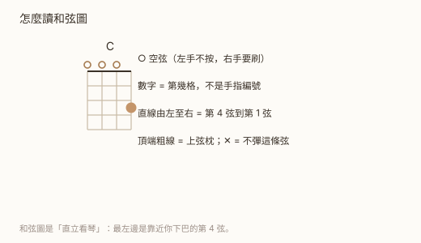

# 第 4 章：看懂流行吉他／烏克麗麗和弦譜與拍子

恭喜你！走到這一章，你的雙手已經做好準備了。在正式彈奏第一首流行歌之前，我們只需要最後一塊拼圖——**看懂專為彈唱設計的樂譜**。

好消息是：學流行彈唱**完全不需要看五線譜**！現代吉他與烏克麗麗玩家在網路上查譜、彈唱，主要依賴的是直覺化的**「和弦圖（Chord Diagram）」**與**「四線譜（TAB）」**，再搭配歌詞上方的英文字母代號。這套系統就像看捷運路線圖一樣簡單，只要 5 分鐘就能徹底掌握。

---

## 4.1 5 分鐘看懂「和弦圖（Chord Diagram）」

當你在網路上搜尋任何一首華語流行歌的烏克麗麗譜，歌詞上方都會標示像 `C`、`Am`、`F`、`G7` 這樣的英文字母，這些字母代表「和弦（Chord）」。而告訴你「手指該按在哪裡」的迷你格子圖，就是和弦圖。




*圖：和弦圖是「直立看琴」：左邊是第 4 弦；上面 ○ 是空弦、✕ 是不彈的弦，數字是格數不是手指。*

### 一、視角轉換：把烏克麗麗「立起來」面對自己
看懂和弦圖的第一步，是建立正確的空間對應感。請想像你把烏克麗麗**直立起來，琴頭朝上、琴身朝下，指板正面朝向你的眼睛**，這就是和弦圖的標準視角：

### 二、和弦圖上的五大符號規則
1. **四條直線**：由左至右依序代表**第 4 弦（G）、第 3 弦（C）、第 2 弦（E）、第 1 弦（A）**。最左邊是離你下巴最近的第 4 弦（G），最右邊是離地板最近的第 1 弦（A）。注意：High-G 調音下第 4 弦不是最粗的弦，最粗的是第 3 弦（C）。
2. **橫線與空格**：最上方粗橫線代表上弦枕，往下每一格依序為第 1 格、第 2 格、第 3 格、第 4 格。如果某個高把位和弦不在第 1 格開始，圖的左側會標註起始格數（例如標示 `3fr` 代表從第 3 格開始算）。
3. **黑點與數字（左手指法編號）**：黑點所在的位置就是手指要按下去的格子。黑點裡面（或下方）通常會標註數字 `1`、`2`、`3`、`4`，對應左手的四根手指：
   * **`1`**：食指（Index Finger）
   * **`2`**：中指（Middle Finger）
   * **`3`**：無名指（Ring Finger）
   * **`4`**：小指（Pinky / Little Finger）
   （註：左手大拇指負責在琴頸後方支撐，不參與編號，若偶爾需要扣弦會標示為 `T`。）

4. **上方的 `O`（空弦 Open String）**：代表這條弦左手不需要按任何格子，保持開放狀態，但右手刷弦時**必須包含這條弦**讓它一起發聲。
5. **上方的 `X`（消音／不彈 Mute）**：代表這條弦在這個和弦中不應該發聲（在烏克麗麗上較少見，多數和弦四條弦都會全部刷響）。

---

## 4.2 認識「四線譜（TAB）」：前奏單音與指法神隊友

當歌曲有好聽的前奏單音旋律，或是我們需要練習右手分解指法時，就會用到**四線譜（Tablature，簡稱 TAB）**。

與和弦圖「直立看琴」不同，四線譜是**「橫向看琴」**，模擬你低頭看指板的視角（但上下方向剛好與你低頭看的視角相反，請特別留意！）：

```text
   四線譜 (TAB) 閱讀範例：〈小星星〉前兩句（C 大調）

A |----------------0---0----------|
E |-------------------------------|
C |0---0--------------------------|
G |--------0---0-----------0------|
```

### 四線譜閱讀三大口訣
1. **上＝第 1 弦、下＝第 4 弦**：最上面那條橫線是**第 1 弦（A）**，最下面是**第 4 弦（G）**。這個上下順序和你低頭看琴面剛好相反，不必用直覺硬記，記住「上＝第 1 弦」即可；另外 High-G 調音下弦的粗細不是「上細下粗」——第 3 弦（C）最粗也最低，第 4 弦（G）反而細。
2. **線上的數字代表「第幾格」**：這裡的數字**不是手指編號**，而是**琴格位置**！
   * 數字 **`0`**：代表按第 0 格，也就是左手不按、直接彈「空弦」。
   * 數字 **`3`**：代表左手按住該弦的「第 3 格」。
   * 數字 **`7`**：代表左手按住該弦的「第 7 格」。

3. **閱讀順序由左至右**：數字排成一橫排代表依序一個音一個音彈奏（單音旋律）；如果有多個數字**垂直上下對齊在同一條直線上**，則代表這幾條弦要**同時一起撥響或刷響**（和弦）。

| 比較項目 | 和弦圖 (Chord Diagram) | 四線譜 (TAB) |
| :--- | :--- | :--- |
| **視覺方向** | 琴頭朝上、直立擺放 | 琴頭朝左、橫向擺放 |
| **第 1 弦（最細弦）位置** | 最**右**邊那條直線 | 最**上**面那條橫線 |
| **第 4 弦（G弦）位置** | 最**左**邊那條直線 | 最**下**面那條橫線 |
| **譜面數字的意義** | **左手手指編號**（1食指、2中指、3無名指、4小指） | **琴格格數**（0空弦、1第一格、2第二格…） |
| **主要用途** | 彈唱伴奏、快速查詢和弦按法 | 單音前奏、右手分解指法、Fingerstyle 獨奏 |

---

## 4.3 拍子與節奏基礎：流行歌最常見的 4/4 拍

看懂了「按哪裡」，接下來我們要搞懂「什麼時候刷、刷幾下」。流行音樂之所以能讓人跟著點頭搖擺，靠的就是穩定的**節拍（Beat）**。

華語流行歌絕大多數都是 **4/4 拍（四四拍）**。它的意思是：**「以四分音符為一拍，每小節有四拍」**。你可以把它想像成時鐘的秒針，每一個小節都整齊地數著 `1 - 2 - 3 - 4`，數完四拍就進入下一個小節，循環往復。

### 流行彈唱必學的三種音符時值與刷弦符號

在現代流行彈唱教學中，我們常在和弦譜上方看到箭頭符號（↓ 代表下刷，↑ 代表上刷），搭配不同的音符時值組合出千變萬化的節奏：

| 音符名稱 | 時值長度（在 4/4 拍中） | 口頭數拍方式 | 常見刷弦動作對應 | 聽覺感受 |
| :--- | :--- | :--- | :--- | :--- |
| **全音符** | 佔滿 **4 拍** | `1 - 2 - 3 - 4` | 第 1 拍下刷（↓）一次，讓聲音延續滿 4 拍 | 寬廣、寧靜、適合歌曲開頭或結尾 |
| **二分音符** | 佔 **2 拍** | `1 - 2` / `3 - 4` | 第 1 拍下刷（↓），第 3 拍再下刷（↓） | 穩重、溫柔，適合抒情歌主歌鋪陳 |
| **四分音符** | 佔 **1 拍** | `1` / `2` / `3` / `4` | 每拍整齊下刷一次：↓ 　 ↓ 　 ↓ 　 ↓ | 踏實、行進感強，新手建立拍感最佳節奏 |
| **八分音符** | 佔 **半拍（0.5 拍）** | `1 & 2 & 3 & 4 &` | 數字下刷、符號 `&` 上刷：↓ ↑ ↓ ↑ ↓ ↑ ↓ ↑ | 輕快、流暢，構成所有流行刷弦節奏的基礎 |

### 為什麼一定要用節拍器（Metronome）？
人類在剛學樂器時，大腦往往會把大部分注意力集中在「左手換和弦」上。一旦遇到難按的和弦，右手就會不自覺地停下來等左手，導致整首歌變得斷斷續續、忽快忽慢。

請在手機下載任何一款免費的節拍器 App（或直接用 Google 搜尋「Metronome」），將速度設定在 **BPM = 65～70**（BPM 代表 Beats Per Minute，每分鐘幾拍）：

* **練琴黃金法則**：**「寧可慢如蝸牛，不可拍子斷掉」**。就算你換和弦的時候稍微慢了半拍沒按好，右手依然要跟著節拍器的「答、答、答、答」準時刷下去，絕不為左手停下腳步！

---

## 4.4 綜合讀譜實戰：〈小蜜蜂〉單音＋刷弦雙重暖身

為了測試你是否已經看懂和弦圖、四線譜與四四拍，請拿起你的烏克麗麗，試著彈出這段大家最熟悉的旋律。

### 任務一：看四線譜彈單音（右手大拇指撥弦，每音一拍或兩拍）
```text
   四線譜 (TAB)：〈小蜜蜂〉第一句（G G A A G G E｜G G E E D D C）

A |--------0---0----------------------------------------------|
E |------------------------0-----------0---0------------------|
C |--------------------------------------------2---2---0------|
G |0---0-----------0---0-------0---0--------------------------|
```
*(提示：G4、A4、E4 都是空弦（第 4、1、2 弦），只有最後的 D 按第 3 弦第 2 格（中指）、C 是第 3 弦空弦。)*

### 任務二：看和弦圖穩定下刷（C 和弦全下刷 4 小節）
按住本章開頭學會的 **C 大調和弦**（左手無名指按住第 1 弦第 3 格），跟著節拍器 `1 - 2 - 3 - 4` 整齊下刷 4 個小節（共 16 下），感受四條弦同時共鳴的和聲魅力！

---

### 本章重點檢查表
* [ ] 我能正確區分「和弦圖（直立看琴、數字是手指編號）」與「四線譜（橫向看琴、數字是琴格格數）」。
* [ ] 我知道在 4/4 拍中，一個全音符佔 4 拍，一個八分音符佔半拍（數拍為 `1 &`）。
* [ ] 我已經能跟著 BPM = 70 的節拍器，穩定地用食指下刷四分音符而不搶拍或拖拍。