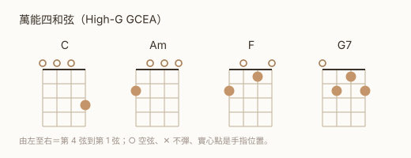

# 第 5 章：華語流行萬能四和弦（C - Am - F - G7）

從這一章開始，我們正式進入華語流行自彈自唱的世界！

你是否曾好奇，為什麼許多流行歌聽起來這麼順耳、只要聽一遍副歌就能跟著哼唱？秘密就在於「和弦進行（Chord Progression）」**。在流行音樂史上，有一組被稱為「50 年代進行（50s Progression）」或「華語流行萬能四和弦」的黃金組合——**`C` $\rightarrow$ `Am` $\rightarrow$ `F` $\rightarrow$ `G7`（樂理級數稱為 **1 - 6 - 4 - 5** 進行）。

這四個和弦在烏克麗麗上不僅極度好按，而且首尾相連、循環不斷，光靠這四個和弦，就能彈唱無數首華語經典情歌！本章我們將一一解鎖它們的指法，傳授無痛換和弦的秘密武器，並帶你完成人生第一首流行金曲的彈唱體驗。

## 5.1 認識 C 大調四個核心和弦

請對照下方的和弦圖，逐一將手指放上指板，每按好一個和弦，就用右手大拇指從第 4 弦到第 1 弦**慢速爬音撥響**，檢查每一條弦是否都清脆發聲、沒有被其他手指肉墊悶到。

```
   1. C 和弦 (C Major)          2. Am 和弦 (A Minor)
     4   3   2   1                4   3   2   1
     O   O   O   |                |   O   O   O
   ┌───┬───┬───┐                ┌───┬───┬───┐
   │   │   │   │                │   │   │   │  1格
   ├───┼───┼───┤                ├───┼───┼───┤
   │   │   │   │                │ ● │   │   │  2格  (2:中指)
   ├───┼───┼───┤                ├───┼───┼───┤
   │   │   │ ● │ (3:無名指)      │   │   │   │  3格
   └───┴───┴───┘                └───┴───┴───┘

   3. F 和弦 (F Major)          4. G7 和弦 (G Dominant 7)
     4   3   2   1                4   3   2   1
     |   O   |   O                O   |   |   |
   ┌───┬───┬───┐                ┌───┬───┬───┐
   │   │   │ ● │ (1:食指)        │   │   ● │   │  1格  (1:食指)
   ├───┼───┼───┤                ├───┼───┼───┤
   │ ● │   │   │ (2:中指)        │ ● │   │ ● │  2格  (2:中指 / 3:無名指)
   ├───┼───┼───┤                ├───┼───┼───┤
   │   │   │   │                │   │   │   │  3格
   └───┴───┴───┘                └───┴───┴───┘

```




*圖：C、Am、F、G7 的按法（由左至右＝第 4 弦到第 1 弦；○ 空弦、✕ 不彈）。*

### 四個和弦的按法細節與聲音情緒

| 和弦代號 | 中文全名 | 左手精準按法位置 | 聲音情緒色彩 | 新手最容易出錯的檢查點 | 
| ----- | ----- | ----- | ----- | ----- | 
| **C** | C 大三和弦 | 無名指（3）按第 1 弦第 3 格，其餘三條弦空弦 | 明亮、陽光、穩定、有「回家」的安全感 | 為什麼不用食指按？因為用**無名指**按，後續接 F 或 G7 時手掌完全不用大幅移動！ | 
| **Am** | A 小三和弦 | 中指（2）按第 4 弦第 2 格，其餘三條弦空弦 | 溫柔、微酸、帶有一絲青春的感傷 | 中指指尖務必立起來，避免指腹往下垂碰到第 3 弦（C 弦）導致悶音 | 
| **F** | F 大三和弦 | 在 `Am` 的基礎上，食指（1）加按第 2 弦第 1 格 | 開闊、溫暖、充滿希望與故事感 | 食指按第 2 弦時，避免指背頂到第 1 弦（A 弦）空弦；中指依然要立高高 | 
| **G7** | G 屬七和弦 | 食指（1）第 2 弦第 1 格、中指（2）第 3 弦第 2 格、無名指（3）第 1 弦第 2 格 | 緊張、充滿懸念，強烈渴望回到 `C` 和弦 | 三根手指排成一個「正三角形」，手腕稍微往琴頭方向微轉，三指就能輕鬆塞進格內 | 

## 5.2 無痛換和弦的三大秘訣：「共同指」與「軸心移動」

新手剛開始練習 `C` $\rightarrow$ `Am` $\rightarrow$ `F` $\rightarrow$ `G7` 循環時，最常犯的錯就是：**每換一個和弦，就把左手手指全部抬起來離開指板，重新一根一根找位置**。這樣不僅慢，還會讓手忙腳亂。

請運用專業樂手的「省力幾何學」，讓手指像跳芭蕾舞一樣優雅切換：

1. **`C`** $\rightarrow$ **`Am`（交接棒移動）**：當你用無名指按 `C` 和弦時，你的**中指（2）其實早就懸空在「第 4 弦第 2 格」的正上方**了！換和弦時，只需中指垂直落下、無名指同步抬起即可。

2. **`Am`** $\rightarrow$ **`F`（保留共同指，零移動！）**：這是這組進行最爽快的一步！按住 `Am` 的中指（第 4 弦第 2 格）**完全不要放開**，只需要把食指（1）直接壓在「第 2 弦第 1 格」，就瞬間變成了 `F` 和弦！

3. **`F`** $\rightarrow$ **`G7`（保留食指當旋轉軸心！）**：觀察 `F` 和 `G7` 的和弦圖，你會發現兩者的**食指（1）都按在「第 2 弦第 1 格」**！因此，從 `F` 換到 `G7` 時，**食指緊緊按住不動當作軸心**，只需將中指從第 4 弦往下移一格到第 3 弦第 2 格，同時無名指落入第 1 弦第 2 格，一秒完成三角形站位！

4. **`G7`** $\rightarrow$ **`C`（無名指順勢滑行）**：從 `G7` 回到 `C` 時，食指與中指同時放開，原本按在第 1 弦第 2 格的**無名指（3）直接貼著第 1 弦往右滑一格到第 3 格**，順勢回到起點！

## 5.3 彈唱協調第一步：如何讓「嘴巴唱的字」對準「右手刷的拍」？

許多人單獨彈琴沒問題，單獨唱歌也很好聽，但一要求「邊彈邊唱」，大腦就會當機——要嘛嘴巴跟著右手的節奏一字一頓像唸經，要嘛一開口唱歌右手就忘記刷弦。

解決彈唱協調的唯一心法是：**「先建立自動化右手，再把歌詞『掛』在和弦拍點上」**。

請嚴格遵守以下「三步拆解訓練法」：

* **第一步：純器樂循環（不唱歌）**
  打開節拍器（BPM = 65），按照 `| C | Am | F | G7 |` 的順序，每個和弦佔一個小節（4 拍），每拍整齊下刷一次（$\downarrow \quad \downarrow \quad \downarrow \quad \downarrow$）。連續循環 10 遍直到你的左手換和弦完全不需要用眼睛盯著看。

* **第二步：看準「換和弦的那一個字」**
  流行彈唱譜都會把和弦代號精準寫在**對應歌詞的正上方**。你不需要管每一拍對到哪個字，你只需要記住：**「唱到頭頂有和弦代號的那個字時，左手剛好換好和弦、右手剛好刷下第 1 拍！」**

* **第三步：先哼唱（La La La），再填歌詞**
  第一遍開口時，先不要急著背歌詞，用「La～」或「嗯～」把主旋律哼出來，專注感受第 1 拍和弦落下的重音與旋律重音重合的快感，順暢後再套入完整歌詞。

## 5.4 流行金曲實戰演練：萬能四和弦循環曲目

只要掌握了 `| C | Am | F | G7 |`（或將最後的 `G7` 換成稍後會學到的 `G`）這套進行，你已經可以立刻彈唱華語樂壇兩首極具代表性的經典作品！以下為你拆解它們的**和弦進行結構與對拍攻略**（建議搭配原曲音檔跟唱練習）：

### 實戰曲目一：張懸〈寶貝〉（C 大調溫暖民謠版）

* **歌曲節奏**：4/4 拍，速度約 BPM = 110（練習時建議先放慢至 BPM = 75）。

* **核心秘密**：這首國民級溫暖情歌的絕大部分段落，都是由同一個四小節和弦進行不斷循環構成！

* **基礎伴奏型態**：每個和弦佔 1 小節，練習初期先使用「每拍全下刷（$\downarrow \quad \downarrow \quad \downarrow \quad \downarrow$）」，讓歌聲成為主角。

```
   【和弦進行循環結構（每小節 4 拍）】
   
   ||:   C         |   Am        |   F         |   G7        :||
   刷法： ↓  ↓  ↓  ↓ | ↓  ↓  ↓  ↓  | ↓  ↓  ↓  ↓  | ↓  ↓  ↓  ↓
   拍數： 1  2  3  4 | 1  2  3  4  | 1  2  3  4  | 1  2  3  4
   
   【主歌對拍結構提示】
   - 第 1 句開頭（我的「寶」貝...）：「寶」字剛好落在 C 和弦的第 1 拍下刷。
   - 第 1 句尾端（...給「你」一點甜甜）：「你」字進入 Am 和弦的第 1 拍。
   - 第 2 句中段（讓「你」今夜都好眠）：「你」字進入 F 和弦的第 1 拍。
   - 第 2 句結尾（我的小「鬼」...）：「鬼」字進入 G7 和弦的第 1 拍，準備接回下一輪 C 和弦。

```

> **練習小叮嚀**：注意這首歌的歌詞往往是從「前一輪最後一拍的後半拍（弱起拍）」就開始唱出第一個字（例如「我的」在拍子前先唱出來），真正的第 1 拍重音是落在「寶」字上！多聽兩遍原曲，抓準那個重音落點，彈唱瞬間就會非常道地。

### 實戰曲目二：五月天〈擁抱〉（C 大調深情抒情版）

* **歌曲節奏**：4/4 拍，速度約 BPM = 72（非常適合新手練習的舒緩速度）。

* **核心秘密**：原曲為 B 大調，在烏克麗麗上移調為最友善的 **C 大調**後，主歌與副歌皆可套用 `C - Am - F - G7` 進行（部分樂句也可將 `Am` 替換為第 7 章會學到的 `Em`，色彩會更貼近原曲）。

* **進階一步伴奏挑戰**：如果你已經覺得「每拍下刷 4 下」太簡單，可以在這首歌嘗試加入「重拍強調」——第 1 拍與第 3 拍稍微刷大聲一點，第 2 拍與第 4 拍輕輕刷過，立刻就能彈出樂團抒情搖滾的呼吸感！

```
   【和弦進行循環結構（每小節 4 拍）】
   
   ||:   C         |   Am        |   F         |   G7        :||
   刷法： ↓(重) ↓(輕) ↓(重) ↓(輕) | ↓(重) ↓(輕) ↓(重) ↓(輕) | ...
   拍數： 1     2     3     4     | 1     2     3     4     | ...
   
   【主歌與副歌對拍結構提示】
   - 主歌第 1 句（脫下長「日」的假面...）：「日」字精準對齊 C 和弦第 1 拍。
   - 主歌第 1 句後半（...奔向夢幻的「疆」界）：「疆」字對齊 Am 和弦第 1 拍。
   - 主歌第 2 句（南瓜馬車的「午」夜...）：「午」字對齊 F 和弦第 1 拍。
   - 主歌第 2 句後半（...換上童話的「玻」璃鞋）：「玻」字對齊 G7 和弦第 1 拍。
   - 副歌高潮句（晚「風」吻盡荷花葉...）：同樣沿用 C -> Am -> F -> G7 循環，情緒自然推高！

```

## 5.5 新手首週突破常見 Q&A

* **Q1：我換和弦的時候總是來不及，每次都要停下來 1 秒才按好怎麼辦？**
  **A**：這代表你的大腦還在「思考手指位置」。請把節拍器調慢到 **BPM = 50**，並使用「提前準備法」：在每小節數到第 4 拍刷下去之後，左手立刻提前放開準備移動，把第 4 拍後半拍的空檔拿來當作移動時間，這樣下一小節第 1 拍就能準時落下。

* **Q2：為什麼我的 `G7` 刷起來總是有一條弦悶悶的？**
  **A**：十之八九是**無名指（按第 1 弦第 2 格）或中指（按第 3 弦第 2 格）的指腹碰到了中間的第 2 弦**，或是食指（按第 2 弦第 1 格）往下垂碰到了第 1 弦。請把左手手腕稍微往前推（讓掌心朝下轉一點），三根手指的指尖就能更垂直地站立在指板上。

### 本章重點檢查表

* \[ \] 我已經能不看和弦圖，直接按出 `C`、`Am`、`F`、`G7` 四個和弦，且每個音都清脆無雜音。

* \[ \] 我在 `Am` 轉 `F` 時會保留中指不動；在 `F` 轉 `G7` 時會保留食指當軸心旋轉。

* \[ \] 我已經能跟著 BPM = 65 的速度，使用全下刷完成〈寶貝〉或〈擁抱〉至少一個主歌＋副歌段落的自彈自唱！