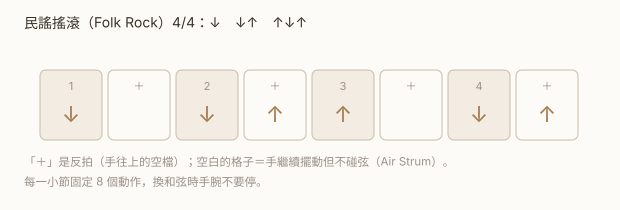

# 第 6 章：流行歌神級節奏：民謠搖滾（Folk Rock）

在上一章，我們用「每拍下刷 4 下」完成了人生第一首流行彈唱。但你一定會發現：全下刷雖然穩重，聽起來卻少了一點流行音樂特有的「躍動感」與「流暢呼吸」。

要讓你的伴奏瞬間從「初學者練習」升級為「街頭藝人等級」，秘密武器就是華語流行樂壇使用率高達 60% 的神級節奏——**民謠搖滾刷法（Folk Rock Strum）**，江湖人稱**「下、下上、上下上」**！只要學會這組節奏型態，全台灣超過一半的華語流行歌你都能直接刷出原曲韻味。

---

## 6.1 拆解「下、下上、上下上」的節奏密碼

民謠搖滾刷法建立在 4/4 拍的八分音符（`1 & 2 & 3 & 4 &`）基礎上，一個小節共有 8 個半拍位置。但我們並不是 8 個位置都刷響，而是透過**刻意留空其中兩下**，創造出充滿彈性的切分律動：

```text
   【民謠搖滾刷法（Folk Rock）8 拍動作全拆解】
   
   拍點數法：  1    &    2    &    3    &    4    &
   手腕方向：  ↓   (↑)   ↓    ↑   (↓)   ↑    ↓    ↑
   實際發聲：  下  [空]   下   上   [空]  上   下   上
   中文口訣：  下   —    下   上    —    上   下   上
```




*圖：民謠搖滾的 8 個動作：↓　↓↑　↑↓↑，空白格是手繼續擺動但不碰弦的空刷。*

### 為什麼這組節奏這麼好聽？
請觀察第 2 拍後半（`2 &`）與第 3 拍正拍（`3`）的關係：在 `2 &` 往上勾刷之後，第 3 拍正拍我們不刷弦，讓剛剛刷出來的和弦餘音自然跨越第 3 拍（這在樂理上稱為**切分音 Syncopation**），緊接著在 `3 &` 突然往上勾出一聲清脆的響音！這種「預期之外的提前重音」，正是流行音樂讓人忍不住跟著點頭搖擺的核心密碼。

---

## 6.2 律動靈魂關鍵：「空刷（Air Strum）」訓練法

許多新手在學「下、下上、上下上」時，常會變成生硬的機器人動作：手腕刷完第 1 下停在下面、等半拍、再往下刷第 2 下……這樣不僅拍子極易亂掉，手腕也會非常僵硬。

職業樂手維持絕對穩定拍子的唯一秘訣，叫做**「永不停歇的鐘擺原則（Constant Pendulum Motion）」**，也就是透過**空刷（Air Strum）**來計算時間：

* **規則一**：無論譜面上有沒有要刷出聲音，你的右手手腕都必須嚴格遵守**「數字（1, 2, 3, 4）永遠往下揮、符號（&）永遠往上揮」**的物理定律！
* **規則二**：遇到括號裡的 `(↑)`（第 1 拍後半）與 `(↓)`（第 3 拍正拍）時，手腕依然照常往上或往下揮動，只是**指尖稍微抬高離開琴弦 1 公分，從空氣中揮過去（空刷）**。
* **自我檢核**：只要你在第 3 拍之後的任何一拍發現自己「變成往下刷的動作在 `&` 拍」，就代表你的鐘擺方向搞反了！

| 拍點位置 | 右手物理動作 | 是否觸弦發聲 | 聽覺與力道提示 |
| :--- | :--- | :--- | :--- |
| **`1`** | 向下揮動 | **是（下刷 $\downarrow$）** | **全小節最穩重的第一拍**，四條弦飽滿刷響 |
| **`&`** | 向上揮動 | **否（空氣上揮 $\uparrow$）** | 順勢把右手帶回上方，準備第 2 拍下刷 |
| **`2`** | 向下揮動 | **是（下刷 $\downarrow$）** | 配合歌曲的小鼓重拍，力道可稍微清脆強調 |
| **`&`** | 向上揮動 | **是（上刷 $\uparrow$）** | 用食指指腹輕巧勾過第 1、2、3 弦即可，不需死命勾全部弦 |
| **`3`** | 向下揮動 | **否（空氣下揮 $\downarrow$）** | **關鍵空刷！** 手腕往下揮過空氣，讓上一拍的餘音延續 |
| **`&`** | 向上揮動 | **是（上刷 $\uparrow$）** | 切分音亮點！清脆往上勾刷 |
| **`4`** | 向下揮動 | **是（下刷 $\downarrow$）** | 穩定過渡到最後半拍 |
| **`&`** | 向上揮動 | **是（上刷 $\uparrow$）** | 輕巧上勾，同時左手準備切換下一個小節的和弦 |

---

## 6.3 刷弦力道動態控制：告別「鋸木頭式」平淡刷奏

當你已經能流暢揮出「下、下上、上下上」之後，下一步就是加入**音色層次（Dynamics）**。如果這 6 下發聲的音量全部一模一樣大聲，聽起來就會像在鋸木頭一樣吵雜。

請嘗試在練習時加入以下兩個微調：
1. **上刷只需刷「最下面的 2～3 條弦」**：下刷時食指指甲自然掃過全部 4 條弦，音色飽滿；但上刷（`2&`、`3&`、`4&`）時，食指指腹只需要輕輕勾過**第 1 弦與第 2 弦（最多到第 3 弦）**。這樣會產生「低音厚實、高音清亮」的立體伴奏感，而且手腕動作更小、速度更快！
2. **強調第 2 拍與第 4 拍的節奏感**：流行搖滾的鼓點中，大鼓在 `1、3` 拍，小鼓在 `2、4` 拍。你在第 2 拍（`2`）與第 4 拍（`4`）下刷時，手腕甩動幅度稍微果斷一點，整首歌的律動感會立刻活起來。

---

## 6.4 流行金曲實戰演練：民謠搖滾經典曲目

現在，請將上一章學過的 `C - Am - F - G7` 進行，套入全新的民謠搖滾刷法！建議先打開節拍器設定在 **BPM = 65**，純刷弦循環 5 分鐘直到右手完全自動化，再搭配以下兩首華語流行金曲進行彈唱。

### 實戰曲目一：告五人〈披星戴月的想你〉（C 大調情感堆疊版）

* **歌曲節奏**：4/4 拍，原曲速度約 BPM = 76（非常適合用來練習民謠搖滾刷法的抒情中板速度）。
* **核心秘密**：這首新世代國民情歌的和弦進行極具規律性，副歌與後半段高潮採用經典的 **`F` $\rightarrow$ `G7` $\rightarrow$ `Em` $\rightarrow$ `Am`**（本章可先用 `C` 暫代 `Em`，下一章學會 `Em` 後即可完美還原原曲進行！）與 **`F` $\rightarrow$ `G7` $\rightarrow$ `C`** 循環，民謠搖滾刷法能完美撐起副歌澎湃的情感張力。

```text
   【副歌高潮段和弦與刷法配置（每小節 4 拍）】
   
   ||:   F               |   G7              |   C               |   Am              :||
   刷法： ↓  -  ↓ ↑ - ↑ ↓ ↑ | ↓  -  ↓ ↑ - ↑ ↓ ↑ | ↓  -  ↓ ↑ - ↑ ↓ ↑ | ↓  -  ↓ ↑ - ↑ ↓ ↑
   拍數： 1  &  2 & 3 & 4 & | 1  &  2 & 3 & 4 & | 1  &  2 & 3 & 4 & | 1  &  2 & 3 & 4 &
   
   【對拍進階提示：如何在「4 &」換和弦？】
   - 當你在每小節最後一個半拍「4 &」往上勾刷時，左手其實可以提前在「4 &」那瞬間稍微放鬆指力，利用最後半拍的空弦過渡音，讓手指順勢滑向下一小節第 1 拍的新和弦！這在民謠吉他與烏克麗麗彈唱中非常自然，完全不會破壞聽覺連貫性。
```

### 實戰曲目二：黃品源〈小薇〉（C 大調輕快經典）

* **歌曲節奏**：4/4 拍，速度約 BPM = 108（練習時請先放慢至 BPM = 80）。
* **核心秘密**：〈小薇〉是華語歌壇公認「練習民謠搖滾刷法與開口唱協調」的第一神曲。全曲旋律節奏非常方正，幾乎每個字都剛好落在正拍或半拍上，極少複雜的切分搶拍，和弦進行也以 `C`、`Am`、`F`、`G7` 為主軸。

```text
   【主歌經典和弦循環（每小節 4 拍）】
   
   ||:   C               |   Am              |   F               |   G7              :||
   刷法： ↓  -  ↓ ↑ - ↑ ↓ ↑ | ↓  -  ↓ ↑ - ↑ ↓ ↑ | ↓  -  ↓ ↑ - ↑ ↓ ↑ | ↓  -  ↓ ↑ - ↑ ↓ ↑
   拍數： 1  &  2 & 3 & 4 & | 1  &  2 & 3 & 4 & | 1  &  2 & 3 & 4 & | 1  &  2 & 3 & 4 &
   
   【對拍結構提示】
   - 「有一個美麗的小『薇』...」：「薇」字精準落在 C 和弦第 1 拍下刷。
   - 「...她的眼睛則『像』一顆水晶」：「像」字落在 Am 和弦第 1 拍下刷。
   - 「她『愛』著我，我也愛著她」：「愛」字落在 F 和弦第 1 拍，後半句接回 G7 與 C。
```

---

### 本章重點檢查表
* [ ] 我在刷「下、下上、上下上」時，右手手腕維持穩定的上下鐘擺，沒有在空刷拍點停頓。
* [ ] 我能邊看著電視或與人簡單對話，邊維持民謠搖滾刷法連續 1 分鐘不亂拍（代表右手已進入肌肉記憶）。
* [ ] 我已經能用民謠搖滾刷法完成〈小薇〉或〈披星戴月的想你〉副歌段落的自彈自唱。