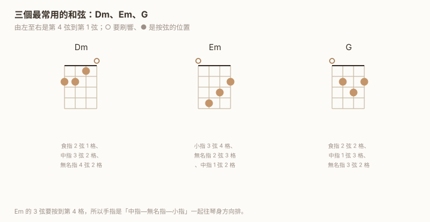
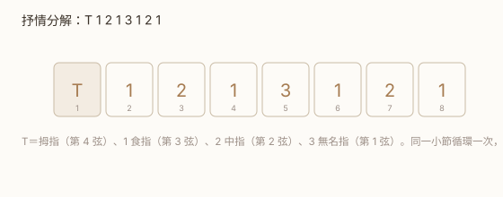
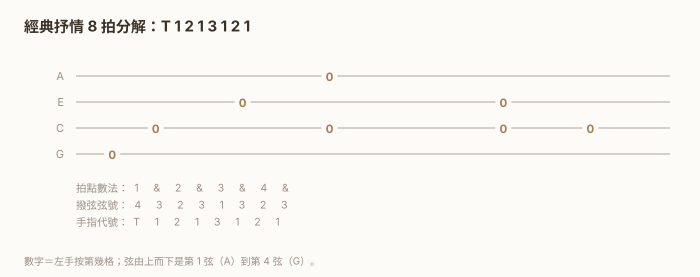

# 第 7 章：加入小和弦與抒情指法分解（T1213121）

如果一首抒情歌從頭到尾都用「刷弦」伴奏，就像一個人從頭到尾都用宏亮的嗓門說話，雖然熱情，卻少了深夜裡耳邊低語的細膩與溫柔。

在華語流行編曲中，絕大多數抒情歌的標準公式都是：**「主歌（Verse）用右手手指撥出如流水般的分解和弦，副歌（Chorus）再切換為澎湃的刷弦」**。本章我們將先補齊 C 大調家族最後三個核心和弦（`Dm`、`Em`、`G`），接著解鎖烏克麗麗最浪漫的右手撥弦指法——**抒情分解和弦（`4-3-2-3-1-3-2-3`）**。

---

## 7.1 擴充 C 大調家族和弦：Dm、Em、G

加上第 5 章學過的 `C`、`Am`、`F`、`G7`，只要再學會下面這三個和弦，你就集齊了 **C 大調所有的順階基本和弦**！這意味著，大部分轉調為 C 大調的流行歌譜，你已經能看懂並按出所有和弦了。

### 新和弦按法拆解與轉換捷徑

| 和弦代號 | 左手精準按法位置 | 聲音情緒色彩 | 省力按法與轉換秘訣 |
| :--- | :--- | :--- | :--- |
| **Dm** | 食指（1）第 2 弦第 1 格、中指（2）第 4 弦第 2 格、無名指（3）第 3 弦第 2 格 | 深沉、憂鬱、帶有戲劇張力的悲傷感 | **直接從 `F` 和弦變形！** 先按好 `F`（食指＋中指），只需把**無名指（3）塞進中指正下方的第 3 弦第 2 格**就完成了！ |
| **Em** | 食指（1）第 1 弦第 2 格、中指（2）第 2 弦第 3 格、無名指（3）第 3 弦第 4 格 | 細膩、清冷、文青感十足的哀愁 | 三根手指像「走樓梯」一樣斜斜排開（2格、3格、4格）。練習時先放食指，再依序放下中指與無名指，手腕稍微往琴身方向微轉會更順手 |
| **G** | 食指（1）第 3 弦第 2 格、中指（2）第 1 弦第 2 格、無名指（3）第 2 弦第 3 格 | 明亮、開闊、正式感比 `G7` 更強（取代 `G7` 的現代流行首選） | 三根手指形成一個「倒三角形」（與 `G7` 方向相反）。注意無名指按第 2 弦第 3 格時指尖要立直，避免碰到第 1 弦 |

---

## 7.2 右手四指分工與經典抒情分解和弦（4-3-2-3-1-3-2-3）

進入指法撥弦（Fingerpicking）時，我們的右手不再用食指上下揮動，而是讓大拇指、食指、中指、無名指各司其職，像彈豎琴一樣溫柔地撥動每一條琴弦。

*圖：T1213121：拇指先落、食指中指交替；同一組型換和弦時，拇指仍負責第 4 弦。*

### 一、右手四指「一指管一弦」黃金分工表
在古典吉他教學中，右手手指常以西班牙文縮寫標示（`p` 大拇指、`i` 食指、`m` 中指、`a` 無名指）；而在華語流行彈唱譜中，則常簡稱為 **`T`（Thumb 大拇指）、`1`（食指）、`2`（中指）、`3`（無名指）**。

| 右手手指 | 流行譜代號 | 負責管理琴弦 | 撥弦方向與觸弦位置 |
| :--- | :--- | :--- | :--- |
| **大拇指** | **`T`**（或 `p`） | **第 4 弦（G）**（偶爾兼管第 3 弦） | **向下撥動**（用大拇指左側邊緣肉墊撥弦） |
| **食指** | **`1`**（或 `i`） | **第 3 弦（C）** | **向上勾動**（指尖微微彎曲，向掌心方向輕勾） |
| **中指** | **`2`**（或 `m`） | **第 2 弦（E）** | **向上勾動** |
| **無名指** | **`3`**（或 `a`） | **第 1 弦（A）** | **向上勾動** |

> **右手手型穩定秘訣**：將右手腕自然懸空在響孔正上方（手腕微拱起，像手心裡握著一顆乒乓球），小指可以輕輕靠在響孔下方的面板上作為支點（若習慣懸空亦可），四根手指分別輕放在對應的四條弦上準備。撥弦時**只動手指關節，手腕保持靜止穩定**，不要像拔蘿蔔一樣整隻手往上抽動！

### 二、華語抒情第一神指法：`T - 1 - 2 - 1 - 3 - 1 - 2 - 1`（弦號 `4-3-2-3-1-3-2-3`）
這組分解和弦由 8 個均勻的八分音符組成（佔滿一個 4/4 拍小節），是無數情歌主歌的標準伴奏型態：

**練習口訣**：心裡默唸弦號**「4 - 3 - 2 - 3 - 1 - 3 - 2 - 3」**，注意第 1 拍的 `4`（大拇指）與第 3 拍的 `1`（無名指）音量可以稍微飽滿一點點，中間穿插的 `3`（食指）則輕柔帶過，聽起來就會像鋼琴伴奏般優美流暢！

---

## 7.3 流行金曲實戰演練：主歌分解＋副歌刷弦

這首歌是近年年輕族群在吉他社、露營與婚禮現場點播率極高的現代抒情經典，全曲和弦進行高度規律，非常適合練習「主歌用指法溫柔傾訴，副歌切換民謠搖滾刷弦爆發情感」的完整編曲層次！

### 實戰曲目：理想混蛋〈不是因為天氣晴朗才愛你〉（C 大調編曲版）

* **歌曲節奏**：4/4 拍，速度約 BPM = 76。
* **核心和弦進行**：**`C` → `G` → `Am` → `Em` → `F` → `C` → `Dm` → `G`**（這正是大名鼎鼎的「卡農和弦進行」，我們將在第 15 章深入解析它的魔力！）。

| 和弦進行 | 節奏／指法 |
| :--- | :--- |
| `C` → `G` → `Am` → `Em` | — |
| `F` → `C` → `Dm` → `G` | — |
| `C` → `G` → `Am` → `Em` | — |
| `F` → `C` → `Dm` → `G` | — |

### 指法與刷弦「無縫切換」的動作秘訣
從主歌最後一小節（`G` 和弦分解）切換到副歌第一小節（`C` 和弦刷弦）時，很多新手會因為右手還要調整姿勢而慢半拍。請注意：**彈主歌最後一小節 `G` 的最後一拍（第 4 弦/第 3 弦撥完）時，右手四指順勢收攏成微握拳、食指微伸出的刷弦預備姿勢**，手臂自然向上抬起，這樣副歌第 1 拍就能準時有力地刷下去！

---

### 本章重點檢查表
* [ ] 我已經能按出 `Dm`、`Em`、`G` 三個和弦，並記住 `F` → `Dm` 只需加入無名指的捷徑。
* [ ] 我的右手四指能分別管理對應琴弦，在不低頭看右手的情況下穩定撥出 `4-3-2-3-1-3-2-3`。
* [ ] 我已經能完成〈不是因為天氣晴朗才愛你〉「主歌分解 → 副歌刷弦」的段落轉換演練。