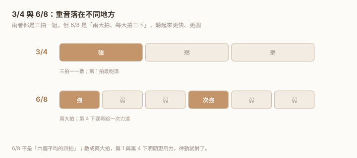
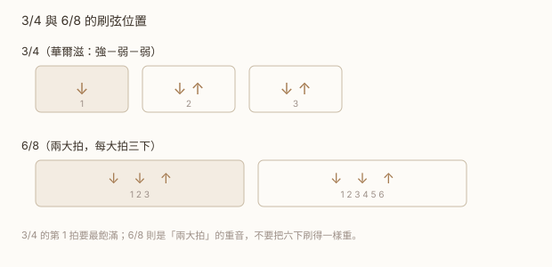

# 第 8 章：三拍子抒情搖滾與華爾滋律動（3/4 & 6/8 拍）

到目前為止，我們練習的所有節奏都是偶數拍（4/4 拍）。然而在流行音樂的世界裡，還有一種充滿復古浪漫、猶如圓舞曲般優雅搖擺的節奏型態——**三拍子系統（3/4 拍與 6/8 拍）**。

三拍子（3/4、6/8）在華語流行裡其實不多，多半出現在改編版：〈月亮代表我的心〉、〈浪子回頭〉、〈告白氣球〉的原曲都是 4/4，本章把它們改編成三拍子當練習，重點是學會「強－弱－弱」的重心，而不是說原曲是三拍。只要掌握「強－弱－弱」的圓舞曲重心，你的彈唱曲庫將立刻多出一種深情款款的浪漫表情！

---

## 8.1 3/4 拍與 6/8 拍的強弱拍律動解析

很多初學者看到樂譜左上角寫著 `3/4` 或 `6/8` 時容易混淆。其實在現代流行彈唱的實際操作中，兩者有著非常相似的「三拍搖擺感」，只是**速度重心與細分方式**略有不同：

| 拍號名稱 | 樂理定義（每小節幾拍） | 口頭數拍方式 | 強弱拍重音結構 | 聽覺氛圍與常見曲風 |
| :--- | :--- | :--- | :--- | :--- |
| **3/4 拍（四三拍）** | 以四分音符為一拍，每小節 **3 拍** | **`1 - 2 - 3`**（或細分為 `1 & 2 & 3 &`） | **強 － 弱 － 弱** （`1` 重、`2` 輕、`3` 輕） | 經典華爾滋（Waltz）、優雅、圓潤、復古抒情民謠（此處以〈月亮代表我的心〉作 3/4 改編示範） |
| **6/8 拍（八六拍）** | 每小節 6 個八分音符，聽成 **2 大拍**（每大拍 3 個八分音符） | **`1 - 2 - 3 - 4 - 5 - 6`**（兩組三連音感） | **強 － 弱 － 弱 － 次強 － 弱 － 弱** （`1` 最重、`4` 次重） | 抒情搖滾、深情滄桑、浪濤般起伏感（6/8 經典如〈Hallelujah〉；〈浪子回頭〉原曲 4/4，此處為改編練習） |

---

## 8.2 三拍子刷弦版與分解和弦版指法

我們為 3/4 拍與 6/8 拍各準備了一套最實用的伴奏模板，分別應對「刷弦」與「指法分解」兩種情境：

*圖：3/4 的第 1 拍最飽滿；6/8 是「兩大拍」，每大拍三下，不要把六下刷得一樣重。*

### 一、3/4 拍華爾滋伴奏模板（適合經典抒情歌）
* **刷弦版（下、下上、下上）**：第 1 拍飽滿下刷（模擬大鼓「蹦」），第 2、3 拍輕巧下上刷（模擬「恰－恰」），形成經典的「蹦－恰－恰」華爾滋律動！
* **指法分解版（`4 - 3 - 2 - 1 - 2 - 3`）**：用 6 個均勻的八分音符填滿 3 拍（`1 & 2 & 3 &`），像海浪般先往上爬音再溫柔落回。

| 3/4 拍刷弦版 | 3/4 拍指法分解版 (TAB) |
| :--- | :--- |
| 拍數：  1    2  &   3  & | 拍數：  1   &   2   &   3   & |
| 刷法：  ↓    ↓  ↑   ↓  ↑ | A (1弦) ｜-----------0-----------｜ |
| 口訣： 蹦   恰 恰  恰 恰 | E (2弦) ｜-------0-------0-------｜ |
| 力道： 重   輕 輕  輕 輕 | C (3弦) ｜---0---------------0---｜ |
| — | G (4弦) ｜0----------------------｜ |
| — | 弦號：  4   3   2   1   2   3 |
| — | 手指：  T   1   2   3   2   1 |

### 二、6/8 拍抒情搖滾模板（示範：〈浪子回頭〉改編）
在 6/8 拍中，每小節有 6 個八分音符。最重要的是把**第 1 拍（`1`）與第 4 拍（`4`）**做出明顯的「重拍強調」，中間的 `2, 3` 與 `5, 6` 則輕輕帶過：

| 6/8 拍刷弦版（抒情搖滾刷法） | 6/8 拍經典分解版 (TAB) |
| :--- | :--- |
| 拍數：  1   2   3   4   5   6 | 拍數：  1   2   3   4   5   6 |
| 刷法：  ↓   ↓   ↑   ↓   ↓   ↑ | A (1弦) ｜-----------0-----------｜ |
| 力道： 重   輕  輕 次重  輕  輕 | E (2弦) ｜-------0-------0-------｜ |
| — | C (3弦) ｜---0---------------0---｜ |
| — | G (4弦) ｜0----------------------｜ |
| — | 弦號：  4   3   2   1   2   3 |
| — | 力道： 重   輕  輕 次重  輕  輕 |

---

## 8.3 流行金曲實戰演練：三拍子雙經典

### 實戰曲目一：〈月亮代表我的心〉（C 大調 3/4 改編練習）

* **歌曲節奏**：3/4 拍，速度約 BPM = 75（舒緩優雅）。
* **編曲建議**：主歌使用 **3/4 拍指法分解（`4-3-2-1-2-3`）**，副歌「輕輕的一個吻」切換為 **3/4 拍華爾滋刷法（`↓ ↓↑ ↓↑`）**。

| 和弦進行 | 節奏／指法 |
| :--- | :--- |
| `C` → `Em` → `Am` → `C` | — |
| `F` → `C` → `G7` | — |

### 實戰曲目二：〈浪子回頭〉（原曲 4/4 的 6/8 改編練習）

* **歌曲節奏**：6/8 拍，原曲為 D 大調，移調為 **C 大調**後全曲僅需 `C`、`G`、`Am`、`Em`、`F` 五個基礎和弦即可呈現！
* **編曲建議**：前奏與第一段主歌使用 **6/8 拍分解和弦**（強調第 1 音與第 4 音），進入副歌「時間一天一天一天的走」時，切換為 **6/8 拍抒情搖滾刷法（`↓ ↓ ↑ ↓ ↓ ↑`）**，在 `1` 與 `4` 拍用力刷出男子漢的深情吶喊！

| 和弦進行 | 節奏／指法 |
| :--- | :--- |
| `C` → `G` → `Am` → `Em` | **刷法** ↓ ↓ ↑ ↓ ↓ ↑ ｜ ↓ ↓ ↑ ↓ ↓ ↑ ｜ ↓ ↓ ↑ ↓ ↓ ↑ ｜ ↓ ↓ ↑ ↓ ↓ ↑ **拍數** 1 2 3 4 5 6 ｜ 1 2 3 4 5 6 ｜ 1 2 3 4 5 6 ｜ 1 2 3 4 5 6 |
| `F` → `C` → `Dm` → `G` | **刷法** ↓ ↓ ↑ ↓ ↓ ↑ ｜ ↓ ↓ ↑ ↓ ↓ ↑ ｜ ↓ ↓ ↑ ↓ ↓ ↑ ｜ ↓ ↓ ↑ ↓ ↓ ↑ |

---

### 本章重點檢查表
* [ ] 我能清楚掌握三拍子「重－輕－輕」的律動重心，不會不自覺彈成四拍子。
* [ ] 我已經熟練 3/4 拍華爾滋刷法（`↓ ↓↑ ↓↑`）與 6/8 拍分解指法（`4-3-2-1-2-3`）。
* [ ] 我已經能用 6/8 拍節奏彈出〈浪子回頭〉副歌的改編版本。