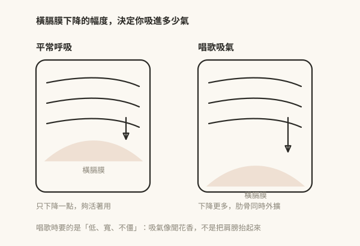
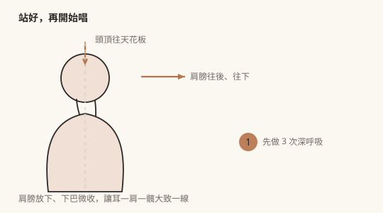
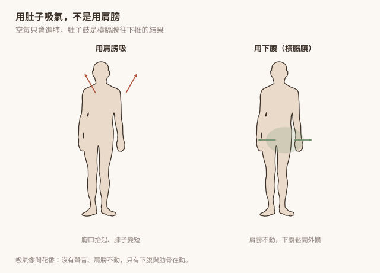
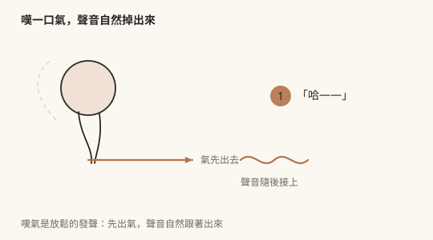
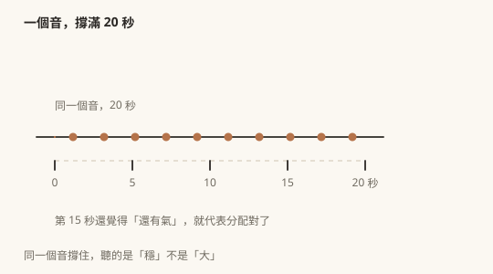

# [歌唱教學] 初階 第 1 章：唱歌的本質：讓音樂成為日常的呼吸

## 先講結論

唱歌不是體力活。你唱到喉嚨痛，通常不是因為氣不夠，是因為肩膀、脖子、下巴一起用力，把聲音的通道壓住了。

這一章只做一件事：把身體調回「可以發聲」的狀態。氣由橫膈膜帶進來，喉嚨不擠，聲音放在穩定的氣流上。

練完你會發現，同一句話用同樣的音量唱，喉嚨比較不累；你也會第一次分清楚「支撐」和「用力」的差別。

先不要管音量，也不要管高音。先把「不該用的力」拿掉。

## 常見誤解

很多人以為唱高音要「往上撐」，所以一遇到副歌就聳肩、抬下巴、把脖子伸長。其實音變高，是聲帶被拉長、拉薄，振動變快。做這件事的是喉嚨裡很小的肌肉，肩頸的大肌肉幫不上忙，只會從外面把通道壓扁。你越撐，聲音越緊。

另一個常見的誤解是「腹式呼吸就是用肚子把氣吸進去」。空氣只會進到肺裡。吸氣時，橫膈膜收縮、下降，胸腔變大，空氣才被吸進來；肚子往外鼓，是腹腔被橫膈膜往下推的結果。肚子鼓是結果，不是動作。你不需要「把氣吸到肚子」，只要讓下腹鬆開，不要頂住。反過來也一樣：不是吸氣時把肚子用力往外撐，撐出來的只有腹壓，氣不會因此吸得更深。

## 原理：為什麼會這樣

先看呼吸。橫膈膜是肺下方的一片圓頂狀肌肉。它收縮時會變平、往下移動，胸腔的體積變大，壓力變小，空氣就從鼻子流進肺。這時候你的下腹會自然往外，不是因為你把肚子撐大，而是裡面的空間被橫膈膜讓出來了。

吐氣時，橫膈膜放鬆、回升。平常說話，這個動作是自動的；唱歌時，我們要讓吐氣慢一點、穩一點，所以下腹會輕輕參與，控制氣流出來的速度。

再看發聲。氣流通過靠攏的聲帶，讓聲帶振動。聲帶自己發出的聲音很小，身體的空腔與管道把它放大，你才聽到聲音。所以聲音的大小，主要來自氣流的穩定與共鳴，不是喉嚨的力氣。

音高也是。音變高，是聲帶被拉長拉薄，振動變快；音變低，是聲帶變厚變短，振動變慢。這是兩組很小的肌肉在做的事。你從外面用力，只會干擾它。

可以把通道想成一根水管。水壓穩、管子不彎折，水就順。你在中間踩住水管，下面再怎麼加壓，水也不會變順。唱歌也一樣：肩膀、下巴、舌根一緊，通道就折住。先移開那隻腳，再談氣要怎麼給。

這個比喻有個地方會失真：人體不是被動的水管，肌肉會自動補償。所以你越用力，身體越會叫別的地方來幫忙。練習的重點不是「更用力控制」，而是「把多餘的力放掉」。

## 現在就做

### 練習一：肩膀歸零

1. 雙腳與肩同寬，膝蓋微彎，不要鎖死。
2. 吸氣，把兩邊肩膀聳到耳朵旁邊，停三秒。
3. 吐氣，讓肩膀直接掉下來，像背包從肩上滑到地上。
4. 重複五次。

感覺：放掉的那一瞬間，脖子兩側會鬆開。做錯會怎樣：如果放掉之後肩膀還是提著，表示你只放了一半；先甩手十秒，再重新做一次，吐氣要長一點。

### 練習二：躺著找橫膈膜

1. 平躺，膝蓋彎曲，一隻手放胸口，一隻手放肚臍上方。
2. 用鼻子吸氣四秒。感覺下腹的手被推起來，胸口的手幾乎不動。
3. 嘴唇微張，像吹蠟燭一樣慢慢吐氣六秒。
4. 做五輪。

感覺：吸氣時下腹鼓起，吐氣時慢慢回落；肩膀全程不動。做錯會怎樣：如果胸口的手先動、肩膀跟著抬起，代表你還在用胸式呼吸。不要用力吸，把氣吸小一點、慢一點，讓下腹自己鼓起來。記得，不是肚子去把氣拉進來，是橫膈膜下降。

### 練習三：嘆氣發聲

1. 吸一口氣，嘴巴微張。
2. 發出「哈——」，像終於坐下來、鬆一口氣那樣。
3. 音量跟聊天差不多，不要大。
4. 維持五秒，重複五次。

感覺：喉嚨沒有擠，聲音有點氣音是正常的。做錯會怎樣：如果聲音一出來就破、喉嚨發癢，代表氣太猛或下巴抬起來了。把音量減半，先只求鬆，不求響。

### 練習四：把嘆氣拉長

1. 用同樣的「哈——」，試著維持八秒。
2. 音量從頭到尾保持一致，不要忽大忽小。
3. 沒氣就停下來，重新吸氣，不要硬撐。
4. 做三次。

感覺：下腹慢慢往內收，氣流像一條細線。做錯會怎樣：最後兩秒變小或發抖，通常是下腹的支撐鬆掉了。不要用喉嚨夾住，下一次吐氣時讓下腹收得慢一點、穩一點。

## 練完之後

做對的徵兆：唱完一首歌，喉嚨是鬆的，不是熱的；講話和唱歌的喉嚨感覺差不多；長音的最後一秒不會突然掉下去。

常見卡點是一開口就太大聲。太大聲會讓身體自動回到「用力」的模式。練習時刻意小聲，是為了讓你聽清楚氣流穩不穩。

另一個卡點是把「放鬆」做成「鬆垮」。放鬆是沒有多餘的力，不是沒有支撐。下半身要穩，上半身要能動，這兩件事不衝突。

下一章要把肩頸與下巴的緊繃一一找出來。那也是唱高音時最常見的兩個代償動作。
