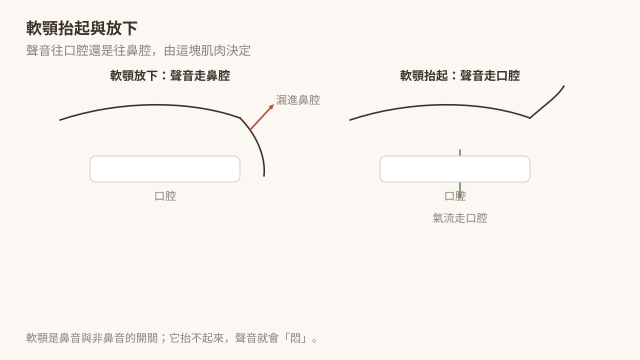
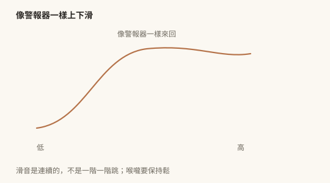

# [歌唱教學] 初階 第 10 章：點亮聲音：鼻腔與頭腔共鳴的初步感受 (讓聲音變明亮、通透的簡單方法)

## 先講結論

高音上不去，常常不是音不夠高，是你把整個胸腔的重量一起拖上去。

音越高，適合放大的空間越小。你要把振動的位置從胸口移到鼻樑、顴骨一帶，同時讓喉嚨更鬆，不是更用力。

這一章做兩件事：找到鼻樑的震動，分辨它和感冒鼻音的差別；再用滑音確認胸口到臉上這條路是通的。

## 常見誤解

很多人一聽到「鼻腔共鳴」就抗拒，因為聯想到鼻塞那種扁扁的聲音。兩者差很多。感冒鼻塞是鼻腔通道被擋住，聲音進不去鼻子，少了鼻共鳴，所以聽起來悶、扁；鼻腔共鳴是聲音從嘴巴正常出來，只是軟顎微開、讓一部分氣流與振動進到鼻腔，多加一點色彩。

另一個誤解是「唱高音要從下面把聲音推上去」。推上去的通常是一整團厚的聲音，到了高音就變成拉扯。比較容易的做法是換空間：放掉胸口的重量，讓振動往上移。

## 原理：為什麼會這樣

先把一個容易搞錯的說法講清楚：頭骨不是音箱。它裡面雖有鼻竇等小氣腔，對聲音的放大卻非常有限。內視鏡觀察顯示，古典唱法說的「頭聲」，實際上對應的是聲道形狀的改變，不是聲音真的跑進頭骨（Aura et al., 2022）。

那「亮」從哪裡來？一部分是鼻腔與聲道的高頻成分，另一部分來自喉嚨上方通道收窄後聚成的高頻能量群。用模型改變會厭腔的形狀，就能把這群能量調得更集中，這已經被模擬出來（Vampola et al., 2024）。所以亮是通道形狀的結果，不是力氣。

空間大小和頻率有關：比較大的空間適合低頻，比較小的空間適合高頻。音高上升時，把振動放在比較高的位置，高頻成分比較容易出來，聲音就變亮、變集中。

但這不是「把聲音搬過去」。共鳴腔是被動的，你改的是通道與口腔形狀：軟顎的位置、喉嚨的放鬆程度、母音的形狀。形狀對了，高頻自然會多；音量要增加時，這些調整也確實會跟著變（Vurma, 2022）。

為什麼要更放鬆？音越高，聲帶被拉得越薄，它需要的是更穩、更細的氣流，不是更大的力氣。你在外面夾緊，只會讓它更難振動。

音高是怎麼上去的？喉嚨裡有兩組小肌肉在調整聲帶：一組讓聲帶變厚變短，音變低；另一組把聲帶拉長拉薄，音變高。它們會自動配合，你從外面加力只會干擾這個過程。

## 打個比方

**從大廳走進小房間。** 同一個人、同樣的音量，在空曠的大廳講話會散掉，走進小房間就變得集中、清楚。不是你變大聲了，是空間變了。

**橡皮筋。** 同一條橡皮筋，拉長、繃緊，彈出來的聲音就高；放鬆、變短，聲音就低。拉到最緊的時候它也最脆弱，一撥就斷——這就是為什麼唱高音不要用蠻力。

**走鋼索。** 走鋼索的人手是張開的、身體是鬆的，越僵硬越容易掉。高音也一樣：越接近極限，越需要平衡，不是越需要用力。

## 現在就做

### 練習一：小狗哼唧

1. 站直，維持頭在肩膀正上方。
2. 輕輕皺鼻，像聞到酸味。
3. 閉唇，用偏高的音發「嗯——」，像小狗委屈的聲音。
4. 手指輕碰鼻樑，感覺細微的震動。

感覺：鼻樑發癢、發麻，喉嚨不緊。做錯會怎樣：如果震動跑到喉嚨、鼻子沒感覺，把音高往上移一點，氣流減小；如果變成喉音，先哼一個很輕的中音，找到鼻樑再往上。

### 練習二：從「嗯」打開成「阿」

1. 先哼「嗯——」，確認鼻樑在震。
2. 不斷氣，把嘴巴慢慢打開成「阿——」。
3. 打開的瞬間，震動要留在鼻樑與顴骨前方。
4. 做五次。

感覺：聲音變亮、變集中，像往前射。做錯會怎樣：一張嘴震動就掉回喉嚨，是嘴巴打開時連下巴也往前了。下巴保持不動，只開嘴唇與口腔。

### 練習三：貓頭鷹的「嗚」

1. 放鬆下巴，嘴唇成小圓形。
2. 用很輕、帶一點氣音的假聲發「嗚——」。
3. 手掌輕放下巴與喉嚨側面，感覺幾乎沒有多餘的擠壓。
4. 做三次。

感覺：聲音輕、飄，手掌幾乎感覺不到擠壓。做錯會怎樣：一出聲就變大、變厚，是胸聲跟上來了。把音量減到很小，先只求輕。

### 練習四：警報器滑音

1. 用彈唇從低音啟動，「噗——」。
2. 不斷氣，把音高慢慢往上滑。
3. 感覺震動離開胸口，往臉上移動。
4. 到高的地方不停留，平滑滑回來，做五次。

感覺：嘴唇持續震，音高在移動，喉嚨越來越鬆。做錯會怎樣：滑到一半卡住或斷掉，是下巴用力，或你把胸口的重量一起帶上去了。把最高音降低、範圍縮小，先求不斷。

### 練習五：用一句話確認

1. 挑一句你唱高音會緊的歌詞。
2. 先用彈唇跑旋律。
3. 再用「嗯」哼一次，確認高處的震動在臉上。
4. 最後把歌詞放回去，喉嚨保持鬆。

感覺：高音不再像在拉東西。做錯會怎樣：放回歌詞又變緊，是咬字把下巴帶出來了。子音減輕，先求位置對，再求字清楚。

## 練完之後

做對的徵兆：唱高音時喉嚨比唱低音更鬆；鼻樑或顴骨有震動；聲音變亮，但沒有變成感冒鼻音。

常見卡點是「一變亮就變大」。亮度不是音量，是頻率的比例。你可以很小聲卻很亮；追求大聲通常會讓位置掉回喉嚨。

另一個卡點是只用哼鳴。哼鳴是找位置的工具，最後還是要放進母音與歌詞，才知道有沒有真的會用。

下一章要處理真音與假音的轉換。那是胸口與頭部之間那道橋。

## 延伸查證

- **Aura, M., Geneid, A., & Bjørkøy, K. (2022).** A Nasoendoscopic Study of "Head Resonance" and "Imposto" in Classical Singing. *Journal of Voice.* 內視鏡觀察顯示「頭腔共鳴」是聲道形狀改變，不是聲音在頭骨裡放大。PMID 32513553。
- **Vampola, T., Horáček, J., & Laukkanen, A. M. (2024).** Three-Dimensional Finite Element Modeling of the Singer's Formant Cluster Optimization by Epilaryngeal Tube Shaping. *Journal of Voice.* 會厭腔那一段的形狀會影響高頻能量是否集中；「亮」是形狀問題。PMID 39218756。
- **Vurma, A. (2022).** Amplitude Effects of Vocal Tract Resonance Adjustments When Singing Louder. *Journal of Voice.* 音量變化時，聲道共鳴的調整是可量測的；亮度與音量是兩件事。PMID 32624371。
