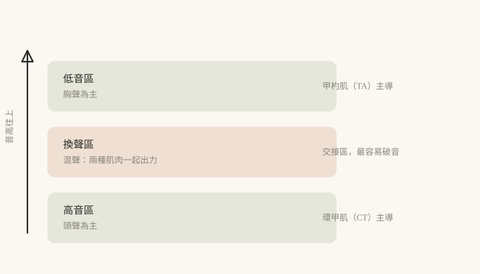
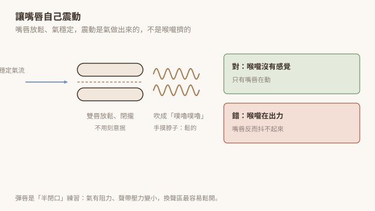
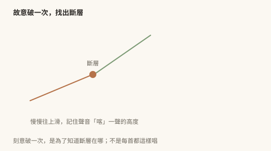

# [歌唱教學] 初階 第 11 章：跨越音域的橋樑：認識真音與假音 (真假音的基本聽覺分辨與發聲嘗試)

## 先講結論

真音和假音不是「真」與「假」的差別，是聲帶振動方式的差別。真音是整片聲帶一起振動，厚、實、有力；假音只有聲帶邊緣在振動，薄、輕、會漏氣。兩種都是正常聲音，沒有誰比較高級。

這一章要你能聽出自己的兩種聲音，並且在低音與高音之間故意來回切換。先能分開，以後才談得上接起來。

如果你現在直接跳上去會「喀」一聲斷掉，那不是你沒天分，是中間少了一座橋。這一章會給你兩座：彈唇和哼鳴。

## 常見誤解

很多人以為用假音唱高音是「逃避」，覺得會唱真音才叫有實力。其實歌裡那些一碰就碎的柔、飄、嘆息，多半是假音做的。整首都用真音硬撐，聽起來只會像在喊口號。

另一個誤解是「假音要用力擠才發得出來」。剛好相反。假音的重點是放掉喉嚨的力氣，讓氣流順一點、聲帶只輕輕靠著。你一擠，聲帶就被夾緊，它反而出不來，還會刮喉嚨。

還有人把「假音」和「氣音」混在一起。氣音是幾乎不震動、只有氣流；假音是聲帶邊緣有在震動，只是同時漏氣。假音是有音高的，氣音沒有。

## 原理：為什麼會這樣

真音（也有人叫胸聲、模態聲）是聲帶整片閉合、一起振動。聲帶愈厚，振動愈慢，音就愈低；這種聲音有核心、有重量，平常說話、喊人、大笑都是它。你講話時不會特別覺得「我在唱歌」，因為真音本來就接近說話的狀態。

假音是聲帶被拉長拉薄，只有邊緣靠在一起振動，中間留著小縫，氣會漏出去。所以假音一定帶氣音，音量也做不大。這不是缺點，是它的構造。你聽到的那種「飄」，就是漏氣造成的。

兩種振動方式在聲帶上的差別，可以用「閉合的位置」來看：真音是整片黏膜一起閉合，假音只有邊緣碰到。聲帶不是被切換成另一條，而是同一條被拉長、被不同方式靠攏（Titze et al., 2014）。

兩者中間有一個換聲區。初學時直接從低音唱到高音，聲音常會在這裡「喀」一聲斷掉。那不是你的音域到頂了，是振動方式臨時換不過去。斷掉的地方，就是你該練的地方。真正要練的不是「不要斷」，而是「斷了也知道自己在哪裡」。

## 打個比方

**換檔。** 騎腳踏車遇到上坡，你會換到輕一點的檔。鏈條沒有換一條，只是換了齒輪的咬合方式。真音和假音也是這樣：同一條聲帶，換的是肌肉的用力比例（甲杓肌把聲帶縮短變厚、環甲肌把它拉長變薄）。換檔的時候腳會頓一下，那就是你的「喀」。不會有人因為換檔頓一下，就說這台車壞了。

**小提琴的泛音。** 同一條弦，按實了拉是厚實的音；手指輕輕碰在弦的中間，會發出細而亮的高音。弦沒換，是振動的範圍變了。假音就是聲帶的「泛音」——不是另一條聲帶，是同一個東西只讓邊緣震。

**踩到一半的離合器。** 很多人唱不上假音，是因為油門（氣）一直踩，離合器（聲帶閉合）卻還咬著不放。你要做的是先鬆開咬合，再補氣；順序反了，聲音就卡在兩者之間。

## 現在就做

### 練習一：先確認真音

1. 站直，想像朋友在馬路對面，你要叫他。用平常的音量喊「嘿！」。
2. 手放胸口，再喊一次。你應該感覺到胸口在震，聲音有核心。
3. 喊三次。不要為了大聲而壓喉嚨。

做錯會怎樣：如果一喊脖子就粗、喉嚨痛，代表你用喉嚨代替了氣。把音量減半，先求放鬆。真音不等於大聲，它可以很小聲卻仍然結實。

### 練習二：用彈唇找到「不要用力」的感覺

彈唇（lip trill）是這一段最重要的練習：它讓你在一種「聲帶不用出力的狀態」下送氣。嘴唇被氣吹到震動，氣在口腔裡遇到阻力，聲帶反而輕鬆（Titze, 2006）。

1. 嘴唇放鬆閉上，像要吹蠟燭，但不要嘟嘴。
2. 用一口穩定的氣讓嘴唇「噗嚕噗嚕」震動，先不出聲，做五次、每次三秒。
3. 維持震動，加上一個舒服的中低音「嗚」，讓聲音跟著嘴唇一起抖。
4. 同樣的震動，從低音慢慢滑到高音，再滑回來。滑的過程不要停、不要加大音量。

感覺：嘴唇在抖，喉嚨沒有感覺；如果脖子出現用力感，代表氣太強或嘴唇太緊。
做錯會怎樣：嘴唇完全抖不起來，通常是嘴唇繃太緊或氣太弱；先只練「噗嚕」的出氣，不發聲。如果一滑高音就斷，把速度放慢，讓嘴唇帶著你走，而不是你帶著嘴唇衝。

### 練習三：用哼鳴找到假音的位置

哼鳴（humming）同樣是半閉口練習，差別是這次氣有一小部分走鼻腔，你會更容易感覺到「臉上的震動」而不是「喉嚨的擠壓」。

1. 閉嘴，發一個舒服的「嗯——」，三秒。
2. 手摸鼻樑與臉頰，確認有微微的震動感。
3. 保持同樣的感覺，把嘴張開成「阿」，音高不變。震動的位置不要掉到喉嚨。
4. 從「嗯」直接往上滑到假音，再滑回來。做五次。

做錯會怎樣：如果「嗯」聽起來悶、像感冒，是把氣全塞進鼻腔了；把嘴周放鬆，讓氣留一點在口腔。如果張開成「阿」時聲音立刻散掉，代表你是靠鼻子撐著，不是靠氣流撐著；回去把音量減小。

### 練習四：故意破一次

1. 用舒服的低音唱「啊」，這是真音。
2. 不要停，直接往上跳，跳到你自然斷掉的那個音，變成假音。
3. 再跳回低音，再跳上去，來回五次。
4. 注意那個「喀」的瞬間：那不是失敗，是兩套肌肉在交接。

做錯會怎樣：如果跳上去時喉嚨痛，代表你帶著真音的力氣硬衝。把高音降低一點，縮小兩端的距離。如果怎麼跳都停留在真音，代表跳得不夠高，往上加一點。

### 練習五：跟著一句歌詞走

1. 挑一句有明顯高低起伏的歌詞。
2. 低音處用真音唱，最高的一個字換成假音。
3. 再唱一次，把換的那個字提前或延後，感受差別。
4. 錄音聽一遍，確認兩個聲音真的不一樣。

做錯會怎樣：如果整句聽起來是同一個聲音，代表你沒有真的換，只是把音高硬撐上去。回到練習三或四，先把兩極分開，再放進歌裡。

## 練完之後

做對的徵兆：你能在五次之內清楚切出「厚」和「薄」兩種聲音，而且切換時喉嚨不會痛；假音聽起來有氣，但音高是準的；你能在一句歌詞裡故意換一次，而且知道自己換在哪個字。

常見卡點是「假音越唱越用力」。一用力，聲帶就閉緊，假音會變成擠出來的真音，聽起來很緊。練習時刻意小聲，是為了讓邊緣振動有機會發生，不是因為小聲好聽。

還有一種卡點是「不敢放手」。很多人到了換聲區會下意識減速、閃避，結果永遠不知道那條線在哪。故意破幾次，比假裝沒有換聲區安全得多。破音本身不傷聲帶，硬撐才是。

下一個要處理的是歌的段落：什麼時候該收，什麼時候該放。

## 延伸查證

- **Titze, I. R. (2006).** Voice training and therapy with a semi-occluded vocal tract: rationale and scientific underpinnings. *Journal of Speech, Language, and Hearing Research, 49*(2), 448–459. 這篇是「彈唇、哼鳴、吸管發聲」這類半閉口練習的理論基礎：口腔後方增加阻力，聲帶可以用較低的壓力振動。PMID 16671856。
- **Titze, I. R., et al. (2014).** Bi-stable vocal fold adduction: a mechanism of modal–falsetto register shifts and mixed registration. *Journal of the Acoustical Society of America.* 說明真音與假音是同一條聲帶的兩種閉合狀態，不是兩條不同的聲帶。PMID 25235006。
- **Differences Among Mixed, Chest, and Falsetto Registers: A Multiparametric Study (2023).** *Journal of Voice.* 以聲學與氣動參數比較胸聲、混聲、假聲三種登記，量測上確實可以區分，但界線是連續的。PMID 33518476。
- **Titze, I. R. (1994).** *Principles of Voice Production.* Prentice Hall. 聲帶振動與音高的力學基礎（教科書，沒有 PMID）。
