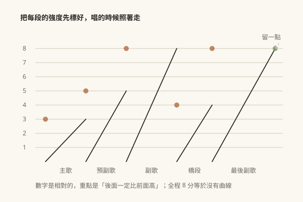
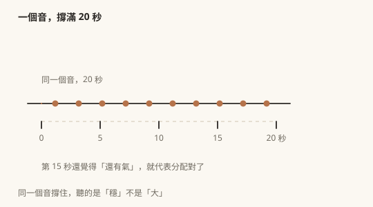
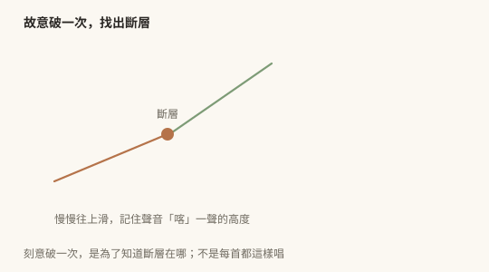

# [歌唱教學] 初階 第 12 章：流行歌曲的標準結構：主歌與副歌的層次差異 (認識 Verse 與 Chorus 的基本動態)

## 先講結論

同一首歌裡，主歌和副歌做的是兩件不同的事。主歌把字送到聽的人耳朵裡，副歌讓聲音穿過伴奏、傳到房間的另一頭。

副歌聽起來大，不是因為你唱得用力，是因為前面主歌先收了。落差做出來，副歌才成立。

這一章要把力氣分配好：主歌用六成，導歌推到七成半，副歌才用得上剩下的。練完之後，你會有一次唱完整首、還有餘力的感覺。

## 常見誤解

很多人以為副歌就是全曲最大聲的地方，所以從第一句就開到八分。結果副歌真的來了，他只剩吼。耳朵對音量會適應，同一個音量持續一段時間就不覺得大聲了，你要更大只能更用力，最後就是破音。

也有人把「大聲」和「用力」當成同一件事。真正讓聲音變大的是氣流量、聲門下壓力，加上聲道形狀的調整（Vurma, 2022）。喉嚨用力只是把出口捏緊，聲音會變刺、變扁，還送不遠。

第三個誤解是「主歌隨便唱，反正重點在副歌」。聽眾決定要不要繼續聽，通常在前十幾秒。主歌糊掉，副歌再大也沒人待到那裡。

## 原理：為什麼會這樣

流行歌的骨架大致是主歌、導歌、副歌，再一輪，中間放橋段，最後一次副歌收。這個順序能活下來，是因為它符合人聽故事的節奏：先交代，再累積，最後釋放。

發聲上的差別不在「用力多少」，而在三個東西的位置。第一是音高：主歌接近說話的音高，副歌往上走，環甲肌把聲帶拉長拉薄，音才上得去。第二是氣流量與聲門下壓力：副歌需要更多氣、更高的壓力，聲音才有辦法越過伴奏。第三是聲道形狀：唱大聲的時候，咽喉與口腔的空間會調整，把中高頻的能量拉起來，那就是聲音「穿透」的原因（Vurma, 2022）。

還有一個實務上的觀察：音量與音高一起上去的時候，頸部與肩部的肌肉活動容易跟著增加（Pettersen, 2005）。也就是說，你越大聲越容易用錯地方。所以副歌要練的其實是「不用喉嚨的大聲」。

支撐也沒有單一標準姿勢。有研究比較不同歌手投射聲音時的軀幹動作，發現他們用不同的策略達到相似的結果（Thorpe, 2001）。所以別人唱副歌時肚子長什麼樣，你不必照抄，你要抄的是「氣流穩定」這個結果。

## 打個比方

**同一杯糖水。** 先喝一口全糖的，再喝這杯三分糖，會覺得沒味道；但如果先喝白開水，三分糖就甜了。耳朵對音量和亮度就是這樣工作的：它比的是前後，不是絕對值。副歌的大，是被主歌的小「墊」出來的。

**水龍頭和捏水管。** 想讓水柱沖遠一點，你是把水龍頭開大，還是把水管前端捏扁？捏扁之後水柱變細、變快、亂噴，這就是用喉嚨加音量：聲音變刺，但送不遠。把閥門開大才是加氣，水柱變粗、變穩，那是副歌該做的事。差別在出口，不在你多用力的手。

**跑八百公尺的配速。** 起跑就衝的人，三百公尺就沒了。主歌是前四百，導歌是彎道，副歌是最後直道。你要做的是「留」，不是「省」：主歌仍然要唱得清楚、有情緒，只是不把最後那口氣用掉。

## 現在就做

### 練習一：先標分數，不要唱

1. 挑一首主歌副歌分明的抒情歌，把歌詞抄下來，段落之間留白。
2. 主歌標 3、導歌標 5、副歌標 8，滿分十分。比的是「聽起來多大」，不是「多用力」。
3. 用說的唸主歌，音量像對坐在對面的人講話。
4. 唸副歌時，改成對十公尺外的人講，音量加大但不要喊。

感覺：唸副歌時下腹有一點撐住的感覺，喉嚨沒有。
做錯會怎樣：如果唸副歌時脖子變粗、聲音變沙，你是在用喉嚨加音量。把距離想近一半，先求每個字清楚。

### 練習二：一個音滑大小

1. 吸氣，用偏低的音唱「嗚——」，音量小。
2. 不斷氣，音量在五秒內慢慢推到最大，音高不要跟著往上跑。
3. 手摸鼻樑，確認大聲時臉部有一點震動，不是只有喉嚨在撐。
4. 再用五秒收回最小。做五次。

感覺：大聲時痠的是側腰，不是喉嚨；小聲時音高沒有掉。
做錯會怎樣：如果音量一大、音準就往上飄，你是在用音高假裝音量。開一個參考音，盯著它唱。

### 練習三：只練接縫

1. 只挑導歌最後一句和副歌第一句，其他都不唱。
2. 先唸一遍，標出換氣點落在哪個字後面。
3. 唱這兩句：導歌維持五分，副歌第一個字直接跳到八分。
4. 重複十次，每次換氣都在同一個位置。

感覺：進副歌那一下像「放出去」，不是「擠上去」。
做錯會怎樣：如果每次進副歌的時間都不一樣，是你在猜拍子。跟著伴奏數四拍，把換氣點釘死。如果進副歌時喉嚨癢，是把氣從脖子推出來的，改從側腰送。

### 練習四：整首唱一遍，錄音

1. 主歌刻意比平常小一半，導歌照標記，副歌放到你控制得住的最大。
2. 整首唱完，中間不要停下來檢討。
3. 錄下來，只聽三件事：主歌的字清不清楚、副歌有沒有比主歌大、唱完喉嚨有沒有熱熱的。
4. 如果副歌不夠大，先回頭把主歌再收一點，不要先加大副歌。

做錯會怎樣：如果主歌小到字糊掉，你收過頭了。小的底線是每個字都聽得懂。如果唱完喉嚨乾、想喝水，代表副歌用錯力。

## 練完之後

做對的徵兆：副歌不用吼就比主歌大一截；整首唱完還能再唱一次；錄音裡主歌清楚，副歌不刺耳。

常見卡點是「一上場就開太大」。腎上腺素會讓你比練習時大聲，主歌的「小」就不見了。上台前先唸一句主歌，把音量校準。

另一個卡點是「導歌就唱滿」。導歌是樓梯，不是電梯。壓在五分，副歌才有位置站。

下一章要處理 KEY：同一首歌，原唱唱得輕鬆，你卻卡住，問題常常不在技巧，在音高。

## 延伸查證

- **Vurma, A. (2022).** Amplitude Effects of Vocal Tract Resonance Adjustments When Singing Louder. *Journal of Voice.* 唱得更大聲時，聲道共鳴的調整是可量測的動作，不只是「感覺」。PMID 32624371。
- **Pettersen, V., Bjørkøy, K., & Torp, H. (2005).** Neck and shoulder muscle activity and thorax movement in singing and speaking tasks with variation in vocal loudness and pitch. *Journal of Voice.* 越大聲、越高音，頸肩的肌肉活動越容易增加。PMID 16301107。
- **Thorpe, C. W., Cala, S. J., & Chapman, J. (2001).** Patterns of breath support in projection of the singing voice. *Journal of Voice.* 支撐不是單一動作，不同歌手用不同的軀幹策略達到同樣的投射。PMID 12269638。
