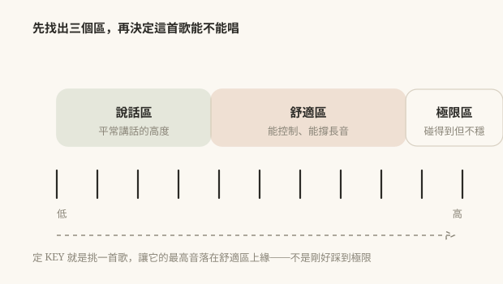
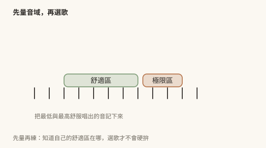

# [歌唱教學] 初階 第 13 章：定 KEY 的藝術：找到最舒適的表達音區 (無音樂基礎者的簡易音域測試法)

## 先講結論

唱起來卡，很多時候不是技巧的問題，是這首歌的音高不適合你。每個人的聲帶長度、厚度、聲道大小都不一樣，能舒服唱出的範圍自然不同。

這一章只做一件事：用手機的升降 KEY 功能，測一首歌對你來說的最高音和最低音，調到兩端都唱得出來。不用懂樂理，也不用有絕對音感。

調對之後，最直接的變化是副歌不再像在求生，主歌也不再虛掉。

## 常見誤解

很多人以為「降 KEY 就是認輸，能唱原 KEY 才叫會唱」。原唱定那個 KEY，是因為那個音高適合他的聲帶。你硬套別人的 KEY，等於穿別人的鞋跑步：跑得完是運氣，跑不遠是正常。

另一個誤解是「唱不上去，多練幾次就上去了」。如果那個音高超過你目前的範圍，多練只會讓喉嚨越來越緊。音域可以慢慢變寬，但不是靠反覆硬撐同一句。

還有人以為「升 KEY 一定比較難」。對低音偏弱的人來說，升 KEY 反而讓主歌變好唱，只是副歌要重新確認。KEY 沒有方向的好壞，只有位置對不對。

## 原理：為什麼會這樣

一首歌的音域，是它最高音與最低音之間的距離。你身上也有一個目前唱得舒服的範圍，中間那段是「怎麼唱都不太費力」的區域，兩端各有一段「擠一下可以，但撐不久」的緩衝。

所謂定 KEY，就是把歌的音域整段平移，讓它落在你的舒適區裡。平移的時候兩端會同時移動，所以你必須測兩次：先看最高音有沒有超出去，再回頭看最低音有沒有掉出來。只看一端，你一定會調錯。

音域這件事最好別憑感覺。臨床上用「音域圖」量測，會同時記錄每個音高能唱到多小聲、多大聲，是標準化的客觀檢查（Berger, 2022）。你用手機測不到那麼細，但同一個原則適用：唱得到，不等於唱得穩。

還有一件容易被忽略的事：音準同時依賴聽覺與身體感覺（Mürbe, 2002）。在 KTV 或耳機裡，伴奏與自己聲音的音量比例一變，你判斷音高的依據就跟著變。而且外部的回饋音量開太大，音準反而會變差（Bottalico, 2017）。所以測 KEY 的時候，把監聽調到「聽得見自己、也聽得見伴奏」，不要為了嗨而把自己蓋掉。

## 打個比方

**別人的鞋。** 同一雙鞋，腳長差半號就會磨。你不會因為穿不進別人的鞋，就說自己的腳有問題。KEY 也一樣：歌沒問題，你的腳也沒問題，是這雙不合。

**限高架。** 卡車過不去限高龍門架，不是卡車不好，也不是路不好，是這條路的淨空高度不適合這台車。降 KEY 就是換一條路線，目的地一樣到得了。硬闖只會撞壞東西，那個東西叫聲帶。

**畫框與掛勾。** 歌的音域是畫框，大小固定；你的音域是牆上的掛勾高度。同一幅畫可以掛高一點或低一點，重點是整幅都在你的視線裡，不要一半在天花板上。

## 現在就做

### 練習一：直接攻最高音

1. 挑一首你一直覺得難唱的歌，找出全曲最高的那一句，通常在最後一次副歌。
2. 播原 KEY 伴奏，只唱那一句，前面都不要唱。
3. 檢查三件事：脖子有沒有變粗、下巴有沒有往前伸、聲音有沒有從「唱」變成「喊」。
4. 三項有任何一項成立，就是紅燈。

感覺：過關的時候，最高音唱上去還能拉長半拍，而且不覺得自己在用力。
做錯會怎樣：紅燈了還反覆硬唱，聲帶會開始疲勞，後面測什麼都不準。一次不對就降，不要戀戰。

### 練習二：一次降半音

1. 把伴奏降一個半音，再唱同一句。
2. 還緊就再降半音，一次只降一格。
3. 停在「唱得上去、喉嚨不痛、最後還能拉長」的那一格。
4. 把這個數字記下來，例如「降二」。

做錯會怎樣：一次降太多，你會不知道最緊的那一格在哪，下次還是抓不準。如果降到很低還緊，問題可能不在 KEY，在這一句的發聲方式，回頭看上一章。

### 練習三：回頭檢查最低音

1. 用剛才找到的 KEY，回到第一段主歌的第一句，那通常是全曲最低的地方。
2. 用說話的音量唱，不要刻意壓低。
3. 檢查：字清不清楚、胸口有沒有震動感、聲音有沒有被伴奏的低音蓋掉。
4. 如果主歌掉出去了，往上調一格再測。

感覺：過關的時候，低音是「鬆鬆地講出來」，不是「擠出來」。
做錯會怎樣：如果為了唱低音把下巴壓進脖子，聲音會悶住。那是壓出來的，不是唱出來的。

### 練習四：記下你的密碼

1. 在歌單上寫下這首歌對你的 KEY，例如「降二」。
2. 同樣的方法測三首歌，看數字有沒有接近。
3. 三個數字都在附近，那就是你目前最舒服的區間。
4. 下次點歌先照這個數字調，再微調一格。

做錯會怎樣：三首差很多是正常的，因為每首歌本身的音域跨度不同。重點不是同一個數字，是每次都測兩端。

## 練完之後

做對的徵兆：副歌最高音唱得上去，還能做漸弱；主歌最低音清楚、有厚度；整首唱完喉嚨不痠。

常見卡點是「高音剛好，低音卻唱不出來」。這代表這首歌的音域跨度比你目前的範圍大。不是你的錯，也不是歌的問題，只是它現在不適合你。先放著，範圍會慢慢變寬。

另一個卡點是「在 KTV 不敢降」。唱歌是給人聽的，不是比賽。降兩格唱得穩、唱得有感，比硬撐原 KEY 破音好聽太多。

下一章要處理的是情緒的分配：同一首歌，什麼地方該收，什麼地方該全放。

## 延伸查證

- **Berger, T., Fuchs, M., & Dippold, S. (2022).** Standardization and Feasibility of Voice Range Profile Measurements in Epidemiological Studies. *Journal of Voice.* 音域圖是標準化的客觀量測，不是憑感覺說「我唱得到」。PMID 32402662。
- **Mürbe, D., Pabst, F., & Hofmann, G. (2002).** Significance of auditory and kinesthetic feedback to singers' pitch control. *Journal of Voice.* 音準同時依賴聽覺與身體感覺；戴耳機或監聽比例改變時，兩者會衝突。PMID 12002886。
- **Bottalico, P., Graetzer, S., & Hunter, E. J. (2017).** Effect of Training and Level of External Auditory Feedback on the Singing Voice: Pitch Inaccuracy. *Journal of Voice.* 外部回饋音量太大，音準反而變差。PMID 26948385。
