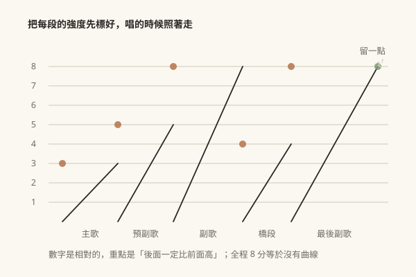
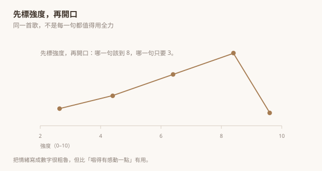
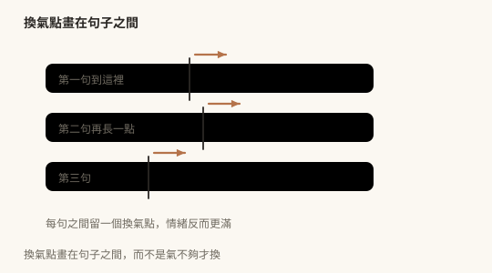

# [歌唱教學] 初階 第 14 章：畫出情緒線：讓唱歌像說故事一樣自然 (基礎的情感量化與段落分配)

## 先講結論

唱得有感情，不是從頭到尾很用力，是知道哪裡該收、哪裡該放。整首維持同一種強度，聽的人十分鐘就膩了。

這一章要你在歌詞旁邊標數字，替每一段定一個強度，然後照著唱。有了這張圖，你才不會被當下的心情牽著跑。

做完你會發現：最感人的那一句，通常不是最大聲的那一句。

## 常見誤解

很多人以為有感情就是放飛自我，眉頭一皺、聲音一啞就叫投入。那其實是失控。情緒一上頭，氣息先亂，喉嚨接著夾緊，聲音很快就會壞，而且壞在台上。

另一個誤解是「設計過就不真」。演戲照劇本演，你還是會哭。有設計才穩定，穩定才傳得出去。

還有人把「小聲」等同「沒感情」。小聲比大聲更難唱，它需要更多支撐，不是更少。很多人一收小就變成虛，那是支撐掉了，不是情緒進去了。

## 原理：為什麼會這樣

強度可以拆開來看。它至少包含四個東西：音量、氣流量、音色的亮暗（共鳴位置），還有咬字的鬆緊。同樣是「大聲」，可以用很亮的音色吼，也可以用厚而暗的音色推，聽起來完全是兩種情緒。

這不是玄學，是量得出來的。比較 belt（偏喊的唱法）與中性唱法，兩者在呼吸型態、聲壓與共振峰策略上都不同（Sundberg & Thalén, 2015）。也就是說，當你決定「這一段要更衝」，你其實是在換一整套設定，不只轉音量旋鈕。

教學系統也把這件事講得很明白：CVT 把聲音分成 neutral、curbing、overdrive、belting 四種模式，各有對應的音量與音色，並有研究評估這套分類在教學上的可行性（McGlashan, 2023）。你可以把它想成四種「檔位」，同一首歌裡本來就會換檔。

至於「支撐」，它沒有單一的正確動作。研究不同歌手投射聲音的方式，發現他們用了不一樣的軀幹策略，結果都能達到投射（Thorpe, 2001）。所以情緒圖上寫「八分」，不是要你模仿某個人的肚子，是要你達到那個結果。

## 打個比方

**一鍋湯的鹽。** 從第一碗就要夠鹹，最後一碗也夠鹹，這鍋湯就毀了。聰明的做法是前面淡一點，讓舌頭有空間，最後那碗再補。情緒線就是鹽的分配：不是每一段都要到位，是留給該到位的那一段。

**雲霄飛車的第一段爬升。** 車子一開始慢慢往上，你覺得無聊，但那一段是必要的，因為沒有它，後面的俯衝就不叫俯衝。第一次副歌如果就到十分，最後一次副歌只能停在十分，整首就變成一條平的高線。

**換氣就是標點符號。** 同一句話，逗號放哪裡，意思就不一樣。「我不要，你走」和「我不要你，走」，字一樣，氣完全不同。換氣不只補氧氣，它替你斷句，也替聽的人留時間。你偷偷快速吸氣，聽起來就是趕；你慢慢吸，聽起來就是捨不得。

## 現在就做

### 練習一：標一張情緒地圖

1. 把歌詞抄下來，保留段落順序，行距留寬。
2. 第一次主歌標 3，第一次副歌標 7。
3. 第二次主歌標 4（比第一次多一點），橋段從 6 推到 8。
4. 最後一次副歌標 9。分數寫在歌詞右邊，用鉛筆。

做錯會怎樣：如果每段都標八分以上，這張圖就沒用了。回頭把開頭壓到 3，讓後面有地方可以升。如果標完發現自己不知道 3 和 7 差在哪，先用嘴巴唸，不要用唱的。

### 練習二：用說的演一次

1. 不唱歌，只用說的把整首歌詞唸完。
2. 3 分的地方，想像聽眾坐在你對面一步的距離。
3. 8 分的地方，想像聽眾在對街。
4. 每次換段，身體要真的切換：站姿、下巴角度、眼神都換。

感覺：唸到 8 分時，痠的是下腹，不是喉嚨；字還是清楚的。
做錯會怎樣：如果唸到 8 分聲音就破，你一次跳太多了。從 5 分開始，一段一段加上去。如果唸完覺得很尷尬，那是正常的，你正在做一件平常不會做的事。

### 練習三：設計三種換氣

1. 在句子中間標「v」，代表快速、無聲地偷一口氣。
2. 在主歌標「h」，代表嘆氣式的吸氣，讓它聽起來像在忍。
3. 在進最後副歌前標「V!」，代表明顯、深沉地吸一口。
4. 照著符號唸一次，聽同一句話的意思有沒有變。

做錯會怎樣：如果每個地方都標「V!」，整首會像在喘。大口的換氣一次就夠，留給真正需要的那個點。

### 練習四：用畫面代替回憶

1. 挑一段你最有感覺的段落。
2. 唱的時候不要回想自己的傷心事，改想一個具體畫面：雨滴在玻璃上慢慢滑下來。
3. 用那個畫面的速度去唱，不要用回憶的濃度去唱。
4. 錄一次，聽聲音有沒有變穩。

做錯會怎樣：如果一想到真實的傷心事就開始哽咽、唱不下去，那是情緒壓過控制。畫面法的目的，是讓你被畫面帶著走，不是被回憶淹沒。

### 練習五：照表唱一遍

1. 看著標好分數與換氣點的歌詞，配伴奏唱一次。
2. 每段開始前先看一眼那個數字，再開口。
3. 唱完對照：哪一段唱得比標記大，哪一段比標記小。
4. 只修最偏的那一段，其餘先不要動。

做錯會怎樣：如果每段都偏大，那是緊張，不是設計。整張圖往下壓一格。如果唱到一半忘記看，先放下伴奏，只用手指著歌詞練。

## 練完之後

做對的徵兆：整首有高低起伏，不是平的；最強的地方之所以強，是因為前面收過；唱完情緒是散的，身體不是虛的。

常見卡點是「越唱越嗨」。副歌一上頭，分數就失控，後面全部變大聲。練習時盯著自己標的數字唱，讓眼睛幫你踩煞車。

另一個卡點是「只有大聲和小聲」。同樣 3 分，也可以有冷的三分和暖的三分，差別在音色與咬字。分數只是骨架，語氣才是血肉。

下一章要處理保養。聲音是消耗品，會用也要會養。

## 延伸查證

- **Sundberg, J., & Thalén, M. (2015).** Respiratory and Acoustical Differences Between Belt and Neutral Style of Singing. *Journal of Voice.* belt 與中性唱法在呼吸、聲壓與共振峰策略上不同，不是同一個設定轉音量。PMID 25819162。
- **McGlashan, J., Aaen, M., & White, A. (2023).** A mixed-method feasibility study of the use of the Complete Vocal Technique (CVT), a pedagogic method to improve the singing voice. *Pilot and Feasibility Studies.* CVT 的四大模式（neutral／curbing／overdrive／belting）與教學可行性。PMID 37226281。
- **Thorpe, C. W., Cala, S. J., & Chapman, J. (2001).** Patterns of breath support in projection of the singing voice. *Journal of Voice.* 支撐沒有單一正確姿勢，不同歌手用不同軀幹策略達到投射。PMID 12269638。
