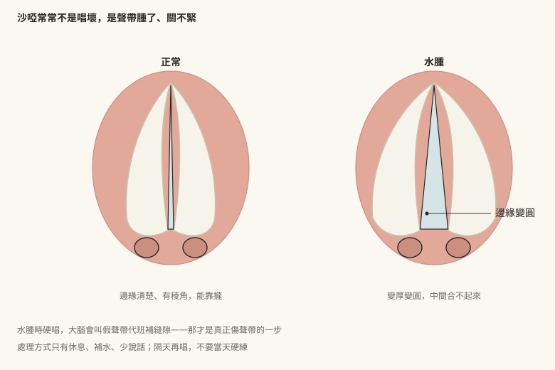
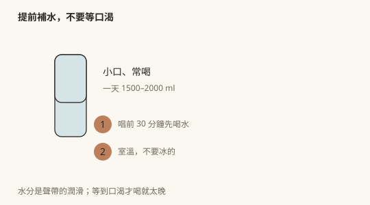
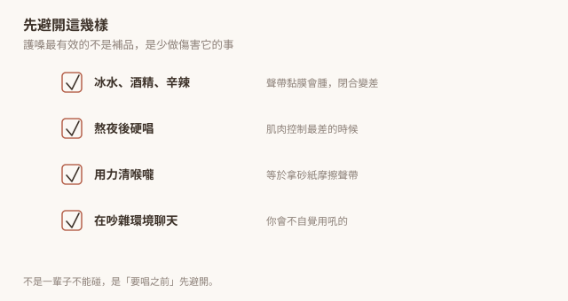
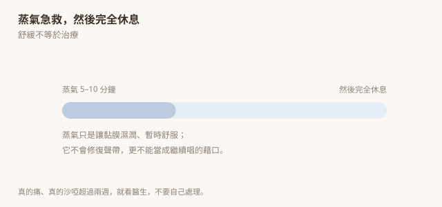
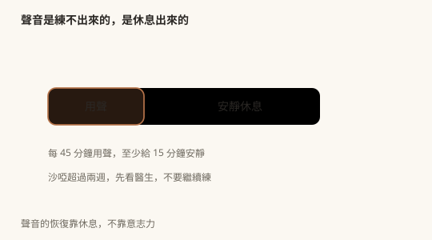
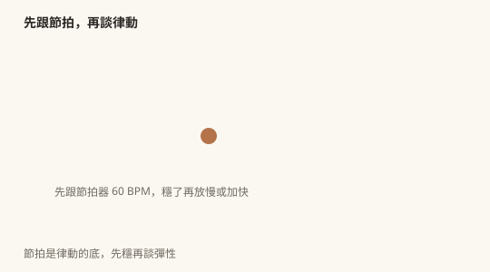

# [歌唱教學] 初階 第 15 章：護嗓指南：日常保養與維持治癒好聲音 (水分補充、飲食建議與喉嚨休息法)

## 先講結論

聲帶是消耗品。技巧再好，遇到乾燥、發炎、過度使用，它還是會壞。

這一章只講三件事：怎麼補水、少碰什麼、累了怎麼休息。這三件做對，比任何偏方有用。

還有一件事要先說清楚：保養的重點是「不要讓它變糟」，不是「讓它變好」。變好要靠練習與睡眠，不是靠喝什麼。

## 常見誤解

很多人以為喉糖、枇杷膏可以直接潤滑聲帶。不會。吞嚥的時候會厭軟骨會蓋住氣管，你吞下去的東西走的是食道；聲帶長在氣管頂端，兩條路是分開的。喉糖頂多讓喉嚨感覺涼涼的，真正供給聲帶水分的是你的血液。

另一個更危險的誤解是「沙啞時用氣音說話比較保護」。氣音是聲帶沒有完全閉合、中間留著縫的狀態，氣流一直從縫裡漏出去。對已經腫的聲帶來說，那是長時間的磨。沙啞時最好的處理是少說話，不是換一種聲音繼續說。

還有人習慣「唱不上去就清一下喉嚨」。清喉嚨那一下，是讓兩片聲帶用力對撞，撞擊力道比唱高音還集中。想清的時候，改成吞口水或喝一小口溫水。

## 原理：為什麼會這樣

聲帶表面有一層薄薄的黏液，振動時它是緩衝。這層黏液的品質，取決於你全身的含水量。但水不是喝了就到：水要經過腸胃吸收、進入血液、再由黏膜分泌出來，需要一段時間。所以上台前五分鐘灌一大瓶，只會讓你想上廁所。

振動本身會產生熱。長時間說話或唱歌，聲帶會疲勞、輕微腫脹，聲音開始毛、高音變難。這是正常的，休息會回復。真正造成慢性問題的是「疲勞了還硬操」。

溫度的影響常被誇大。太燙的飲料會刺激黏膜；冰的飲料其實不會直接碰到聲帶，但有些人喝下後喉部有緊縮感。常溫或微溫最中性，喝了冰的如果沒有不舒服，不必勉強忌口。

胃酸是另一個容易被忽略的敵人。吃太飽、太油、吃完馬上躺下，胃酸可能逆流到咽喉，直接刺激聲帶。很多人早上起來聲音沙啞、高音不見，原因就在這裡。

至於暖嗓，它是有效的，只是效果限於「讓狀況穩定」，不是「讓音域變寬」。有研究比較教師使用暖嗓與收操的效果（Masson et al., 2019），也有研究直接比較蒸氣與半閉口練習當作早晨暖嗓的兩種做法（Keltz & McHenry, 2022）；兩者都能用，但蒸氣是舒緩，不是治療。

## 打個比方

**在鞋子外面擦鞋油。** 你把鞋油塗在鞋面上，擦得再亮，鞋裡面濕了也不會乾。喉糖就是鞋油：它接觸的是口腔與咽喉的表面，不是聲帶那一層。要讓裡面不濕，得從身體補水。

**兩扇門猛力對關。** 清喉嚨就像用力甩門，聲音很響，鉸鏈也很快壞。你以為清乾淨了，其實是兩片黏膜互相撞了一下。想清的時候，改成把門輕輕推開：吞口水、喝水。

**乾海綿吸水。** 乾的海綿丟進水裡，要等它慢慢吸；已經濕的海綿，一滴就夠。聲帶的黏膜就是那塊海綿。平常維持含水量，它隨時是濕的；乾了才猛灌水，來不及。

## 現在就做

### 練習一：提前補水

1. 算出你下次練唱的時間。
2. 從前兩小時開始，每十五到二十分鐘喝兩三口常溫水。
3. 一次不要灌一大杯，小口、規律。
4. 練唱中間維持同樣的節奏。

感覺：練完之後喉嚨是鬆的，不是乾的、熱的。
做錯會怎樣：上台前才灌一大瓶，你只會想上廁所，聲帶還是乾的。如果整天只喝咖啡和茶，利尿會讓水分流失更快，記得補回等量的清水。

### 練習二：先避開這幾樣

1. 練唱前兩小時，避開咖啡、濃茶、酒精。
2. 乳製品不一定會增加痰，但有些人喝了喉嚨會有包覆感、一直想清；如果你會，練唱前先避開。
3. 避開炸物、辣、過甜，這些容易刺激胃酸。
4. 真的吃了，練唱前至少留兩小時，而且不要吃完馬上躺下。

做錯會怎樣：如果練到一半一直想清喉嚨，先停下來喝水、吞口水，不要用力咳。清喉嚨只會讓喉嚨更想清，這是會上癮的循環。

### 練習三：蒸氣，不是熱氣

1. 倒一杯約七十度的熱水，臉靠近杯口，保持一個手掌以上的距離。
2. 用鼻子和嘴巴慢慢吸，五到十分鐘。
3. 感覺到喉嚨濕潤就停，不要吸到燙。
4. 聲音毛、高音變難的時候做一次。

做錯會怎樣：水太燙、距離太近，會燙傷黏膜，那比原本的問題嚴重。蒸完不要馬上喝冰水。如果每天早上都要靠蒸氣才開得了聲，那不是暖嗓問題，去看醫生。

### 練習四：安排真正的休息

1. 連續說話或練唱四十五分鐘後，停下來。
2. 給自己十五分鐘完全不講話、不哼歌、不講電話。
3. 一天安排兩到三次這樣的安靜時段。
4. 睡眠至少七小時，修復主要發生在睡覺的時候。

做錯會怎樣：如果休息時間還在滑手機、小聲聊天，那不算休息。聲帶要的是停下來。如果已經沙啞，休息要拉長到一整天。

### 練習五：收操比暖嗓更容易被跳過

1. 練唱結束前，用彈唇或哼鳴做兩分鐘的滑音，音量只有一半。
2. 再降回說話的音高，隨便唸兩句話。
3. 收操完不要立刻大吼或講電話。
4. 一週至少有一天完全不唱。

做錯會怎樣：練完直接收東西走人，聲帶還在高張力狀態，隔天容易毛。收操不需要久，需要的是每次都做。

## 練完之後

做對的徵兆：早上起來聲音是清的；練唱後喉嚨是鬆的，不是熱的、乾的；隔天沒有比前一天更沙啞。

常見卡點是「只有表演前才保養」。聲帶的狀態是累積的：前一天熬夜、喝酒、在吵雜的地方吼了一晚，當天再怎麼補救都有限。

另一個卡點是「啞了還想練開」。沙啞代表聲帶已經在發炎，這時候練唱只會更糟。休息、補水，等聲音回來再練。專業用聲者的嗓音衛生建議裡，最常被提到的就是這幾件基本的事（Behlau & Oliveira, 2009）。

初階到這裡結束。接下來要處理的是更精細的氣息控制：同一個音，怎麼從很小推到很大，再收回來。

## 延伸查證

- **Behlau, M., & Oliveira, G. (2009).** Vocal hygiene for the voice professional. *Current Opinion in Otolaryngology & Head and Neck Surgery.* 補水、避免清喉嚨、聲音休息的實證建議。PMID 19342952。
- **Keltz, A., & McHenry, M. (2022).** Steam and/or Semi-occluded Vocal Tract Exercise as Morning Vocal Warm-up Strategy. *Journal of Voice.* 蒸氣與半閉口練習都能當早晨暖嗓，蒸氣是舒緩，不是治療。PMID 32988703。
- **Masson, M. L. V., Fabbron, E. M. G., & Loiola-Barreiro, C. M. (2019).** Vocal warm-up and cool-down in teachers: a quasi-experimental controlled study. *CoDAS.* 暖嗓與收操對長時間用聲者的效果。PMID 31531555。
