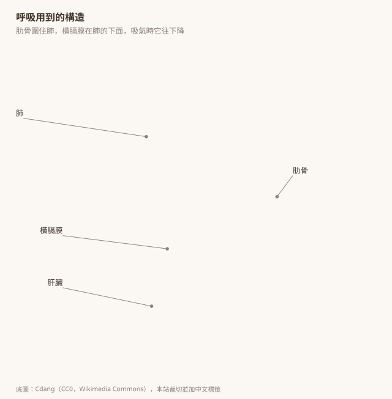
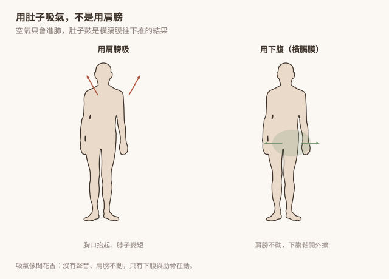
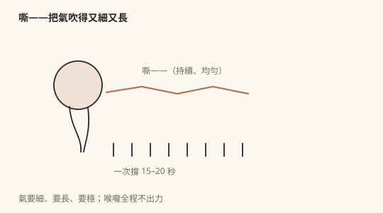

# [歌唱教學] 進階 第 16 章：橫膈膜的深度重訓：建立強大的氣息動態範圍

## 先講結論

唱長音、唱大聲，靠的不是肺活量大，是「氣漏得慢」。

很多人吸得很滿，一開口氣就噴光。問題不在氣不夠，在你沒有控制氣回去的速度。

這一章練的是吐氣時的阻力：讓氣流又穩又細，想停就停，想加就加。練完之後，同一口氣能唱的句子會變長，高音也不再那麼快虛掉。

## 常見誤解

很多人以為支撐就是肚子用力往外推，把氣擠出去。這樣做氣反而衝得更快，聲帶被一大團氣撞上，高音就破。支撐管的不是「給多少」，是「出多快」。

另一個誤解是「吸得越滿越好」。吸到胸口緊繃、肩膀聳起來，身體會更想趕快把氣吐掉。好用的氣是吸得深，但上半身還是鬆的。

還有人以為肚子要一直鼓著。鼓著是吸氣時的結果，不是目的。你要維持的是「還想再吸一口」的那種擴張感，不是把肚子撐成氣球。

## 原理：為什麼會這樣

橫膈膜是一片傘狀的肌肉，位在肺的下方。吸氣時它收縮、往下降，胸腔變大，空氣被吸進來；腹腔被往下壓，肚子因此往外。注意順序：橫膈膜先下降，肚子才往外。想用肚子去頂、把氣吸進來，是倒過來了。

吐氣時，橫膈膜放鬆、往上升回原位，肺與胸壁的彈性回縮也幫忙把氣推出去。這個過程本來是被動的。問題就在這裡：完全放任它，氣會一下子衝出來，長句唱到一半就沒氣，而且氣流太大對聲帶的振動不利。

所以進階練的是「不要讓它那麼快回去」。腹部與側腰的肌肉維持一點張力，跟上升的橫膈膜對抗，讓氣流變細、變勻。聲樂裡把這種「吐氣時仍維持吸氣姿態」的對抗叫 appoggio。它不是憋氣：氣一直在出來，只是出得很慢。

還有一層構造常被忽略：骨盆底也參與呼吸，它和深層腹肌一起構成下腹的穩定（Emerich Gordon & Reed, 2020）。所謂「丹田出力」，解剖上對應的是這一組深層的張力，不是把肚臍用力吸進去。

支撐也沒有單一正解。研究歌手投射聲音時的軀幹動作，發現不同歌手用不同策略達到類似的結果（Thorpe, 2001）。有人側腰外撐得明顯，有人下腹更用力。所以你要抓的是「氣流穩」，不是「姿勢像誰」。

最後提醒一件事：音量往上加、音高往上走的時候，頸部與肩部的肌肉活動容易跟著增加（Pettersen et al., 2005）。那代表你一旦想「更用力」，身體會先從肩膀和喉外肌代償。練支撐的目的，就是讓那件事不要發生。

## 打個比方

**捏住口的氣球。** 灌飽的氣球，手一放就亂噴。你捏住氣球口，只留一個小縫，氣就會細細地、穩定地出來。太用力捏，氣根本不出來，聲音就沒了；完全不捏，噴兩秒就結束。支撐就是那隻手的力道，位置在出口，不在氣球裡面。

**擠牙膏。** 正確的擠法是從尾端慢慢往上推，力量平均，牙膏成一直線。錯誤的擠法是從中間猛捏，一大坨先出來，後面只剩空氣。唱歌的長句也一樣：開頭省一點，句尾才有東西。

**拉著風箏的線。** 風箏往上飛的力量是肺的回彈，你的手是腹部的張力。線全放，風箏會亂飄；拉太緊，風箏掉下來。你要的是一條「有張力但一直在放線」的線，這正是吐氣時對抗的意思。

## 現在就做

### 練習一：先確認方向

1. 站直，一隻手放胸口，一隻手放下腹。
2. 用鼻子慢慢吸氣，感覺下腹與側腰往外，胸口盡量不動。
3. 吐氣，感覺下腹慢慢回來，不要一下子塌掉。
4. 做五次。肩膀不要跟著聳。

感覺：吸氣時手是被「推開」，不是被你「頂出去」。
做錯會怎樣：只有胸口起伏、肚子沒動，那是淺呼吸。如果肚子硬推出去卻頭暈，是吸太快。放慢，用鼻子吸。

### 練習二：噝音阻力

1. 吸氣，雙手插腰，四指貼側腰。
2. 牙齒輕閉，發長音的「噝——」，像洩一點點氣。
3. 吐氣時側腰維持微微往外撐，讓「噝」從頭到尾一樣細。
4. 目標三十秒。撐不到沒關係，先求穩，再求長。

感覺：痠的是側腰與下腹，喉嚨沒有感覺。
做錯會怎樣：如果「噝」一開始很粗、最後變細，是開頭放太多氣。如果肚子一下子塌下去，是支撐放掉了。如果憋到臉紅，是氣根本沒出來，那不是支撐，是閉氣。

### 練習三：短促斷音

1. 嘴巴微張，像跑步後喘氣：「哈、哈、哈、哈」，一次八下。
2. 手放下腹，確認每一次「哈」都是肚子快速彈一下。
3. 換成有音高的「啊」，短、斷、乾淨。
4. 熟練後加快一點，但每一下還是要有肚子那一下。

做錯會怎樣：如果胸口上下起伏、肩膀跟著動，是你在用上半身喘。如果聲音是喉嚨「夾斷」的，聽起來會卡，改成讓氣流停，不是讓喉嚨關。

### 練習四：同一個音推拉

1. 選一個唱得舒服的中高音。
2. 用很小的音量唱「嗚」，維持三秒。
3. 慢慢加大，五秒內推到你能控制的最大聲，再花五秒收回最小。
4. 做三次。收尾時音高不能掉。

感覺：推到最大時，聲音是變「寬」而不是變「刺」。
做錯會怎樣：如果漸強時聲音變刺、喉嚨緊，是你在用喉嚨加音量。要加的是氣與共鳴空間，不是喉嚨的力氣。如果漸弱時發抖、走音，是支撐提早放掉，把側腰的張力留到最後一口氣。

## 練完之後

做對的徵兆：同一口氣，句子能唱得比以前長；大聲不破、小聲不抖；練完痠的是側腰與下腹，不是喉嚨。

常見卡點是「開頭給太多氣」。大聲的句子，很多人第一拍就把氣倒光，後面只能眼睜睜看它虛掉。開頭收一點，留給句尾。

另一個卡點是「憋氣式的支撐」。肚子繃得很硬，但氣沒在流，聲音會悶、會抖。支撐是控制流速，不是把氣關住。

下一章處理聲音的兩端：怎麼開始、怎麼結束。中間唱得再好，頭尾草率，質感就差一截。

## 延伸查證

- **Thorpe, C. W., Cala, S. J., & Chapman, J. (2001).** Patterns of breath support in projection of the singing voice. *Journal of Voice.* 支撐不是單一動作，不同歌手用不同的軀幹策略達到同樣的投射。PMID 12269638。
- **Emerich Gordon, K., & Reed, O. (2020).** The Role of the Pelvic Floor in Respiration: A Multidisciplinary Literature Review. *Journal of Voice.* 骨盆底與深層腹肌在呼吸時的角色，也就是「丹田」的解剖對應。PMID 30447797。
- **Pettersen, V., Bjørkøy, K., & Torp, H. (2005).** Neck and shoulder muscle activity and thorax movement in singing and speaking tasks with variation in vocal loudness and pitch. *Journal of Voice.* 越大聲、越高音，頸肩的肌肉活動越容易增加。PMID 16301107。
